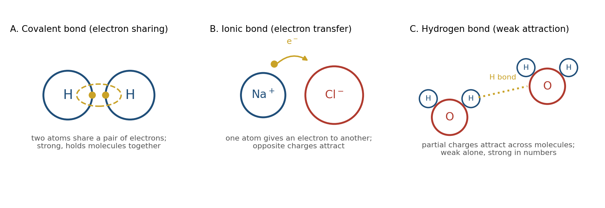
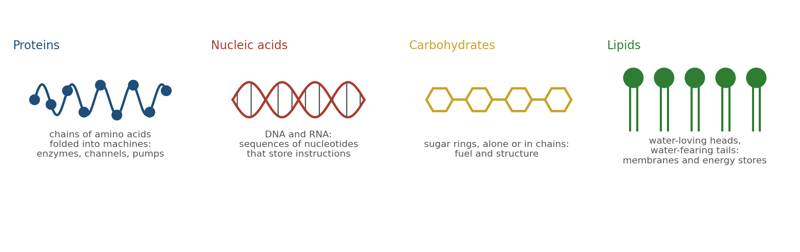
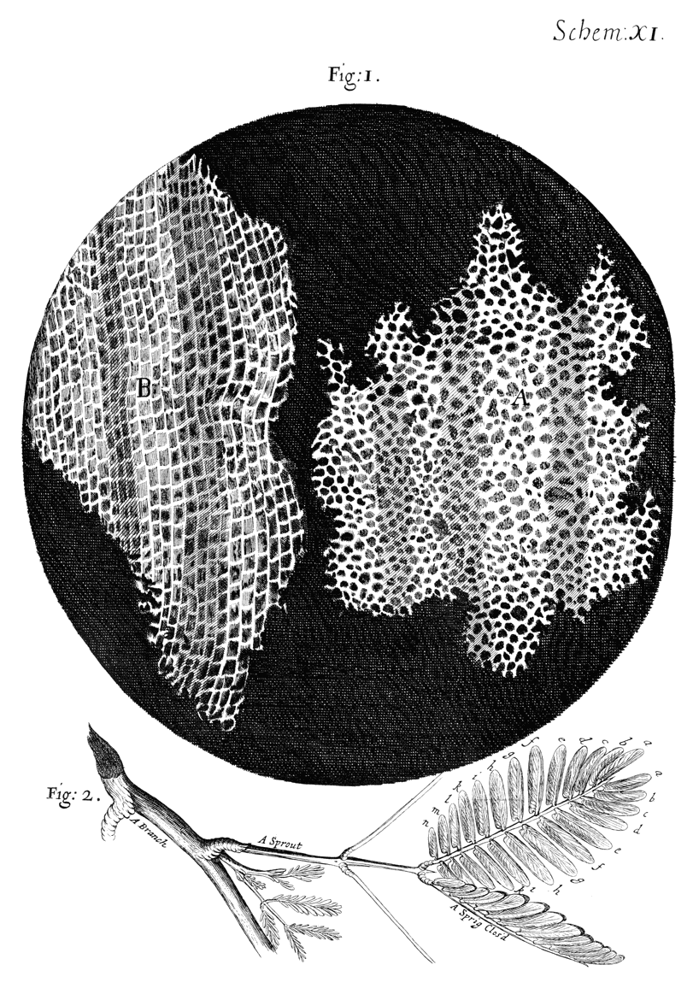
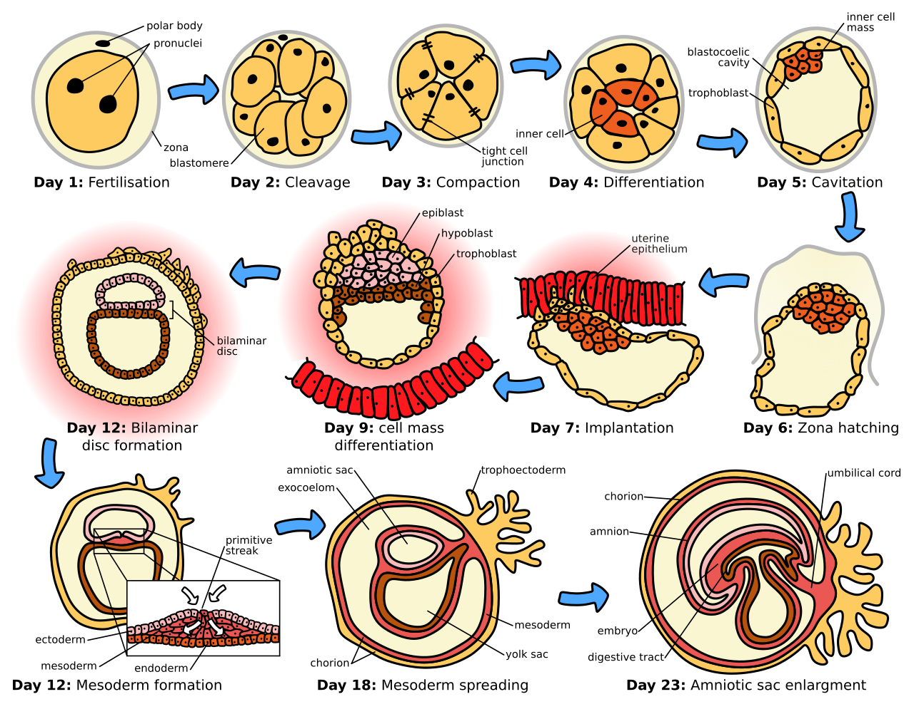

> *"The cell is the basic unit of life."*
>
> --- Theodor Schwann (1839)

Before we can understand how neurons work, we must understand what cells are. Before we can understand how the brain learns, we must understand the physical and chemical laws that govern all living things. This chapter provides that foundation.

If you have studied biology, much of this will be familiar. If you have not, this chapter will give you what you need to follow the rest of the book. Either way, these fundamentals matter: the brain's capabilities and limitations arise directly from the properties of the matter it is made of.

# What Is a Cell?

Every living thing on Earth is made of cells. A bacterium is a single cell. A human body contains approximately 37 trillion cells.[^1] Despite this enormous range in complexity, all cells share certain features that define what it means to be alive.[^2]

A cell is a compartment bounded by a membrane. Inside that membrane is a complex chemical environment where thousands of reactions occur simultaneously. The membrane separates the controlled interior from the unpredictable exterior. Without this boundary, life as we know it could not exist.

Cells are not passive containers. They actively maintain their internal environment, resist degradation, harvest energy from their surroundings, respond to signals, and—crucially—reproduce. These activities require continuous work. A cell that stops working dies.

## The Two Domains of Cells

Cells come in two fundamental types:

**Prokaryotes** (bacteria and archaea) are small and structurally simple. They lack a nucleus; their DNA floats freely in the cell interior. Despite their simplicity, prokaryotes dominated Earth for over two billion years and remain the most numerous organisms on the planet.[^3]

**Eukaryotes** (plants, animals, fungi, and protists) are larger and more complex. Their DNA is enclosed in a membrane-bound nucleus. They contain specialized internal compartments called organelles that perform specific functions. All neurons are eukaryotic cells.

The distinction matters because eukaryotic complexity enabled the evolution of multicellular organisms, specialized cell types, and eventually nervous systems. The brain could not exist without eukaryotic cellular machinery.[^4]

# The Physical Laws That Govern Cells

Cells obey the same physical laws as everything else in the universe. There is no vital force, no special exemption for living matter. Understanding these laws is essential for understanding why cells—and neurons—behave as they do.

## Thermodynamics: Energy and Order

The first and second laws of thermodynamics govern all physical systems, including cells.[^5]

**The First Law** states that energy cannot be created or destroyed, only transformed. When a cell breaks down glucose for energy, the chemical energy in glucose is converted to other forms: some becomes useful work, some becomes heat. Nothing is lost; nothing is gained. The total energy remains constant.

**The Second Law** states that in any spontaneous process, the total entropy (disorder) of the universe increases. Left alone, ordered structures tend to become disordered. A house, untended, falls into ruin. A cell, without continuous energy input, dies and decomposes.

This second law is profound. It means that maintaining the organized structure of a cell requires constant work. Cells must continuously import energy and export waste to maintain their internal order against the universal tendency toward disorder. When this process stops, death follows.[^6]

## Electrochemistry: Charge and Gradients

Neurons are electrical devices, but their electricity differs fundamentally from the electricity in wires. Understanding this difference requires understanding electrochemistry.

**Ions** are atoms or molecules that carry electrical charge. Common biological ions include:

- Sodium (Na⁺): positively charged
- Potassium (K⁺): positively charged
- Calcium (Ca²⁺): positively charged, two charges
- Chloride (Cl⁻): negatively charged[^7]

When ions are distributed unequally across a barrier, two types of gradients form:

**Concentration gradients**: Ions tend to move from regions of high concentration to low concentration (diffusion). This is a consequence of thermodynamics—spreading out increases entropy.

**Electrical gradients**: Opposite charges attract; like charges repel. Positive ions are pulled toward negative regions and pushed away from positive regions.

When a membrane separates two regions with different ion concentrations, these gradients create stored energy—like a compressed spring waiting to be released. Neurons exploit these gradients to generate electrical signals.[^8]

[^9]

## Diffusion: Movement Without Direction

Molecules in solution are in constant random motion due to thermal energy. This motion causes substances to spread from regions of high concentration to low concentration—a process called diffusion.[^10]

Diffusion is fundamental to cell biology. Neurotransmitters diffuse across synaptic gaps. Oxygen diffuses from blood into tissue. Waste products diffuse away from cells. No energy is required; the process is driven by random molecular motion and the statistical tendency toward uniform distribution.[^11]

However, diffusion is slow over long distances. It works well over micrometers (the scale of synapses) but poorly over centimeters (the scale of axons). This physical constraint is one reason neurons evolved specialized mechanisms for long-distance signaling.[^12]

# The Chemical Laws That Govern Cells

Chemistry describes how atoms and molecules interact. Cellular chemistry is often called biochemistry, but it follows the same principles as all chemistry.

## Atoms, Molecules, and Bonds

All matter is made of atoms. Atoms combine to form molecules by sharing or exchanging electrons. The forces holding atoms together in molecules are called chemical bonds.[^13]

**Covalent bonds** form when atoms share electrons. These bonds are strong and stable. The atoms in a water molecule (H₂O) are held together by covalent bonds.

**Ionic bonds** form when atoms transfer electrons, creating positive and negative ions that attract each other. Table salt (NaCl) is held together by ionic bonds.

**Hydrogen bonds** are weaker attractions that occur when hydrogen atoms bonded to oxygen or nitrogen are attracted to other oxygen or nitrogen atoms. Though individually weak, hydrogen bonds are crucial for protein structure and DNA base pairing.[^14]

## The Central Molecules of Life

Four classes of large molecules (macromolecules) perform most of the work in cells:

**Proteins** are molecular machines. They catalyze chemical reactions (enzymes), form structural elements, transport materials, send and receive signals, and perform mechanical work. Proteins are built from chains of amino acids folded into specific three-dimensional shapes. The shape determines the function.[^15] Ion channels in neurons are proteins. Neurotransmitter receptors are proteins. The machinery that releases neurotransmitter vesicles consists of proteins.

**Nucleic acids** (DNA and RNA) store and transmit genetic information. DNA contains the instructions for building proteins. RNA carries those instructions from DNA to the protein-building machinery.[^16]

**Carbohydrates** (sugars) store energy and form structural materials. Glucose is the primary fuel for brain cells.[^17]

**Lipids** (fats) form membranes, store energy, and serve as signaling molecules. The membrane surrounding every cell and every organelle is made primarily of lipid molecules.[^18]

## Enzymes: Molecular Catalysts

Most chemical reactions in cells would occur far too slowly to support life without assistance. Enzymes are proteins that accelerate specific reactions by factors of millions or more.[^19]

Enzymes work by bringing reactant molecules together in precisely the right orientation and chemical environment. They are not consumed in the reaction; a single enzyme molecule can catalyze thousands of reactions per second.[^20]

Enzymes are highly specific. Each enzyme typically catalyzes only one reaction or a small family of related reactions.[^21] This specificity allows cells to control which reactions occur, when, and where.

Neural signaling depends on enzymes at every step: synthesizing neurotransmitters, breaking them down, producing and consuming energy molecules, building and modifying ion channels.

# How These Laws Were Discovered

Understanding does not appear from nowhere. The laws governing cells emerged from centuries of careful observation, experimentation, and theoretical insight. A brief history provides context.

## The Discovery of Cells (1665-1839)

In 1665, Robert Hooke looked at cork through a microscope and observed small compartments he called "cells" (from Latin *cella*, a small room). He was seeing the walls of dead plant cells, but the name stuck.[^22]

Over the next 170 years, microscopes improved and observations accumulated. In 1839, Theodor Schwann and Matthias Schleiden proposed the **cell theory**: all living organisms are composed of cells, and the cell is the basic unit of life.[^23] Rudolf Virchow later added that all cells arise from pre-existing cells.[^24]

This was revolutionary. It meant that despite the apparent diversity of life—trees, mushrooms, fish, humans—all organisms share a common structural basis.

## The Discovery of Thermodynamics (1824-1865)

The laws of thermodynamics emerged from practical concerns about steam engines. Sadi Carnot, Rudolf Clausius, and others developed the mathematical framework that describes energy transformation and entropy.[^25]

By the late 19th century, scientists realized these laws applied universally—including to living systems. This realization ended vitalism, the belief that life requires some special non-physical force. Cells are physical systems obeying physical laws.[^26]

## The Discovery of Electrochemistry (1780-1952)

Around 1780, Luigi Galvani discovered that electrical stimulation could make frog legs twitch, demonstrating that electricity plays a role in biological systems.[^27] His contemporary Alessandro Volta invented the battery while investigating this phenomenon.[^28]

Over the next 170 years, scientists gradually uncovered how cells use ions and electrical gradients. The culmination came in 1952, when Alan Hodgkin and Andrew Huxley published their mathematical model of the action potential in squid neurons, explaining in precise detail how ion movements across membranes generate electrical signals. They received the Nobel Prize for this work in 1963.[^29]

## The Discovery of Biochemistry (1897-present)

In 1897, Eduard Buchner demonstrated that fermentation—previously thought to require living cells—could occur in cell-free extracts. This showed that cellular chemistry could be studied outside cells, launching modern biochemistry.[^30]

The 20th century brought explosive progress: the structure of DNA (Watson and Crick, 1953), the genetic code (Nirenberg and Khorana, 1960s)[^31], the mechanisms of protein synthesis, the details of metabolic pathways. This work continues today with structural biology, proteomics, and systems biology.

# How Cells Organize Into Tissues and Organisms

A single cell is remarkable, but brains are not single cells. The human brain contains approximately 86 billion neurons and a similar number of non-neuronal cells, organized into precise structures.[^32] How does this organization arise?

## Development: From One Cell to Trillions

Every human begins as a single fertilized egg cell. Through repeated cell division, differentiation, and organization, this one cell becomes 37 trillion cells organized into tissues, organs, and systems.[^33]

This process is not random. Cells follow genetic programs inherited from their parent cells. These programs specify when to divide, when to differentiate into specialized types, where to migrate, and how to connect with other cells.

Development is a cascade. Early events constrain later possibilities. A cell that becomes part of the nervous system cannot later become a liver cell. A neuron that migrates to the cortex cannot relocate to the spinal cord. This is why early development is so critical—errors propagate forward.[^34]

## Cell Signaling: How Cells Communicate

Cells do not develop in isolation. They constantly send and receive chemical signals that coordinate their behavior.

**Autocrine signals** act on the same cell that produced them.

**Paracrine signals** act on nearby cells.

**Endocrine signals** (hormones) travel through the bloodstream to act on distant cells.

**Synaptic signals** are specialized paracrine signals released at close range across synaptic gaps.

These signals allow cells to coordinate during development, maintain tissue organization in adults, and respond to changing conditions. The nervous system is, in one sense, an elaboration of cell signaling mechanisms specialized for rapid, precise communication.[^35]

## Self-Organization: Order from Simple Rules

Complex organization can emerge from simple rules followed by many agents. This principle, called self-organization, operates throughout biology.[^36]

Consider how the visual cortex develops. Neurons from the eye connect to neurons in the brain. Initially, these connections are imprecise. But a simple rule—neurons that fire together wire together—gradually refines the connections. Neurons responding to similar visual features strengthen their connections; those responding to different features weaken them. Over time, organized maps of visual space emerge.[^37]

No central controller directs this process. No blueprint specifies where each connection should go. The organization emerges from local interactions following simple rules.

This principle applies throughout the brain. Neural circuits self-organize based on activity patterns, genetic programs, and chemical gradients.[^38] The result is structure that appears designed but was never designed—it evolved and developed.

# The Emergence of Mind from Matter

We now arrive at the deepest question: How do physical cells produce mental experience? How does the wet electrochemistry of neurons give rise to perception, memory, emotion, and thought?

This is the hard problem of consciousness, and we will not solve it here.[^39] But we can say something useful about how to approach it.

## What Emergence Means

When many simple components interact according to local rules, properties can emerge at the system level that are not present at the component level. This is called emergence.[^40]

A single water molecule is not wet. Wetness is a property that emerges from the collective behavior of many water molecules interacting with other substances. A single neuron does not think. Thought emerges from the collective behavior of billions of neurons interacting in specific patterns.

Emergence is not magic. It is not dualism (the view that mind is made of different stuff than matter). It is a statement about levels of description. Some properties only become meaningful when describing systems at certain scales.

## What Neurons Provide

Individual neurons have specific capabilities:

- They can receive chemical signals from thousands of other neurons
- They can integrate these signals over time and space
- They can generate electrical outputs based on this integration
- They can modify their connections based on experience (learning)
- They can transmit signals rapidly over long distances[^41]

None of these capabilities constitutes thought. But when billions of neurons with these capabilities are connected in specific patterns, the system can:

- Detect patterns in sensory input
- Associate patterns with past experience
- Generate predictions about future events
- Control behavior based on goals and expectations
- Model the mental states of other agents
- Reflect on its own processes

The gap between component capabilities and system capabilities is where emergence operates.

## What We Know and What We Don't

Neuroscience has made remarkable progress in understanding how specific neural circuits perform specific functions. We understand in considerable detail how the retina encodes visual information, how the hippocampus supports memory formation, how the motor cortex generates movement commands.[^42]

What we do not understand is how these mechanisms relate to subjective experience—the felt quality of seeing red, tasting coffee, or feeling pain. This explanatory gap may reflect fundamental limits on what physical explanation can achieve, or it may reflect current ignorance that future science will overcome. The question remains open.[^43]

For the purposes of this book, we will focus on what can be explained: the physical mechanisms that enable learning, memory, perception, and action. These mechanisms are remarkable enough to warrant careful study regardless of whether they fully explain the mind.

# Why This Foundation Matters

Everything that follows in this book depends on what we have covered here.

Neurons are cells. They obey the laws of thermodynamics and electrochemistry. They are built from proteins, lipids, and other molecules. They develop according to genetic programs and organize through self-organization. Their properties emerge from physical and chemical constraints.

When the following chapters describe action potentials, they are describing physical events governed by electrochemistry. When they describe learning, they are describing physical changes in synapses governed by molecular biology. When they describe memory, they are describing physical traces left in neural tissue.

The brain is not a metaphor. It is matter, and matter is enough.

# Summary

| Concept | Key Point |
|---------|-----------|
| **Cells** | Membrane-bounded compartments that maintain internal order, harvest energy, and reproduce |
| **Thermodynamics** | Energy is conserved; entropy increases; maintaining order requires continuous work |
| **Electrochemistry** | Ion gradients across membranes store energy that powers neural signals |
| **Biochemistry** | Proteins, nucleic acids, carbohydrates, and lipids perform cellular functions |
| **Development** | One cell becomes trillions through division, differentiation, and organization |
| **Self-organization** | Complex structure emerges from simple local rules |
| **Emergence** | System properties arise from component interactions but cannot be reduced to them |

# Glossary of Key Terms

**Atom**: The smallest unit of a chemical element, consisting of a nucleus surrounded by electrons.

**ATP (Adenosine Triphosphate)**: The primary energy currency of cells; breaking its bonds releases energy for cellular work.

**Cell membrane**: The lipid bilayer that surrounds all cells, separating interior from exterior.

**Covalent bond**: A chemical bond formed by electron sharing between atoms.

**Diffusion**: The movement of molecules from regions of high to low concentration due to random thermal motion.

**Electrochemical gradient**: The combined effect of concentration differences and electrical charge differences across a membrane.

**Emergence**: The appearance of system-level properties that arise from component interactions but are not present in individual components.

**Entropy**: A measure of disorder; the second law of thermodynamics states that entropy tends to increase.

**Enzyme**: A protein that catalyzes (accelerates) specific chemical reactions.

**Eukaryote**: An organism whose cells contain a membrane-bound nucleus and organelles.

**Ion**: An atom or molecule carrying electrical charge due to gaining or losing electrons.

**Ion channel**: A protein that forms a selective pore allowing specific ions to cross the cell membrane.

**Lipid**: A class of molecules including fats that form cell membranes and store energy.

**Macromolecule**: A large biological molecule: protein, nucleic acid, carbohydrate, or lipid.

**Nucleic acid**: DNA or RNA; molecules that store genetic information.

**Organelle**: A membrane-bound compartment within eukaryotic cells with specific functions.

**Prokaryote**: An organism (bacterium or archaeon) whose cells lack a membrane-bound nucleus.

**Protein**: A macromolecule made of amino acids that performs most cellular functions.

**Self-organization**: The emergence of order from local interactions without central control.

**Thermodynamics**: The branch of physics dealing with heat, energy, and their transformations.

# Next Chapter

**Chapter 1: What the Brain Is (and Is Not)**

With the foundations of cell biology and physical law established, we turn to the brain itself—not as a metaphor or an abstraction, but as a physical organ shaped by evolution to solve specific problems of survival.

# References and Attribution

## Figure Attribution

Figure 0.1: cell structure, Wikimedia Commons, LadyofHats, public domain. Figure 0.2: Wikimedia Commons, Tim Vickers, public domain. Figure 0.3: Wikimedia Commons, public domain. Figures 0.4 and 0.5 were drawn for this book. Figure 0.6: Robert Hooke, *Micrographia* (1665), public domain. Figure 0.7: Wikimedia Commons, Chris 73, CC BY-SA 3.0. Figure 0.8: Wikimedia Commons, Zephyris, CC BY-SA 3.0. Figure 0.9: Wikimedia Commons, Swpb, public domain.

## Epigraph

After Theodor Schwann, *Mikroskopische Untersuchungen über die Uebereinstimmung in der Structur und dem Wachsthum der Thiere und Pflanzen* (Berlin: Sander, 1839); English translation by H. Smith (Sydenham Society, 1847). The epigraph condenses the cell theory of Schleiden and Schwann rather than quoting a single sentence.

## References

Alberts, B., Heald, R., Johnson, A., Morgan, D., Raff, M., Roberts, K., & Walter, P. (2022). *Molecular Biology of the Cell* (7th ed.). W. W. Norton.

Anderson, P. W. (1972). More is different. *Science*, 177(4047), 393–396.

Anfinsen, C. B. (1973). Principles that govern the folding of protein chains. *Science*, 181(4096), 223–230.

Azevedo, F. A. C., Carvalho, L. R. B., Grinberg, L. T., Farfel, J. M., Ferretti, R. E. L., Leite, R. E. P., Jacob Filho, W., Lent, R., & Herculano-Houzel, S. (2009). Equal numbers of neuronal and nonneuronal cells make the human brain an isometrically scaled-up primate brain. *Journal of Comparative Neurology*, 513(5), 532–541.

Barresi, M. J. F., & Gilbert, S. F. (2019). *Developmental Biology* (12th ed.). Sinauer Associates.

Berg, H. C. (1993). *Random Walks in Biology* (expanded ed.). Princeton University Press.

Bianconi, E., Piovesan, A., Facchin, F., Beraudi, A., Casadei, R., Frabetti, F., Vitale, L., Pelleri, M. C., Tassani, S., Piva, F., Perez-Amodio, S., Strippoli, P., & Canaider, S. (2013). An estimation of the number of cells in the human body. *Annals of Human Biology*, 40(6), 463–471.

Buchner, E. (1897). Alkoholische Gährung ohne Hefezellen. *Berichte der deutschen chemischen Gesellschaft*, 30(1), 117–124.

Camazine, S., Deneubourg, J.-L., Franks, N. R., Sneyd, J., Theraulaz, G., & Bonabeau, E. (2001). *Self-Organization in Biological Systems*. Princeton University Press.

Carnot, S. (1824). *Réflexions sur la puissance motrice du feu et sur les machines propres à développer cette puissance*. Paris: Bachelier.

Chalmers, D. J. (1995). Facing up to the problem of consciousness. *Journal of Consciousness Studies*, 2(3), 200–219.

Clausius, R. (1865). Ueber verschiedene für die Anwendung bequeme Formen der Hauptgleichungen der mechanischen Wärmetheorie. *Annalen der Physik und Chemie*, 125, 353–400.

Crick, F. (1970). Central dogma of molecular biology. *Nature*, 227, 561–563.

Crick, F. H. C., Barnett, L., Brenner, S., & Watts-Tobin, R. J. (1961). General nature of the genetic code for proteins. *Nature*, 192, 1227–1232.

Einstein, A. (1905). Über die von der molekularkinetischen Theorie der Wärme geforderte Bewegung von in ruhenden Flüssigkeiten suspendierten Teilchen. *Annalen der Physik*, 322(8), 549–560.

Fick, A. (1855). Ueber Diffusion. *Annalen der Physik und Chemie*, 94, 59–86.

Fischer, E. (1894). Einfluss der Configuration auf die Wirkung der Enzyme. *Berichte der deutschen chemischen Gesellschaft*, 27(3), 2985–2993.

Galvani, L. (1791). *De viribus electricitatis in motu musculari commentarius*. Bologna: Ex Typographia Instituti Scientiarum.

Goldman, D. E. (1943). Potential, impedance, and rectification in membranes. *Journal of General Physiology*, 27(1), 37–60.

Gorter, E., & Grendel, F. (1925). On bimolecular layers of lipoids on the chromocytes of the blood. *Journal of Experimental Medicine*, 41(4), 439–443.

Hebb, D. O. (1949). *The Organization of Behavior: A Neuropsychological Theory*. New York: Wiley.

Helmholtz, H. von (1847). *Über die Erhaltung der Kraft*. Berlin: Reimer.

Hille, B. (2001). *Ion Channels of Excitable Membranes* (3rd ed.). Sinauer Associates.

Hodgkin, A. L., & Huxley, A. F. (1952). A quantitative description of membrane current and its application to conduction and excitation in nerve. *Journal of Physiology*, 117(4), 500–544.

Hooke, R. (1665). *Micrographia: or Some Physiological Descriptions of Minute Bodies Made by Magnifying Glasses*. London: J. Martyn and J. Allestry, for the Royal Society.

Kandel, E. R., Koester, J. D., Mack, S. H., & Siegelbaum, S. A. (Eds.). (2021). *Principles of Neural Science* (6th ed.). McGraw-Hill.

Katz, L. C., & Shatz, C. J. (1996). Synaptic activity and the construction of cortical circuits. *Science*, 274(5290), 1133–1138.

Levine, J. (1983). Materialism and qualia: The explanatory gap. *Pacific Philosophical Quarterly*, 64(4), 354–361.

Mergenthaler, P., Lindauer, U., Dienel, G. A., & Meisel, A. (2013). Sugar for the brain: The role of glucose in physiological and pathological brain function. *Trends in Neurosciences*, 36(10), 587–597.

Nelson, D. L., & Cox, M. M. (2021). *Lehninger Principles of Biochemistry* (8th ed.). W. H. Freeman.

Nernst, W. (1889). Die elektromotorische Wirksamkeit der Ionen. *Zeitschrift für physikalische Chemie*, 4, 129–181.

Nirenberg, M. W., & Matthaei, J. H. (1961). The dependence of cell-free protein synthesis in E. coli upon naturally occurring or synthetic polyribonucleotides. *Proceedings of the National Academy of Sciences*, 47(10), 1588–1602.

Pauling, L. (1960). *The Nature of the Chemical Bond* (3rd ed.). Cornell University Press.

Purves, D., Augustine, G. J., Fitzpatrick, D., Hall, W. C., LaMantia, A.-S., Mooney, R. D., Platt, M. L., & White, L. E. (Eds.). (2018). *Neuroscience* (6th ed.). Sinauer Associates.

Radzicka, A., & Wolfenden, R. (1995). A proficient enzyme. *Science*, 267(5194), 90–93.

Schleiden, M. J. (1838). Beiträge zur Phytogenesis. *Archiv für Anatomie, Physiologie und wissenschaftliche Medicin*, 5, 137–176.

Schrödinger, E. (1944). *What Is Life? The Physical Aspect of the Living Cell*. Cambridge University Press.

Schwann, T. (1839). *Mikroskopische Untersuchungen über die Uebereinstimmung in der Structur und dem Wachsthum der Thiere und Pflanzen*. Berlin: Sander. English translation by H. Smith, *Microscopical Researches into the Accordance in the Structure and Growth of Animals and Plants* (Sydenham Society, 1847).

Singer, S. J., & Nicolson, G. L. (1972). The fluid mosaic model of the structure of cell membranes. *Science*, 175(4023), 720–731.

Skou, J. C. (1957). The influence of some cations on an adenosine triphosphatase from peripheral nerves. *Biochimica et Biophysica Acta*, 23, 394–401.

Sperry, R. W. (1963). Chemoaffinity in the orderly growth of nerve fiber patterns and connections. *Proceedings of the National Academy of Sciences*, 50(4), 703–710.

Tessier-Lavigne, M., & Goodman, C. S. (1996). The molecular biology of axon guidance. *Science*, 274(5290), 1123–1133.

Turing, A. M. (1952). The chemical basis of morphogenesis. *Philosophical Transactions of the Royal Society B*, 237(641), 37–72.

Virchow, R. (1858). *Die Cellularpathologie in ihrer Begründung auf physiologische und pathologische Gewebelehre*. Berlin: Hirschwald.

Volta, A. (1800). On the electricity excited by the mere contact of conducting substances of different kinds. *Philosophical Transactions of the Royal Society of London*, 90, 403–431.

Waddington, C. H. (1957). *The Strategy of the Genes*. London: Allen & Unwin.

Watson, J. D., & Crick, F. H. C. (1953). Molecular structure of nucleic acids: A structure for deoxyribose nucleic acid. *Nature*, 171, 737–738.

Whitman, W. B., Coleman, D. C., & Wiebe, W. J. (1998). Prokaryotes: The unseen majority. *Proceedings of the National Academy of Sciences*, 95(12), 6578–6583.

[^1]: Bianconi, E., Piovesan, A., Facchin, F., Beraudi, A., Casadei, R., Frabetti, F., Vitale, L., Pelleri, M. C., Tassani, S., Piva, F., Perez-Amodio, S., Strippoli, P., & Canaider, S. (2013). An estimation of the number of cells in the human body. *Annals of Human Biology*, 40(6), 463–471.

[^2]: Alberts, B., Heald, R., Johnson, A., Morgan, D., Raff, M., Roberts, K., & Walter, P. (2022). *Molecular Biology of the Cell* (7th ed.). W. W. Norton. Chapter 1.

[^3]: Whitman, W. B., Coleman, D. C., & Wiebe, W. J. (1998). Prokaryotes: The unseen majority. *Proceedings of the National Academy of Sciences*, 95(12), 6578–6583.

[^4]: Alberts, B., Heald, R., Johnson, A., Morgan, D., Raff, M., Roberts, K., & Walter, P. (2022). *Molecular Biology of the Cell* (7th ed.). W. W. Norton. Chapter 1 gives the prokaryote–eukaryote comparison.

[^5]: Helmholtz, H. von (1847). *Über die Erhaltung der Kraft*. Berlin: Reimer; Clausius, R. (1865). Ueber verschiedene für die Anwendung bequeme Formen der Hauptgleichungen der mechanischen Wärmetheorie. *Annalen der Physik und Chemie*, 125, 353–400. Helmholtz stated energy conservation in general form, with physiology among his examples; Clausius named entropy and stated the second law in the form used here.

[^6]: Schrödinger, E. (1944). *What Is Life? The Physical Aspect of the Living Cell*. Cambridge University Press. Schrödinger's account of the organism as feeding on "negative entropy" is the classic statement of this point.

[^7]: Hille, B. (2001). *Ion Channels of Excitable Membranes* (3rd ed.). Sinauer Associates. Chapter 1 for the ions of excitable membranes and their typical concentrations.

[^8]: Nernst, W. (1889). Die elektromotorische Wirksamkeit der Ionen. *Zeitschrift für physikalische Chemie*, 4, 129–181; Goldman, D. E. (1943). Potential, impedance, and rectification in membranes. *Journal of General Physiology*, 27(1), 37–60. Nernst gave the equilibrium potential for a single ion; Goldman the voltage set by several ions with different permeabilities.

[^9]: Skou, J. C. (1957). The influence of some cations on an adenosine triphosphatase from peripheral nerves. *Biochimica et Biophysica Acta*, 23, 394–401. The sodium–potassium pump that maintains these gradients was discovered by Skou.

[^10]: Fick, A. (1855). Ueber Diffusion. *Annalen der Physik und Chemie*, 94, 59–86; Einstein, A. (1905). Über die von der molekularkinetischen Theorie der Wärme geforderte Bewegung von in ruhenden Flüssigkeiten suspendierten Teilchen. *Annalen der Physik*, 322(8), 549–560. Fick's law describes the flux; Einstein derived it from random molecular motion.

[^11]: Berg, H. C. (1993). *Random Walks in Biology* (expanded ed.). Princeton University Press.

[^12]: Berg, H. C. (1993). *Random Walks in Biology* (expanded ed.). Princeton University Press. The time a diffusing molecule takes to cover a distance grows with the square of the distance (Berg, Chapter 1).

[^13]: Pauling, L. (1960). *The Nature of the Chemical Bond* (3rd ed.). Cornell University Press.

[^14]: Watson, J. D., & Crick, F. H. C. (1953). Molecular structure of nucleic acids: A structure for deoxyribose nucleic acid. *Nature*, 171, 737–738; Nelson, D. L., & Cox, M. M. (2021). *Lehninger Principles of Biochemistry* (8th ed.). W. H. Freeman.

[^15]: Anfinsen, C. B. (1973). Principles that govern the folding of protein chains. *Science*, 181(4096), 223–230.

[^16]: Crick, F. (1970). Central dogma of molecular biology. *Nature*, 227, 561–563.

[^17]: Mergenthaler, P., Lindauer, U., Dienel, G. A., & Meisel, A. (2013). Sugar for the brain: The role of glucose in physiological and pathological brain function. *Trends in Neurosciences*, 36(10), 587–597.

[^18]: Gorter, E., & Grendel, F. (1925). On bimolecular layers of lipoids on the chromocytes of the blood. *Journal of Experimental Medicine*, 41(4), 439–443; Singer, S. J., & Nicolson, G. L. (1972). The fluid mosaic model of the structure of cell membranes. *Science*, 175(4023), 720–731.

[^19]: Radzicka, A., & Wolfenden, R. (1995). A proficient enzyme. *Science*, 267(5194), 90–93. Rate enhancements of 10^17 have been measured.

[^20]: Nelson, D. L., & Cox, M. M. (2021). *Lehninger Principles of Biochemistry* (8th ed.). W. H. Freeman. Chapter 6, on enzyme kinetics and turnover numbers.

[^21]: Fischer, E. (1894). Einfluss der Configuration auf die Wirkung der Enzyme. *Berichte der deutschen chemischen Gesellschaft*, 27(3), 2985–2993. The "lock and key" account of specificity.

[^22]: Hooke, R. (1665). *Micrographia: or Some Physiological Descriptions of Minute Bodies Made by Magnifying Glasses*. London: J. Martyn and J. Allestry, for the Royal Society. Observation XVIII, "Of the Schematisme or Texture of Cork."

[^23]: Schleiden, M. J. (1838). Beiträge zur Phytogenesis. *Archiv für Anatomie, Physiologie und wissenschaftliche Medicin*, 5, 137–176; Schwann, T. (1839). *Mikroskopische Untersuchungen über die Uebereinstimmung in der Structur und dem Wachsthum der Thiere und Pflanzen*. Berlin: Sander. English translation by H. Smith, *Microscopical Researches into the Accordance in the Structure and Growth of Animals and Plants* (Sydenham Society, 1847).

[^24]: Virchow, R. (1858). *Die Cellularpathologie in ihrer Begründung auf physiologische und pathologische Gewebelehre*. Berlin: Hirschwald. The maxim *omnis cellula e cellula*.

[^25]: Carnot, S. (1824). *Réflexions sur la puissance motrice du feu et sur les machines propres à développer cette puissance*. Paris: Bachelier; Clausius, R. (1865). Ueber verschiedene für die Anwendung bequeme Formen der Hauptgleichungen der mechanischen Wärmetheorie. *Annalen der Physik und Chemie*, 125, 353–400.

[^26]: Schrödinger, E. (1944). *What Is Life? The Physical Aspect of the Living Cell*. Cambridge University Press.

[^27]: Galvani, L. (1791). *De viribus electricitatis in motu musculari commentarius*. Bologna: Ex Typographia Instituti Scientiarum. Galvani's experiments began around 1780; the full account was published in 1791.

[^28]: Volta, A. (1800). On the electricity excited by the mere contact of conducting substances of different kinds. *Philosophical Transactions of the Royal Society of London*, 90, 403–431.

[^29]: Hodgkin, A. L., & Huxley, A. F. (1952). A quantitative description of membrane current and its application to conduction and excitation in nerve. *Journal of Physiology*, 117(4), 500–544. The 1963 Nobel Prize in Physiology or Medicine was shared with John Eccles.

[^30]: Buchner, E. (1897). Alkoholische Gährung ohne Hefezellen. *Berichte der deutschen chemischen Gesellschaft*, 30(1), 117–124.

[^31]: Watson, J. D., & Crick, F. H. C. (1953). Molecular structure of nucleic acids: A structure for deoxyribose nucleic acid. *Nature*, 171, 737–738; Nirenberg, M. W., & Matthaei, J. H. (1961). The dependence of cell-free protein synthesis in E. coli upon naturally occurring or synthetic polyribonucleotides. *Proceedings of the National Academy of Sciences*, 47(10), 1588–1602; Crick, F. H. C., Barnett, L., Brenner, S., & Watts-Tobin, R. J. (1961). General nature of the genetic code for proteins. *Nature*, 192, 1227–1232.

[^32]: Azevedo, F. A. C., Carvalho, L. R. B., Grinberg, L. T., Farfel, J. M., Ferretti, R. E. L., Leite, R. E. P., Jacob Filho, W., Lent, R., & Herculano-Houzel, S. (2009). Equal numbers of neuronal and nonneuronal cells make the human brain an isometrically scaled-up primate brain. *Journal of Comparative Neurology*, 513(5), 532–541.

[^33]: Barresi, M. J. F., & Gilbert, S. F. (2019). *Developmental Biology* (12th ed.). Sinauer Associates.

[^34]: Waddington, C. H. (1957). *The Strategy of the Genes*. London: Allen & Unwin. Waddington's "epigenetic landscape" is the standard image of progressively restricted cell fate.

[^35]: Alberts, B., Heald, R., Johnson, A., Morgan, D., Raff, M., Roberts, K., & Walter, P. (2022). *Molecular Biology of the Cell* (7th ed.). W. W. Norton. Chapter 15 for the classification of signaling modes.

[^36]: Turing, A. M. (1952). The chemical basis of morphogenesis. *Philosophical Transactions of the Royal Society B*, 237(641), 37–72; Camazine, S., Deneubourg, J.-L., Franks, N. R., Sneyd, J., Theraulaz, G., & Bonabeau, E. (2001). *Self-Organization in Biological Systems*. Princeton University Press.

[^37]: Hebb, D. O. (1949). *The Organization of Behavior: A Neuropsychological Theory*. New York: Wiley; Katz, L. C., & Shatz, C. J. (1996). Synaptic activity and the construction of cortical circuits. *Science*, 274(5290), 1133–1138. "Fire together, wire together" paraphrases Hebb's postulate; Katz and Shatz review activity-dependent refinement of visual connections.

[^38]: Sperry, R. W. (1963). Chemoaffinity in the orderly growth of nerve fiber patterns and connections. *Proceedings of the National Academy of Sciences*, 50(4), 703–710; Tessier-Lavigne, M., & Goodman, C. S. (1996). The molecular biology of axon guidance. *Science*, 274(5290), 1123–1133.

[^39]: Chalmers, D. J. (1995). Facing up to the problem of consciousness. *Journal of Consciousness Studies*, 2(3), 200–219.

[^40]: Anderson, P. W. (1972). More is different. *Science*, 177(4047), 393–396.

[^41]: Kandel, E. R., Koester, J. D., Mack, S. H., & Siegelbaum, S. A. (Eds.). (2021). *Principles of Neural Science* (6th ed.). McGraw-Hill. Chapters 3–4 for the neuron's input, integration, and output properties.

[^42]: Kandel, E. R., Koester, J. D., Mack, S. H., & Siegelbaum, S. A. (Eds.). (2021). *Principles of Neural Science* (6th ed.). McGraw-Hill; Purves, D., Augustine, G. J., Fitzpatrick, D., Hall, W. C., LaMantia, A.-S., Mooney, R. D., Platt, M. L., & White, L. E. (Eds.). (2018). *Neuroscience* (6th ed.). Sinauer Associates.

[^43]: Levine, J. (1983). Materialism and qualia: The explanatory gap. *Pacific Philosophical Quarterly*, 64(4), 354–361; Chalmers, D. J. (1995). Facing up to the problem of consciousness. *Journal of Consciousness Studies*, 2(3), 200–219.
