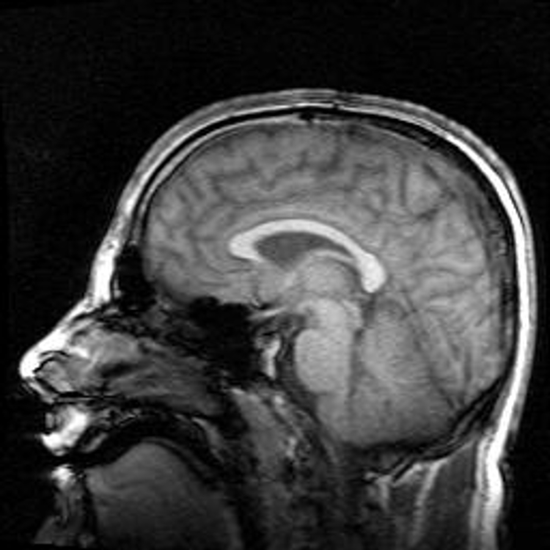

> *"The Brain is wider than the Sky."*
>
> --- Emily Dickinson, *The Brain is wider than the Sky* (c. 1862)

# What This Chapter Is For

This book is about the brain, but it is not written primarily for neuroscientists. It is written for readers who already know how to think carefully about complex systems, engineers, programmers, physicists, and mathematicians among them, but who have not yet learned how biological intelligence resists many of the assumptions that work so well in their own fields. Chapter 0 supplied the cell biology and physics that the rest of the book assumes, and readers who already have that background can skip it; this chapter supplies the frame.

Neuroscience presents a peculiar challenge. Unlike astronomy or particle physics, its object of study is not remote. We experience the brain continuously, from the inside, and this intimacy creates confidence without understanding. We feel that we know what thinking is, what memory is, what perception is, simply because we experience them. Yet introspection is a poor guide to mechanism. In a series of experiments in the 1970s, Richard Nisbett and Timothy Wilson showed that people asked why they had made a choice gave fluent, confident reasons that had nothing to do with the factors that actually drove it: shoppers asked to pick the best of four identical pairs of stockings laid out in a row preferred the rightmost pair by about four to one, and explained the preference by its knit, its sheerness, anything but its position.[^1] The brain does not reveal its workings by reflecting on them.

For technically trained readers, this difficulty is compounded by metaphor. Since the 1940s, when Warren McCulloch and Walter Pitts showed that networks of idealized neurons could implement any function of propositional logic, and John von Neumann borrowed their vocabulary for the first description of a stored-program computer, the language of computation has been the dominant way of speaking about minds.[^2] We talk about inputs and outputs, representations and processing, memory and storage. These terms are not wrong, but they are dangerously incomplete. They import assumptions about precision, modularity, and design that do not hold for biological systems.

If you approach the brain as if it were a poorly documented piece of software, you will find yourself constantly asking why it is so badly engineered. Why is learning slow? Why is memory unreliable? Why are perceptual judgments biased? Why does the system forget, hallucinate, and mispredict? The answer is not that evolution did a bad job. It is that the brain was never trying to solve the problem you think it was solving, and this chapter exists to reframe the problem. It does so by saying what the brain is not (a digital computer), what it is (a physical system with a history, built to keep a body alive), and what follows from that for noise, redundancy, and the meaning of optimization. Along the way it introduces a few of the numbers and experiments on which the rest of the book depends.

# The Brain Is Not a Digital Computer

The comparison between brains and computers is so natural that it often escapes notice. We say the brain "processes information" as casually as we say the heart "pumps blood." The analogy feels descriptive rather than metaphorical, and this ease is precisely what makes it dangerous.

Digital computers are artifacts of design, and the design is easy to draw. Figure 1.1 shows the architecture von Neumann described in 1945 for the EDVAC, the plan that almost every computer since has followed. A central processing unit, made of a control unit and an arithmetic and logic unit, fetches instructions and data from a separate memory over a single channel, operates on them, and writes results back; input and output devices hang off the sides. Three features of the drawing matter here. Memory is distinct from computation. Control is centralized, in a unit that decides what happens next. And time is discretized: a clock sets when each step occurs, and the components are engineered so that the signal at every step is unambiguously a zero or a one.[^3] Noise, in such a machine, is an enemy to be suppressed, though von Neumann himself knew that the brain did not work that way. In lectures given in 1952 he asked how reliable computation could be built from unreliable components and showed that it could, by redundancy and majority voting, which is one reason the contrast drawn in this section is a contrast of emphasis rather than of kind.[^4]

Brains are none of these things. A human brain contains about 86 billion neurons, the electrically excitable cells that carry its signals, together with a roughly equal number of non-neuronal cells, and the neurons are joined by on the order of a hundred trillion synapses, the junctions at which one neuron influences another.[^5] There is no instruction stream to tell these cells what to do, no central controller, and no boundary between storage and processing: the same synapses that carry a signal are the places where the system's memory is written, and they change as a result of use.[^6] Signals are continuous in time, variable in amplitude, and context dependent. Neurons operate asynchronously, with no clock, and the system rewires itself while it is running.

The difference shows most clearly in time. A neuron's action potential, the brief electrical pulse by which it signals, lasts about a millisecond. The chemical step at a synapse, in which the arriving pulse releases a transmitter molecule that diffuses across a gap and opens channels on the receiving cell, adds about half a millisecond more; Bernard Katz and Ricardo Miledi measured that delay at the junction between a frog's nerve and muscle in 1965.[^7] The fastest axons in the human body, the fibers along which neurons send their pulses, conduct at roughly 100 meters per second, and most are much slower. A transistor, by contrast, switches in picoseconds, and a processor clock ticks several billion times a second. Measured step for step, the brain is about a million times slower than a laptop. Yet Simon Thorpe and his colleagues showed in 1996 that a person can decide whether a photograph flashed for 20 milliseconds contains an animal, and that the brain's electrical response to the two categories diverges within about 150 milliseconds of the picture appearing.[^8] At a few milliseconds per step, 150 milliseconds allows perhaps a hundred sequential steps; Jerome Feldman and Dana Ballard called this the hundred-step constraint, and it rules out any account of perception that resembles a long serial program.[^9] Whatever the brain is doing, it is doing it with enormous breadth and very little depth: billions of slow, unreliable components working at once.

These differences are not superficial. They reflect fundamentally different goals. Computers are designed to produce correct answers to well-specified problems. Brains evolved to keep organisms alive in uncertain, hostile environments, where a fast, approximately right answer is worth more than a slow, exact one, and where precision is valuable only insofar as it supports survival.[^10] This distinction explains why many computational metaphors break down under scrutiny. When we look for symbols, registers, or clean data structures in the brain, we are often disappointed. When we look instead for dynamics, feedback, and constraint-driven adaptation, the system begins to make sense.

A more honest statement is not that the brain is a computer, but that both brains and computers are physical systems capable of computation under radically different constraints. David Marr's distinction between what a system computes, the procedure it uses, and the hardware that runs the procedure is the standard way of keeping those levels apart, and it cuts both ways: the brain may compute something a computer can also compute while sharing nothing with it at the level of procedure or hardware.[^11] Conflating the two hides exactly the differences that matter.

# The Brain Is a Physical System

At the most basic level, the brain is matter. It occupies space, has mass, consumes energy, and obeys the same physical laws as any other biological tissue. Its signals arise from the movement of ions, charged atoms such as sodium and potassium, across the membranes that enclose its cells, and its components are proteins that change shape, channels that open and close, and molecules that diffuse through crowded cellular environments. Every thought corresponds to physical change, and the clearest demonstration that the physical account is the whole account came in 1952.

Alan Hodgkin and Andrew Huxley worked on the giant axon of the squid, a nerve fiber about half a millimeter across, large enough to thread a wire down its inside. Holding the voltage across the membrane fixed and measuring the current that flowed, they separated it into a sodium current and a potassium current, each switched on and off by the voltage itself with its own time course. They described the two with four differential equations and then asked the equations what a nerve impulse should look like. The equations produced the impulse: its shape, its threshold, and its conduction velocity, which Huxley computed by hand on a mechanical calculator at 18.8 meters per second against a measured 21.2.[^12] Nothing was left over. The impulse was not a signal carried by the membrane; it was the membrane's physics, and that is the sense in which this book treats every mental event. Figure 1.2 shows the organ in which those events occur, a midline magnetic resonance image of a human head, with the folded sheet of the cerebral cortex above, the cerebellum tucked beneath it at the back, and the brainstem descending toward the spinal cord.

This fact is easy to state and difficult to absorb. Many accounts of cognition implicitly treat the physical substrate as incidental, as if the real processes occurred at an abstract level divorced from biology. In reality, the properties of cognition are inseparable from the properties of the tissue that generates it. Physical processes take time, consume energy, and are noisy, and they leave traces. Memory persists because structural change persists. Fatigue, intoxication, and disease affect cognition because they affect metabolism, signaling, and cellular integrity.

The energy budget is the constraint that shapes everything else. The adult human brain is about two percent of body mass and uses about twenty percent of the body's resting energy, which works out to roughly 20 watts: the power of a dim light bulb, running a system with 86 billion processors.[^13] David Attwell and Simon Laughlin traced where that energy goes in the gray matter of the rodent brain, the tissue that holds the cell bodies and synapses. Nearly half, by their estimate 47 percent, is spent on action potentials, a further 34 percent on the effects of the main excitatory transmitter, glutamate, on the receiving cells, 13 percent on maintaining the resting voltage of cells that are not signaling at all, and the small remainder on recycling transmitter and other steps.[^14] Signaling is expensive, and the budget cannot cover much of it: Peter Lennie calculated that the cortex can afford to have only about one neuron in a hundred firing at any moment.[^15] The brain is therefore forced into sparse codes, low average firing rates, and wiring plans that minimize the length of axons, and many of the design choices the later chapters describe, from the inhibition that keeps cortical firing sparse in Chapter 4 to the use of prediction to suppress expected signals in Chapter 6, are what a 20-watt budget looks like from the inside.

Even the brain's apparent inefficiencies make sense in this light. Synapses fail, neurons die, and signals degrade, and rather than eliminating these problems, evolution built systems that tolerate them. Feedback compensates for unreliability, and plasticity, the capacity of neurons and synapses to change their structure and strength with use, compensates for damage: after a stroke destroys part of the motor cortex, the region of cortex that drives movement, the representation of the hand can re-form in the surviving tissue around the lesion, provided the hand is used.[^16] What looks sloppy from the standpoint of a designer is often robust from the standpoint of an organism. To understand the brain, we must abandon the idea that biology is merely an imperfect implementation of abstract computation. Biology is the source of the computation.

# Why Learning Is Slow

The first question a technical reader asks about the brain is usually why it learns so slowly. A network on a computer can be retrained in an afternoon; a person takes years to learn a language and a decade to master an instrument. The answer has two parts, and they are different in kind.

The first is that lasting change is molecular, and molecules take time. The earliest steps of synaptic plasticity are fast: a second of intense stimulation can strengthen a hippocampal synapse within a minute or two, by inserting receptor proteins that are already waiting near the membrane.[^17] But a change that lasts more than a few hours requires the cell to synthesize new proteins and to build or enlarge the physical structures of the synapse, and that takes hours; blocking protein synthesis leaves the early change intact and erases the late one. Eric Kandel's work on the sea slug Aplysia showed the same division at the level of a single reflex: a single shock to the tail produces a heightened withdrawal reflex that lasts minutes and needs no new protein, while five shocks spaced over time produce one that lasts days to weeks and depends on genes being switched on in the nucleus.[^18] Learning that is meant to persist is slow because it is construction.

The second reason is that fast change is dangerous. A memory system that rewrote itself completely on every experience would be unable to keep anything, because each new pattern would overwrite the old. When Michael McCloskey and Neal Cohen trained an artificial network on one set of arithmetic facts and then on a second set, the second erased the first, a failure they named catastrophic interference.[^19] James McClelland, Bruce McNaughton, and Randall O'Reilly argued in 1995 that the brain avoids this by dividing the labor: the hippocampus, a structure deep in the temporal lobe, learns in a single exposure, and then replays what it has learned to the cortex slowly, interleaved with everything the cortex already knows, so that the slow learner is never forced to choose between the new memory and the old.[^20] Slow learning in the cortex is a requirement of stability, not a limitation of the hardware, and fast learning is quarantined where it can do no harm. Chapter 5 shows how both halves of this answer work in the synapse.

# Time, Change, and the Absence of Reset

One of the most underappreciated differences between brains and machines is that biological systems have no reset button. A computer can be restarted, its memory cleared, its parameters reinitialized. A brain cannot be returned to an earlier state without destroying the system itself. Every experience leaves some trace, however small. Development, learning, aging, and injury accumulate, and the brain you have today is the product of a continuous, irreversible history.

The cleanest demonstration is also one of the oldest in systems neuroscience. In 1963 Torsten Wiesel and David Hubel sutured one eyelid of newborn kittens closed for the first months of life and then recorded from neurons in the visual cortex. Almost every neuron answered only to the eye that had stayed open; the closed eye, though its retina and optic nerve were intact, had lost its cortical territory.[^21] Later experiments showed that the loss was largely permanent, and that the same closure in an adult cat did nothing. Experience during a sensitive period, a window of early life in which a circuit is unusually open to being shaped, had set the initial conditions for all later experience, and there was no way back to the state before it. Eric Knudsen's review of sensitive periods finds the same logic in the owl's auditory map, in birdsong, and in human language: early experience has outsized effects not because it is special in some abstract sense, but because it shapes the starting point from which everything later is learned.[^22]

The same irreversibility operates over evolutionary time. Engineers often look for optimal solutions; biological systems settle for workable ones, and once a solution supports survival it tends to persist, even if better ones might exist in principle. Evolution, as François Jacob put it, is a tinkerer, not an engineer: it cannot redesign from scratch, only modify what is already there.[^23] The recurrent laryngeal nerve is the standard illustration. In fish, the nerve runs a short, direct course from the brain, past the heart, to the gills. As the neck lengthened in land vertebrates, the nerve stayed hooked under an artery near the heart, so in a human it descends into the chest and loops back up to the larynx, and in a giraffe the round trip is several meters for a destination a short distance from where the nerve began.[^24] No designer would draw that path; a tinkerer who could only lengthen what was already there had no choice. Stephen Jay Gould and Richard Lewontin warned that the same history means not every feature of an organism is an adaptation at all; some are byproducts of the way other features were built.[^25] Historical contingency is what it means to be a living system.

# The Brain as an Adaptive Control System

If the brain is not a computer, what kind of system is it? A useful framing is to view it as an adaptive control system embedded in a body. What it controls is not the world but a set of internal variables that must stay within bounds for the organism to live: core temperature, blood sugar, blood oxygen, water balance, and, at a longer range, distance from predators and proximity to food and mates. Walter Cannon named the maintenance of these variables homeostasis, and W. Ross Ashby made the idea precise: an organism's behavior is whatever keeps its essential variables inside their limits, and learning is the process by which the controller changes its own organization when the old behavior no longer does so.[^26] The brain's role is to regulate behavior in an environment that is uncertain, dynamic, and only partially observable, and it does this by continuously coupling perception and action, adjusting its internal organization based on the consequences of its own behavior. The division of labor is simple to state. The brain generates behavior, and the world corrects it.

From this perspective, cognition is not a detached process that observes the world and computes answers. It is an activity inseparable from action. Perception is an active process of inference shaped by prior experience and biological need; Hermann von Helmholtz said so in 1867, calling perception an unconscious inference from inadequate sensory evidence, and the contemporary view of the brain as a prediction machine that issues guesses and listens for its errors is a direct descendant of his.[^27] Learning is the mechanism by which the control system adapts. Memory is the persistence of those adaptations. Chapter 6 takes up the inference, and Chapter 4 the generation and correction of movement; here the point is only that none of these is a separate faculty bolted onto a controller. They are what controlling a body in an uncertain world requires.

The objective of this system is therefore not truth in the abstract but viability. The brain must keep the organism alive long enough to reproduce, and Ashby's essential variables, or in Humberto Maturana and Francisco Varela's later phrase the continued self-production of the living system, are what it serves.[^28] Accuracy is a means, and viability is the end. When precision conflicts with speed, energy efficiency, or robustness, precision often loses. One contemporary and contested attempt to formalize this idea, Karl Friston's free-energy principle, treats the organism as minimizing the long-run surprise of its own sensory states; whether that formulation adds anything to Ashby's is disputed, but the core claim, that the system's job is to stay within bounds, is not.[^29]

This framing helps explain why human cognition is full of heuristics, biases, and shortcuts. Herbert Simon pointed out in 1956 that an organism with limited time and computation cannot optimize and must instead settle for options that are good enough, a strategy he called satisficing; Amos Tversky and Daniel Kahneman documented the systematic errors that fast heuristics produce; and Gerd Gigerenzer and Henry Brighton showed that in uncertain environments, where the data are few and noisy, simple rules that ignore most of the available information often predict better than models that use all of it.[^30] These are trade-offs that favor survival under uncertainty, and the next section examines the most basic of them.

# Noise, Degeneracy, and the Myth of Optimization

Engineers are trained to suppress noise, and they use redundancy deliberately and well: error-correcting memory, mirrored disks, and the triple-redundant flight computers of an airliner all protect a system by duplicating a component and comparing the copies. Biological systems are built from parts far noisier than any engineer would accept, and their redundancy is of a different kind.

The noise first. Christopher Allen and Charles Stevens recorded from single synapses in slices of rodent hippocampus in 1994, stimulating one axon and watching for the response in the cell it contacted, and found that more than half of the arriving impulses evoked no response at all. They ruled out failures of the stimulating electrode, failures of conduction along the axon, and the artificially cool temperature of the bath, and concluded that the synapse itself simply fails to release transmitter on most trials.[^31] A cortical neuron shows the same unreliability at the level of its output. Michael Shadlen and William Newsome analyzed neurons in the visual cortex of monkeys watching identical repeated stimuli and found that the number of spikes fired on each repeat varied so widely that the variance was about as large as the mean: the same stimulus never produces the same spike train twice.[^32] Noise enters at every stage, from the random opening of individual ion channels to the random arrival of photons at the retina, and its sources are well enough characterized that they can be budgeted.[^33]

Rather than eliminating this variability, the brain exploits it. Populations of neurons average over the failures of their members, so that a signal carried by a hundred unreliable synapses is reliable even when each one fails more often than not. Feedback stabilizes the dynamics of the whole, and the components regulate themselves: neurons monitor their own average activity over hours and days and scale their synapses up or down to keep it within a working range, a mechanism Gina Turrigiano and Sacha Nelson called homeostatic plasticity, so that a circuit whose components drift is held at the operating point where it is most sensitive.[^34] Chapter 4 shows how inhibition prevents runaway excitation on a faster timescale, and Chapter 5 shows why slow cortical learning is itself a stabilizing device.

The redundancy is where the contrast with engineering is sharpest. An engineer's redundancy is duplication: three identical computers running the same program. The brain's redundancy is what Gerald Edelman and Joseph Gally called degeneracy, the ability of structurally different elements to perform the same function.[^35] Many different combinations of neurons in a population can produce the same movement; many different synaptic configurations can store the same memory; many different genes can be deleted without changing the organism, because other pathways cover the loss. Degenerate systems are robust in a way duplicated ones are not. A duplicated system fails when all its copies meet the same unanticipated condition, while a degenerate one has, in effect, many partially independent answers to every problem, and degeneracy is also the raw material of evolution, since a change to one element is tolerated while the others keep the function alive. Distributed representations prevent single points of failure for the same reason. The recovery after stroke described earlier is degeneracy at work: the surviving tissue was never a spare copy of the lost tissue, but it could be taught to do part of its job.

Optimization in biology does not mean maximizing performance on a benchmark. It means maintaining function across a wide range of conditions with limited resources, and the resource that binds hardest is the 20 watts. Peter Sterling and Simon Laughlin argue that, judged by that standard, the nervous system is a near-optimal design: it sends information at the lowest rate that will do, uses the cheapest signal that will carry it, and builds its wiring to the minimum length that connects what must be connected.[^36] By the standard that matters to an organism, the brain is not inefficient at all. Nor is it true that the brain optimizes nothing. There is no single global objective that the whole brain minimizes by gradient descent, as an artificial network minimizes its loss, but many of its circuits are well described as minimizing a local error or cost: the reward prediction error carried by a large population of dopamine neurons in Chapter 3, the sensory prediction error of Chapter 6, and the near-optimal combination of cues that Chapter 6 also describes.

# Why This Matters Before We Study Neurons

This chapter has stayed above the level of cells on purpose. That is not because the details are unimportant, but because they are easily misinterpreted without the right conceptual frame.

Figure 1.3 shows what the frame is for. It is Santiago Ramón y Cajal's 1899 drawing of a single Purkinje cell from the human cerebellum, made from tissue prepared with the Golgi stain, a silver method devised by Camillo Golgi that, for reasons still not understood, blackens only about one cell in a hundred and leaves the rest invisible, so that one neuron stands out entire against its unstained neighbors. Drawings like this established that the nervous system is made of discrete, branching cells rather than a continuous net, and the branching is the point. A Purkinje cell's dendritic tree, the branched input region of the neuron that fills the upper part of the drawing, receives on the order of 200,000 inputs, and its single axon, the line leaving the base of the cell body, is the only output of the cerebellar cortex. A reader who looks at the drawing with this chapter's frame sees a component shaped by its constraints: a cell whose geometry is a wiring solution, whose inputs are individually unreliable, whose output is a slow train of millisecond pulses, and whose synapses are among the sites at which the cerebellum learns to correct movements before their errors are felt. Chapter 4 explains how.

When we turn to neurons in the next chapter, we will encounter cells that signal electrically, communicate chemically, and change physically in response to activity. Without the framing established here, these mechanisms can seem arbitrary or unnecessarily complex. With it, they become intelligible as solutions shaped by constraint, history, and function. If there is one idea to carry forward, it is this: the brain is not an engineered solution to a clean problem. It is an evolved solution to a messy one, and understanding it requires patience, humility, and a willingness to revise intuitions forged in other domains. Neuroscience begins not with facts but with learning how to see.

# Implications for Artificial Intelligence

The artificial neural networks that now dominate machine learning were named for the brain, and the comparison drawn in this chapter bears on them in several ways.

First, energy. A brain runs on about 20 watts, and that budget, not any abstract preference for elegance, is what forced it into sparse activity, low firing rates, local wiring, and prediction. Training a large model consumes energy that is measured in megawatt-hours, and running it is not cheap either. As power becomes the binding constraint on artificial systems, the brain's economies, which Attwell, Laughlin, and Lennie have made quantitative, are a design guide rather than a curiosity.

Second, noise. Artificial networks are built on deterministic arithmetic and made insensitive to small perturbations, when they are, only as an afterthought. The brain is built from components that fail more often than they succeed and gets reliability from populations, feedback, and degeneracy. Techniques that inject noise during training, or that spread a representation across many units so that no single one is essential, are rediscoveries of this strategy, and the brain suggests they could be pushed much further.

Third, the absence of reset. A network can be reinitialized and retrained from scratch, and most are; the brain cannot, and so it had to solve the problem of learning continually without erasing what it already knew. The catastrophic interference that McCloskey and Cohen demonstrated is still unsolved in general for artificial networks, and the brain's answer, a fast learner that replays into a slow one, was arrived at independently in machine learning in the form of experience replay. Chapter 5 tells that story.

Fourth, control. Most artificial systems are trained to map inputs to outputs and are then frozen. The brain is a controller that generates behavior, observes the consequences, and corrects, and it is never frozen. Reinforcement learning is the branch of machine learning that takes this seriously, and the agents it produces face exactly the problems this chapter has described: a world that is only partially observable, feedback that is delayed and noisy, and no clean separation between the part that acts and the part that learns. The brain is an existence proof that those problems can be solved by a system with no central controller at all, and Chapter 4 describes the machinery that makes a central controller unnecessary.

Finally, a caution. Nothing in this chapter says that the brain's solutions are the only ones, or that an artificial system must copy them. The brain is a tinkered solution under constraints that silicon does not share: it cannot duplicate a component exactly, it cannot run a clock, and it cannot be reset. Some of what it does is a response to those constraints and would be foolish to imitate. The point of the comparison is to know which is which, and that requires understanding the brain on its own terms, which is what the rest of this book attempts.

# The Central Lesson

The brain is not a digital computer that happens to be built from cells. It is a physical system, made of slow, noisy, energy-limited components, with an irreversible history written into its structure at every scale, whose job is not to compute correct answers but to keep a body alive by generating behavior and letting the world correct it. Its slowness, its unreliability, and its biases are what that job looks like when it is done within a budget of 20 watts by a tinkerer who could never start over. Every mechanism the following chapters describe should be read as a solution to that problem, not to the one an engineer would have posed.

# Next Chapter

Chapter 2: Neurons: The Brain's Signaling Cells

# References and Attribution

## Figure Attribution

Figure 1.1: "Von Neumann Architecture" diagram by Wikimedia Commons user Kapooht, CC BY-SA 3.0, via Wikimedia Commons.

Figure 1.2: "Mri brain side view" (midsagittal magnetic resonance image of a human head) by Oliver Stollmann, free-use attribution license, via Wikimedia Commons.

Figure 1.3: Santiago Ramón y Cajal, drawing of a Purkinje cell from the human cerebellum, Golgi stain (1899), ink on paper, Instituto Cajal (CSIC), Madrid; public domain.

## Epigraph

Emily Dickinson, "The Brain—is wider than the Sky—" (c. 1862), poem 632 in *The Poems of Emily Dickinson*, ed. T. H. Johnson (Harvard University Press, 1955); Fr598 in R. W. Franklin's edition (1998). The epigraph gives the first line without Dickinson's dashes.

## References

Allen, C., & Stevens, C. F. (1994). An evaluation of causes for unreliability of synaptic transmission. *Proceedings of the National Academy of Sciences*, 91(22), 10380–10383.

Ashby, W. R. (1952). *Design for a Brain*. Chapman & Hall.

Attwell, D., & Laughlin, S. B. (2001). An energy budget for signaling in the grey matter of the brain. *Journal of Cerebral Blood Flow & Metabolism*, 21(10), 1133–1145.

Azevedo, F. A. C., Carvalho, L. R. B., Grinberg, L. T., Farfel, J. M., Ferretti, R. E. L., Leite, R. E. P., Jacob Filho, W., Lent, R., & Herculano-Houzel, S. (2009). Equal numbers of neuronal and nonneuronal cells make the human brain an isometrically scaled-up primate brain. *Journal of Comparative Neurology*, 513(5), 532–541.

Cannon, W. B. (1932). *The Wisdom of the Body*. W. W. Norton.

Churchland, P. S., & Sejnowski, T. J. (1992). *The Computational Brain*. MIT Press.

Clark, A. (2013). Whatever next? Predictive brains, situated agents, and the future of cognitive science. *Behavioral and Brain Sciences*, 36(3), 181–204.

Edelman, G. M., & Gally, J. A. (2001). Degeneracy and complexity in biological systems. *Proceedings of the National Academy of Sciences*, 98(24), 13763–13768.

Faisal, A. A., Selen, L. P. J., & Wolpert, D. M. (2008). Noise in the nervous system. *Nature Reviews Neuroscience*, 9(4), 292–303.

Feldman, J. A., & Ballard, D. H. (1982). Connectionist models and their properties. *Cognitive Science*, 6(3), 205–254.

Friston, K. (2010). The free-energy principle: A unified brain theory? *Nature Reviews Neuroscience*, 11(2), 127–138.

Gigerenzer, G., & Brighton, H. (2009). Homo heuristicus: Why biased minds make better inferences. *Topics in Cognitive Science*, 1(1), 107–143.

Gould, S. J., & Lewontin, R. C. (1979). The spandrels of San Marco and the Panglossian paradigm: A critique of the adaptationist programme. *Proceedings of the Royal Society of London B*, 205(1161), 581–598.

Helmholtz, H. von (1867). *Handbuch der physiologischen Optik*. Leipzig: Voss. English edition: *Treatise on Physiological Optics*, vol. III, trans. J. P. C. Southall (Optical Society of America, 1925).

Hodgkin, A. L., & Huxley, A. F. (1952). A quantitative description of membrane current and its application to conduction and excitation in nerve. *Journal of Physiology*, 117(4), 500–544.

Jacob, F. (1977). Evolution and tinkering. *Science*, 196(4295), 1161–1166.

Kandel, E. R. (2001). The molecular biology of memory storage: A dialogue between genes and synapses. *Science*, 294(5544), 1030–1038.

Katz, B., & Miledi, R. (1965). The measurement of synaptic delay, and the time course of acetylcholine release at the neuromuscular junction. *Proceedings of the Royal Society of London B*, 161(985), 483–495.

Knudsen, E. I. (2004). Sensitive periods in the development of the brain and behavior. *Journal of Cognitive Neuroscience*, 16(8), 1412–1425.

Lennie, P. (2003). The cost of cortical computation. *Current Biology*, 13(6), 493–497.

Malinow, R., & Malenka, R. C. (2002). AMPA receptor trafficking and synaptic plasticity. *Annual Review of Neuroscience*, 25, 103–126.

Marr, D. (1982). *Vision: A Computational Investigation into the Human Representation and Processing of Visual Information*. W. H. Freeman.

Maturana, H. R., & Varela, F. J. (1980). *Autopoiesis and Cognition: The Realization of the Living*. D. Reidel.

McCarthy, J., Minsky, M. L., Rochester, N., & Shannon, C. E. (1955). A proposal for the Dartmouth Summer Research Project on Artificial Intelligence. Reprinted in *AI Magazine*, 27(4), 12–14 (2006).

McClelland, J. L., McNaughton, B. L., & O'Reilly, R. C. (1995). Why there are complementary learning systems in the hippocampus and neocortex: Insights from the successes and failures of connectionist models of learning and memory. *Psychological Review*, 102(3), 419–457.

McCloskey, M., & Cohen, N. J. (1989). Catastrophic interference in connectionist networks: The sequential learning problem. *Psychology of Learning and Motivation*, 24, 109–165.

McCulloch, W. S., & Pitts, W. (1943). A logical calculus of the ideas immanent in nervous activity. *Bulletin of Mathematical Biophysics*, 5(4), 115–133.

Mink, J. W., Blumenschine, R. J., & Adams, D. B. (1981). Ratio of central nervous system to body metabolism in vertebrates: Its constancy and functional basis. *American Journal of Physiology*, 241(3), R203–R212.

Nisbett, R. E., & Wilson, T. D. (1977). Telling more than we can know: Verbal reports on mental processes. *Psychological Review*, 84(3), 231–259.

Nudo, R. J. (2013). Recovery after brain injury: Mechanisms and principles. *Frontiers in Human Neuroscience*, 7, 887.

Powers, W. T. (1973). *Behavior: The Control of Perception*. Aldine.

Shadlen, M. N., & Newsome, W. T. (1998). The variable discharge of cortical neurons: Implications for connectivity, computation, and information coding. *Journal of Neuroscience*, 18(10), 3870–3896.

Simon, H. A. (1956). Rational choice and the structure of the environment. *Psychological Review*, 63(2), 129–138.

Sterling, P., & Laughlin, S. (2015). *Principles of Neural Design*. MIT Press.

Thorpe, S., Fize, D., & Marlot, C. (1996). Speed of processing in the human visual system. *Nature*, 381(6582), 520–522.

Turing, A. M. (1950). Computing machinery and intelligence. *Mind*, 59(236), 433–460.

Turrigiano, G. G., & Nelson, S. B. (2004). Homeostatic plasticity in the developing nervous system. *Nature Reviews Neuroscience*, 5(2), 97–107.

Tversky, A., & Kahneman, D. (1974). Judgment under uncertainty: Heuristics and biases. *Science*, 185(4157), 1124–1131.

von Neumann, J. (1945). *First Draft of a Report on the EDVAC*. Moore School of Electrical Engineering, University of Pennsylvania. Reprinted in *IEEE Annals of the History of Computing*, 15(4), 27–75 (1993).

von Neumann, J. (1956). Probabilistic logics and the synthesis of reliable organisms from unreliable components. In C. E. Shannon & J. McCarthy (Eds.), *Automata Studies* (pp. 43–98). Princeton University Press.

von Neumann, J. (1958). *The Computer and the Brain*. Yale University Press.

Wedel, M. J. (2012). A monument of inefficiency: The presumed course of the recurrent laryngeal nerve in sauropod dinosaurs. *Acta Palaeontologica Polonica*, 57(2), 251–256.

Wiesel, T. N., & Hubel, D. H. (1963). Single-cell responses in striate cortex of kittens deprived of vision in one eye. *Journal of Neurophysiology*, 26(6), 1003–1017.

[^1]: Nisbett, R. E., & Wilson, T. D. (1977). Telling more than we can know: Verbal reports on mental processes. *Psychological Review*, 84(3), 231–259.

[^2]: McCulloch, W. S., & Pitts, W. (1943). A logical calculus of the ideas immanent in nervous activity. *Bulletin of Mathematical Biophysics*, 5(4), 115–133; von Neumann, J. (1945). *First Draft of a Report on the EDVAC*. Moore School of Electrical Engineering, University of Pennsylvania. Reprinted in *IEEE Annals of the History of Computing*, 15(4), 27–75 (1993); Turing, A. M. (1950). Computing machinery and intelligence. *Mind*, 59(236), 433–460; McCarthy, J., Minsky, M. L., Rochester, N., & Shannon, C. E. (1955). A proposal for the Dartmouth Summer Research Project on Artificial Intelligence. Reprinted in *AI Magazine*, 27(4), 12–14 (2006); von Neumann, J. (1958). *The Computer and the Brain*. Yale University Press. McCulloch and Pitts are the start of the vocabulary; von Neumann's EDVAC report borrows their idealized neurons by name; the Dartmouth proposal of 1955 is the start of artificial intelligence as a field; von Neumann's posthumous lectures are the most careful early statement of the comparison.

[^3]: von Neumann, J. (1945). *First Draft of a Report on the EDVAC*. Moore School of Electrical Engineering, University of Pennsylvania. Reprinted in *IEEE Annals of the History of Computing*, 15(4), 27–75 (1993).

[^4]: von Neumann, J. (1956). Probabilistic logics and the synthesis of reliable organisms from unreliable components. In C. E. Shannon & J. McCarthy (Eds.), *Automata Studies* (pp. 43–98). Princeton University Press. The text is based on lectures given at the California Institute of Technology in January 1952.

[^5]: Azevedo, F. A. C., Carvalho, L. R. B., Grinberg, L. T., Farfel, J. M., Ferretti, R. E. L., Leite, R. E. P., Jacob Filho, W., Lent, R., & Herculano-Houzel, S. (2009). Equal numbers of neuronal and nonneuronal cells make the human brain an isometrically scaled-up primate brain. *Journal of Comparative Neurology*, 513(5), 532–541. The counts are 86.1 billion neurons and 84.6 billion non-neuronal cells, with only 19 percent of the neurons in the cerebral cortex.

[^6]: Kandel, E. R. (2001). The molecular biology of memory storage: A dialogue between genes and synapses. *Science*, 294(5544), 1030–1038.

[^7]: Katz, B., & Miledi, R. (1965). The measurement of synaptic delay, and the time course of acetylcholine release at the neuromuscular junction. *Proceedings of the Royal Society of London B*, 161(985), 483–495.

[^8]: Thorpe, S., Fize, D., & Marlot, C. (1996). Speed of processing in the human visual system. *Nature*, 381(6582), 520–522.

[^9]: Feldman, J. A., & Ballard, D. H. (1982). Connectionist models and their properties. *Cognitive Science*, 6(3), 205–254.

[^10]: Sterling, P., & Laughlin, S. (2015). *Principles of Neural Design*. MIT Press.

[^11]: Churchland, P. S., & Sejnowski, T. J. (1992). *The Computational Brain*. MIT Press; Marr, D. (1982). *Vision: A Computational Investigation into the Human Representation and Processing of Visual Information*. W. H. Freeman. Marr's three levels (computational, algorithmic, implementational) are the standard way of keeping the two apart.

[^12]: Hodgkin, A. L., & Huxley, A. F. (1952). A quantitative description of membrane current and its application to conduction and excitation in nerve. *Journal of Physiology*, 117(4), 500–544. The calculated velocity of 18.8 meters per second and the observed 21.2 meters per second, both at 18.5 degrees Celsius, are reported in the paper's section on the propagated action potential.

[^13]: Mink, J. W., Blumenschine, R. J., & Adams, D. B. (1981). Ratio of central nervous system to body metabolism in vertebrates: Its constancy and functional basis. *American Journal of Physiology*, 241(3), R203–R212; Sterling, P., & Laughlin, S. (2015). *Principles of Neural Design*. MIT Press. Twenty percent of a resting metabolic rate of roughly 100 watts is about 20 watts.

[^14]: Attwell, D., & Laughlin, S. B. (2001). An energy budget for signaling in the grey matter of the brain. *Journal of Cerebral Blood Flow & Metabolism*, 21(10), 1133–1145.

[^15]: Lennie, P. (2003). The cost of cortical computation. *Current Biology*, 13(6), 493–497.

[^16]: Nudo, R. J. (2013). Recovery after brain injury: Mechanisms and principles. *Frontiers in Human Neuroscience*, 7, 887.

[^17]: Malinow, R., & Malenka, R. C. (2002). AMPA receptor trafficking and synaptic plasticity. *Annual Review of Neuroscience*, 25, 103–126.

[^18]: Kandel, E. R. (2001). The molecular biology of memory storage: A dialogue between genes and synapses. *Science*, 294(5544), 1030–1038.

[^19]: McCloskey, M., & Cohen, N. J. (1989). Catastrophic interference in connectionist networks: The sequential learning problem. *Psychology of Learning and Motivation*, 24, 109–165.

[^20]: McClelland, J. L., McNaughton, B. L., & O'Reilly, R. C. (1995). Why there are complementary learning systems in the hippocampus and neocortex: Insights from the successes and failures of connectionist models of learning and memory. *Psychological Review*, 102(3), 419–457.

[^21]: Wiesel, T. N., & Hubel, D. H. (1963). Single-cell responses in striate cortex of kittens deprived of vision in one eye. *Journal of Neurophysiology*, 26(6), 1003–1017.

[^22]: Knudsen, E. I. (2004). Sensitive periods in the development of the brain and behavior. *Journal of Cognitive Neuroscience*, 16(8), 1412–1425.

[^23]: Jacob, F. (1977). Evolution and tinkering. *Science*, 196(4295), 1161–1166.

[^24]: Wedel, M. J. (2012). A monument of inefficiency: The presumed course of the recurrent laryngeal nerve in sauropod dinosaurs. *Acta Palaeontologica Polonica*, 57(2), 251–256.

[^25]: Gould, S. J., & Lewontin, R. C. (1979). The spandrels of San Marco and the Panglossian paradigm: A critique of the adaptationist programme. *Proceedings of the Royal Society of London B*, 205(1161), 581–598.

[^26]: Cannon, W. B. (1932). *The Wisdom of the Body*. W. W. Norton; Ashby, W. R. (1952). *Design for a Brain*. Chapman & Hall; Powers, W. T. (1973). *Behavior: The Control of Perception*. Aldine.

[^27]: Helmholtz, H. von (1867). *Handbuch der physiologischen Optik*. Leipzig: Voss. English edition: *Treatise on Physiological Optics*, vol. III, trans. J. P. C. Southall (Optical Society of America, 1925); Clark, A. (2013). Whatever next? Predictive brains, situated agents, and the future of cognitive science. *Behavioral and Brain Sciences*, 36(3), 181–204.

[^28]: Ashby, W. R. (1952). *Design for a Brain*. Chapman & Hall; Maturana, H. R., & Varela, F. J. (1980). *Autopoiesis and Cognition: The Realization of the Living*. D. Reidel.

[^29]: Friston, K. (2010). The free-energy principle: A unified brain theory? *Nature Reviews Neuroscience*, 11(2), 127–138.

[^30]: Simon, H. A. (1956). Rational choice and the structure of the environment. *Psychological Review*, 63(2), 129–138; Tversky, A., & Kahneman, D. (1974). Judgment under uncertainty: Heuristics and biases. *Science*, 185(4157), 1124–1131; Gigerenzer, G., & Brighton, H. (2009). Homo heuristicus: Why biased minds make better inferences. *Topics in Cognitive Science*, 1(1), 107–143.

[^31]: Allen, C., & Stevens, C. F. (1994). An evaluation of causes for unreliability of synaptic transmission. *Proceedings of the National Academy of Sciences*, 91(22), 10380–10383.

[^32]: Shadlen, M. N., & Newsome, W. T. (1998). The variable discharge of cortical neurons: Implications for connectivity, computation, and information coding. *Journal of Neuroscience*, 18(10), 3870–3896.

[^33]: Faisal, A. A., Selen, L. P. J., & Wolpert, D. M. (2008). Noise in the nervous system. *Nature Reviews Neuroscience*, 9(4), 292–303.

[^34]: Turrigiano, G. G., & Nelson, S. B. (2004). Homeostatic plasticity in the developing nervous system. *Nature Reviews Neuroscience*, 5(2), 97–107.

[^35]: Edelman, G. M., & Gally, J. A. (2001). Degeneracy and complexity in biological systems. *Proceedings of the National Academy of Sciences*, 98(24), 13763–13768.

[^36]: Sterling, P., & Laughlin, S. (2015). *Principles of Neural Design*. MIT Press.
