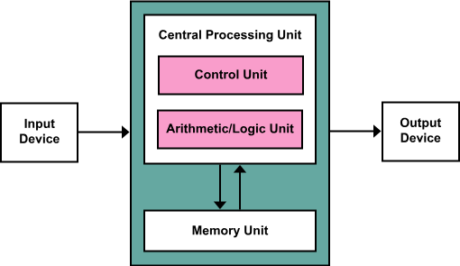
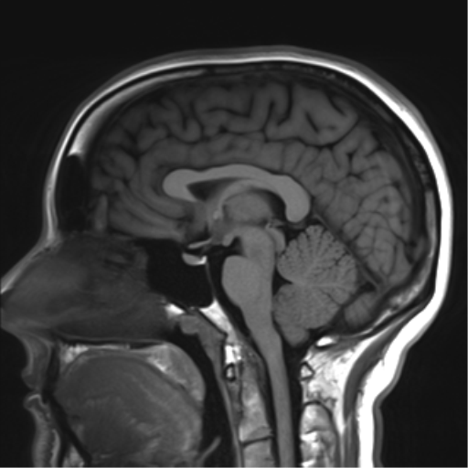
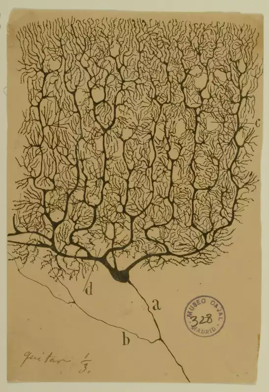

> *"The brain is wider than the sky."*
>
> --- Emily Dickinson (1830--1886)

This book is about the brain, but it is not written primarily for neuroscientists. It is written for readers who already know how to think carefully about complex systems, but who have not yet learned how biological intelligence resists many of the assumptions that work so well in engineering and mathematics.

Neuroscience presents a peculiar challenge. Unlike astronomy or particle physics, its object of study is not remote. We experience the brain continuously, from the inside. This intimacy creates confidence without understanding. We feel that we know what thinking is, what memory is, what perception is, simply because we experience them. Yet introspection is a poor guide to mechanism.[^1] The brain does not reveal its workings by reflecting on them.

For technically trained readers, this difficulty is compounded by metaphor. Over the last seventy years, the language of computation has become the dominant way of speaking about minds.[^2] We talk about inputs and outputs, representations and processing, memory and storage. These terms are not wrong, but they are dangerously incomplete. They import assumptions about precision, modularity, and design that do not hold for biological systems.

If you approach the brain as if it were a poorly documented piece of software, you will find yourself constantly asking why it is so badly engineered. Why is learning slow? Why is memory unreliable? Why are perceptual judgments biased? Why does the system forget, hallucinate, and mispredict? The answer is not that evolution did a bad job. It is that the brain was never trying to solve the problem you think it was solving.

This chapter exists to reframe the problem.

# The Brain Is Not a Digital Computer

The comparison between brains and computers is so natural that it often escapes notice. We say the brain "processes information" as casually as we say the heart "pumps blood." The analogy feels descriptive rather than metaphorical. Yet this ease is precisely what makes it dangerous.

Digital computers are artifacts of design. They are built to execute explicit instructions on discrete symbols. Their components are engineered for reliability and repeatability. Memory is distinct from computation. Control is centralized. Time is discretized and regulated by a clock. Noise is an enemy to be suppressed.[^3]

Brains are none of these things.

Neural systems have no instruction stream, no central controller, and no clear boundary between storage and processing. Signals are continuous in time, variable in amplitude, and deeply context dependent. Neurons operate asynchronously. Synapses change as a result of use. The system rewires itself while it is running.[^4]

These differences are not superficial. They reflect fundamentally different goals. Computers are designed to produce correct answers to well-specified problems. Brains evolved to keep organisms alive in uncertain, hostile environments. Precision is valuable only insofar as it supports survival. Flexibility, robustness, and speed often matter more.[^5]

This distinction explains why many computational metaphors break down under scrutiny. When we look for symbols, registers, or clean data structures in the brain, we are often disappointed. When we look instead for dynamics, feedback, and constraint-driven adaptation, the system begins to make sense.

A more honest statement is not that the brain is a computer, but that both brains and computers are physical systems capable of computation under radically different constraints. Conflating the two obscures more than it reveals.[^6]

# The Brain Is a Physical System

At the most basic level, the brain is matter. It occupies space, has mass, consumes energy, and obeys the same physical laws as any other biological tissue. Its signals arise from the movement of ions across membranes.[^7] Its components are proteins that change shape, channels that open and close, and molecules that diffuse through crowded cellular environments.

Every thought corresponds to physical change.

This fact is easy to state and difficult to absorb. Many accounts of cognition implicitly treat the physical substrate as incidental, as if the "real" processes occur at an abstract level divorced from biology. In reality, the properties of cognition are inseparable from the properties of the tissue that generates it.

Physical processes take time. They consume energy. They are noisy. They leave traces.[^8] Learning is slow because molecular change is slow. Memory persists because structural change persists. Fatigue, intoxication, and disease affect cognition because they affect metabolism, signaling, and cellular integrity.

Even the brain's apparent inefficiencies make sense in this light. Synapses fail. Neurons die. Signals degrade.[^9] Rather than eliminating these problems, evolution built systems that tolerate them. Redundancy and feedback compensate for unreliability. Plasticity compensates for damage.[^10] What looks sloppy from an engineering perspective is often robust from a biological one.

To understand the brain, we must abandon the idea that biology is merely an imperfect implementation of abstract computation. Biology is the source of the computation.

# Time, Change, and the Absence of Reset

One of the most underappreciated differences between brains and machines is that biological systems have no reset button.

A computer can be restarted. Memory can be cleared. Parameters can be reinitialized. A brain cannot be returned to an earlier state without destroying the system itself. Every experience leaves some trace, however small. Development, learning, aging, and injury accumulate. The brain you have today is the product of a continuous, irreversible history.

This has profound implications for learning and behavior. It means that learning is always incremental, constrained by what came before. It means that habits form because the system carries its past forward. It means that early experiences can have outsized effects, not because they are special in some abstract sense, but because they shape the initial conditions under which all later learning occurs.[^11]

Engineers often look for optimal solutions. Biological systems settle for workable ones. Once a solution supports survival, it tends to persist, even if better ones might exist in principle. Evolution cannot redesign from scratch; it can only modify what is already there.[^12]

This historical contingency is not a flaw. It is a defining feature of living systems.

# The Brain as an Adaptive Control System

If the brain is not a computer, what kind of system is it?

A useful framing is to view the brain as an adaptive control system embedded in a body.[^13] Its role is to regulate behavior in an environment that is uncertain, dynamic, and only partially observable. It does this by continuously coupling perception and action, adjusting its internal organization based on the consequences of its own behavior.

From this perspective, cognition is not a detached process that observes the world and computes answers. It is an activity inseparable from action. Perception is an active process of inference shaped by prior experience and biological need.[^14] Learning is the mechanism by which the control system adapts. Memory is the persistence of those adaptations.

Crucially, the objective of this system is not truth in the abstract. It is viability.[^15] The brain must keep the organism alive long enough to reproduce. Accuracy matters only insofar as it serves this goal. When precision conflicts with speed, energy efficiency, or robustness, precision often loses.

This framing helps explain why human cognition is full of heuristics, biases, and shortcuts. These are not bugs. They are trade-offs that favor survival under uncertainty.[^16]

# Noise, Redundancy, and the Myth of Optimization

Engineers are trained to eliminate noise and redundancy. Biological systems embrace both.

Neural signaling is noisy. Synapses sometimes fail to transmit. Neurons fluctuate in their responsiveness.[^17] Rather than eliminating this variability, the brain exploits it. Populations of neurons average over noise. Redundant pathways provide resilience. Feedback stabilizes dynamics.

What appears inefficient at the level of individual components often contributes to stability at the system level. Slow learning prevents catastrophic instability.[^18] Inhibitory mechanisms prevent runaway excitation. Distributed representations prevent single points of failure.

Optimization in biology does not mean maximizing performance on a benchmark. It means maintaining function across a wide range of conditions with limited resources. By that standard, the brain is not inefficient at all.

# Why This Matters Before We Study Neurons

This chapter has deliberately avoided detailed neurobiology. That is not because the details are unimportant, but because they are easily misinterpreted without the right conceptual frame.

When we turn to neurons in the next chapter, we will encounter cells that signal electrically, communicate chemically, and change physically in response to activity. Without the framing established here, these mechanisms can seem arbitrary or unnecessarily complex. With it, they become intelligible as solutions shaped by constraint, history, and function.

If there is one idea to carry forward, it is this: the brain is not an engineered solution to a clean problem. It is an evolved solution to a messy one. Understanding it requires patience, humility, and a willingness to revise intuitions forged in other domains.

Neuroscience begins not with facts, but with learning how to see.

# Next Chapter

Chapter 2: Neurons --- The Brain's Signaling Cells

# References and Attribution

## Figure Attribution

Figure 1.1: "Von Neumann Architecture" diagram by Wikimedia Commons user Kapooht, CC BY-SA 3.0, via Wikimedia Commons.

Figure 1.2: T1-weighted midsagittal magnetic resonance image of a human head; believed to be a public-domain or Creative Commons image from Wikimedia Commons (source file to be confirmed).

Figure 1.3: Santiago Ramón y Cajal, drawing of a Purkinje cell from the human cerebellum (1899), ink on paper, Instituto Cajal (CSIC), Madrid; public domain.

## Epigraph

Emily Dickinson, "The Brain—is wider than the Sky—" (c. 1862), poem 632 in *The Poems of Emily Dickinson*, ed. T. H. Johnson (Harvard University Press, 1955); Fr598 in R. W. Franklin's edition (1998).

## References

Allen, C., & Stevens, C. F. (1994). An evaluation of causes for unreliability of synaptic transmission. *Proceedings of the National Academy of Sciences*, 91(22), 10380–10383.

Ashby, W. R. (1952). *Design for a Brain*. Chapman & Hall.

Attwell, D., & Laughlin, S. B. (2001). An energy budget for signaling in the grey matter of the brain. *Journal of Cerebral Blood Flow & Metabolism*, 21(10), 1133–1145.

Cannon, W. B. (1932). *The Wisdom of the Body*. W. W. Norton.

Churchland, P. S., & Sejnowski, T. J. (1992). *The Computational Brain*. MIT Press.

Clark, A. (2013). Whatever next? Predictive brains, situated agents, and the future of cognitive science. *Behavioral and Brain Sciences*, 36(3), 181–204.

Faisal, A. A., Selen, L. P. J., & Wolpert, D. M. (2008). Noise in the nervous system. *Nature Reviews Neuroscience*, 9(4), 292–303.

Friston, K. (2010). The free-energy principle: A unified brain theory? *Nature Reviews Neuroscience*, 11(2), 127–138.

Gigerenzer, G., & Brighton, H. (2009). Homo heuristicus: Why biased minds make better inferences. *Topics in Cognitive Science*, 1(1), 107–143.

Gould, S. J., & Lewontin, R. C. (1979). The spandrels of San Marco and the Panglossian paradigm: A critique of the adaptationist programme. *Proceedings of the Royal Society of London B*, 205(1161), 581–598.

Helmholtz, H. von (1867). *Handbuch der physiologischen Optik*. Leipzig: Voss. English edition: *Treatise on Physiological Optics*, vol. III, trans. J. P. C. Southall (Optical Society of America, 1925).

Hodgkin, A. L., & Huxley, A. F. (1952). A quantitative description of membrane current and its application to conduction and excitation in nerve. *Journal of Physiology*, 117(4), 500–544.

Jacob, F. (1977). Evolution and tinkering. *Science*, 196(4295), 1161–1166.

Kandel, E. R. (2001). The molecular biology of memory storage: A dialogue between genes and synapses. *Science*, 294(5544), 1030–1038.

Knudsen, E. I. (2004). Sensitive periods in the development of the brain and behavior. *Journal of Cognitive Neuroscience*, 16(8), 1412–1425.

Marr, D. (1982). *Vision: A Computational Investigation into the Human Representation and Processing of Visual Information*. W. H. Freeman.

McCarthy, J., Minsky, M. L., Rochester, N., & Shannon, C. E. (1955). A proposal for the Dartmouth Summer Research Project on Artificial Intelligence. Reprinted in *AI Magazine*, 27(4), 12–14 (2006).

McClelland, J. L., McNaughton, B. L., & O'Reilly, R. C. (1995). Why there are complementary learning systems in the hippocampus and neocortex: Insights from the successes and failures of connectionist models of learning and memory. *Psychological Review*, 102(3), 419–457.

Nisbett, R. E., & Wilson, T. D. (1977). Telling more than we can know: Verbal reports on mental processes. *Psychological Review*, 84(3), 231–259.

Powers, W. T. (1973). *Behavior: The Control of Perception*. Aldine.

Shadlen, M. N., & Newsome, W. T. (1998). The variable discharge of cortical neurons: Implications for connectivity, computation, and information coding. *Journal of Neuroscience*, 18(10), 3870–3896.

Simon, H. A. (1956). Rational choice and the structure of the environment. *Psychological Review*, 63(2), 129–138.

Sterling, P., & Laughlin, S. (2015). *Principles of Neural Design*. MIT Press.

Turrigiano, G. G., & Nelson, S. B. (2004). Homeostatic plasticity in the developing nervous system. *Nature Reviews Neuroscience*, 5(2), 97–107.

Tversky, A., & Kahneman, D. (1974). Judgment under uncertainty: Heuristics and biases. *Science*, 185(4157), 1124–1131.

von Neumann, J. (1945). *First Draft of a Report on the EDVAC*. Moore School of Electrical Engineering, University of Pennsylvania. Reprinted in *IEEE Annals of the History of Computing*, 15(4), 27–75 (1993).

von Neumann, J. (1958). *The Computer and the Brain*. Yale University Press.

[^1]: Nisbett, R. E., & Wilson, T. D. (1977). Telling more than we can know: Verbal reports on mental processes. *Psychological Review*, 84(3), 231–259.

[^2]: McCarthy, J., Minsky, M. L., Rochester, N., & Shannon, C. E. (1955). A proposal for the Dartmouth Summer Research Project on Artificial Intelligence. Reprinted in *AI Magazine*, 27(4), 12–14 (2006); von Neumann, J. (1958). *The Computer and the Brain*. Yale University Press. The Dartmouth proposal of 1955 is usually taken as the start of this vocabulary; von Neumann's posthumous lectures are its most careful early statement.

[^3]: von Neumann, J. (1945). *First Draft of a Report on the EDVAC*. Moore School of Electrical Engineering, University of Pennsylvania. Reprinted in *IEEE Annals of the History of Computing*, 15(4), 27–75 (1993).

[^4]: Kandel, E. R. (2001). The molecular biology of memory storage: A dialogue between genes and synapses. *Science*, 294(5544), 1030–1038.

[^5]: Sterling, P., & Laughlin, S. (2015). *Principles of Neural Design*. MIT Press.

[^6]: Churchland, P. S., & Sejnowski, T. J. (1992). *The Computational Brain*. MIT Press; Marr, D. (1982). *Vision: A Computational Investigation into the Human Representation and Processing of Visual Information*. W. H. Freeman. Marr's three levels (computational, algorithmic, implementational) are the standard way of keeping the two apart.

[^7]: Hodgkin, A. L., & Huxley, A. F. (1952). A quantitative description of membrane current and its application to conduction and excitation in nerve. *Journal of Physiology*, 117(4), 500–544.

[^8]: Attwell, D., & Laughlin, S. B. (2001). An energy budget for signaling in the grey matter of the brain. *Journal of Cerebral Blood Flow & Metabolism*, 21(10), 1133–1145; Faisal, A. A., Selen, L. P. J., & Wolpert, D. M. (2008). Noise in the nervous system. *Nature Reviews Neuroscience*, 9(4), 292–303.

[^9]: Allen, C., & Stevens, C. F. (1994). An evaluation of causes for unreliability of synaptic transmission. *Proceedings of the National Academy of Sciences*, 91(22), 10380–10383.

[^10]: Turrigiano, G. G., & Nelson, S. B. (2004). Homeostatic plasticity in the developing nervous system. *Nature Reviews Neuroscience*, 5(2), 97–107.

[^11]: Knudsen, E. I. (2004). Sensitive periods in the development of the brain and behavior. *Journal of Cognitive Neuroscience*, 16(8), 1412–1425.

[^12]: Jacob, F. (1977). Evolution and tinkering. *Science*, 196(4295), 1161–1166; Gould, S. J., & Lewontin, R. C. (1979). The spandrels of San Marco and the Panglossian paradigm: A critique of the adaptationist programme. *Proceedings of the Royal Society of London B*, 205(1161), 581–598.

[^13]: Ashby, W. R. (1952). *Design for a Brain*. Chapman & Hall; Cannon, W. B. (1932). *The Wisdom of the Body*. W. W. Norton; Powers, W. T. (1973). *Behavior: The Control of Perception*. Aldine.

[^14]: Helmholtz, H. von (1867). *Handbuch der physiologischen Optik*. Leipzig: Voss. English edition: *Treatise on Physiological Optics*, vol. III, trans. J. P. C. Southall (Optical Society of America, 1925); Clark, A. (2013). Whatever next? Predictive brains, situated agents, and the future of cognitive science. *Behavioral and Brain Sciences*, 36(3), 181–204.

[^15]: Friston, K. (2010). The free-energy principle: A unified brain theory? *Nature Reviews Neuroscience*, 11(2), 127–138.

[^16]: Simon, H. A. (1956). Rational choice and the structure of the environment. *Psychological Review*, 63(2), 129–138; Tversky, A., & Kahneman, D. (1974). Judgment under uncertainty: Heuristics and biases. *Science*, 185(4157), 1124–1131; Gigerenzer, G., & Brighton, H. (2009). Homo heuristicus: Why biased minds make better inferences. *Topics in Cognitive Science*, 1(1), 107–143.

[^17]: Shadlen, M. N., & Newsome, W. T. (1998). The variable discharge of cortical neurons: Implications for connectivity, computation, and information coding. *Journal of Neuroscience*, 18(10), 3870–3896.

[^18]: McClelland, J. L., McNaughton, B. L., & O'Reilly, R. C. (1995). Why there are complementary learning systems in the hippocampus and neocortex: Insights from the successes and failures of connectionist models of learning and memory. *Psychological Review*, 102(3), 419–457.
