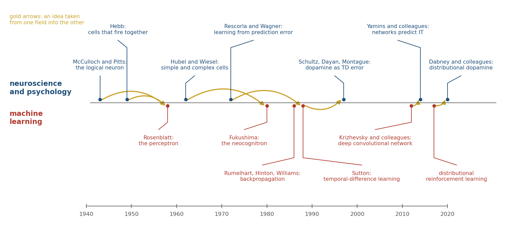
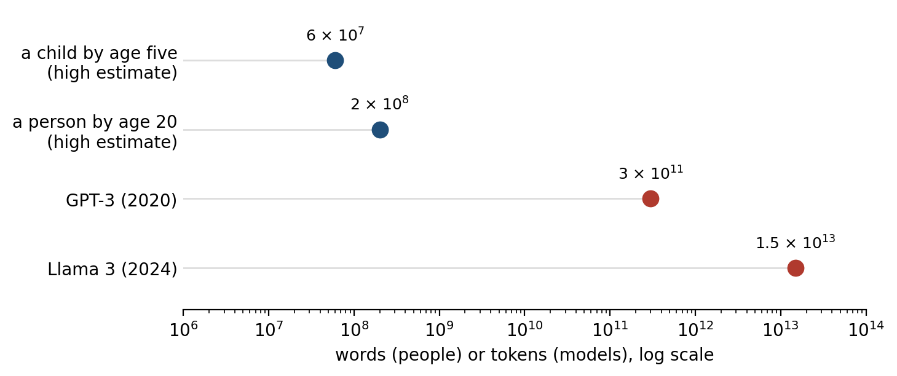

> *"Instead of trying to produce a programme to simulate the adult mind, why not rather try to produce one which simulates the child's?"*
>
> --- Alan Turing, "Computing Machinery and Intelligence" (1950)

# What Is Being Measured

In July 1958 the United States Navy showed reporters a machine built by the psychologist Frank Rosenblatt. It was a room-sized computer running a program he called the perceptron, and after 50 trials it had learned to tell whether a card had been marked on its left side or its right. The *New York Times* reported that the Navy expected the machine's descendants to walk, talk, see, write, reproduce themselves, and be conscious of their existence.[^1] None of that happened for a long time, and some of it has not happened yet. But the idea Rosenblatt demonstrated, a network of simple units that learns by adjusting the strength of its connections after its mistakes, is the idea on which the artificial intelligence of the 2020s runs. It came from the brain.

Each chapter of this book has ended by asking what its subject means for artificial intelligence. Chapter 3 asked how a machine might decide for itself when to learn; Chapter 5, how it might learn without forgetting; Chapter 6, why an imperceptible change to an image can make it confidently wrong; Chapter 7, what a machine can value when it has no body; Chapter 8, whether it knows when it does not know; Chapter 9, how it might turn deliberation into reflex and when it should turn it back. This chapter gathers those questions and measures machine learning against the brain directly. The question is not whether machines are intelligent, which depends on a definition, but which of the brain's solutions machine learning has found, which it has not, and which it does not need.

Measuring needs a scale, and there are three. A system can match the brain in performance, doing what a person does as well as a person does it. It can match in representation, organizing information inside it as the brain does. Or it can match in mechanism, getting there by the same means. Chapter 1 kept apart, after David Marr, what a system computes, the procedure it uses, and the hardware that runs it, and these three scales borrow that discipline loosely.[^2] The distinction matters because current machine learning scores very differently on them. A language model can write a competent paragraph, matching performance; its internal states predict the activity of the human language network, matching representation in part; and it learns by a procedure that no brain is known to use, matching mechanism hardly at all.

The argument of this chapter is that machine learning got right the thing it took from the brain first: that useful knowledge can be learned rather than written by hand, stored in the strengths of many connections, and shaped by error and prediction. Where it has applied that idea at scale, its systems have come to resemble the brain more than anyone expected. Where it differs is in the conditions of learning. A brain learns from little data, all its life, on 20 watts, with values anchored to a body, from rules available at each synapse, and while it is being used. Most machine learning learns from enormous data, once, on megawatts, toward an objective supplied from outside, by a global procedure, and then stops. Some of those differences are failures that the brain shows how to repair. Others are the brain's responses to constraints that silicon does not share, and copying them would be a mistake. Telling the two apart is the purpose of the comparison.

# A Shared Ancestry

The traffic between the fields has run in both directions for 80 years (Figure 10.1). Warren McCulloch and Walter Pitts described the neuron as a logical unit in 1943, as Chapter 2 recounted, and Rosenblatt's perceptron added what their units lacked: weights that changed with experience, as Donald Hebb had proposed in 1949 that synapses do.[^3] Its learning rule was crude, and in 1969 Marvin Minsky and Seymour Papert showed that a single layer of such units could not compute some simple functions, among them exclusive-or, the same function that Chapter 2 found a single human cortical neuron can compute.[^4] Multilayer networks could compute it, but there was no practical, widely known way to train them.

The architecture of modern vision systems came from Chapter 6. David Hubel and Torsten Wiesel had found that neurons in visual cortex respond to oriented edges and that cells further along respond to the same edge over a wider area. Kunihiko Fukushima built that hierarchy into a network in 1980, alternating layers that detect features with layers that pool them, and called it the neocognitron.[^5]

The method of training such a network came from mathematics and control engineering, where the calculation it needs had been worked out in the 1970s. Backpropagation passes the error at the output backward through the network to assign each weight its share of the blame, and David Rumelhart, Geoffrey Hinton, and Ronald Williams showed in 1986 that it could train networks with hidden layers to discover useful internal representations.[^6] Yann LeCun and his colleagues combined the two in 1989 and trained a convolutional network to read handwritten zip codes.[^7] In 2012 Alex Krizhevsky, Ilya Sutskever, and Hinton trained a much larger one on a million labeled photographs, using graphics processors built for video games, and cut the error rate in the leading image-recognition competition from 26 percent to 15 percent.[^8] The current era of artificial intelligence dates from that result.

The traffic in the other direction is just as old. Chapter 3 told how temporal-difference learning turned out to describe the firing of dopamine neurons that Wolfram Schultz had recorded in monkeys. Richard Sutton and Andrew Barto had developed it from the Rescorla-Wagner model of animal conditioning, and Sutton then generalized it into an engineering method for learning predictions, so the idea went from psychology to engineering and on to the physiology of the midbrain.[^9] The exchange has continued since. Will Dabney and his colleagues at DeepMind found that artificial agents learn better when they predict the whole distribution of possible rewards rather than only the average, and then, with Naoshige Uchida's laboratory, found that individual dopamine neurons in mice are tuned more optimistically or more pessimistically, together encoding a distribution of the kind the agents used.[^10] Demis Hassabis and his colleagues have argued that this kind of exchange is the main reason for engineers to study the brain: not to copy it, but to find out which problems it has already solved.[^11]

# What the Machines Got Right: Representations

The strongest evidence that machine learning has found something real about the brain is that its systems, trained only to perform a task, end up organized inside, in some respects, like the brain.

Daniel Yamins, James DiCarlo, and their colleagues trained many networks to recognize objects in photographs and compared each network's internal activity with recordings from inferior temporal cortex (IT), the stage of the monkey's ventral stream where Chapter 6 located object recognition. The networks that were better at recognizing objects were better at predicting the responses of recording sites in IT, and the best of them predicted about half of the variance that could be predicted at all, far more than models built by hand to resemble the visual system.[^12] No one had told the networks anything about IT. Seyed-Mahdi Khaligh-Razavi and Nikolaus Kriegeskorte reached the same conclusion with a different method, comparing the pattern of similarities among images in a network with the pattern in human IT measured by functional imaging.[^13] Figure 10.2 shows the shape of the result: for the networks of 2014, performance and resemblance rose together.

The relation did not hold indefinitely. Drew Linsley, Thomas Serre, and their colleagues found that as networks grew more accurate than those of 2014, their ability to predict IT stopped improving and then began to fall, because the most accurate networks had come to rely on features that IT does not use.[^14] Optimizing for a task brought the networks toward the brain only while the task forced them to solve the problem the brain solves.

Chapter 6 noted a further limit: the networks copied the brain's first sweep through the visual hierarchy, not its loops. The gap shows in timing. Kohitij Kar, DiCarlo, and their colleagues found hundreds of images that monkeys recognized and that standard feedforward networks did not. For those images, the object's identity appeared in IT about 30 milliseconds later than for easy ones, as if a second pass had been needed. Feedforward networks predicted those late responses poorly and deeper networks predicted them better, which the authors read as a sign that the brain was using recurrent processing to do what extra layers do.[^15]

Language models have repeated the first part of the story. Martin Schrimpf, Evelina Fedorenko, and their colleagues tested dozens of language models against recordings of people reading and listening. The models' internal activity predicted responses in the brain's language network, and the models that predicted it best were the ones best at predicting the next word, rather than those best at other language tasks.[^16] Ariel Goldstein, Uri Hasson, and their colleagues, recording from electrodes on the cortex of epilepsy patients listening to a podcast, found that the brain, like the model, signals its prediction of an upcoming word before the word is heard, and signals surprise in proportion to how unexpected the word turns out to be.[^17] Charlotte Caucheteux and Jean-Rémi King found the resemblance only partial, strongest for the middle layers of the models and weaker for the top.[^18]

Even the brain's map of space has appeared unbidden. Andrea Banino and his colleagues trained a network to keep track of its position from its own movements, the problem of path integration, and units resembling the grid cells of entorhinal cortex emerged in it.[^19] Here a caution came quickly. Rylan Schaeffer, Mikail Khona, and Ila Fiete trained more than 11,000 such networks and found that grid-like units appeared only under particular choices made by the modelers, especially in how the network's output was encoded, and that where they appeared they lacked key properties of real grid cells; others have argued that the needed choices are principled.[^20] A resemblance can come from what the modeler put in.

Resemblance is also measured in ways that can flatter. Jeffrey Bowers and his colleagues have argued that networks that predict neural data well still fail many of the classic experiments of vision science, where human perception shows effects the networks do not.[^21] The fair conclusion is that a network trained hard enough on the right task arrives at some of the brain's solutions, which says something about both: the solutions are not arbitrary, and the brain is, in part, a system that has been optimized for its tasks.[^22]

# What the Machines Got Right: Error and Prediction

The second thing machine learning got right is the principle by which both systems learn: compare what was expected with what happened, and change in proportion to the difference. Chapter 3 showed that dopamine broadcasts such an error about reward, Chapter 5 that synapses change according to the timing of activity and a third factor that signals whether the change should count, and Chapter 6 that perception can be described as the continual correction of predictions by sensory error. In every case learning is driven by error and aimed at prediction.

Machine learning arrived at the same aim from its own direction. The most capable systems of the 2020s were trained mostly without labels, by being asked to predict part of their input from the rest: the next word from the words before, a hidden patch of an image from the visible ones. This is self-supervised learning, and it is the regime of the brain, which receives few labels and an endless stream of input against which to test its predictions. A language model's training objective shares the aim that Chapter 6 attributed to cortex, predicting what comes next, though not its form: cortex, on that account, predicts at every level of a hierarchy and corrects itself while it perceives, where a language model predicts only its next input. The final stages of training add a different signal, rewards from human preferences or from checking answers.

Prediction has also proved to scale. Jared Kaplan and his colleagues at OpenAI found that the error of a language model at predicting text falls as a smooth power of the model's size, the amount of data, and the computation spent on training, over many orders of magnitude.[^23] Jordan Hoffmann and his colleagues at DeepMind corrected the recipe, showing that models of the time had been trained on too little data for their size: their Chinchilla outperformed models several times larger that had been trained on less.[^24] A power law is also the shape often fitted to human practice, as Chapter 9 described, though there the fit is disputed.

What these results establish is that error-driven learning of predictions, applied at a large enough scale, produces knowledge that is general enough to use for tasks the learner was never trained on. That was the bet of the connectionists of the 1980s, and it has paid. What they do not establish is that the brain learns its predictions by the same procedure, which is a separate question taken up below.

# Shortcuts

The resemblance ends where the training data end. Chapter 6 described adversarial images and networks that recognize texture where people recognize shape. Those are symptoms of a broader pattern that Robert Geirhos and his colleagues called shortcut learning: a network trained to reduce its error will use whatever feature of the training data reduces it, whether or not that feature is the one a person would use.[^25] John Zech and his colleagues trained a network to detect pneumonia in chest X-rays from three hospital systems. It performed well, and part of what it had learned was to recognize which hospital an image came from, which it could do almost perfectly from metal tokens and other marks on the films. Because the hospitals differed greatly in how often their patients had pneumonia, knowing the hospital was a good guess at the diagnosis.[^26] The network was right for a reason that would fail at the next hospital.

The brain is not free of shortcuts: Chapter 9's habits go on producing yesterday's answer after the reason for it has gone. But a person has learned from a world in which most shortcuts eventually break, and has met the same object under so many lights, angles, and contexts that the features that survive are mostly the ones that matter. A network trained on one collection of images has had no such schooling, and even small changes can expose it. Benjamin Recht and his colleagues built a fresh test set for the standard image benchmark, following the original procedure as closely as they could, and found that the accuracy of every model they tested dropped by roughly 11 to 14 percentage points.[^27] Logan Engstrom and his colleagues later traced much of the drop to subtle differences in how the new images had been selected, which is itself the point: changes too slight for the builders of the test set to notice were enough to move every model.[^28]

The gap is narrowing, and it is narrowing in an instructive way. When Geirhos and colleagues later compared people with newer models on distorted images, the models trained on far larger and more varied datasets had closed much of the difference in robustness, and their errors had come to resemble human errors more closely, though people and models still went wrong on different images.[^29] That is Chapter 9's lesson about varied practice. A learner exposed to the variability of the world learns the features that survive it. What remains different is the amount of data required.

# The Data Gap

A child of three speaks in sentences, and a child of ten has a vocabulary in the tens of thousands of words. Michael Frank has estimated how much language reaches a child. On generous assumptions it is about a million words a month, some 60 million by the age of five and 200 million by 20; on cautious ones, ten times fewer.[^30] GPT-3, the language model that in 2020 made fluent machine prose familiar, was trained on about 300 billion tokens of text, a token being roughly a word or a part of one, and Meta's Llama 3 in 2024 on about 15 trillion.[^31] Against a five-year-old, the models see thousands to hundreds of thousands of times more language (Figure 10.3), and the child has learned to walk, see, and play in the same years.

Part of the explanation is that a child does not start from nothing. A colt walks within hours of birth. A newborn human tracks a face-like pattern further than a scrambled one within the first hour of life, and by four or five months infants look longer when a hidden object seems to have vanished, as if they expected it to persist, though how much that expectation implies is debated.[^32] Anthony Zador has argued that this is the most underrated difference between brains and networks: an animal's brain arrives with circuits shaped by evolution, so much of what looks like rapid learning is the tuning of a system already close to the answer.[^33] The genome cannot specify every synapse, because there are far too many, so it must specify rules for wiring, and Zador calls this a genomic bottleneck that forces evolution to encode compact, general structure. Machine learning's equivalent is the choice of architecture: a convolutional network builds in the assumption that a feature means the same thing wherever it appears, which is one reason it learns vision from far fewer examples than a network without it.

The other part is that a child learns from experience that is rich, embodied, and chosen. Wai Keen Vong, Brenden Lake, and their colleagues trained a network on 61 hours of video and transcribed speech recorded from a camera mounted on the head of one child, between the ages of six and 25 months, about one percent of the child's waking hours. From that alone, with no built-in knowledge of language, the network learned to match words to what they named. Tested on 22 everyday words, choosing which of four pictures showed the named thing, it was right 62 percent of the time, where chance was 25, close to the 67 percent of a model trained on 400 million captioned images from the internet, and it generalized some words to objects it had never seen.[^34]

The result shows that a learner without innate linguistic knowledge can begin to map words onto things from one child's view of the world. It also shows how far there is to go: the network was tested on a few dozen words and not on grammar at all, while the child was by then on the way to sentences. A related line of work, the BabyLM Challenge, trains language models on 100 million words or fewer, roughly what a child hears by early adolescence. On the challenge's tests, most of them judgments of whether sentences are grammatical, the best such models did as well as some models trained on trillions of words, which suggests that much of what the giant datasets buy is not grammar.[^35]

People learn new concepts from one example. Shown a single unfamiliar written character, a person can recognize other examples, draw new ones, and see its parts. Lake, Ruslan Salakhutdinov, and Joshua Tenenbaum built a system that did the same by representing characters as programs for drawing them, and, with colleagues, argued that human learning is fast because people build models of how things are caused, not only of what they look like.[^36] Large language models have partly closed this gap from the other side. Once trained, they learn a new task from a handful of examples placed in their input, without any change to their weights, an ability called in-context learning.[^37] Jane Wang and her colleagues had found that a recurrent network trained on many related tasks develops exactly such a fast learner in its activity, and proposed that prefrontal cortex is one, trained slowly by dopamine to learn quickly.[^38] On this view the machine's few-shot learning is real but expensive. It took the enormous dataset to buy it, much as the child's took evolution.

# Learning That Never Stops

A brain learns while it is used, and no one ever stops it to retrain it. Most deployed machine learning works the other way (Figure 10.4). A model is trained, its weights are fixed, and then it is used; what it learns from a conversation lasts only as long as the conversation is held in its context window, and when the conversation ends the model is as it was. A language model knows nothing of events after its training data were collected unless it is told about them, looks them up, or is retrained. The memories that some assistants now keep between conversations are stored as text and fed back in, not learned into the weights.

The obstacle is the one Michael McCloskey and Neal Cohen found in 1989 and Chapter 5 described: a network trained on a second set of associations loses the first.[^39] Figure 10.5 shows it in a small network. Trained on one list of associations and then on a second that uses the same cues with different answers, the network loses half of the first list within a few passes and nearly all of it within about 20, well before it has finished learning the second. If a few items from the first list are mixed back into the training on the second, both survive. The brain's answer, on the complementary learning systems theory of Chapter 5, is to keep a fast learner, the hippocampus, that stores episodes at once and replays them into a slow one, the cortex, interleaved with what it already knows.[^40] Machine learning had found the same answer independently, as Chapter 5 noted, and Volodymyr Mnih and his colleagues made experience replay part of the first network to learn dozens of Atari games from the screen alone, citing hippocampal replay as its biological counterpart.[^41]

Replay helps, and Chapter 9 described elastic weight consolidation, which protects the weights that mattered for old tasks.[^42] Neither has made continual learning routine. A newer finding suggests that the problem is deeper than forgetting. Shibhansh Dohare, Richard Sutton, and their colleagues trained standard networks on long sequences of tasks and found that they gradually lose the ability to learn at all: after thousands of tasks, a network learned each new one no better than a network with no hidden layers, because more and more of its units had become inactive or redundant.[^43] They restored the ability by continually reinitializing a small fraction of the least-used units, which they called continual backpropagation.

The brain does something that looks similar. It keeps making new synapses and removing unused ones, as Chapter 9's motor cortex did for a new skill, and in many mammals the hippocampus adds new neurons throughout life, although whether adult humans do so is disputed.[^44] Plasticity in the brain is not a phase but a maintained state, and it is maintained at a cost.

# Credit Without Backpropagation

Backpropagation sends the error at the output backward through the network along the same connections, with the same weights, that carried the signal forward. Chapter 3 recounted Francis Crick's objection of 1989: axons carry signals one way, and a synapse has no evident means of learning the strength of a synapse somewhere downstream.[^45] If the brain does not backpropagate, then the most successful learning procedure known is one it does not use, and the resemblance of trained networks to cortex is a resemblance of destination, not of route.

The two most developed answers were met in Chapters 3 and 6. Chapter 3 showed that a backward pathway with random, fixed weights can be enough, because the forward weights come to align with it, and that bursts arriving at the apical dendrites of pyramidal neurons could carry an error apart from the cell's main output.[^46] Chapter 6 showed that a network built to correct its own predictions, as cortex may be, can compute nearly the same weight changes that backpropagation does, using only plasticity local to each synapse.[^47] João Sacramento and his colleagues have built a model of dendritic microcircuits that approximates backpropagation in the same spirit.[^48] None of these has been shown to operate in cortex, and when Sergey Bartunov, Lillicrap, and their colleagues tested several on hard image-recognition problems, they fell well short of backpropagation.[^49]

What can be said is that the brain solves the problem backpropagation solves, deciding which of billions of connections to change, with signals available at each synapse: the activity on either side, the dendritic potential, and a broadcast modulator of the kind Chapter 3 described. Whether that combination amounts to an approximation of the gradient or to something different is open. Yuhang Song, Rafal Bogacz, and their colleagues have argued for the second: in their models, the network first settles its activity on what the outcome should have been and only then changes its synapses; in their simulations, networks trained this way learned faster than with backpropagation and with less interference between tasks.[^50] If that is how the brain works, its local rules would be not a makeshift for lack of a backward pathway but a better way to learn while acting.

# The Energy Bill

Chapter 1 put the brain's power at about 20 watts. Over 20 years, from birth to adulthood, that comes to about 3.5 megawatt-hours. David Patterson and his colleagues estimated that training GPT-3 used about 1,300 megawatt-hours, the energy of several hundred human brains running for 20 years (Figure 10.6).[^51] Training is only part of the bill. At Google, about three-fifths of the energy used for machine learning went to answering queries rather than training.[^52] A single data-center processor of the mid-2020s can draw 700 watts, as much as 35 brains, and newer ones draw more.[^53]

The comparison is unfair in both directions. It omits the billions of years of evolution that designed the brain and the body that feeds it, and it omits that one trained model serves millions of people. But the brain's frugality is not an accident, and Chapters 1 and 2 traced it to sparse activity, all-or-none spikes that cost energy only when sent, and computation done where the memory is stored.

Machine learning has begun to rediscover parts of this. Models built as mixtures of experts activate only a small fraction of their parameters for each word, which lets them grow without a proportional growth in computation.[^54] Neuromorphic chips such as IBM's TrueNorth and Intel's Loihi compute with spikes and keep memory beside the processing units, and run some tasks on a small fraction of the power of a conventional processor: TrueNorth, with a million artificial neurons, consumed 63 milliwatts while processing live video.[^55] They have not yet been shown to train large models. The brain's lesson is that the binding constraint on intelligence may be energy rather than data or computation, and that a system built under that constraint looks very different from one built without it.

# Bodies

In March 2016 AlphaGo, the program described in Chapter 8, beat Lee Sedol, one of the strongest Go players in the world, by four games to one.[^56] The program chose its moves, but it could not make them. Aja Huang, a DeepMind programmer, sat across the board from Lee, read each move from a screen, and placed the stones by hand.[^57] Picking a stone out of a bowl and setting it on a crowded board without disturbing its neighbors was, for a machine, the harder problem, and in 2016 no robot could have done it as easily as Huang did. Hans Moravec had noticed the pattern in the 1980s: computers could be made to perform like adults on intelligence tests or at checkers far more easily than they could be given the perception and mobility of a one-year-old.[^58] Moravec's explanation was evolutionary. The skills that feel effortless, seeing, grasping, and walking, have been refined over hundreds of millions of years, and their difficulty is hidden in the brain's machinery rather than absent; abstract reasoning is recent and, by comparison, thin.

The paradox has softened. Chapter 9 described a robot hand that learned to turn a cube only after training in simulations whose physics were randomized far beyond anything real, and robots trained on large collections of demonstrations now fold laundry and clear tables in some settings.[^59] But a child learns to grasp from a few months of its own fumbling, with its own body, and robots still need far more practice, much of it simulated, for narrower skills. What the child has are the forward models of Chapters 6 and 9: predictions of the sensory consequences of its own movements, compared with what happens and corrected on every movement for life, by a cerebellum that never stops recalibrating.

A body also gives an organism something to care about. Chapter 7 argued that value in the brain is anchored to the state of the body, which limits how far an animal's goals can drift. A language model has no body and no needs; what it learns to value is whatever its training rewarded. The difference returns below, in the question of whether a machine knows when it does not know.

# Fluency and Thought

Large language models produce fluent, often correct prose on almost any subject, and the question of what that fluency implies has divided researchers.[^60] The brain offers a way to frame it. Kyle Mahowald, Anna Ivanova, Fedorenko, and their colleagues distinguished formal competence in language, knowing its words and rules, from functional competence, using language to reason, plan, and refer to the world.[^61] In the human brain the two depend on different networks. The language network responds to sentences but not to arithmetic, logic, or music.

Rosemary Varley and her colleagues studied three men whose strokes had left them with severe aphasia: in sentences such as "the man killed the lion", where only the order of the words shows who did what to whom, they could no longer reliably tell the doer from the done-to, and yet they solved arithmetic problems whose structure is as nested as a sentence's, such as 90 − [(3 + 17) × 3].[^62] Language, on this and similar evidence, is how people communicate thought, not the medium in which they do most of it.[^63] A system trained only on language could master the language network's job without acquiring the others.

The evidence suggests that the models have acquired some of both, unevenly. Thomas McCoy, Thomas Griffiths, and their colleagues argued that a model trained to predict text will be shaped by the statistics of text even when a task does not depend on them. Asked to decode a message written in a simple cipher that shifts each letter along the alphabet, GPT-4 did much better with a shift of 13, which is common on the internet, than with a shift of 12, which is not, although the procedure is the same.[^64]

Lukas Berglund and his colleagues found that models that learned "A is B" from their training data often failed to infer "B is A": asked about a thousand celebrities, GPT-4 could name a celebrity's parent 79 percent of the time, but given the parent could name the celebrity only 33 percent of the time.[^65] Karthik Valmeekam and his colleagues gave GPT-4 simple planning problems about stacking blocks. It solved about a third of them, and almost none when the same problems were disguised with unfamiliar names for the objects and actions.[^66] In each case the system did well where its training text had done the reasoning for it and worse where it had to reason afresh.

That picture has changed quickly. Models asked to write out intermediate steps before answering, a method called chain of thought, solve more multistep problems, and models trained by reinforcement learning to reason at length before they answer have become much better at mathematics and programming problems whose answers can be checked.[^67] When Valmeekam's group retested its block-stacking problems on one such reasoning model in 2024, it solved nearly all of the plain problems and about half of the disguised ones.[^68] Chapter 8 saw in this an echo of accumulation to a bound: computation spent before committing.

Other systems learn models of their world and plan inside them. Danijar Hafner and his colleagues' DreamerV3 learned to collect diamonds in the video game Minecraft, a long sequence of subgoals, from scratch and without examples from human players, by imagining the consequences of its actions in a learned model.[^69] Brains appear to do something similar: in rats, the hippocampal sequences of Chapter 5 sometimes sketch the path to a remembered goal before the animal sets off.[^70] What is still rare is the combination the brain manages routinely: one system that learns a model of the world from its own actions, plans in it, talks about it, and keeps learning while it does all three.

# Knowing What It Does Not Know

Lee Sedol won one game of the five. In the fourth, his 78th move was one that AlphaGo had judged to have about one chance in 10,000 of being played by a human. The program answered with a poor move, and for several moves afterward its own estimate of its position stayed high; Hassabis wrote during the game that AlphaGo had made its mistake at move 79 and came to that realization only around move 87.[^71] A system that had learned its confidence from millions of games met a position unlike them and did not know it.

The failure has a familiar modern form. A language model asked a question it cannot answer will often answer anyway, with a fluent and confident invention, a failure called hallucination. Adam Kalai and his colleagues have argued that this is partly a product of how the models are trained and tested: an evaluation that gives credit for a correct answer and none for "I do not know" rewards guessing, in the way a multiple-choice test rewards a student who never leaves a blank.[^72] Models can be trained to estimate whether their own answers are right, as Chapter 8 noted, and do it fairly well within the range of their training.[^73] The clearest evidence that training can blunt a model's sense of its own reliability comes from OpenAI's report on GPT-4. As first trained to predict text, the model was well calibrated: its confidence in an answer matched how often it was right. The later training that made it a helpful assistant made it markedly less so.[^74]

People are not perfectly calibrated either. They are often overconfident on questions of general knowledge, and they sometimes invent reasons for what they did. But a person's confidence is shaped by consequences, and the cost of being wrong, felt by a body that gives outcomes their value, tends to pull confidence back toward accuracy. A model is rewarded for what its designers chose to reward, and many of its evaluations reward an answer over an admission.

Chapter 9 ended on a related question: when a fast system should hand control back to a slow one. A pianist plays automatically until a wrong note, and the wrong note is the signal. Language models that reason at length have begun to make this decision for themselves, spending more reasoning on problems they judge harder. But the judgment is learned from whatever training rewarded, and it is often poorly matched to difficulty: Xingyu Chen and his colleagues found such models spending many times more computation than needed on trivial problems, generating more than a dozen solutions to "2 + 3", while Yue Wang and colleagues found them abandoning promising lines of thought too soon on hard ones.[^75] The brain's trigger is simpler: an expected outcome that fails to arrive. AlphaGo, answering move 78, had no such trigger, and many of its successors still lack one.

# What Not to Copy

There is a case against using the brain as a guide at all, and it deserves a hearing. Sutton wrote in 2019, in an essay called "The Bitter Lesson", that the biggest lesson of 70 years of artificial intelligence research is that general methods that make use of more computation have always, in the end, beaten methods built on human knowledge of the problem.[^76] Chess programs that searched more beat programs that encoded grandmaster insight; speech systems that learned from more data beat systems built around linguistics. Each time, researchers who had built in what they knew were overtaken. On this view, copying the brain's mechanisms is another way of building in what we think we know, and it will lose to scale.

The argument is strong, and the history in this chapter supports part of it: the networks came to resemble cortex by being trained, not by being designed to resemble it. But it is an argument against building in solutions, not against learning what the problems are. The brain is useful to engineers less as a blueprint than as a list of problems that a learning system meets when it leaves the laboratory, with evidence that each can be solved. Learning for a lifetime without forgetting, by rules available at each synapse, on a small energy budget, with values anchored to something it cannot redefine: these are the rows that Figure 10.7 marks as largely absent from current machines, and they are among the problems the brain was shaped by.

Some of the brain's features should not be copied. Its neurons are slow, so it must compute in parallel and cannot run a long serial calculation; its components are imprecise, so it relies on redundancy; and it cannot be copied, reset, or inspected, so it must learn everything in one lifetime and protect what it has. Silicon is fast, precise, and can be duplicated, restarted, and examined, and a machine that inherited the brain's limitations along with its solutions would gain nothing.

Sorted this way, the differences named at the start of this chapter fall on both sides. Learning all its life without forgetting, and an honest estimate of what it knows, are solutions to problems that every system meets once it is put to use, and machines lack them to their cost. The brain's frugality is also a solution, forced by a constraint that now binds silicon too. Its small appetite for data is partly evolution's gift, which a machine can buy back, expensively, by training on a library. Values anchored to a body are a constraint a machine need not share, although what the anchoring buys, a limit on how far goals can drift, is something machines still need by other means. The local learning rule is the hardest to place: makeshift or improvement, no one yet knows.

# Implications for Neuroscience

The traffic of Figure 10.1 runs both ways, and in the last decade the return direction has been the busier one: machine learning has changed neuroscience as much as neuroscience changed it.

First, trained networks are now models of the brain. Until the mid-2010s most models of higher visual cortex were built largely by hand, with learning confined to a stage or two; now a model is often a network trained on a task, and its quality is judged by how well it predicts recorded neurons. Kriegeskorte and Blake Richards with many colleagues have argued that neuroscience should describe brains as machine learning describes networks, by their objectives, their learning rules, and their architectures, rather than by what each neuron computes.[^77] Describing the brain this way has made old questions precise: what its objectives are, whether it approximates the gradient, and how it keeps its plasticity.

Second, a model good enough to predict neurons is good enough to control them. Pouya Bashivan, Kar, and DiCarlo used a network model of the monkey's visual area V4 to design images that the model predicted would drive particular neurons harder than any natural image did. Shown to the monkeys, many of the synthetic images did exactly that.[^78] Carlos Ponce, Margaret Livingstone, and their colleagues let neurons in the monkey's IT cortex guide an image-generating network, each generation of images bred from those the neurons responded to most. The images evolved toward pictures that often contained parts of faces or bodies, or objects familiar to the monkeys, combined in ways no one had predicted.[^79] Experiments of this kind were impossible before the models existed.

Third, machine learning has reopened an old argument about how much of the mind must be innate. Systems with no built-in grammar, though with architectural biases of their own, now produce grammatical language from text alone, and Steven Piantadosi has argued that this undermines the case for an innate universal grammar.[^80] Others reply that the models need thousands of times more language than a child hears, so that they show what can be learned from text in bulk, not what a child learns from what it hears. The disagreement is now partly about numbers that can be measured, such as how well a model does on a child's budget of words, and that is progress.[^81]

What the brain could still lend to machines, and how its mechanisms might be built into them, is the subject of Chapter 11.

# The Central Lesson

Machine learning took one idea from the brain, that knowledge can be learned into the strengths of many connections by correcting errors of prediction, and proved it more powerful than its inventors could: trained at scale, networks match people at tasks once thought to need a mind, and arrive at representations like those of a cortex they were never shown. What they did not take are the conditions under which a brain learns. A brain learns from little data because evolution has built in much of the structure and because its experience is rich, embodied, and chosen; it learns all its life because it replays what it knows and keeps its synapses changeable; and it runs on 20 watts because it computes sparsely where its memory is. Some of those conditions are constraints a machine is right to ignore; the rest are answers to problems that every learner meets once it leaves the laboratory. Turing proposed in 1950 to build a machine that learns like a child. Seventy-six years later the machines learn, but not like children: they learn once, from a library, at great cost, and then stop. The child's way is still the harder one to build.

# Next Chapter

Chapter 11: Integrating Brain Mechanisms into AI Models: What Machines Could Borrow from Biology

# References and Attribution

## Figure Attribution

Figures 10.1 to 10.7 were drawn for this book. The points in Figure 10.2 are illustrative, after the patterns reported by Yamins et al. (2014) and Linsley et al. (2023), not recorded data. The values in Figure 10.3 are from Frank (2023), Brown et al. (2020), and Grattafiori et al. (2024); those in Figure 10.6 are from Patterson et al. (2021) and a brain power of 20 watts. Figure 10.5 is a simulation of a small network trained by backpropagation on two lists of associations in the design of McCloskey and Cohen (1989). Figures 10.1, 10.4, and 10.7 are schematic; Figure 10.1 includes Rescorla and Wagner (1972) as the psychological ancestor of temporal-difference learning; the judgments in Figure 10.7 are the author's.

## Epigraph

Alan M. Turing, "Computing Machinery and Intelligence," *Mind*, 59(236), 433–460 (1950), section 7, "Learning Machines," p. 456.

## References

After 3 losses, master Go player scores a win against computer. (2016, March 13). *NPR, The Two-Way*. https://www.npr.org/sections/thetwo-way/2016/03/13/470284113/

Baillargeon, R., Spelke, E. S., & Wasserman, S. (1985). Object permanence in five-month-old infants. *Cognition*, 20(3), 191–208.

Banino, A., Barry, C., Uria, B., Blundell, C., Lillicrap, T., Mirowski, P., Pritzel, A., Chadwick, M. J., Degris, T., Modayil, J., Wayne, G., Soyer, H., Viola, F., Zhang, B., Goroshin, R., Rabinowitz, N., Pascanu, R., Beattie, C., Petersen, S., … Kumaran, D. (2018). Vector-based navigation using grid-like representations in artificial agents. *Nature*, 557(7705), 429–433.

Bartunov, S., Santoro, A., Richards, B. A., Marris, L., Hinton, G. E., & Lillicrap, T. P. (2018). Assessing the scalability of biologically-motivated deep learning algorithms and architectures. In *Advances in Neural Information Processing Systems 31*.

Bashivan, P., Kar, K., & DiCarlo, J. J. (2019). Neural population control via deep image synthesis. *Science*, 364(6439), eaav9436.

Berglund, L., Tong, M., Kaufmann, M., Balesni, M., Stickland, A. C., Korbak, T., & Evans, O. (2024). The reversal curse: LLMs trained on "A is B" fail to learn "B is A". In *International Conference on Learning Representations*.

Black, K., Brown, N., Driess, D., Esmail, A., Equi, M., et al. (2024). π0: A vision-language-action flow model for general robot control. *arXiv*, 2410.24164.

Boldrini, M., Fulmore, C. A., Tartt, A. N., Simeon, L. R., Pavlova, I., Poposka, V., Rosoklija, G. B., Stankov, A., Arango, V., Dwork, A. J., Hen, R., & Mann, J. J. (2018). Human hippocampal neurogenesis persists throughout aging. *Cell Stem Cell*, 22(4), 589–599.

Bowers, J. S., Malhotra, G., Dujmović, M., Llera Montero, M., Tsvetkov, C., Biscione, V., Puebla, G., Adolfi, F., Hummel, J. E., Heaton, R. F., Evans, B. D., Mitchell, J., & Blything, R. (2023). Deep problems with neural network models of human vision. *Behavioral and Brain Sciences*, 46, e385.

Brown, T. B., Mann, B., Ryder, N., Subbiah, M., Kaplan, J., Dhariwal, P., Neelakantan, A., Shyam, P., Sastry, G., Askell, A., Agarwal, S., Herbert-Voss, A., Krueger, G., Henighan, T., Child, R., Ramesh, A., Ziegler, D. M., Wu, J., Winter, C., … Amodei, D. (2020). Language models are few-shot learners. In *Advances in Neural Information Processing Systems 33* (pp. 1877–1901).

Caucheteux, C., & King, J.-R. (2022). Brains and algorithms partially converge in natural language processing. *Communications Biology*, 5, 134.

Chen, X., Xu, J., Liang, T., He, Z., Pang, J., Yu, D., Song, L., Liu, Q., Zhou, M., Zhang, Z., Wang, R., Tu, Z., Mi, H., & Yu, D. (2024). Do NOT think that much for 2+3=? On the overthinking of o1-like LLMs. *arXiv*, 2412.21187.

Crick, F. (1989). The recent excitement about neural networks. *Nature*, 337(6203), 129–132.

Cueva, C. J., & Wei, X.-X. (2018). Emergence of grid-like representations by training recurrent neural networks to perform spatial localization. In *International Conference on Learning Representations*.

Dabney, W., Kurth-Nelson, Z., Uchida, N., Starkweather, C. K., Hassabis, D., Munos, R., & Botvinick, M. (2020). A distributional code for value in dopamine-based reinforcement learning. *Nature*, 577(7792), 671–675.

Davies, M., Srinivasa, N., Lin, T.-H., Chinya, G., Cao, Y., Choday, S. H., Dimou, G., Joshi, P., Imam, N., Jain, S., Liao, Y., Lin, C.-K., Lines, A., Liu, R., Mathaikutty, D., McCoy, S., Paul, A., Tse, J., Venkataramanan, G., … Wang, H. (2018). Loihi: A neuromorphic manycore processor with on-chip learning. *IEEE Micro*, 38(1), 82–99.

Dohare, S., Hernandez-Garcia, J. F., Lan, Q., Rahman, P., Mahmood, A. R., & Sutton, R. S. (2024). Loss of plasticity in deep continual learning. *Nature*, 632(8026), 768–774.

Engstrom, L., Ilyas, A., Santurkar, S., Tsipras, D., Steinhardt, J., & Madry, A. (2020). Identifying statistical bias in dataset replication. In *Proceedings of the 37th International Conference on Machine Learning* (PMLR 119, pp. 2922–2932).

Fedorenko, E., Piantadosi, S. T., & Gibson, E. A. F. (2024). Language is primarily a tool for communication rather than thought. *Nature*, 630(8017), 575–586.

Fedus, W., Zoph, B., & Shazeer, N. (2022). Switch transformers: Scaling to trillion parameter models with simple and efficient sparsity. *Journal of Machine Learning Research*, 23(120), 1–39.

Frank, M. C. (2023). Bridging the data gap between children and large language models. *Trends in Cognitive Sciences*, 27(11), 990–992.

Fukushima, K. (1980). Neocognitron: A self-organizing neural network model for a mechanism of pattern recognition unaffected by shift in position. *Biological Cybernetics*, 36(4), 193–202.

Geirhos, R., Jacobsen, J.-H., Michaelis, C., Zemel, R., Brendel, W., Bethge, M., & Wichmann, F. A. (2020). Shortcut learning in deep neural networks. *Nature Machine Intelligence*, 2(11), 665–673.

Geirhos, R., Narayanappa, K., Mitzkus, B., Thieringer, T., Bethge, M., Wichmann, F. A., & Brendel, W. (2021). Partial success in closing the gap between human and machine vision. In *Advances in Neural Information Processing Systems 34* (pp. 23885–23899).

Goldstein, A., Zada, Z., Buchnik, E., Schain, M., Price, A., Aubrey, B., Nastase, S. A., Feder, A., Emanuel, D., Cohen, A., Jansen, A., Gazula, H., Choe, G., Rao, A., Kim, C., Casto, C., Fanda, L., Doyle, W., Friedman, D., … Hasson, U. (2022). Shared computational principles for language processing in humans and deep language models. *Nature Neuroscience*, 25(3), 369–380.

Grattafiori, A., Dubey, A., Jauhri, A., Pandey, A., Kadian, A., et al. (2024). The Llama 3 herd of models. *arXiv*, 2407.21783.

Guo, D., Yang, D., Zhang, H., Song, J., Wang, P., Zhu, Q., Xu, R., Zhang, R., Ma, S., Bi, X., et al. (2025). DeepSeek-R1 incentivizes reasoning in LLMs through reinforcement learning. *Nature*, 645(8081), 633–638.

Hafner, D., Pasukonis, J., Ba, J., & Lillicrap, T. (2025). Mastering diverse control tasks through world models. *Nature*, 640(8059), 647–653.

Hassabis, D. (2016, March 16). What we learned in Seoul with AlphaGo. *The Keyword* (Google blog). https://blog.google/technology/ai/what-we-learned-in-seoul-with-alphago/

Hassabis, D., Kumaran, D., Summerfield, C., & Botvinick, M. (2017). Neuroscience-inspired artificial intelligence. *Neuron*, 95(2), 245–258.

Hebb, D. O. (1949). *The Organization of Behavior: A Neuropsychological Theory*. Wiley.

Hoffmann, J., Borgeaud, S., Mensch, A., Buchatskaya, E., Cai, T., Rutherford, E., de Las Casas, D., Hendricks, L. A., Welbl, J., Clark, A., Hennigan, T., Noland, E., Millican, K., van den Driessche, G., Damoc, B., Guy, A., Osindero, S., Simonyan, K., Elsen, E., … Sifre, L. (2022). An empirical analysis of compute-optimal large language model training. In *Advances in Neural Information Processing Systems 35* (pp. 30016–30030). Preprint titled “Training compute-optimal large language models,” arXiv:2203.15556.

Hubel, D. H., & Wiesel, T. N. (1962). Receptive fields, binocular interaction and functional architecture in the cat's visual cortex. *The Journal of Physiology*, 160(1), 106–154.

Johnson, M. H., Dziurawiec, S., Ellis, H., & Morton, J. (1991). Newborns' preferential tracking of face-like stimuli and its subsequent decline. *Cognition*, 40(1–2), 1–19.

Kadavath, S., Conerly, T., Askell, A., Henighan, T., Drain, D., Perez, E., Schiefer, N., Hatfield-Dodds, Z., DasSarma, N., Tran-Johnson, E., et al. (2022). Language models (mostly) know what they know. *arXiv*, 2207.05221.

Kalai, A. T., Nachum, O., Vempala, S. S., & Zhang, E. (2025). Why language models hallucinate. *arXiv*, 2509.04664.

Kaplan, J., McCandlish, S., Henighan, T., Brown, T. B., Chess, B., Child, R., Gray, S., Radford, A., Wu, J., & Amodei, D. (2020). Scaling laws for neural language models. *arXiv*, 2001.08361.

Kar, K., Kubilius, J., Schmidt, K., Issa, E. B., & DiCarlo, J. J. (2019). Evidence that recurrent circuits are critical to the ventral stream's execution of core object recognition behavior. *Nature Neuroscience*, 22(6), 974–983.

Khaligh-Razavi, S.-M., & Kriegeskorte, N. (2014). Deep supervised, but not unsupervised, models may explain IT cortical representation. *PLoS Computational Biology*, 10(11), e1003915.

Kirkpatrick, J., Pascanu, R., Rabinowitz, N., Veness, J., Desjardins, G., Rusu, A. A., Milan, K., Quan, J., Ramalho, T., Grabska-Barwinska, A., Hassabis, D., Clopath, C., Kumaran, D., & Hadsell, R. (2017). Overcoming catastrophic forgetting in neural networks. *Proceedings of the National Academy of Sciences*, 114(13), 3521–3526.

Kriegeskorte, N. (2015). Deep neural networks: A new framework for modeling biological vision and brain information processing. *Annual Review of Vision Science*, 1, 417–446.

Krizhevsky, A., Sutskever, I., & Hinton, G. E. (2012). ImageNet classification with deep convolutional neural networks. In *Advances in Neural Information Processing Systems 25* (pp. 1097–1105).

Kumaran, D., Hassabis, D., & McClelland, J. L. (2016). What learning systems do intelligent agents need? Complementary learning systems theory updated. *Trends in Cognitive Sciences*, 20(7), 512–534.

Lake, B. M., Salakhutdinov, R., & Tenenbaum, J. B. (2015). Human-level concept learning through probabilistic program induction. *Science*, 350(6266), 1332–1338.

Lake, B. M., Ullman, T. D., Tenenbaum, J. B., & Gershman, S. J. (2017). Building machines that learn and think like people. *Behavioral and Brain Sciences*, 40, e253.

LeCun, Y., Boser, B., Denker, J. S., Henderson, D., Howard, R. E., Hubbard, W., & Jackel, L. D. (1989). Backpropagation applied to handwritten zip code recognition. *Neural Computation*, 1(4), 541–551.

Lillicrap, T. P., Cownden, D., Tweed, D. B., & Akerman, C. J. (2016). Random synaptic feedback weights support error backpropagation for deep learning. *Nature Communications*, 7, 13276.

Lillicrap, T. P., Santoro, A., Marris, L., Akerman, C. J., & Hinton, G. (2020). Backpropagation and the brain. *Nature Reviews Neuroscience*, 21(6), 335–346.

Lin, L.-J. (1992). Self-improving reactive agents based on reinforcement learning, planning and teaching. *Machine Learning*, 8(3–4), 293–321.

Linsley, D., Rodriguez, I. F., Fel, T., Arcaro, M., Sharma, S., Livingstone, M., & Serre, T. (2023). Performance-optimized deep neural networks are evolving into worse models of inferotemporal visual cortex. In *Advances in Neural Information Processing Systems 36* (pp. 28873–28891).

Mahowald, K., Ivanova, A. A., Blank, I. A., Kanwisher, N., Tenenbaum, J. B., & Fedorenko, E. (2024). Dissociating language and thought in large language models. *Trends in Cognitive Sciences*, 28(6), 517–540.

Marr, D. (1982). *Vision: A Computational Investigation into the Human Representation and Processing of Visual Information*. W. H. Freeman.

McClelland, J. L., McNaughton, B. L., & O'Reilly, R. C. (1995). Why there are complementary learning systems in the hippocampus and neocortex: Insights from the successes and failures of connectionist models of learning and memory. *Psychological Review*, 102(3), 419–457.

McCloskey, M., & Cohen, N. J. (1989). Catastrophic interference in connectionist networks: The sequential learning problem. *Psychology of Learning and Motivation*, 24, 109–165.

McCoy, R. T., Yao, S., Friedman, D., Hardy, M. D., & Griffiths, T. L. (2024). Embers of autoregression show how large language models are shaped by the problem they are trained to solve. *Proceedings of the National Academy of Sciences*, 121(41), e2322420121.

McCulloch, W. S., & Pitts, W. (1943). A logical calculus of the ideas immanent in nervous activity. *Bulletin of Mathematical Biophysics*, 5(4), 115–133.

Merolla, P. A., Arthur, J. V., Alvarez-Icaza, R., Cassidy, A. S., Sawada, J., Akopyan, F., Jackson, B. L., Imam, N., Guo, C., Nakamura, Y., Brezzo, B., Vo, I., Esser, S. K., Appuswamy, R., Taba, B., Amir, A., Flickner, M. D., Risk, W. P., Manohar, R., & Modha, D. S. (2014). A million spiking-neuron integrated circuit with a scalable communication network and interface. *Science*, 345(6197), 668–673.

Metz, C. (2016, March 16). In two moves, AlphaGo and Lee Sedol redefined the future. *Wired*.

Minsky, M., & Papert, S. (1969). *Perceptrons: An Introduction to Computational Geometry*. MIT Press.

Mitchell, M., & Krakauer, D. C. (2023). The debate over understanding in AI's large language models. *Proceedings of the National Academy of Sciences*, 120(13), e2215907120.

Mnih, V., Kavukcuoglu, K., Silver, D., Rusu, A. A., Veness, J., Bellemare, M. G., Graves, A., Riedmiller, M., Fidjeland, A. K., Ostrovski, G., Petersen, S., Beattie, C., Sadik, A., Antonoglou, I., King, H., Kumaran, D., Wierstra, D., Legg, S., & Hassabis, D. (2015). Human-level control through deep reinforcement learning. *Nature*, 518(7540), 529–533.

Moravec, H. (1988). *Mind Children: The Future of Robot and Human Intelligence*. Harvard University Press.

New Navy device learns by doing: Psychologist shows embryo of computer designed to read and grow wiser. (1958, July 8). *The New York Times*, p. 25.

NVIDIA. (n.d.). *NVIDIA H100 Tensor Core GPU* [Product specifications]. Retrieved October 18, 2026, from https://www.nvidia.com/en-us/data-center/h100/

OpenAI, Akkaya, I., Andrychowicz, M., Chociej, M., Litwin, M., McGrew, B., Petron, A., Paino, A., Plappert, M., Powell, G., Ribas, R., Schneider, J., Tezak, N., Tworek, J., Welinder, P., Weng, L., Yuan, Q., Zaremba, W., & Zhang, L. (2019). Solving Rubik's cube with a robot hand. *arXiv*, 1910.07113.

OpenAI. (2023). GPT-4 technical report. *arXiv*, 2303.08774.

Patterson, D., Gonzalez, J., Hölzle, U., Le, Q., Liang, C., Munguia, L.-M., Rothchild, D., So, D. R., Texier, M., & Dean, J. (2022). The carbon footprint of machine learning training will plateau, then shrink. *Computer*, 55(7), 18–28.

Patterson, D., Gonzalez, J., Le, Q., Liang, C., Munguia, L.-M., Rothchild, D., So, D., Texier, M., & Dean, J. (2021). Carbon emissions and large neural network training. *arXiv*, 2104.10350.

Payeur, A., Guerguiev, J., Zenke, F., Richards, B. A., & Naud, R. (2021). Burst-dependent synaptic plasticity can coordinate learning in hierarchical circuits. *Nature Neuroscience*, 24(7), 1010–1019.

Pfeiffer, B. E., & Foster, D. J. (2013). Hippocampal place-cell sequences depict future paths to remembered goals. *Nature*, 497(7447), 74–79.

Piantadosi, S. T. (2024). Modern language models refute Chomsky's approach to language. In E. Gibson & M. Poliak (Eds.), *From Fieldwork to Linguistic Theory: A Tribute to Dan Everett* (pp. 353–414). Language Science Press. https://doi.org/10.5281/zenodo.12665933

Ponce, C. R., Xiao, W., Schade, P. F., Hartmann, T. S., Kreiman, G., & Livingstone, M. S. (2019). Evolving images for visual neurons using a deep generative network reveals coding principles and neuronal preferences. *Cell*, 177(4), 999–1009.

Recht, B., Roelofs, R., Schmidt, L., & Shankar, V. (2019). Do ImageNet classifiers generalize to ImageNet? In *Proceedings of the 36th International Conference on Machine Learning* (pp. 5389–5400). PMLR.

Rescorla, R. A., & Wagner, A. R. (1972). A theory of Pavlovian conditioning: Variations in the effectiveness of reinforcement and nonreinforcement. In A. H. Black & W. F. Prokasy (Eds.), *Classical Conditioning II: Current Research and Theory* (pp. 64–99). Appleton-Century-Crofts.

Richards, B. A., Lillicrap, T. P., Beaudoin, P., Bengio, Y., Bogacz, R., Christensen, A., Clopath, C., Costa, R. P., de Berker, A., Ganguli, S., Gillon, C. J., Hafner, D., Kepecs, A., Kriegeskorte, N., Latham, P., Lindsay, G. W., Miller, K. D., Naud, R., Pack, C. C., … Kording, K. P. (2019). A deep learning framework for neuroscience. *Nature Neuroscience*, 22(11), 1761–1770.

Rosenblatt, F. (1958). The perceptron: A probabilistic model for information storage and organization in the brain. *Psychological Review*, 65(6), 386–408.

Rumelhart, D. E., Hinton, G. E., & Williams, R. J. (1986). Learning representations by back-propagating errors. *Nature*, 323(6088), 533–536.

Sacramento, J., Ponte Costa, R., Bengio, Y., & Senn, W. (2018). Dendritic cortical microcircuits approximate the backpropagation algorithm. In *Advances in Neural Information Processing Systems 31* (pp. 8721–8732).

Schaeffer, R., Khona, M., & Fiete, I. R. (2022). No free lunch from deep learning in neuroscience: A case study through models of the entorhinal-hippocampal circuit. In *Advances in Neural Information Processing Systems 35*.

Schrimpf, M., Blank, I. A., Tuckute, G., Kauf, C., Hosseini, E. A., Kanwisher, N., Tenenbaum, J. B., & Fedorenko, E. (2021). The neural architecture of language: Integrative modeling converges on predictive processing. *Proceedings of the National Academy of Sciences*, 118(45), e2105646118.

Schultz, W., Dayan, P., & Montague, P. R. (1997). A neural substrate of prediction and reward. *Science*, 275(5306), 1593–1599.

Shazeer, N., Mirhoseini, A., Maziarz, K., Davis, A., Le, Q., Hinton, G., & Dean, J. (2017). Outrageously large neural networks: The sparsely-gated mixture-of-experts layer. In *International Conference on Learning Representations*.

Silver, D., Huang, A., Maddison, C. J., Guez, A., Sifre, L., van den Driessche, G., Schrittwieser, J., Antonoglou, I., Panneershelvam, V., Lanctot, M., Dieleman, S., Grewe, D., Nham, J., Kalchbrenner, N., Sutskever, I., Lillicrap, T., Leach, M., Kavukcuoglu, K., Graepel, T., & Hassabis, D. (2016). Mastering the game of Go with deep neural networks and tree search. *Nature*, 529(7587), 484–489.

Song, Y., Millidge, B., Salvatori, T., Lukasiewicz, T., Xu, Z., & Bogacz, R. (2024). Inferring neural activity before plasticity as a foundation for learning beyond backpropagation. *Nature Neuroscience*, 27(2), 348–358.

Sorrells, S. F., Paredes, M. F., Cebrian-Silla, A., Sandoval, K., Qi, D., Kelley, K. W., James, D., Mayer, S., Chang, J., Auguste, K. I., Chang, E. F., Gutierrez, A. J., Kriegstein, A. R., Mathern, G. W., Oldham, M. C., Huang, E. J., Garcia-Verdugo, J. M., Yang, Z., & Alvarez-Buylla, A. (2018). Human hippocampal neurogenesis drops sharply in children to undetectable levels in adults. *Nature*, 555(7696), 377–381.

Sorscher, B., Mel, G. C., Ocko, S. A., Giocomo, L. M., & Ganguli, S. (2023). A unified theory for the computational and mechanistic origins of grid cells. *Neuron*, 111(1), 121–137.

Sousa, M., Bujalski, P., Cruz, B. F., Louie, K., McNamee, D. C., & Paton, J. J. (2025). A multidimensional distributional map of future reward in dopamine neurons. *Nature*, 642, 691–699.

Spelke, E. S., & Kinzler, K. D. (2007). Core knowledge. *Developmental Science*, 10(1), 89–96.

Sutton, R. S. (1988). Learning to predict by the methods of temporal differences. *Machine Learning*, 3(1), 9–44.

Sutton, R. S. (2019, March 13). The bitter lesson. *Incomplete Ideas*. http://www.incompleteideas.net/IncIdeas/BitterLesson.html

Sutton, R. S., & Barto, A. G. (1981). Toward a modern theory of adaptive networks: Expectation and prediction. *Psychological Review*, 88(2), 135–170.

Valmeekam, K., Marquez, M., Sreedharan, S., & Kambhampati, S. (2023). On the planning abilities of large language models: A critical investigation. In *Advances in Neural Information Processing Systems 36* (pp. 75993–76005).

Valmeekam, K., Stechly, K., & Kambhampati, S. (2024). LLMs still can't plan; can LRMs? A preliminary evaluation of OpenAI's o1 on PlanBench. *arXiv*, 2409.13373.

Varley, R. A., Klessinger, N. J. C., Romanowski, C. A. J., & Siegal, M. (2005). Agrammatic but numerate. *Proceedings of the National Academy of Sciences*, 102(9), 3519–3524.

Vong, W. K., Wang, W., Orhan, A. E., & Lake, B. M. (2024). Grounded language acquisition through the eyes and ears of a single child. *Science*, 383(6682), 504–511.

Wang, J. X., Kurth-Nelson, Z., Kumaran, D., Tirumala, D., Soyer, H., Leibo, J. Z., Hassabis, D., & Botvinick, M. (2018). Prefrontal cortex as a meta-reinforcement learning system. *Nature Neuroscience*, 21(6), 860–868.

Wang, Y., Liu, Q., Xu, J., Liang, T., Chen, X., He, Z., Song, L., Yu, D., Li, J., Zhang, Z., Wang, R., Tu, Z., Mi, H., & Yu, D. (2025). Thoughts are all over the place: On the underthinking of o1-like LLMs. *arXiv*, 2501.18585.

Warstadt, A., Mueller, A., Choshen, L., Wilcox, E., Zhuang, C., Ciro, J., Mosquera, R., Paranjape, B., Williams, A., Linzen, T., & Cotterell, R. (2023). Findings of the BabyLM Challenge: Sample-efficient pretraining on developmentally plausible corpora. In *Proceedings of the BabyLM Challenge at the 27th Conference on Computational Natural Language Learning* (pp. 1–34). https://doi.org/10.18653/v1/2023.conll-babylm.1

Wei, J., Wang, X., Schuurmans, D., Bosma, M., Ichter, B., Xia, F., Chi, E., Le, Q. V., & Zhou, D. (2022). Chain-of-thought prompting elicits reasoning in large language models. In *Advances in Neural Information Processing Systems 35* (pp. 24824–24837).

Whittington, J. C. R., & Bogacz, R. (2017). An approximation of the error backpropagation algorithm in a predictive coding network with local Hebbian synaptic plasticity. *Neural Computation*, 29(5), 1229–1262.

Yamins, D. L. K., Hong, H., Cadieu, C. F., Solomon, E. A., Seibert, D., & DiCarlo, J. J. (2014). Performance-optimized hierarchical models predict neural responses in higher visual cortex. *Proceedings of the National Academy of Sciences*, 111(23), 8619–8624.

Zador, A. M. (2019). A critique of pure learning and what artificial neural networks can learn from animal brains. *Nature Communications*, 10, 3770.

Zech, J. R., Badgeley, M. A., Liu, M., Costa, A. B., Titano, J. J., & Oermann, E. K. (2018). Variable generalization performance of a deep learning model to detect pneumonia in chest radiographs: A cross-sectional study. *PLoS Medicine*, 15(11), e1002683.

[^1]: New Navy device learns by doing: Psychologist shows embryo of computer designed to read and grow wiser. (1958, July 8). *The New York Times*, p. 25; Rosenblatt, F. (1958). The perceptron: A probabilistic model for information storage and organization in the brain. *Psychological Review*, 65(6), 386–408.

[^2]: Marr, D. (1982). *Vision: A Computational Investigation into the Human Representation and Processing of Visual Information*. W. H. Freeman.

[^3]: McCulloch, W. S., & Pitts, W. (1943). A logical calculus of the ideas immanent in nervous activity. *Bulletin of Mathematical Biophysics*, 5(4), 115–133; Hebb, D. O. (1949). *The Organization of Behavior: A Neuropsychological Theory*. Wiley.

[^4]: Minsky, M., & Papert, S. (1969). *Perceptrons: An Introduction to Computational Geometry*. MIT Press.

[^5]: Hubel, D. H., & Wiesel, T. N. (1962). Receptive fields, binocular interaction and functional architecture in the cat's visual cortex. *The Journal of Physiology*, 160(1), 106–154; Fukushima, K. (1980). Neocognitron: A self-organizing neural network model for a mechanism of pattern recognition unaffected by shift in position. *Biological Cybernetics*, 36(4), 193–202.

[^6]: Rumelhart, D. E., Hinton, G. E., & Williams, R. J. (1986). Learning representations by back-propagating errors. *Nature*, 323(6088), 533–536.

[^7]: LeCun, Y., Boser, B., Denker, J. S., Henderson, D., Howard, R. E., Hubbard, W., & Jackel, L. D. (1989). Backpropagation applied to handwritten zip code recognition. *Neural Computation*, 1(4), 541–551.

[^8]: Krizhevsky, A., Sutskever, I., & Hinton, G. E. (2012). ImageNet classification with deep convolutional neural networks. In *Advances in Neural Information Processing Systems 25* (pp. 1097–1105).

[^9]: Rescorla, R. A., & Wagner, A. R. (1972). A theory of Pavlovian conditioning: Variations in the effectiveness of reinforcement and nonreinforcement. In A. H. Black & W. F. Prokasy (Eds.), *Classical Conditioning II: Current Research and Theory* (pp. 64–99). Appleton-Century-Crofts; Sutton, R. S., & Barto, A. G. (1981). Toward a modern theory of adaptive networks: Expectation and prediction. *Psychological Review*, 88(2), 135–170; Sutton, R. S. (1988). Learning to predict by the methods of temporal differences. *Machine Learning*, 3(1), 9–44; Schultz, W., Dayan, P., & Montague, P. R. (1997). A neural substrate of prediction and reward. *Science*, 275(5306), 1593–1599.

[^10]: Dabney, W., Kurth-Nelson, Z., Uchida, N., Starkweather, C. K., Hassabis, D., Munos, R., & Botvinick, M. (2020). A distributional code for value in dopamine-based reinforcement learning. *Nature*, 577(7792), 671–675; Sousa, M., Bujalski, P., Cruz, B. F., Louie, K., McNamee, D. C., & Paton, J. J. (2025). A multidimensional distributional map of future reward in dopamine neurons. *Nature*, 642, 691–699.

[^11]: Hassabis, D., Kumaran, D., Summerfield, C., & Botvinick, M. (2017). Neuroscience-inspired artificial intelligence. *Neuron*, 95(2), 245–258.

[^12]: Yamins, D. L. K., Hong, H., Cadieu, C. F., Solomon, E. A., Seibert, D., & DiCarlo, J. J. (2014). Performance-optimized hierarchical models predict neural responses in higher visual cortex. *Proceedings of the National Academy of Sciences*, 111(23), 8619–8624.

[^13]: Khaligh-Razavi, S.-M., & Kriegeskorte, N. (2014). Deep supervised, but not unsupervised, models may explain IT cortical representation. *PLoS Computational Biology*, 10(11), e1003915.

[^14]: Linsley, D., Rodriguez, I. F., Fel, T., Arcaro, M., Sharma, S., Livingstone, M., & Serre, T. (2023). Performance-optimized deep neural networks are evolving into worse models of inferotemporal visual cortex. In *Advances in Neural Information Processing Systems 36* (pp. 28873–28891).

[^15]: Kar, K., Kubilius, J., Schmidt, K., Issa, E. B., & DiCarlo, J. J. (2019). Evidence that recurrent circuits are critical to the ventral stream's execution of core object recognition behavior. *Nature Neuroscience*, 22(6), 974–983.

[^16]: Schrimpf, M., Blank, I. A., Tuckute, G., Kauf, C., Hosseini, E. A., Kanwisher, N., Tenenbaum, J. B., & Fedorenko, E. (2021). The neural architecture of language: Integrative modeling converges on predictive processing. *Proceedings of the National Academy of Sciences*, 118(45), e2105646118.

[^17]: Goldstein, A., Zada, Z., Buchnik, E., Schain, M., Price, A., Aubrey, B., Nastase, S. A., Feder, A., Emanuel, D., Cohen, A., Jansen, A., Gazula, H., Choe, G., Rao, A., Kim, C., Casto, C., Fanda, L., Doyle, W., Friedman, D., … Hasson, U. (2022). Shared computational principles for language processing in humans and deep language models. *Nature Neuroscience*, 25(3), 369–380.

[^18]: Caucheteux, C., & King, J.-R. (2022). Brains and algorithms partially converge in natural language processing. *Communications Biology*, 5, 134.

[^19]: Banino, A., Barry, C., Uria, B., Blundell, C., Lillicrap, T., Mirowski, P., Pritzel, A., Chadwick, M. J., Degris, T., Modayil, J., Wayne, G., Soyer, H., Viola, F., Zhang, B., Goroshin, R., Rabinowitz, N., Pascanu, R., Beattie, C., Petersen, S., … Kumaran, D. (2018). Vector-based navigation using grid-like representations in artificial agents. *Nature*, 557(7705), 429–433; Cueva, C. J., & Wei, X.-X. (2018). Emergence of grid-like representations by training recurrent neural networks to perform spatial localization. In *International Conference on Learning Representations*.

[^20]: Schaeffer, R., Khona, M., & Fiete, I. R. (2022). No free lunch from deep learning in neuroscience: A case study through models of the entorhinal-hippocampal circuit. In *Advances in Neural Information Processing Systems 35*; Sorscher, B., Mel, G. C., Ocko, S. A., Giocomo, L. M., & Ganguli, S. (2023). A unified theory for the computational and mechanistic origins of grid cells. *Neuron*, 111(1), 121–137.

[^21]: Bowers, J. S., Malhotra, G., Dujmović, M., Llera Montero, M., Tsvetkov, C., Biscione, V., Puebla, G., Adolfi, F., Hummel, J. E., Heaton, R. F., Evans, B. D., Mitchell, J., & Blything, R. (2023). Deep problems with neural network models of human vision. *Behavioral and Brain Sciences*, 46, e385.

[^22]: Richards, B. A., Lillicrap, T. P., Beaudoin, P., Bengio, Y., Bogacz, R., Christensen, A., Clopath, C., Costa, R. P., de Berker, A., Ganguli, S., Gillon, C. J., Hafner, D., Kepecs, A., Kriegeskorte, N., Latham, P., Lindsay, G. W., Miller, K. D., Naud, R., Pack, C. C., … Kording, K. P. (2019). A deep learning framework for neuroscience. *Nature Neuroscience*, 22(11), 1761–1770.

[^23]: Kaplan, J., McCandlish, S., Henighan, T., Brown, T. B., Chess, B., Child, R., Gray, S., Radford, A., Wu, J., & Amodei, D. (2020). Scaling laws for neural language models. *arXiv*, 2001.08361.

[^24]: Hoffmann, J., Borgeaud, S., Mensch, A., Buchatskaya, E., Cai, T., Rutherford, E., de Las Casas, D., Hendricks, L. A., Welbl, J., Clark, A., Hennigan, T., Noland, E., Millican, K., van den Driessche, G., Damoc, B., Guy, A., Osindero, S., Simonyan, K., Elsen, E., … Sifre, L. (2022). An empirical analysis of compute-optimal large language model training. In *Advances in Neural Information Processing Systems 35* (pp. 30016–30030). Preprint titled “Training compute-optimal large language models,” arXiv:2203.15556.

[^25]: Geirhos, R., Jacobsen, J.-H., Michaelis, C., Zemel, R., Brendel, W., Bethge, M., & Wichmann, F. A. (2020). Shortcut learning in deep neural networks. *Nature Machine Intelligence*, 2(11), 665–673.

[^26]: Zech, J. R., Badgeley, M. A., Liu, M., Costa, A. B., Titano, J. J., & Oermann, E. K. (2018). Variable generalization performance of a deep learning model to detect pneumonia in chest radiographs: A cross-sectional study. *PLoS Medicine*, 15(11), e1002683.

[^27]: Recht, B., Roelofs, R., Schmidt, L., & Shankar, V. (2019). Do ImageNet classifiers generalize to ImageNet? In *Proceedings of the 36th International Conference on Machine Learning* (pp. 5389–5400). PMLR.

[^28]: Engstrom, L., Ilyas, A., Santurkar, S., Tsipras, D., Steinhardt, J., & Madry, A. (2020). Identifying statistical bias in dataset replication. In *Proceedings of the 37th International Conference on Machine Learning* (PMLR 119, pp. 2922–2932).

[^29]: Geirhos, R., Narayanappa, K., Mitzkus, B., Thieringer, T., Bethge, M., Wichmann, F. A., & Brendel, W. (2021). Partial success in closing the gap between human and machine vision. In *Advances in Neural Information Processing Systems 34* (pp. 23885–23899).

[^30]: Frank, M. C. (2023). Bridging the data gap between children and large language models. *Trends in Cognitive Sciences*, 27(11), 990–992.

[^31]: Brown, T. B., Mann, B., Ryder, N., Subbiah, M., Kaplan, J., Dhariwal, P., Neelakantan, A., Shyam, P., Sastry, G., Askell, A., Agarwal, S., Herbert-Voss, A., Krueger, G., Henighan, T., Child, R., Ramesh, A., Ziegler, D. M., Wu, J., Winter, C., … Amodei, D. (2020). Language models are few-shot learners. In *Advances in Neural Information Processing Systems 33* (pp. 1877–1901); Grattafiori, A., Dubey, A., Jauhri, A., Pandey, A., Kadian, A., et al. (2024). The Llama 3 herd of models. *arXiv*, 2407.21783.

[^32]: Johnson, M. H., Dziurawiec, S., Ellis, H., & Morton, J. (1991). Newborns' preferential tracking of face-like stimuli and its subsequent decline. *Cognition*, 40(1–2), 1–19; Baillargeon, R., Spelke, E. S., & Wasserman, S. (1985). Object permanence in five-month-old infants. *Cognition*, 20(3), 191–208; Spelke, E. S., & Kinzler, K. D. (2007). Core knowledge. *Developmental Science*, 10(1), 89–96.

[^33]: Zador, A. M. (2019). A critique of pure learning and what artificial neural networks can learn from animal brains. *Nature Communications*, 10, 3770.

[^34]: Vong, W. K., Wang, W., Orhan, A. E., & Lake, B. M. (2024). Grounded language acquisition through the eyes and ears of a single child. *Science*, 383(6682), 504–511.

[^35]: Warstadt, A., Mueller, A., Choshen, L., Wilcox, E., Zhuang, C., Ciro, J., Mosquera, R., Paranjape, B., Williams, A., Linzen, T., & Cotterell, R. (2023). Findings of the BabyLM Challenge: Sample-efficient pretraining on developmentally plausible corpora. In *Proceedings of the BabyLM Challenge at the 27th Conference on Computational Natural Language Learning* (pp. 1–34). https://doi.org/10.18653/v1/2023.conll-babylm.1.

[^36]: Lake, B. M., Salakhutdinov, R., & Tenenbaum, J. B. (2015). Human-level concept learning through probabilistic program induction. *Science*, 350(6266), 1332–1338; Lake, B. M., Ullman, T. D., Tenenbaum, J. B., & Gershman, S. J. (2017). Building machines that learn and think like people. *Behavioral and Brain Sciences*, 40, e253.

[^37]: Brown, T. B., Mann, B., Ryder, N., Subbiah, M., Kaplan, J., Dhariwal, P., Neelakantan, A., Shyam, P., Sastry, G., Askell, A., Agarwal, S., Herbert-Voss, A., Krueger, G., Henighan, T., Child, R., Ramesh, A., Ziegler, D. M., Wu, J., Winter, C., … Amodei, D. (2020). Language models are few-shot learners. In *Advances in Neural Information Processing Systems 33* (pp. 1877–1901).

[^38]: Wang, J. X., Kurth-Nelson, Z., Kumaran, D., Tirumala, D., Soyer, H., Leibo, J. Z., Hassabis, D., & Botvinick, M. (2018). Prefrontal cortex as a meta-reinforcement learning system. *Nature Neuroscience*, 21(6), 860–868.

[^39]: McCloskey, M., & Cohen, N. J. (1989). Catastrophic interference in connectionist networks: The sequential learning problem. *Psychology of Learning and Motivation*, 24, 109–165.

[^40]: McClelland, J. L., McNaughton, B. L., & O'Reilly, R. C. (1995). Why there are complementary learning systems in the hippocampus and neocortex: Insights from the successes and failures of connectionist models of learning and memory. *Psychological Review*, 102(3), 419–457; Kumaran, D., Hassabis, D., & McClelland, J. L. (2016). What learning systems do intelligent agents need? Complementary learning systems theory updated. *Trends in Cognitive Sciences*, 20(7), 512–534.

[^41]: Lin, L.-J. (1992). Self-improving reactive agents based on reinforcement learning, planning and teaching. *Machine Learning*, 8(3–4), 293–321; Mnih, V., Kavukcuoglu, K., Silver, D., Rusu, A. A., Veness, J., Bellemare, M. G., Graves, A., Riedmiller, M., Fidjeland, A. K., Ostrovski, G., Petersen, S., Beattie, C., Sadik, A., Antonoglou, I., King, H., Kumaran, D., Wierstra, D., Legg, S., & Hassabis, D. (2015). Human-level control through deep reinforcement learning. *Nature*, 518(7540), 529–533.

[^42]: Kirkpatrick, J., Pascanu, R., Rabinowitz, N., Veness, J., Desjardins, G., Rusu, A. A., Milan, K., Quan, J., Ramalho, T., Grabska-Barwinska, A., Hassabis, D., Clopath, C., Kumaran, D., & Hadsell, R. (2017). Overcoming catastrophic forgetting in neural networks. *Proceedings of the National Academy of Sciences*, 114(13), 3521–3526.

[^43]: Dohare, S., Hernandez-Garcia, J. F., Lan, Q., Rahman, P., Mahmood, A. R., & Sutton, R. S. (2024). Loss of plasticity in deep continual learning. *Nature*, 632(8026), 768–774.

[^44]: Sorrells, S. F., Paredes, M. F., Cebrian-Silla, A., Sandoval, K., Qi, D., Kelley, K. W., James, D., Mayer, S., Chang, J., Auguste, K. I., Chang, E. F., Gutierrez, A. J., Kriegstein, A. R., Mathern, G. W., Oldham, M. C., Huang, E. J., Garcia-Verdugo, J. M., Yang, Z., & Alvarez-Buylla, A. (2018). Human hippocampal neurogenesis drops sharply in children to undetectable levels in adults. *Nature*, 555(7696), 377–381; Boldrini, M., Fulmore, C. A., Tartt, A. N., Simeon, L. R., Pavlova, I., Poposka, V., Rosoklija, G. B., Stankov, A., Arango, V., Dwork, A. J., Hen, R., & Mann, J. J. (2018). Human hippocampal neurogenesis persists throughout aging. *Cell Stem Cell*, 22(4), 589–599.

[^45]: Crick, F. (1989). The recent excitement about neural networks. *Nature*, 337(6203), 129–132.

[^46]: Lillicrap, T. P., Cownden, D., Tweed, D. B., & Akerman, C. J. (2016). Random synaptic feedback weights support error backpropagation for deep learning. *Nature Communications*, 7, 13276; Payeur, A., Guerguiev, J., Zenke, F., Richards, B. A., & Naud, R. (2021). Burst-dependent synaptic plasticity can coordinate learning in hierarchical circuits. *Nature Neuroscience*, 24(7), 1010–1019.

[^47]: Whittington, J. C. R., & Bogacz, R. (2017). An approximation of the error backpropagation algorithm in a predictive coding network with local Hebbian synaptic plasticity. *Neural Computation*, 29(5), 1229–1262.

[^48]: Sacramento, J., Ponte Costa, R., Bengio, Y., & Senn, W. (2018). Dendritic cortical microcircuits approximate the backpropagation algorithm. In *Advances in Neural Information Processing Systems 31* (pp. 8721–8732); Lillicrap, T. P., Santoro, A., Marris, L., Akerman, C. J., & Hinton, G. (2020). Backpropagation and the brain. *Nature Reviews Neuroscience*, 21(6), 335–346.

[^49]: Bartunov, S., Santoro, A., Richards, B. A., Marris, L., Hinton, G. E., & Lillicrap, T. P. (2018). Assessing the scalability of biologically-motivated deep learning algorithms and architectures. In *Advances in Neural Information Processing Systems 31*.

[^50]: Song, Y., Millidge, B., Salvatori, T., Lukasiewicz, T., Xu, Z., & Bogacz, R. (2024). Inferring neural activity before plasticity as a foundation for learning beyond backpropagation. *Nature Neuroscience*, 27(2), 348–358.

[^51]: Patterson, D., Gonzalez, J., Le, Q., Liang, C., Munguia, L.-M., Rothchild, D., So, D., Texier, M., & Dean, J. (2021). Carbon emissions and large neural network training. *arXiv*, 2104.10350.

[^52]: Patterson, D., Gonzalez, J., Hölzle, U., Le, Q., Liang, C., Munguia, L.-M., Rothchild, D., So, D. R., Texier, M., & Dean, J. (2022). The carbon footprint of machine learning training will plateau, then shrink. *Computer*, 55(7), 18–28.

[^53]: NVIDIA. (n.d.). *NVIDIA H100 Tensor Core GPU* [Product specifications]. Retrieved October 18, 2026, from https://www.nvidia.com/en-us/data-center/h100/.

[^54]: Shazeer, N., Mirhoseini, A., Maziarz, K., Davis, A., Le, Q., Hinton, G., & Dean, J. (2017). Outrageously large neural networks: The sparsely-gated mixture-of-experts layer. In *International Conference on Learning Representations*; Fedus, W., Zoph, B., & Shazeer, N. (2022). Switch transformers: Scaling to trillion parameter models with simple and efficient sparsity. *Journal of Machine Learning Research*, 23(120), 1–39.

[^55]: Merolla, P. A., Arthur, J. V., Alvarez-Icaza, R., Cassidy, A. S., Sawada, J., Akopyan, F., Jackson, B. L., Imam, N., Guo, C., Nakamura, Y., Brezzo, B., Vo, I., Esser, S. K., Appuswamy, R., Taba, B., Amir, A., Flickner, M. D., Risk, W. P., Manohar, R., & Modha, D. S. (2014). A million spiking-neuron integrated circuit with a scalable communication network and interface. *Science*, 345(6197), 668–673; Davies, M., Srinivasa, N., Lin, T.-H., Chinya, G., Cao, Y., Choday, S. H., Dimou, G., Joshi, P., Imam, N., Jain, S., Liao, Y., Lin, C.-K., Lines, A., Liu, R., Mathaikutty, D., McCoy, S., Paul, A., Tse, J., Venkataramanan, G., … Wang, H. (2018). Loihi: A neuromorphic manycore processor with on-chip learning. *IEEE Micro*, 38(1), 82–99.

[^56]: Silver, D., Huang, A., Maddison, C. J., Guez, A., Sifre, L., van den Driessche, G., Schrittwieser, J., Antonoglou, I., Panneershelvam, V., Lanctot, M., Dieleman, S., Grewe, D., Nham, J., Kalchbrenner, N., Sutskever, I., Lillicrap, T., Leach, M., Kavukcuoglu, K., Graepel, T., & Hassabis, D. (2016). Mastering the game of Go with deep neural networks and tree search. *Nature*, 529(7587), 484–489; Hassabis, D. (2016, March 16). What we learned in Seoul with AlphaGo. *The Keyword* (Google blog). https://blog.google/technology/ai/what-we-learned-in-seoul-with-alphago/.

[^57]: Metz, C. (2016, March 16). In two moves, AlphaGo and Lee Sedol redefined the future. *Wired*.

[^58]: Moravec, H. (1988). *Mind Children: The Future of Robot and Human Intelligence*. Harvard University Press. The observation is on p. 15.

[^59]: OpenAI, Akkaya, I., Andrychowicz, M., Chociej, M., Litwin, M., McGrew, B., Petron, A., Paino, A., Plappert, M., Powell, G., Ribas, R., Schneider, J., Tezak, N., Tworek, J., Welinder, P., Weng, L., Yuan, Q., Zaremba, W., & Zhang, L. (2019). Solving Rubik's cube with a robot hand. *arXiv*, 1910.07113; Black, K., Brown, N., Driess, D., Esmail, A., Equi, M., et al. (2024). π0: A vision-language-action flow model for general robot control. *arXiv*, 2410.24164.

[^60]: Mitchell, M., & Krakauer, D. C. (2023). The debate over understanding in AI's large language models. *Proceedings of the National Academy of Sciences*, 120(13), e2215907120.

[^61]: Mahowald, K., Ivanova, A. A., Blank, I. A., Kanwisher, N., Tenenbaum, J. B., & Fedorenko, E. (2024). Dissociating language and thought in large language models. *Trends in Cognitive Sciences*, 28(6), 517–540.

[^62]: Varley, R. A., Klessinger, N. J. C., Romanowski, C. A. J., & Siegal, M. (2005). Agrammatic but numerate. *Proceedings of the National Academy of Sciences*, 102(9), 3519–3524.

[^63]: Fedorenko, E., Piantadosi, S. T., & Gibson, E. A. F. (2024). Language is primarily a tool for communication rather than thought. *Nature*, 630(8017), 575–586.

[^64]: McCoy, R. T., Yao, S., Friedman, D., Hardy, M. D., & Griffiths, T. L. (2024). Embers of autoregression show how large language models are shaped by the problem they are trained to solve. *Proceedings of the National Academy of Sciences*, 121(41), e2322420121.

[^65]: Berglund, L., Tong, M., Kaufmann, M., Balesni, M., Stickland, A. C., Korbak, T., & Evans, O. (2024). The reversal curse: LLMs trained on "A is B" fail to learn "B is A". In *International Conference on Learning Representations*.

[^66]: Valmeekam, K., Marquez, M., Sreedharan, S., & Kambhampati, S. (2023). On the planning abilities of large language models: A critical investigation. In *Advances in Neural Information Processing Systems 36* (pp. 75993–76005).

[^67]: Wei, J., Wang, X., Schuurmans, D., Bosma, M., Ichter, B., Xia, F., Chi, E., Le, Q. V., & Zhou, D. (2022). Chain-of-thought prompting elicits reasoning in large language models. In *Advances in Neural Information Processing Systems 35* (pp. 24824–24837); Guo, D., Yang, D., Zhang, H., Song, J., Wang, P., Zhu, Q., Xu, R., Zhang, R., Ma, S., Bi, X., et al. (2025). DeepSeek-R1 incentivizes reasoning in LLMs through reinforcement learning. *Nature*, 645(8081), 633–638.

[^68]: Valmeekam, K., Stechly, K., & Kambhampati, S. (2024). LLMs still can't plan; can LRMs? A preliminary evaluation of OpenAI's o1 on PlanBench. *arXiv*, 2409.13373.

[^69]: Hafner, D., Pasukonis, J., Ba, J., & Lillicrap, T. (2025). Mastering diverse control tasks through world models. *Nature*, 640(8059), 647–653.

[^70]: Pfeiffer, B. E., & Foster, D. J. (2013). Hippocampal place-cell sequences depict future paths to remembered goals. *Nature*, 497(7447), 74–79.

[^71]: Metz, C. (2016, March 16). In two moves, AlphaGo and Lee Sedol redefined the future. *Wired*; Hassabis, D. (2016, March 16). What we learned in Seoul with AlphaGo. *The Keyword* (Google blog). https://blog.google/technology/ai/what-we-learned-in-seoul-with-alphago/; After 3 losses, master Go player scores a win against computer. (2016, March 13). *NPR, The Two-Way*. https://www.npr.org/sections/thetwo-way/2016/03/13/470284113/.

[^72]: Kalai, A. T., Nachum, O., Vempala, S. S., & Zhang, E. (2025). Why language models hallucinate. *arXiv*, 2509.04664.

[^73]: Kadavath, S., Conerly, T., Askell, A., Henighan, T., Drain, D., Perez, E., Schiefer, N., Hatfield-Dodds, Z., DasSarma, N., Tran-Johnson, E., et al. (2022). Language models (mostly) know what they know. *arXiv*, 2207.05221.

[^74]: OpenAI. (2023). GPT-4 technical report. *arXiv*, 2303.08774.

[^75]: Chen, X., Xu, J., Liang, T., He, Z., Pang, J., Yu, D., Song, L., Liu, Q., Zhou, M., Zhang, Z., Wang, R., Tu, Z., Mi, H., & Yu, D. (2024). Do NOT think that much for 2+3=? On the overthinking of o1-like LLMs. *arXiv*, 2412.21187; Wang, Y., Liu, Q., Xu, J., Liang, T., Chen, X., He, Z., Song, L., Yu, D., Li, J., Zhang, Z., Wang, R., Tu, Z., Mi, H., & Yu, D. (2025). Thoughts are all over the place: On the underthinking of o1-like LLMs. *arXiv*, 2501.18585.

[^76]: Sutton, R. S. (2019, March 13). The bitter lesson. *Incomplete Ideas*. http://www.incompleteideas.net/IncIdeas/BitterLesson.html.

[^77]: Kriegeskorte, N. (2015). Deep neural networks: A new framework for modeling biological vision and brain information processing. *Annual Review of Vision Science*, 1, 417–446; Richards, B. A., Lillicrap, T. P., Beaudoin, P., Bengio, Y., Bogacz, R., Christensen, A., Clopath, C., Costa, R. P., de Berker, A., Ganguli, S., Gillon, C. J., Hafner, D., Kepecs, A., Kriegeskorte, N., Latham, P., Lindsay, G. W., Miller, K. D., Naud, R., Pack, C. C., … Kording, K. P. (2019). A deep learning framework for neuroscience. *Nature Neuroscience*, 22(11), 1761–1770.

[^78]: Bashivan, P., Kar, K., & DiCarlo, J. J. (2019). Neural population control via deep image synthesis. *Science*, 364(6439), eaav9436.

[^79]: Ponce, C. R., Xiao, W., Schade, P. F., Hartmann, T. S., Kreiman, G., & Livingstone, M. S. (2019). Evolving images for visual neurons using a deep generative network reveals coding principles and neuronal preferences. *Cell*, 177(4), 999–1009.

[^80]: Piantadosi, S. T. (2024). Modern language models refute Chomsky's approach to language. In E. Gibson & M. Poliak (Eds.), *From Fieldwork to Linguistic Theory: A Tribute to Dan Everett* (pp. 353–414). Language Science Press. https://doi.org/10.5281/zenodo.12665933.

[^81]: Warstadt, A., Mueller, A., Choshen, L., Wilcox, E., Zhuang, C., Ciro, J., Mosquera, R., Paranjape, B., Williams, A., Linzen, T., & Cotterell, R. (2023). Findings of the BabyLM Challenge: Sample-efficient pretraining on developmentally plausible corpora. In *Proceedings of the BabyLM Challenge at the 27th Conference on Computational Natural Language Learning* (pp. 1–34). https://doi.org/10.18653/v1/2023.conll-babylm.1.
