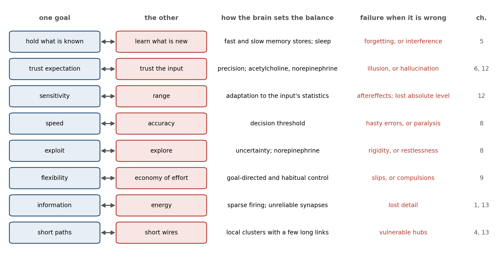

> *"Nothing in biology makes sense except in the light of evolution."*
>
> --- Theodosius Dobzhansky (1973)

# The Fish That Gave Up Its Eyes

In the limestone caves of northeastern Mexico live populations of a small silvery fish, *Astyanax mexicanus*, that have no eyes. Their relatives in the rivers outside see perfectly well, and the two forms belong to the same species and can interbreed. The cavefish begin to form eyes as embryos, and the eyes then degenerate. In 2015 Damian Moran, Rowan Softley, and Eric Warrant set out to measure what the cavefish had saved. They dissected eyes and brains from river fish and cavefish, measured how much oxygen the tissues consumed, and combined the measurements with the sizes of the organs in living fish. For a river fish weighing one gram, they estimated, the eyes and the part of the brain that processes vision cost about 15 percent of the animal's resting metabolism, falling to about 5 percent in larger fish whose eyes and brains are relatively smaller.[^1] In a cave, where there is nothing to see and food is scarce, that is a large bill paid for nothing. Whether the saving is the reason the eyes were lost is still debated, since mutations that degrade the eye may have spread for other reasons, but the number shows how heavily seeing weighs in a small animal's budget.

The cavefish is a small parable for this chapter. The earlier chapters have described what the brain does: how its cells signal, how chemicals reset its circuits, how it learns, perceives, feels, decides, and practices, and, in Chapter 12, how much of that activity can be read as prediction. Chapter 12 closed with questions prediction cannot answer: why the brain signals with spikes, why it is built as a hierarchy of areas, why it keeps a fast memory beside a slow one, and why it spends its energy as it does. These are questions of a different kind.

In 1963 the ethologist Niko Tinbergen pointed out that "why" has four answers for any feature of an animal. One concerns causation, the mechanism that produces it; one its development in the individual; one its survival value, what it is good for; and one its evolution, the history from which it came.[^2] Most of this book has answered the first two. This chapter is about the other two, and its argument is that the brain's form is where a few hard physical constraints meet a history that could only modify what already existed. The constraints are energy, space, time, noise, and the amount of information a genome can carry. Many of the brain's features are trade-offs among them, positions on a frontier where improving one thing costs another, rather than optimal solutions to a single problem. Some features are simply inherited. Figure 13.1 sets the constraints beside the mechanisms of the earlier chapters that each one helps explain, and the work of the chapter is to tell the kinds of explanation apart.

# The Price of a Bit

A blowfly darting across a sunlit yard and a fruit fly drifting over a bowl of fruit have eyes built on the same plan, but they run them on very different budgets. Jeremy Niven, John Anderson, and Simon Laughlin recorded from the photoreceptors of four species of fly. Those of the large, fast-flying blowfly carried at their best about 955 bits of information per second, a bit being the amount needed to decide between two equally likely possibilities. That is nearly five times the 197 bits per second of the small, slow fruit fly, but coding the same quantity of information cost the blowfly's photoreceptors about ten times as much energy.[^3] Each eye buys only as much information as its owner's way of life will pay for.

Chapter 1 gave the brain's budget, about 20 watts. The flies show what the budget buys, and why the price rises so steeply. Laughlin, Rob de Ruyter van Steveninck, and Anderson had worked out in 1998 what a bit costs a blowfly. A single chemical synapse spends about 10,000 molecules of ATP, the cell's energy currency, per bit. A photoreceptor or the interneuron it drives spends between one million and ten million, and in bright light the photoreceptors and their first interneurons together use close to 10 percent of the resting fly's energy.[^4] They also found a law of diminishing returns. A signal is made more reliable by adding more channels, more vesicles, or more photon detectors, and its signal-to-noise ratio grows roughly in proportion to their number, but the information it carries grows only as the logarithm of that ratio. Each additional bit therefore costs more than the last, and a weak pathway of low capacity transmits information more cheaply per bit than a strong one.

The same arithmetic constrains how often a neuron should fire. In 1996 William Levy and Robert Baxter treated a neuron as a channel that, in each brief interval of time, either fires or does not. The information it can carry per interval is greatest when it fires half the time, because then each interval is least predictable. But a neuron pays a small cost simply to stay alive and a much larger cost each time it fires, and when information is divided by energy the best rate falls far below one half, as Figure 13.2 shows.[^5] Their later estimates put the most efficient probability of firing at 0.025 to 0.05 in each interval of 2.5 milliseconds, about 10 to 20 spikes a second, against about 200 a second for the rate that would maximize information alone.[^6] Sparse firing is not a shortage of activity; it is what an efficient code looks like when spikes are dear.

The argument extends to the synaptic failures that Chapter 1 described, in which more than half of the impulses arriving at a hippocampal synapse release nothing. Levy and Baxter showed in theory that such failures can raise a neuron's efficiency: a synapse that transmits on only some trials costs much less, while the information it loses is information the receiving neuron could not have passed on anyway.[^7]

An experiment by Julia Harris, Renaud Jolivet, Elisabeth Engl, and David Attwell points the same way. In slices of rat brain they studied the synapse at which a fiber from the retina drives a relay neuron in the thalamus, and used a technique called dynamic clamp to make the synapse artificially stronger or weaker. A stronger synapse would have passed on up to four times more information from the retina; in most cells the synapse's natural strength instead came close to maximizing the information transmitted for each molecule of ATP spent. Only about one retinal spike in five triggered a spike in the relay cell.[^8] The experiment was done in a slice, with the cortex's feedback cut away and inhibition blocked, but within those limits the synapse was tuned for bits per unit energy rather than for bits.

Even the action potential has been trimmed. The squid axon of Chapter 1, it turns out, lets in about four times as much sodium as the minimum a spike needs, because its sodium and potassium currents overlap, and early energy budgets assumed the same waste in mammals. Henrik Alle, Arnd Roth, and Jörg Geiger found that in the thin axons of the rat hippocampus the overlap is so small that a spike costs only 1.3 times the theoretical minimum.[^9] Brett Carter and Bruce Bean then showed that the efficiency varies with a cell's job. Cortical pyramidal neurons are about as frugal as the axons Alle measured, but the fast-spiking inhibitory neurons that fire hundreds of times a second let in about twice as much sodium as the minimum, because their sodium channels never fully close between spikes.[^10] Speed has a price in energy as well as in space, and the brain pays it only where it needs speed.

# Why Spikes

If information is so expensive, it is fair to ask why the brain uses spikes at all. A graded signal, a voltage that rises and falls smoothly with its input, carries more information than a train of all-or-none pulses. The interneurons behind the blowfly's photoreceptors use graded signals, and they transmit up to about 1,650 bits per second, three to five times the best rates measured in neurons that spike.[^11]

The difficulty is distance. Chapter 2 described how a voltage spreading passively along a thin fiber fades over a short distance, and how noise added at each point along the way accumulates with it. An analog signal cannot be cleaned up; whatever noise has been added is now part of the signal. A spike is regenerated at every point it reaches, so that what arrives at the far end of the axon is as crisp as what left, much as a digital signal can be copied indefinitely without loss. Rahul Sarpeshkar, an engineer who designs low-power circuits, argued in 1998 that the most efficient way to compute with noisy components is neither analog nor digital but a hybrid: compute in graded form over short distances, where graded signals are cheap and rich, and restore the signal to discrete form before noise accumulates.[^12]

That is roughly how nervous systems are built. Where distances are short, they compute in graded form. Photoreceptors and most bipolar cells of the retina signal mostly with graded voltages, although some bipolar cells turn out to spike as well.[^13] Most of the neurons of the nematode worm *Caenorhabditis elegans*, an animal about a millimeter long, signal with graded potentials, and the worm has no voltage-gated sodium channels at all; a few of its neurons fire all-or-none spikes carried by calcium instead.[^14] Within a single cortical neuron, as Chapter 2 described, the dendrites combine their inputs in graded and partly regenerative ways before the cell commits to a spike. The spike is what long distances cost. A large animal whose neurons must send signals across centimeters or meters has to digitize them, and once it has done so, a spike is a cheap way to say a great deal with a single, sparing event.

# Speed Costs Space

A spike regenerates as it travels, but it travels slowly, and its speed depends on the width of the fiber that carries it. In a bare axon, speed rises only with the square root of the diameter, so doubling the speed requires a fiber four times as wide. The squid's way of escaping quickly is to grow a giant axon. The one Alan Hodgkin and Andrew Huxley used in 1952 was 476 micrometers across, nearly half a millimeter, and conducted at 21.2 meters per second.[^15]

Vertebrates found a different solution. Wrapping an axon in myelin, the fatty insulation that Chapter 2 described, forces the impulse to jump between gaps in the sheath, and the speed of a myelinated fiber rises in proportion to its diameter rather than its square root. In the nerves of a cat, conduction speed is about six meters per second for each micrometer of the fiber's overall diameter.[^16] By that rule a myelinated fiber about 3.5 micrometers across should match the squid's giant axon, although the comparison is only approximate, because the squid's nerve works at the temperature of the sea and the cat's at 37 degrees Celsius.

Figure 13.3 shows the two scaling rules and what they imply. At the squid's speed, a bare axon needs about 18,000 times the cross-section of a myelinated one. Daniel Hartline and David Colman, reviewing the evolution of fast conduction, put it more vividly: to make bare fibers ten times faster by widening them, they would have to be a hundred times wider, and "Imagine yourself with a 100-fold thicker spinal cord!"[^17] Myelin also cuts the energy cost of each impulse, by several hundredfold on their estimate, because only the gaps in the sheath need to be recharged.

![Figure 13.3. Speed costs space (computed). A: conduction speed rises with the square root of fiber diameter in a bare axon (calibrated to the squid giant axon, 476 µm and 21.2 m/s) and in proportion to diameter in a myelinated fiber (about 6 m/s per µm, after Hursh, 1939). A myelinated fiber about 3.5 µm across matches the squid's axon. B: the ratio of the cross-sections the two kinds of fiber need to reach a given speed. The temperatures of the two calibrations differ, so the comparison is approximate.](images/fig_conduction.png)

Even myelin does not make speed free, and the brain buys it sparingly. Samuel Wang and his colleagues measured the axons of white matter in 14 species, from shrews to whales, spanning nearly five orders of magnitude in brain size. Larger brains shifted toward a greater share of myelinated axons and widened their fastest fibers, so that the quickest signals still crossed the neocortex in about one to five milliseconds; but most axons stayed thin, and the distribution of axon sizes implied that the average fiber could sustain only about seven spikes a second.[^18] The brain has a few fast lines and a great many slow ones, and it trades volume against delay and energy in deciding which is which.

The slow lines shape how a large brain is organized. Most of the fibers that join the two cerebral hemispheres through the corpus callosum are thinner than a micrometer. James Ringo and his colleagues calculated that in a human the average myelinated fiber linking the two temporal lobes would take more than 25 milliseconds to carry a signal across, and conjectured that this delay is why large brains concentrate time-critical skills, such as the rapid processing of speech sounds, in a single hemisphere: a computation that must pass back and forth between the hemispheres many times would be too slow.[^19] The idea is a conjecture rather than a demonstration, but it turns hemispheric specialization, often treated as a mystery, into a predictable consequence of size.

Wiring also takes up space as a brain grows. Kechen Zhang and Terrence Sejnowski showed that across mammals the volume of white matter, the wiring, grows faster than the volume of gray matter, the cell bodies and synapses it connects. They derived an exponent of four-thirds from geometry and measured a slightly smaller one, about 1.23, across species from shrews to elephants.[^20] A large brain that kept every neuron as well connected as in a small one would be mostly wire, so large brains must connect each neuron to a smaller fraction of the others and rely more on local circuits joined by a sparser set of long links.

Even the brain's folds are a matter of physical constraint. Bruno Mota and Suzana Herculano-Houzel found that across mammals the degree of folding is predicted not by the number of neurons but by the cortex's surface area and thickness, following a law that also describes how a sheet of paper crumples when it is squeezed into a ball.[^21] Tuomas Tallinen, L. Mahadevan, and their colleagues made the point with a model. They 3D-printed a gel copy of a smooth fetal brain from an MRI taken at 22 weeks of gestation, coated it with a thin layer of a second gel, and immersed it in a solvent that made the outer layer swell faster than the core. Within minutes the surface buckled into folds similar to those that form in the human fetal brain over the following weeks.[^22] No gene specifies each fold. A sheet that grows faster than what lies beneath it has to buckle, as Chapter 0 described for other self-organizing structures, and evolution works with the pattern physics provides.

# Placing the Parts

If wire is expensive, the parts of a nervous system should sit where they minimize it, and in one celebrated case they appear to. In 1994 Christopher Cherniak examined the nematode worm, whose complete wiring diagram had been mapped from electron micrographs. Its nervous system has 11 clusters of neurons that can be placed in different orders along the body's length, which allows 39,916,800 possible arrangements. Of those, the arrangement the worm actually has was the one that minimized the total length of the connecting fibers.[^23] Dmitri Chklovskii and Alexei Koulakov argued that the maps of the visual cortex, in which neurons with similar preferences sit side by side, can be read the same way, as arrangements that keep connected neurons close.[^24]

Wire minimization is not the whole story. Marcus Kaiser and Claus Hilgetag rearranged the positions of neurons in the worm and of areas in the macaque monkey's cortex by computer to find the layouts with the least wire. Total wiring could be cut by 48 percent in the worm and 32 percent in the macaque. The savings were possible because both networks contain long-distance connections that a wire-minimizing layout would shorten, and the price of removing or shortening them was that signals would need many more steps to get from one part of the network to another. The real networks had paths almost as short as networks designed for nothing but short paths.[^25] The nervous system pays for some expensive wire in order to keep everything only a few steps from everything else.

Figure 13.4 shows the trade-off in a simulation. It places 100 neurons at random in a square, connects each to its nearest neighbors, and then reroutes a growing fraction of the connections to random distant partners. With all-local wiring the average path between two neurons takes about nine steps. Making five percent of the connections long-range adds about a quarter to the total wire and cuts the average path to six steps; making ten percent long-range adds half and cuts it to about five. Rewiring everything at random brings the path down only to about 3.7 steps, at nearly six times the wire. The steep part of the curve, where a few long connections buy most of the gain, is where Chapter 4's small-world networks sit, and Edward Bullmore and Olaf Sporns have argued that the brain's networks are best understood as this kind of economy, a negotiated trade between the cost of wiring and the value of short paths, robustness, and hubs.[^26]

Wire cost may also help explain why the brain is divided into modules and arranged as a hierarchy of areas. Jeff Clune, Jean-Baptiste Mouret, and Hod Lipson evolved small networks in a computer to recognize patterns on an eight-pixel "retina" whose left and right halves could each contain an object. Networks selected for performance alone evolved into tangles with little modular structure. When each connection also carried a cost, the networks evolved separate modules for the two halves, solved the task at least as well, and, when the task was changed, adapted in about a twentieth as many generations.[^27] Henok Mengistu, Joost Huizinga, Mouret, and Clune then found that on problems with nested structure the same cost also produced hierarchy, modules built out of smaller modules, which solved the problems and adapted to new ones faster.[^28] These are small, abstract networks, and they show only that a cost on wiring is enough to produce modules and a hierarchy, not that it is what produced the brain's. But a brain that pays for every axon is pushed toward the arrangement of areas the earlier chapters described.

# Many Jobs at Once

The red line in Figure 13.4 has a name. When a design must serve two goals at once, the designs worth considering are those that cannot be improved on one goal without becoming worse on the other, and economists and engineers call the set of such designs a Pareto front, after the economist Vilfredo Pareto. Nothing on the front is optimal in the everyday sense; every point on it is a different compromise.

Uri Alon and his colleagues showed in 2012 that this idea predicts the shapes of animals. If an organism must perform several tasks, and each task is best served by one particular design, an "archetype," then the designs that no other design beats at every task are blends of the archetypes, and they fill the line, triangle, or polygon whose corners the archetypes occupy, as Figure 13.5 shows for three tasks. The beaks and bodies of Darwin's ground finches fall within such a triangle, with corners for probing cactus flowers and insects, cracking large hard seeds, and eating small soft ones; the wings of insect-eating bats fall within another.[^29] Each species sits at its own compromise, and the compromise is the design.

The brain's components face the same geometry. Chapter 1 described degeneracy, the capacity of different combinations of parts to produce the same function, and it reaches down to single cells and small circuits. Astrid Prinz, Dirk Bucher, and Eve Marder simulated millions of versions of a small rhythm-generating circuit from the stomach of a crustacean and found that very different combinations of ion channels and synaptic strengths produced nearly the same rhythm.[^30] Peter Jedlicka, Alexander Bird, and Hermann Cuntz have proposed that the configurations nature actually uses are those on the front between economy and effectiveness, so that among all the mixtures that would work, a neuron uses one that wastes as little energy as possible for what it must do.[^31] The proposal is a framework rather than a finding, but it gives degeneracy a direction.

Trade-offs also explain a pattern of failure. Marie Csete and John Doyle, comparing cells with engineered systems such as the Boeing 777, argued that complex regulated systems are "robust yet fragile": extremely robust to the disturbances they were built for, and vulnerable to rare ones they were not, because robustness in one place is paid for with fragility in another.[^32] The hubs of Chapter 4 are an example. They make communication across the brain fast and economical, and they are where damage, across many brain disorders, does the most harm.

# How Big a Brain

The most visible trade-off is size. A bigger brain buys more neurons, and neurons are expensive in a way that can be stated simply. Suzana Herculano-Houzel estimated from measurements in rodents and primates that each billion neurons costs about 6 kilocalories a day, roughly the same in every species studied, so that the human brain's 86 billion neurons cost about 500 kilocalories a day.[^33] Karina Fonseca-Azevedo and Herculano-Houzel calculated that an ape eating raw plant food could not easily afford many more neurons than great apes have: a primate with a human-sized brain living on such a diet would need to feed for more than nine hours a day, and they proposed that cooking, which makes food easier to digest, is what allowed the human brain to grow.[^34] Others dispute the arithmetic: Alianda Cornélio and her colleagues argued that the calculation assumed an unrealistically low rate of foraging, and that a raw diet could have supported a large brain without such long days.[^35]

The bill is highest in childhood. Christopher Kuzawa and his colleagues combined brain-imaging measurements of glucose use with data on brain and body size across development. At its peak, around the age of four, the brain takes up glucose equivalent to about two-thirds of the child's resting metabolic rate and about 43 percent of the child's total daily energy needs, and the ages at which the brain's demand is highest are the ages at which the body grows most slowly; the brain's total daily use of glucose peaks a year later, at about five.[^36] The authors argue that the long, slow human childhood is partly a way of paying for the brain. The glucose figures are not a precise energy budget, since some glucose is used for building rather than burned, but the trade-off with body growth is clear.

Where did the extra energy come from? Leslie Aiello and Peter Wheeler proposed in 1995 that humans paid for their brains by shrinking another expensive organ, the gut.[^37] When Ana Navarrete, Carel van Schaik, and Karin Isler tested the idea across 100 species of mammals, they found no trade-off between brain size and the size of the gut or any other expensive organ, although species with larger brains did tend to store less fat.[^38] Herman Pontzer and his colleagues then measured the daily energy use of humans and other apes with a technique that tracks the body's turnover of labeled water. After body size and activity were taken into account, humans burned about 400 kilocalories a day more than chimpanzees and bonobos, much of it in a higher basal metabolism, and humans also carried more fat.[^39] Humans seem to have paid for their brains less by cutting elsewhere than by raising the whole budget, with fat as a reserve against bad days.

Size also meets the constraint of birth. The traditional view, the "obstetric dilemma," holds that human babies are born helpless because a bigger head would not pass through a pelvis narrow enough for efficient walking. Holly Dunsworth and her colleagues argued instead that birth comes when the mother's metabolism reaches the limit of what she can sustain, and Anna Warrener and her colleagues found that a wider pelvis does not, in fact, make walking or running less efficient.[^40] The metabolic account has been criticized in turn: Cédric Cordey, Nicole Webb, and Martin Haeusler noted that the proposed ceiling rests on a single study of 12 women, and that in a third of the studies they reviewed, pregnant women exceeded it before the end of pregnancy.[^41] The question is open, and its openness is itself instructive, since a single feature of the brain's life history can plausibly be explained by two different constraints.

At the extremes, the constraints are stark. The elephantnose fish, an African fish that senses its world with weak electric fields, has a brain estimated to use roughly 60 percent of the oxygen the whole animal consumes, three times the share in any other vertebrate studied, humans included.[^42] At the other end, the parasitic wasp *Megaphragma mymaripenne*, one of the smallest insects known at about 200 micrometers long, comparable in size to some single-celled organisms, has about 7,400 neurons. During its final stage of development more than 95 percent of them lose their nuclei, which would otherwise take up too much room, and the adult flies, finds hosts, and lays its eggs with a nervous system made mostly of cells that can no longer make new proteins.[^43]

A honeybee, with fewer than a million neurons, can learn to count small numbers of objects and to sort pictures into categories, and Lars Chittka and Jeremy Niven have argued that bigger brains buy more replication of similar circuits, more precision, and more storage, rather than kinds of computation a small brain cannot do at all.[^44]

# Different Histories, Same Answers

The constraints do not act on a blank slate. Chapter 1 quoted François Jacob's remark that evolution is a tinkerer, and some of the brain's features are best explained by its history. One way to separate history from constraint is to compare lineages that faced similar problems from different starting points. Where the same solution appears independently, the constraint is probably doing the work; where a solution persists unchanged, history probably is.

The basal ganglia, the loops that select actions and that dopamine teaches (Chapters 3, 8, and 9), are an example of persistence. Sten Grillner and Brita Robertson have reviewed evidence from the lamprey, a jawless fish whose ancestors split from ours about 560 million years ago, that its basal ganglia have the same basic organization as a mammal's: a striatum with a direct and an indirect pathway, inputs from the forebrain and thalamus, output nuclei that hold actions in check, and a dopamine input that signals value.[^45] The solution to selecting one action among many was found early and has been kept.

Birds show the opposite case. Their forebrain lacks the layered sheet of the mammalian cortex, and for a century this was taken as a sign of simpler minds. Seweryna Olkowicz, Pavel Němec, and their colleagues counted the neurons in the brains of birds and found that the brains of parrots and songbirds hold on average about twice as many neurons as primate brains of the same mass, and put a larger share of them in the forebrain. A raven has about 1.2 billion neurons in its pallium, the region corresponding to the cortex, more than a capuchin monkey, and a blue-and-yellow macaw about 1.9 billion, more than a rhesus macaque, in brains a fraction of the size.[^46] Flight puts a premium on weight, and birds answered with small, densely packed neurons.

Martin Stacho, Onur Güntürkün, and their colleagues then traced fibers in the forebrains of pigeons and owls and found circuits repeated in column-like arrangements across the layer-like nuclei, organized much like the cortex's canonical circuit.[^47] Studies of cell types and development published in 2025, among them one led by Eneritz Rueda-Alaña and Fernando García-Moreno, suggest that the resemblance is largely convergent: birds and mammals built similar circuits out of different developmental starting material.[^48] When two lineages separated for more than 300 million years arrive at similar solutions, the solution probably reflects what the problem requires.

The octopus is the most distant test. Its last common ancestor with vertebrates was a simple worm-like animal, and yet it has a large brain, about 500 million neurons by J. Z. Young's classic count, with most of them in the arms rather than the head.[^49] The arms carry out much of their own control, as Chapter 4's central pattern generators do in a spinal cord, and the central brain issues more general commands. The octopus is a reminder that the vertebrate arrangement, with a head that does most of the computing, is one solution among several.

History also leaves features that no constraint requires. The vertebrate retina is inverted: light must pass through the layers of neurons and blood vessels before reaching the photoreceptors at the back, and the fibers leaving the eye must punch through the retina at the blind spot that Chapter 6 described. The octopus eye, evolved independently, has its photoreceptors facing the light and no blind spot. Vertebrates have partly compensated. Kristian Franze, Jochen Guck, and their colleagues showed that the Müller cells, glial cells that span the retina, guide light through it like optical fibers, and Amichai Labin, Erez Ribak, and their colleagues found that they funnel the red and green light used in daylight vision onto the cones.[^50] Some researchers argue that the arrangement is not a defect at all, since it places the photoreceptors, among the most energy-hungry cells in the body, directly against the tissue that feeds them and renews their pigment.[^51] Even so, the blind spot and the layers that light must cross are costs the octopus does not pay, and the compensation shows what a tinkerer does with a design it cannot discard.

# The Bottleneck of the Genome

Chapter 10 described Anthony Zador's argument that an animal arrives in the world with much of its competence already built in. Zador has also put a number on the difficulty this raises. The human genome has about three billion nucleotides, enough to encode no more than about a gigabyte of information, "an hour or so of streaming video." The brain has about 86 billion neurons, which Zador rounds to 100 billion, each with more than a thousand synapses. Naming the target of a single connection among 100 billion neurons takes about 37 bits, so a complete list of the brain's 100 trillion connections would take about 3.7 × 10^15^ bits. Even if every nucleotide in the genome were devoted to the brain's wiring, it would fall short by a factor of more than half a million on the round numbers used here, and by "at least six orders of magnitude" on Zador's own reckoning.[^52]

Direct counts are consistent with his round number of connections: the human neocortex alone holds about 164 trillion synapses.[^53] For the nematode worm, with 302 neurons and about 7,000 synapses, the arithmetic runs the other way, and its genome could list its entire wiring diagram thousands of times over. Figure 13.6 sets the two cases side by side.

The calculation is an upper bound on what a wiring list would need, not an estimate of what development uses, and that is the point. A large brain cannot be specified; it must be grown. The genome encodes rules rather than connections: which kinds of cells to make, how they should migrate, which chemical gradients their axons should follow, which learning rules their synapses should obey. Self-organization, as Chapter 0 described, and experience, as the sensitive periods of Chapter 1 showed, supply the rest. Seen this way, learning is not an optional addition to a brain that could in principle have been built complete. It is the only way a brain of this size can be finished.

The bottleneck may also be useful. Sergey Shuvaev, Alexei Koulakov, Zador, and their colleagues trained a small "genome" network whose only job was to generate the connection weights of a much larger network, and asked how well the large network performed before it had learned anything. A network for reading handwritten digits, compressed through a genome 322 times smaller than itself, recognized 94 percent of digits with no training at all, against 98 percent after full training; a network for playing the Atari game BeamRider, compressed about 500-fold, played nearly perfectly from its first game.[^54] On harder problems the compressed networks also transferred more readily to new versions of a task, although on simple ones they did not. A genome that can store only a little must store what generalizes.

# Trade-offs That Cannot Be Escaped

Looking back across the book, the same structure keeps reappearing. Almost every mechanism the earlier chapters described sits on a trade-off that no amount of engineering could remove, because improving one side worsens the other. Figure 13.7 collects them.

Some are trade-offs between holding and changing. A memory system must be stable enough to keep what it has learned and plastic enough to learn more, and Chapter 5 described the brain's answer: a fast hippocampal store and a slow cortical one, with sleep to move memories between them. The constraint here is statistical rather than physical: a single network that learns fast enough to capture one experience will overwrite what it already knew, so two learners working at different rates are the economical answer. A perceptual system must weigh what it expects against what it receives, and Chapters 6 and 12 described the price of getting the balance wrong in either direction, from illusions to hallucinations. A neuron that adapts to the range of its input gains sensitivity within that range at the cost of losing the absolute level, which is why, as Chapter 12 described, a waterfall can make a still rock face appear to drift.

Others are trade-offs between acting and waiting. Chapter 8 described the trade between speed and accuracy in a decision, and between exploiting what is known and exploring what is not. Chapter 9 described the trade between the flexibility of goal-directed action and the economy of habit. Each has a characteristic failure: hasty errors and paralysis, compulsive novelty-seeking and rigid routine, behavior that persists when its purpose has gone.

The brain does not sit at one fixed point on these fronts. One of the most general things the earlier chapters showed is that it moves along them as conditions change. Chapter 3's neuromodulators are in part the means by which it does so. Norepinephrine raises the learning rate when the world has changed, as Chapter 12 described; acetylcholine shifts the weight from expectation toward incoming evidence; dopamine sets how vigorously the animal acts and how much effort it will spend;[^55] and stress, as Chapter 7 described, tips the balance from deliberation toward fast, habitual responses. A fixed design must choose one compromise for every situation. A design that can move along its fronts can choose a different compromise for each.

# Built for a Different World

A design shaped by trade-offs is shaped by the world in which they were struck, and it can misfire in a world that has changed.

In the 1950s Niko Tinbergen and his colleagues tested what triggers instinctive behavior by offering animals artificial objects. Herring gull chicks, which beg for food by pecking at a red spot on the parent's bill, pecked more at a thin red rod with white bands near its tip than at a realistic model of a gull's head.[^56] An oystercatcher, offered a choice between its own egg and a giant artificial one, tried to brood the giant.[^57] Tinbergen called such objects supernormal stimuli. The rule the bird's brain follows, roughly "the bigger the egg, the better," works perfectly in a world where no egg is bigger than an oystercatcher can lay.

The most famous case was found by accident. In 1983 Darryl Gwynne and David Rentz reported that males of a jewel beetle, then identified as *Julodimorpha bakewelli*, were trying to mate with discarded beer bottles. The bottles, known locally as stubbies, were brown and shiny like the female's wing covers, and a row of small raised bumps near the base reflected light much as the dimples on her back do. When the authors put four bottles on the ground, two had attracted beetles within half an hour; a brown wine bottle of a different shade attracted none.[^58] The male's rule, something like "large, brown, shiny, and dimpled means female," had never had to deal with an object that was larger, browner, and shinier than any female.

Norman Li, Mark van Vugt, and Stephen Colarelli have argued that much of human behavior should be read the same way: the mechanisms of the human brain were tuned in environments very different from the modern one, and many of the inputs they now receive "differ in quantity and intensity or no longer have the same fitness associations," so that mechanisms that worked well can produce harmful results.[^59] Claims of mismatch are easy to make and hard to test, since the ancestral environment cannot be observed directly. But the logic follows from everything in this chapter. A brain that learns slowly, spends its energy carefully, and relies on rules tuned by long experience will be most reliable in a world that resembles the one that shaped it.

# Implications for Artificial Intelligence

An artificial system is built under constraints too, but not the same ones, and that difference is the most useful thing this chapter has to offer the people who build such systems.

First, the constraints of silicon are different, and where they coincide with the brain's, engineers have arrived at the brain's solutions largely without copying them. Chapter 11 described Mark Horowitz's table of energy costs: in a chip, fetching a number from memory costs far more than computing with it. One response, met in Chapters 10 and 11, is the mixture of experts, in which each word is sent to only a few of a model's many subnetworks. DeepSeek-V3, released at the end of 2024, has 671 billion parameters, of which 37 billion, about one in eighteen, are used for each word it processes.[^60] This is the economy Levy and Baxter described: a large population of which only a small fraction is active at once, because activity is what costs. It is largely a convergence. The earliest mixtures of experts drew partly on the brain's division of labor, but the modern versions were built to save computation, not to imitate the brain, and like the convergences of Chapter 11 they suggest that the constraint is doing the work.

Second, where the constraints differ, the brain's solutions may not be worth copying. Spikes solve the problem of sending a signal over a long, noisy fiber, and a digital chip already restores its signals to clean levels at every step, the same answer the axon found. The slow conduction that may have pushed time-critical skills into one hemisphere has no counterpart in a machine whose signals cross a chip in nanoseconds. Each feature of the brain should be asked which constraint it answers, and copied only if the machine faces the same one. Spiking hardware, for example, earns its place where it saves energy by doing nothing when nothing happens, not because spikes are how brains work.

Third, the genome bottleneck has no counterpart in how large models are trained. A model's architecture and training procedure are specified in a few thousand lines of code, but nothing forces the knowledge it starts with to pass through a narrow channel, because it starts with none. The result of Shuvaev and his colleagues suggests that forcing such compression could be a way of building in only what generalizes, a kind of inductive bias learned over many tasks rather than designed by hand.

Fourth, the brain is judged on many tasks at once under a fixed budget, and it moves along its trade-offs as conditions change. Artificial systems are usually trained and measured one benchmark at a time, and an improvement on one benchmark is often a move along a front rather than an advance beyond it. The systems of Chapters 10 and 11 that decide how long to think about each problem, spending more computation on hard ones, are a first step toward the brain's habit of choosing a different compromise for each situation.

The constraints that shaped the brain do not disappear when it is put to work in classrooms, in offices, and in front of screens, and what they imply for how people learn and work is the subject of Chapter 14.

# The Central Lesson

The brain is not the best possible brain, and it is not a botched one. It is a set of compromises struck under a few hard constraints; the cavefish's lost eyes are one such compromise, struck again when the world changed. Information is expensive, so the brain fires sparsely, lets its synapses fail, and buys only as much precision as it needs. Wire takes space and conducts slowly, so the brain keeps most connections local, insulates a few fast lines, and puts time-critical work where signals need not travel far. A genome cannot specify a large brain, so the brain is grown by rules and finished by learning. Many goals cannot all be met at once, so its designs are positions on fronts between them, and its neuromodulators move it along those fronts as conditions change. All of this was done by a tinkerer working with what it had, so some features are history rather than design, and the way to tell them apart is to ask whether lineages that started from different places arrived at the same answer. Asking why the brain works as it does, in Tinbergen's sense, does not replace the mechanisms of the earlier chapters. It explains why those mechanisms, rather than others, are the ones the brain has.

# Next Chapter

Chapter 14: Implications for Learning, Work, and Technology: What the Brain's Design Asks of the World We Have Built

# References and Attribution

## Figure Attribution

Figures 13.1 to 13.7 were drawn for this book. Figures 13.2 to 13.6 are computed: Figure 13.2 applies the energy-efficiency analysis of Levy and Baxter (1996) to a neuron that fires or stays silent in each time bin; Figure 13.3 uses the square-root scaling of conduction speed in bare axons, calibrated to the squid giant axon of Hodgkin and Huxley (1952), and the linear scaling of myelinated fibers given by Hursh (1939); Figure 13.4 simulates networks of 100 neurons with varying fractions of long-range connections, in the spirit of Kaiser and Hilgetag (2006); Figure 13.5 computes the Pareto-optimal designs for three tasks after Shoval et al. (2012); Figure 13.6 applies the calculation of Zador (2019) to the human and the nematode worm. Figures 13.1 and 13.7 are schematic.

## Epigraph

Theodosius Dobzhansky, "Nothing in biology makes sense except in the light of evolution," *The American Biology Teacher*, 35(3), 125–129 (1973).

## References

Aiello, L. C., & Wheeler, P. (1995). The expensive-tissue hypothesis: The brain and the digestive system in human and primate evolution. *Current Anthropology*, 36(2), 199–221.

Alle, H., Roth, A., & Geiger, J. R. P. (2009). Energy-efficient action potentials in hippocampal mossy fibers. *Science*, 325(5946), 1405–1408.

Baden, T., & Nilsson, D.-E. (2022). Is our retina really upside down? *Current Biology*, 32(7), R300–R303.

Baden, T., Esposti, F., Nikolaev, A., & Lagnado, L. (2011). Spikes in retinal bipolar cells phase-lock to visual stimuli with millisecond precision. *Current Biology*, 21(22), 1859–1869.

Bullmore, E., & Sporns, O. (2012). The economy of brain network organization. *Nature Reviews Neuroscience*, 13(5), 336–349.

Carter, B. C., & Bean, B. P. (2009). Sodium entry during action potentials of mammalian neurons: Incomplete inactivation and reduced metabolic efficiency in fast-spiking neurons. *Neuron*, 64(6), 898–909.

Cherniak, C. (1994). Component placement optimization in the brain. *Journal of Neuroscience*, 14(4), 2418–2427.

Chittka, L., & Niven, J. (2009). Are bigger brains better? *Current Biology*, 19(21), R995–R1008.

Chklovskii, D. B., & Koulakov, A. A. (2004). Maps in the brain: What can we learn from them? *Annual Review of Neuroscience*, 27, 369–392.

Clune, J., Mouret, J.-B., & Lipson, H. (2013). The evolutionary origins of modularity. *Proceedings of the Royal Society B: Biological Sciences*, 280(1755), 20122863.

Cordey, C., Webb, N. M., & Haeusler, M. (2023). Take it to the limit: The limitations of energetic explanations for birth timing in humans. *Evolution, Medicine, and Public Health*, 11(1), 415–428.

Cornélio, A. M., de Bittencourt-Navarrete, R. E., de Bittencourt Brum, R., Queiroz, C. M., & Costa, M. R. (2016). Human brain expansion during evolution is independent of fire control and cooking. *Frontiers in Neuroscience*, 10, 167.

Csete, M. E., & Doyle, J. C. (2002). Reverse engineering of biological complexity. *Science*, 295(5560), 1664–1669.

de Ruyter van Steveninck, R. R., & Laughlin, S. B. (1996). The rate of information transfer at graded-potential synapses. *Nature*, 379(6566), 642–645.

DeepSeek-AI. (2024). *DeepSeek-V3 technical report* (arXiv:2412.19437). arXiv.

Dunsworth, H. M., Warrener, A. G., Deacon, T., Ellison, P. T., & Pontzer, H. (2012). Metabolic hypothesis for human altriciality. *Proceedings of the National Academy of Sciences*, 109(38), 15212–15216.

Fonseca-Azevedo, K., & Herculano-Houzel, S. (2012). Metabolic constraint imposes tradeoff between body size and number of brain neurons in human evolution. *Proceedings of the National Academy of Sciences*, 109(45), 18571–18576.

Franze, K., Grosche, J., Skatchkov, S. N., Schinkinger, S., Foja, C., Schild, D., Uckermann, O., Travis, K., Reichenbach, A., & Guck, J. (2007). Müller cells are living optical fibers in the vertebrate retina. *Proceedings of the National Academy of Sciences*, 104(20), 8287–8292.

Goodman, M. B., Hall, D. H., Avery, L., & Lockery, S. R. (1998). Active currents regulate sensitivity and dynamic range in *C. elegans* neurons. *Neuron*, 20(4), 763–772.

Grillner, S., & Robertson, B. (2016). The basal ganglia over 500 million years. *Current Biology*, 26(20), R1088–R1100.

Gwynne, D. T., & Rentz, D. C. F. (1983). Beetles on the bottle: Male buprestids mistake stubbies for females (Coleoptera). *Journal of the Australian Entomological Society*, 22(1), 79–80.

Harris, J. J., Jolivet, R., Engl, E., & Attwell, D. (2015). Energy-efficient information transfer by visual pathway synapses. *Current Biology*, 25(24), 3151–3160.

Hartline, D. K., & Colman, D. R. (2007). Rapid conduction and the evolution of giant axons and myelinated fibers. *Current Biology*, 17(1), R29–R35.

Herculano-Houzel, S. (2012). The remarkable, yet not extraordinary, human brain as a scaled-up primate brain and its associated cost. *Proceedings of the National Academy of Sciences*, 109(Suppl. 1), 10661–10668.

Hochner, B. (2012). An embodied view of octopus neurobiology. *Current Biology*, 22(20), R887–R892.

Hodgkin, A. L., & Huxley, A. F. (1952). A quantitative description of membrane current and its application to conduction and excitation in nerve. *The Journal of Physiology*, 117(4), 500–544.

Hursh, J. B. (1939). Conduction velocity and diameter of nerve fibers. *American Journal of Physiology*, 127(1), 131–139.

Jedlicka, P., Bird, A. D., & Cuntz, H. (2022). Pareto optimality, economy–effectiveness trade-offs and ion channel degeneracy: Improving population modelling for single neurons. *Open Biology*, 12(7), 220073.

Kaiser, M., & Hilgetag, C. C. (2006). Nonoptimal component placement, but short processing paths, due to long-distance projections in neural systems. *PLoS Computational Biology*, 2(7), e95.

Kuzawa, C. W., Chugani, H. T., Grossman, L. I., Lipovich, L., Muzik, O., Hof, P. R., Wildman, D. E., Sherwood, C. C., Leonard, W. R., & Lange, N. (2014). Metabolic costs and evolutionary implications of human brain development. *Proceedings of the National Academy of Sciences*, 111(36), 13010–13015.

Labin, A. M., Safuri, S. K., Ribak, E. N., & Perlman, I. (2014). Müller cells separate between wavelengths to improve day vision with minimal effect upon night vision. *Nature Communications*, 5, 4319.

Laughlin, S. B., de Ruyter van Steveninck, R. R., & Anderson, J. C. (1998). The metabolic cost of neural information. *Nature Neuroscience*, 1(1), 36–41.

Levy, W. B., & Baxter, R. A. (1996). Energy efficient neural codes. *Neural Computation*, 8(3), 531–543.

Levy, W. B., & Baxter, R. A. (2002). Energy-efficient neuronal computation via quantal synaptic failures. *Journal of Neuroscience*, 22(11), 4746–4755.

Li, N. P., van Vugt, M., & Colarelli, S. M. (2018). The evolutionary mismatch hypothesis: Implications for psychological science. *Current Directions in Psychological Science*, 27(1), 38–44.

Liu, Q., Kidd, P. B., Dobosiewicz, M., & Bargmann, C. I. (2018). *C. elegans* AWA olfactory neurons fire calcium-mediated all-or-none action potentials. *Cell*, 175(1), 57–70.e17.

Mengistu, H., Huizinga, J., Mouret, J.-B., & Clune, J. (2016). The evolutionary origins of hierarchy. *PLOS Computational Biology*, 12(6), e1004829.

Moran, D., Softley, R., & Warrant, E. J. (2015). The energetic cost of vision and the evolution of eyeless Mexican cavefish. *Science Advances*, 1(8), e1500363.

Mota, B., & Herculano-Houzel, S. (2015). Cortical folding scales universally with surface area and thickness, not number of neurons. *Science*, 349(6243), 74–77.

Navarrete, A., van Schaik, C. P., & Isler, K. (2011). Energetics and the evolution of human brain size. *Nature*, 480(7375), 91–93.

Nilsson, G. E. (1996). Brain and body oxygen requirements of *Gnathonemus petersii*, a fish with an exceptionally large brain. *Journal of Experimental Biology*, 199(3), 603–607.

Niv, Y., Daw, N. D., Joel, D., & Dayan, P. (2007). Tonic dopamine: Opportunity costs and the control of response vigor. *Psychopharmacology*, 191(3), 507–520.

Niven, J. E., Anderson, J. C., & Laughlin, S. B. (2007). Fly photoreceptors demonstrate energy-information trade-offs in neural coding. *PLoS Biology*, 5(4), e116.

Olkowicz, S., Kocourek, M., Lučan, R. K., Porteš, M., Fitch, W. T., Herculano-Houzel, S., & Němec, P. (2016). Birds have primate-like numbers of neurons in the forebrain. *Proceedings of the National Academy of Sciences*, 113(26), 7255–7260.

Polilov, A. A. (2012). The smallest insects evolve anucleate neurons. *Arthropod Structure & Development*, 41(1), 29–34.

Pontzer, H., Brown, M. H., Raichlen, D. A., Dunsworth, H., Hare, B., Walker, K., Luke, A., Dugas, L. R., Durazo-Arvizu, R., Schoeller, D., Plange-Rhule, J., Bovet, P., Forrester, T. E., Lambert, E. V., Thompson, M. E., Shumaker, R. W., & Ross, S. R. (2016). Metabolic acceleration and the evolution of human brain size and life history. *Nature*, 533(7603), 390–392.

Prinz, A. A., Bucher, D., & Marder, E. (2004). Similar network activity from disparate circuit parameters. *Nature Neuroscience*, 7(12), 1345–1352.

Ringo, J. L., Doty, R. W., Demeter, S., & Simard, P. Y. (1994). Time is of the essence: A conjecture that hemispheric specialization arises from interhemispheric conduction delay. *Cerebral Cortex*, 4(4), 331–343.

Rueda-Alaña, E., Senovilla-Ganzo, R., Grillo, M., Vázquez, E., Marco-Salas, S., Gallego-Flores, T., Ordeñana-Manso, A., Ftara, A., Escobar, L., Benguría, A., Quintas, A., Dopazo, A., Rábano, M., Vivanco, M. d. M., Aransay, A. M., Garrigos, D., Toval, Á., Ferrán, J. L., Nilsson, M., Encinas-Pérez, J. M., De Pittà, M., & García-Moreno, F. (2025). Evolutionary convergence of sensory circuits in the pallium of amniotes. *Science*, 387(6735), eadp3411.

Sarpeshkar, R. (1998). Analog versus digital: Extrapolating from electronics to neurobiology. *Neural Computation*, 10(7), 1601–1638.

Shoval, O., Sheftel, H., Shinar, G., Hart, Y., Ramote, O., Mayo, A., Dekel, E., Kavanagh, K., & Alon, U. (2012). Evolutionary trade-offs, Pareto optimality, and the geometry of phenotype space. *Science*, 336(6085), 1157–1160.

Shuvaev, S., Lachi, D., Koulakov, A., & Zador, A. (2024). Encoding innate ability through a genomic bottleneck. *Proceedings of the National Academy of Sciences*, 121(38), e2409160121.

Simmons, P. J., & de Ruyter van Steveninck, R. (2005). Reliability of signal transfer at a tonically transmitting, graded potential synapse of the locust ocellar pathway. *Journal of Neuroscience*, 25(33), 7529–7537.

Stacho, M., Herold, C., Rook, N., Wagner, H., Axer, M., Amunts, K., & Güntürkün, O. (2020). A cortex-like canonical circuit in the avian forebrain. *Science*, 369(6511), eabc5534.

Stephenson-Jones, M., Samuelsson, E., Ericsson, J., Robertson, B., & Grillner, S. (2011). Evolutionary conservation of the basal ganglia as a common vertebrate mechanism for action selection. *Current Biology*, 21(13), 1081–1091.

Tallinen, T., Chung, J. Y., Rousseau, F., Girard, N., Lefèvre, J., & Mahadevan, L. (2016). On the growth and form of cortical convolutions. *Nature Physics*, 12(6), 588–593.

Tang, Y., Nyengaard, J. R., De Groot, D. M. G., & Gundersen, H. J. G. (2001). Total regional and global number of synapses in the human brain neocortex. *Synapse*, 41(3), 258–273.

Tinbergen, N. (1951). *The Study of Instinct*. Clarendon Press.

Tinbergen, N. (1963). On aims and methods of ethology. *Zeitschrift für Tierpsychologie*, 20(4), 410–433.

Tinbergen, N., & Perdeck, A. C. (1950). On the stimulus situation releasing the begging response in the newly hatched herring gull chick (*Larus argentatus argentatus* Pont.). *Behaviour*, 3(1), 1–39.

Wang, S. S.-H., Shultz, J. R., Burish, M. J., Harrison, K. H., Hof, P. R., Towns, L. C., Wagers, M. W., & Wyatt, K. D. (2008). Functional trade-offs in white matter axonal scaling. *Journal of Neuroscience*, 28(15), 4047–4056.

Warrener, A. G., Lewton, K. L., Pontzer, H., & Lieberman, D. E. (2015). A wider pelvis does not increase locomotor cost in humans, with implications for the evolution of childbirth. *PLOS ONE*, 10(3), e0118903.

Young, J. Z. (1963). The number and sizes of nerve cells in *Octopus*. *Proceedings of the Zoological Society of London*, 140(2), 229–254.

Zador, A. M. (2019). A critique of pure learning and what artificial neural networks can learn from animal brains. *Nature Communications*, 10, 3770.

Zhang, K., & Sejnowski, T. J. (2000). A universal scaling law between gray matter and white matter of cerebral cortex. *Proceedings of the National Academy of Sciences*, 97(10), 5621–5626.

[^1]: Moran, D., Softley, R., & Warrant, E. J. (2015). The energetic cost of vision and the evolution of eyeless Mexican cavefish. *Science Advances*, 1(8), e1500363.

[^2]: Tinbergen, N. (1963). On aims and methods of ethology. *Zeitschrift für Tierpsychologie*, 20(4), 410–433.

[^3]: Niven, J. E., Anderson, J. C., & Laughlin, S. B. (2007). Fly photoreceptors demonstrate energy-information trade-offs in neural coding. *PLoS Biology*, 5(4), e116.

[^4]: Laughlin, S. B., de Ruyter van Steveninck, R. R., & Anderson, J. C. (1998). The metabolic cost of neural information. *Nature Neuroscience*, 1(1), 36–41.

[^5]: Levy, W. B., & Baxter, R. A. (1996). Energy efficient neural codes. *Neural Computation*, 8(3), 531–543.

[^6]: Levy, W. B., & Baxter, R. A. (2002). Energy-efficient neuronal computation via quantal synaptic failures. *Journal of Neuroscience*, 22(11), 4746–4755.

[^7]: Levy, W. B., & Baxter, R. A. (2002). Energy-efficient neuronal computation via quantal synaptic failures. *Journal of Neuroscience*, 22(11), 4746–4755.

[^8]: Harris, J. J., Jolivet, R., Engl, E., & Attwell, D. (2015). Energy-efficient information transfer by visual pathway synapses. *Current Biology*, 25(24), 3151–3160.

[^9]: Alle, H., Roth, A., & Geiger, J. R. P. (2009). Energy-efficient action potentials in hippocampal mossy fibers. *Science*, 325(5946), 1405–1408.

[^10]: Carter, B. C., & Bean, B. P. (2009). Sodium entry during action potentials of mammalian neurons: Incomplete inactivation and reduced metabolic efficiency in fast-spiking neurons. *Neuron*, 64(6), 898–909.

[^11]: de Ruyter van Steveninck, R. R., & Laughlin, S. B. (1996). The rate of information transfer at graded-potential synapses. *Nature*, 379(6566), 642–645; Simmons, P. J., & de Ruyter van Steveninck, R. (2005). Reliability of signal transfer at a tonically transmitting, graded potential synapse of the locust ocellar pathway. *Journal of Neuroscience*, 25(33), 7529–7537.

[^12]: Sarpeshkar, R. (1998). Analog versus digital: Extrapolating from electronics to neurobiology. *Neural Computation*, 10(7), 1601–1638.

[^13]: Baden, T., Esposti, F., Nikolaev, A., & Lagnado, L. (2011). Spikes in retinal bipolar cells phase-lock to visual stimuli with millisecond precision. *Current Biology*, 21(22), 1859–1869.

[^14]: Goodman, M. B., Hall, D. H., Avery, L., & Lockery, S. R. (1998). Active currents regulate sensitivity and dynamic range in *C. elegans* neurons. *Neuron*, 20(4), 763–772; Liu, Q., Kidd, P. B., Dobosiewicz, M., & Bargmann, C. I. (2018). *C. elegans* AWA olfactory neurons fire calcium-mediated all-or-none action potentials. *Cell*, 175(1), 57–70.e17.

[^15]: Hodgkin, A. L., & Huxley, A. F. (1952). A quantitative description of membrane current and its application to conduction and excitation in nerve. *The Journal of Physiology*, 117(4), 500–544.

[^16]: Hursh, J. B. (1939). Conduction velocity and diameter of nerve fibers. *American Journal of Physiology*, 127(1), 131–139.

[^17]: Hartline, D. K., & Colman, D. R. (2007). Rapid conduction and the evolution of giant axons and myelinated fibers. *Current Biology*, 17(1), R29–R35.

[^18]: Wang, S. S.-H., Shultz, J. R., Burish, M. J., Harrison, K. H., Hof, P. R., Towns, L. C., Wagers, M. W., & Wyatt, K. D. (2008). Functional trade-offs in white matter axonal scaling. *Journal of Neuroscience*, 28(15), 4047–4056.

[^19]: Ringo, J. L., Doty, R. W., Demeter, S., & Simard, P. Y. (1994). Time is of the essence: A conjecture that hemispheric specialization arises from interhemispheric conduction delay. *Cerebral Cortex*, 4(4), 331–343.

[^20]: Zhang, K., & Sejnowski, T. J. (2000). A universal scaling law between gray matter and white matter of cerebral cortex. *Proceedings of the National Academy of Sciences*, 97(10), 5621–5626.

[^21]: Mota, B., & Herculano-Houzel, S. (2015). Cortical folding scales universally with surface area and thickness, not number of neurons. *Science*, 349(6243), 74–77.

[^22]: Tallinen, T., Chung, J. Y., Rousseau, F., Girard, N., Lefèvre, J., & Mahadevan, L. (2016). On the growth and form of cortical convolutions. *Nature Physics*, 12(6), 588–593.

[^23]: Cherniak, C. (1994). Component placement optimization in the brain. *Journal of Neuroscience*, 14(4), 2418–2427.

[^24]: Chklovskii, D. B., & Koulakov, A. A. (2004). Maps in the brain: What can we learn from them? *Annual Review of Neuroscience*, 27, 369–392.

[^25]: Kaiser, M., & Hilgetag, C. C. (2006). Nonoptimal component placement, but short processing paths, due to long-distance projections in neural systems. *PLoS Computational Biology*, 2(7), e95.

[^26]: Bullmore, E., & Sporns, O. (2012). The economy of brain network organization. *Nature Reviews Neuroscience*, 13(5), 336–349.

[^27]: Clune, J., Mouret, J.-B., & Lipson, H. (2013). The evolutionary origins of modularity. *Proceedings of the Royal Society B: Biological Sciences*, 280(1755), 20122863.

[^28]: Mengistu, H., Huizinga, J., Mouret, J.-B., & Clune, J. (2016). The evolutionary origins of hierarchy. *PLOS Computational Biology*, 12(6), e1004829.

[^29]: Shoval, O., Sheftel, H., Shinar, G., Hart, Y., Ramote, O., Mayo, A., Dekel, E., Kavanagh, K., & Alon, U. (2012). Evolutionary trade-offs, Pareto optimality, and the geometry of phenotype space. *Science*, 336(6085), 1157–1160.

[^30]: Prinz, A. A., Bucher, D., & Marder, E. (2004). Similar network activity from disparate circuit parameters. *Nature Neuroscience*, 7(12), 1345–1352.

[^31]: Jedlicka, P., Bird, A. D., & Cuntz, H. (2022). Pareto optimality, economy–effectiveness trade-offs and ion channel degeneracy: Improving population modelling for single neurons. *Open Biology*, 12(7), 220073.

[^32]: Csete, M. E., & Doyle, J. C. (2002). Reverse engineering of biological complexity. *Science*, 295(5560), 1664–1669.

[^33]: Herculano-Houzel, S. (2012). The remarkable, yet not extraordinary, human brain as a scaled-up primate brain and its associated cost. *Proceedings of the National Academy of Sciences*, 109(Suppl. 1), 10661–10668.

[^34]: Fonseca-Azevedo, K., & Herculano-Houzel, S. (2012). Metabolic constraint imposes tradeoff between body size and number of brain neurons in human evolution. *Proceedings of the National Academy of Sciences*, 109(45), 18571–18576.

[^35]: Cornélio, A. M., de Bittencourt-Navarrete, R. E., de Bittencourt Brum, R., Queiroz, C. M., & Costa, M. R. (2016). Human brain expansion during evolution is independent of fire control and cooking. *Frontiers in Neuroscience*, 10, 167.

[^36]: Kuzawa, C. W., Chugani, H. T., Grossman, L. I., Lipovich, L., Muzik, O., Hof, P. R., Wildman, D. E., Sherwood, C. C., Leonard, W. R., & Lange, N. (2014). Metabolic costs and evolutionary implications of human brain development. *Proceedings of the National Academy of Sciences*, 111(36), 13010–13015.

[^37]: Aiello, L. C., & Wheeler, P. (1995). The expensive-tissue hypothesis: The brain and the digestive system in human and primate evolution. *Current Anthropology*, 36(2), 199–221.

[^38]: Navarrete, A., van Schaik, C. P., & Isler, K. (2011). Energetics and the evolution of human brain size. *Nature*, 480(7375), 91–93.

[^39]: Pontzer, H., Brown, M. H., Raichlen, D. A., Dunsworth, H., Hare, B., Walker, K., Luke, A., Dugas, L. R., Durazo-Arvizu, R., Schoeller, D., Plange-Rhule, J., Bovet, P., Forrester, T. E., Lambert, E. V., Thompson, M. E., Shumaker, R. W., & Ross, S. R. (2016). Metabolic acceleration and the evolution of human brain size and life history. *Nature*, 533(7603), 390–392.

[^40]: Dunsworth, H. M., Warrener, A. G., Deacon, T., Ellison, P. T., & Pontzer, H. (2012). Metabolic hypothesis for human altriciality. *Proceedings of the National Academy of Sciences*, 109(38), 15212–15216; Warrener, A. G., Lewton, K. L., Pontzer, H., & Lieberman, D. E. (2015). A wider pelvis does not increase locomotor cost in humans, with implications for the evolution of childbirth. *PLOS ONE*, 10(3), e0118903.

[^41]: Cordey, C., Webb, N. M., & Haeusler, M. (2023). Take it to the limit: The limitations of energetic explanations for birth timing in humans. *Evolution, Medicine, and Public Health*, 11(1), 415–428.

[^42]: Nilsson, G. E. (1996). Brain and body oxygen requirements of *Gnathonemus petersii*, a fish with an exceptionally large brain. *Journal of Experimental Biology*, 199(3), 603–607.

[^43]: Polilov, A. A. (2012). The smallest insects evolve anucleate neurons. *Arthropod Structure & Development*, 41(1), 29–34.

[^44]: Chittka, L., & Niven, J. (2009). Are bigger brains better? *Current Biology*, 19(21), R995–R1008.

[^45]: Grillner, S., & Robertson, B. (2016). The basal ganglia over 500 million years. *Current Biology*, 26(20), R1088–R1100; Stephenson-Jones, M., Samuelsson, E., Ericsson, J., Robertson, B., & Grillner, S. (2011). Evolutionary conservation of the basal ganglia as a common vertebrate mechanism for action selection. *Current Biology*, 21(13), 1081–1091.

[^46]: Olkowicz, S., Kocourek, M., Lučan, R. K., Porteš, M., Fitch, W. T., Herculano-Houzel, S., & Němec, P. (2016). Birds have primate-like numbers of neurons in the forebrain. *Proceedings of the National Academy of Sciences*, 113(26), 7255–7260.

[^47]: Stacho, M., Herold, C., Rook, N., Wagner, H., Axer, M., Amunts, K., & Güntürkün, O. (2020). A cortex-like canonical circuit in the avian forebrain. *Science*, 369(6511), eabc5534.

[^48]: Rueda-Alaña, E., Senovilla-Ganzo, R., Grillo, M., Vázquez, E., Marco-Salas, S., Gallego-Flores, T., Ordeñana-Manso, A., Ftara, A., Escobar, L., Benguría, A., Quintas, A., Dopazo, A., Rábano, M., Vivanco, M. d. M., Aransay, A. M., Garrigos, D., Toval, Á., Ferrán, J. L., Nilsson, M., Encinas-Pérez, J. M., De Pittà, M., & García-Moreno, F. (2025). Evolutionary convergence of sensory circuits in the pallium of amniotes. *Science*, 387(6735), eadp3411.

[^49]: Young, J. Z. (1963). The number and sizes of nerve cells in *Octopus*. *Proceedings of the Zoological Society of London*, 140(2), 229–254; Hochner, B. (2012). An embodied view of octopus neurobiology. *Current Biology*, 22(20), R887–R892.

[^50]: Franze, K., Grosche, J., Skatchkov, S. N., Schinkinger, S., Foja, C., Schild, D., Uckermann, O., Travis, K., Reichenbach, A., & Guck, J. (2007). Müller cells are living optical fibers in the vertebrate retina. *Proceedings of the National Academy of Sciences*, 104(20), 8287–8292; Labin, A. M., Safuri, S. K., Ribak, E. N., & Perlman, I. (2014). Müller cells separate between wavelengths to improve day vision with minimal effect upon night vision. *Nature Communications*, 5, 4319.

[^51]: Baden, T., & Nilsson, D.-E. (2022). Is our retina really upside down? *Current Biology*, 32(7), R300–R303.

[^52]: Zador, A. M. (2019). A critique of pure learning and what artificial neural networks can learn from animal brains. *Nature Communications*, 10, 3770.

[^53]: Tang, Y., Nyengaard, J. R., De Groot, D. M. G., & Gundersen, H. J. G. (2001). Total regional and global number of synapses in the human brain neocortex. *Synapse*, 41(3), 258–273.

[^54]: Shuvaev, S., Lachi, D., Koulakov, A., & Zador, A. (2024). Encoding innate ability through a genomic bottleneck. *Proceedings of the National Academy of Sciences*, 121(38), e2409160121.

[^55]: Niv, Y., Daw, N. D., Joel, D., & Dayan, P. (2007). Tonic dopamine: Opportunity costs and the control of response vigor. *Psychopharmacology*, 191(3), 507–520.

[^56]: Tinbergen, N., & Perdeck, A. C. (1950). On the stimulus situation releasing the begging response in the newly hatched herring gull chick (*Larus argentatus argentatus* Pont.). *Behaviour*, 3(1), 1–39.

[^57]: Tinbergen, N. (1951). *The Study of Instinct*. Clarendon Press.

[^58]: Gwynne, D. T., & Rentz, D. C. F. (1983). Beetles on the bottle: Male buprestids mistake stubbies for females (Coleoptera). *Journal of the Australian Entomological Society*, 22(1), 79–80.

[^59]: Li, N. P., van Vugt, M., & Colarelli, S. M. (2018). The evolutionary mismatch hypothesis: Implications for psychological science. *Current Directions in Psychological Science*, 27(1), 38–44.

[^60]: DeepSeek-AI. (2024). *DeepSeek-V3 technical report* (arXiv:2412.19437). arXiv.
