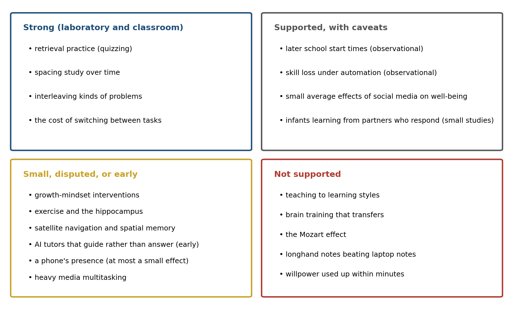

> *"This discovery of yours will create forgetfulness in the learners' souls, because they will not use their memories; they will trust to the external written characters and not remember of themselves."*
>
> --- Plato, *Phaedrus* (translated by Benjamin Jowett)

# The Babies Who Learned Mandarin

In the early 2000s Patricia Kuhl, Feng-Ming Tsao, and Huei-Mei Liu brought nine-month-old American infants, all from English-speaking homes, into their laboratory in Seattle for 12 sessions of 25 minutes over four weeks, about five hours in all. In each session a native speaker of Mandarin Chinese read picture books to the infant and played with toys, talking all the while. A control group had the same sessions in English. Shortly afterward the infants were tested on two Mandarin consonants that English does not distinguish. Infants at this age are losing the ability to hear distinctions their language does not use, and the English-only group told the two sounds apart only 56.7 percent of the time, not far above chance. The infants who had spent five hours with Mandarin speakers scored 65.7 percent, statistically indistinguishable from Taiwanese infants of the same age in an earlier study who had heard Mandarin every day of their lives.[^1]

The experiment's second part is the one that matters for this chapter. Another group of infants saw the same speakers, reading the same books and playing with the same toys, on a television screen, and a fourth group heard the soundtrack alone. Neither group learned anything: "exposure to recorded Mandarin, without interpersonal interaction, had no effect," the authors wrote. Figure 14.1 shows the result. The groups were small, about a dozen infants each, and the infants watching the screen paid less attention than those with a live speaker, so the experiment cannot say exactly what the live sessions supplied. But the same sounds, from the same people, were learned when they came from someone in the room and not when they came from a screen.

Later experiments suggest that what the screen lacked was not a body but a response. Sarah Roseberry, Kathy Hirsh-Pasek, and Roberta Golinkoff taught two-year-olds new verbs, such as "blicking," in three ways: in person, over a video call in which the speaker responded to the child, and through a recording of someone else's video call. The toddlers learned the words in person and over the live call, and learned nothing from the recording.[^2] And when Roseberry, now writing as Sarah Roseberry Lytle, and Kuhl let nine-month-olds play Mandarin video clips on a touchscreen, infants who did so beside another infant learned more than infants alone.[^3] A screen can teach a young child when someone on it, or beside it, responds.

![Figure 14.1. Learning from a person and from a screen (data from Kuhl, Tsao, & Liu, 2003). After about five hours of exposure at nine months, infants who heard Mandarin from live speakers discriminated a Mandarin contrast as well as Taiwanese infants (from an earlier study) who heard Mandarin daily. Infants who saw the same speakers on video, or heard only the audio, did no better than infants exposed only to English. Live and English values are from the paper's text, with standard errors; the others are read approximately from its figure. The dotted line marks chance.](images/fig_kuhl.png)

The previous chapters described a brain built under constraints. It learns slowly and finishes the job offline, in sleep. It learns most from errors in its predictions, and from other people. It runs on a fixed budget of energy and attention, turns repeated rewarded actions into habits, and reorganizes itself around the tools it uses. Chapter 13 ended by noting that these constraints do not disappear when the brain is put to work in classrooms, in offices, and in front of screens. This chapter asks what they imply.

Two warnings come first. Neuroscience rarely tells a teacher, a manager, or an engineer what to do directly. In 1997 John Bruer called the direct path from neuroscience to the classroom "a bridge too far" and argued that it needs a stop in between, in the psychology of how people learn.[^4] A fact about synapses does not become a lesson plan without passing through experiments on how people actually learn and work, and the evidence that matters most in this chapter is of that kind. The second warning is that claims sold as "brain-based" are often wrong, and the next section begins with them. Figure 14.2 sets the features of the brain described in earlier chapters beside the practical consequences this chapter examines, and the strength of evidence for each varies widely.

# What Does Not Follow

Sanne Dekker, Paul Howard-Jones, and their colleagues surveyed 242 teachers in Britain and the Netherlands, all interested in applying neuroscience to their teaching. Ninety-three percent of the British teachers and 96 percent of the Dutch agreed that individuals learn better when they receive information in their preferred learning style, auditory, visual, or kinesthetic. On average the teachers believed about half of the 15 myths in the survey, and the teachers who knew most about the brain in general believed more of them, not fewer.[^5] Across 37 later studies of educators in 18 countries, about 89 percent endorsed matching teaching to learning styles.[^6]

The learning-styles idea makes a testable prediction. If visual learners learn better from pictures and verbal learners from words, then sorting students by style and teaching each group both ways should produce a crossover, with each group doing best under its own method. Harold Pashler, Mark McDaniel, Doug Rohrer, and Robert Bjork reviewed the literature in 2008 for studies with that design and "found virtually no evidence for the interaction pattern"; several well-designed studies contradicted it.[^7] People do have preferences, and differ in their abilities, but there is no evidence that matching instruction to a preferred style helps.

Other myths began as real findings that were stretched. In 1993 Frances Rauscher, Gordon Shaw, and Katherine Ky reported in *Nature* that 36 college students who had just listened to ten minutes of a Mozart sonata scored higher on spatial reasoning tasks, by the equivalent of eight or nine IQ points, than after listening to a relaxation tape or sitting in silence; the effect lasted no more than 10 to 15 minutes.[^8] Within five years the governor of Georgia had proposed giving every newborn in the state a recording of classical music. When Christopher Chabris pooled the studies that followed, the benefit of Mozart over silence averaged the equivalent of 1.4 IQ points, and he suggested that what small effect there was came from the arousal of enjoying the music.[^9] A later meta-analysis found that other music helped about as much as Mozart did.[^10]

The popular idea that people are "left-brained" or "right-brained" fared no better: Jared Nielsen, Jeffrey Anderson, and their colleagues examined the brain scans of 1,011 people and found that although particular functions are lateralized, no individual's brain as a whole was more left- or right-dominant than another's.[^11]

Commercial brain training rests on a similar leap, from the true fact that the brain changes with practice to the hope that practicing a game will improve the mind in general. Adrian Owen and his colleagues tested it with 11,430 viewers of a BBC science program, who trained online for six weeks on tasks of reasoning, memory, and attention. They improved substantially on the tasks they practiced, but "no evidence was found for transfer effects to untrained tasks, even when those tasks were cognitively closely related," and a control group that merely answered obscure questions online improved as much.[^12] A large review by Daniel Simons and his colleagues reached the same verdict: brain training improves performance on the trained tasks, less on closely related ones, and shows little evidence of improving everyday cognition.[^13] This fits what Chapter 9 described: practice builds the particular routine that is practiced.

# Learning That Lasts

Chapter 5 described the forgetting curve and three things that slow it, retrieval, spacing, and sleep, and Chapter 9 described how mixing practice makes it look worse while making it work better. The question for schools is whether laboratory effects of this kind survive in real classrooms, with real curricula and months between lesson and test.

John Dunlosky and four colleagues rated ten common study techniques by the strength of the evidence. Only two, practice testing and spacing study over time, earned their highest rating; rereading and highlighting, two of the most familiar habits of students, were rated low because they "do not consistently boost students' performance."[^14] Classroom trials have borne out the high ratings. Henry Roediger, Pooja Agarwal, and their colleagues gave sixth graders in a social studies class short quizzes, with feedback, on some of the material and not on the rest. On the chapter exams students got 94 percent of the quizzed material right and 81 percent of the rest, and at the end of the semester 79 percent against 67.[^15] In a second experiment the advantage over simply rereading had faded by the semester's end, a reminder that classroom effects are smaller and noisier than laboratory ones.

Rohrer and his colleagues randomly assigned 54 seventh-grade mathematics classes, 787 students in all, to homework in which problems of different kinds were mixed together or grouped by kind, for four months. On a surprise test a month later, the students who had mixed their practice scored 61 percent and the others 38 percent, and the advantage appeared in the classes of every one of the 15 teachers.[^16]

Spacing has a further twist: the best gap between study sessions depends on how long the memory must last. Nicholas Cepeda, Pashler, and their colleagues taught 1,354 people a set of obscure facts, reviewed the facts once after a gap of up to three and a half months, and tested them up to a year later. The best gap grew with the time to the test but shrank as a fraction of it, from about 20 to 40 percent of a one-week delay to about 5 to 10 percent of a one-year delay, and the best gap improved recall by 64 percent on average over reviewing at once.[^17]

Figure 14.3 shows why a gap can be too short or too long in a simple model. A review that comes while the memory is still fresh adds little, because there is little to relearn. One that comes after the memory has faded, but before it is lost, forces an effortful retrieval and strengthens the memory most, much as Chapter 12's prediction errors drive learning hardest when expectation and outcome differ. One that comes too late finds nothing to retrieve and must start again. The model captures the shape of Cepeda's results but not their values, and real memories are more complicated, but the principle is the one a school calendar can use: a topic that must be remembered for years should come back months later, not only in next week's review.

![Figure 14.3. Why spacing works (computed, illustrative). A memory fades as a power function of time, and a review strengthens it more the more has been forgotten, provided it can still be retrieved. A: recall at a test 7, 35, or 350 days after the second of two study sessions, as a function of the gap between them; each curve has a best gap (dots). B: the best gap grows with the time to the test but becomes a smaller fraction of it. Squares show the best gaps interpolated from the data of Cepeda et al. (2008); the model's curve is flatter than the data.](images/fig_spacing.png)

# The Illusion of Fluency

If spacing and testing work so well, why do students reread and cram? Part of the answer is that the brain is a poor judge of its own learning. Nate Kornell and Bjork showed people six paintings by each of 12 artists, either grouped by artist or mixed together, and then asked them to name the artists of new paintings. Mixing worked far better: people assigned 61 percent of the new paintings correctly after mixed study and 35 percent after grouped study. Seventy-eight percent of the participants did better with mixing, yet 78 percent said that grouping had worked as well or better.[^18] Figure 14.4 shows the gap between what happened and what the learners believed. Grouped study feels fluent, because each painting resembles the one before it, and fluency feels like learning. The difficulty that makes mixed study effective is the same difficulty that makes it feel ineffective.

Errors themselves can help. Kornell, Matthew Hays, and Bjork asked people to guess answers they could not know before showing them the correct one, and found that the failed guesses improved later memory compared with simply studying the answer; in one experiment, guessing did as well as studying the answer for more than twice as long.[^19] The guess creates an expectation, and the answer arrives as a prediction error. Curiosity seems to act in a similar way. Matthias Gruber, Bernard Gelman, and Charan Ranganath asked people trivia questions and found that answers they were curious about were better remembered, and so were unrelated faces shown while they waited for the answer; the benefit tracked activity in the midbrain region that contains dopamine neurons and in the hippocampus, the dopamine signal of Chapter 3 and the memory system of Chapter 5.[^20]

Beliefs about learning matter less than was once hoped. The idea that students learn more if they believe intelligence can grow, a "growth mindset," was tested in a national experiment with 12,490 American ninth graders: a short online intervention raised the grades of lower-achieving students by a tenth of a grade point and did not raise the grades of higher achievers.[^21] A meta-analysis by Brooke Macnamara and Alexander Burgoyne found an average effect too small to distinguish from zero once publication bias and study quality were taken into account, while another, by Jeni Burnette and her colleagues, found modest effects in the groups for whom the interventions were designed.[^22] The disagreement is real, and the effects, where they exist, are small.

Another brief intervention shows how hard such effects are to pin down. Gerardo Ramirez and Sian Beilock reported that anxious ninth graders who spent ten minutes writing about their worries before a biology exam scored about six percentage points higher than those who did not, as if writing had freed working memory that worry would have occupied.[^23] A large replication, part of a project that repeated 21 social-science experiments published in *Nature* and *Science*, found no effect, although the original authors argued that the replication had not created enough pressure to test it.[^24]

# Sleep and the School Day

Chapter 5 described how sleep consolidates what was learned during the day, replaying it and moving it from the hippocampus toward the cortex. A school that wants its lessons remembered therefore has an interest in its students' sleep, and the timing of the school day works against it in adolescence. Around puberty the biological timing of sleep shifts later: in a small laboratory study by Mary Carskadon and her colleagues, the nightly secretion of melatonin, the hormone that signals biological night, ended later in older and more mature children, and later work found that sleep pressure also builds more slowly across the day in older adolescents.[^25] Carskadon has called the result a "perfect storm": a body ready to sleep later, evening activities and screens that push bedtime later still, and a school bus that comes at the same early hour.[^26]

In 2016 the public high schools of Seattle moved their start time from 7:50 to 8:45 in the morning. Gideon Dunster, Horacio de la Iglesia, and their colleagues gave wrist activity monitors to students in the same biology course at two schools, in the spring before the change and in the spring after. The median sleep on school nights rose by 34 minutes, the students reported less daytime sleepiness, and the median grade in the course rose from 77.5 to 82 percent. The start time moved by 55 minutes but sleep grew by only 34, because students also went to bed a little later; attendance and punctuality improved at the school with more economically disadvantaged students.[^27] The two years involved different students and there was no control group, so the authors were cautious about attributing the higher grades to the change; but the extra sleep was measured, not reported.

Light is one of the things that pushes bedtime later. Anne-Marie Chang, Charles Czeisler, and their colleagues had 12 young adults read for four hours before bed for five nights, either on a tablet at full brightness or from a printed book, in an otherwise dim room. After the tablet, the evening rise in melatonin was suppressed by about half and delayed by more than an hour and a half, the readers took about ten minutes longer to fall asleep, and they were sleepier the next morning.[^28] Four hours at full brightness is a large dose, and ordinary use probably has smaller effects, but the direction is the one the biology of the body clock predicts, since bright light in the evening tells the clock that it is still day.

# Attention Is a Budget

Chapter 8 described thinking as costly, and the capacity to hold several things in mind at once is small, about four items by Nelson Cowan's estimate.[^29] Attention is the means by which that capacity is allotted, and the most robust finding about it is also the least dramatic. When people switch between two simple tasks, they respond more slowly and make more errors on the first trial after each switch. Robert Rogers and Stephen Monsell showed that warning people of the switch in advance reduces this cost but does not eliminate it, even with more than a second to prepare.[^30] Each switch requires the brain to reconfigure which rules are active, and that takes time that cannot be fully hidden.

More dramatic claims have fared less well. In 2009 Eyal Ophir, Clifford Nass, and Anthony Wagner reported that heavy media multitaskers, people who habitually use several media at once, were more easily distracted by irrelevant information and worse at switching tasks.[^31] Later replications and meta-analyses found the effects on measured performance to be small or absent once small studies were accounted for.[^32] In 2017 Adrian Ward and his colleagues reported that the mere presence of a smartphone on the desk, even turned off, reduced performance on tests of working memory and reasoning; a preregistered replication found no such effect, and a meta-analysis of 56 studies found support only for a small effect on working memory.[^33]

What does hold up is the cost of divided attention in a real setting. Faria Sana, Tina Weston, and Nicholas Cepeda had students take notes on a lecture by laptop, and asked half of them to do unrelated online tasks during it. Those who did scored 11 percentage points lower on a test of the lecture. In a second experiment, students who took notes on paper scored 17 points lower when they could see a classmate's laptop with off-task activity on it.[^34] A related claim, that taking notes by hand is better than typing them because typing invites verbatim transcription, came from a widely cited study by Pam Mueller and Daniel Oppenheimer; two careful replications found that typists did transcribe more but learned no less.[^35] The problem was what else was on the screen, not the keyboard.

Interruptions at work carry a cost of a different kind. Gloria Mark, Daniela Gudith, and Ulrich Klocke interrupted people doing an email task every couple of minutes and found that they finished faster, with no loss of quality, but reported more stress, frustration, and time pressure.[^36] In an earlier study of office workers, Mark and her colleagues found that work that was interrupted and resumed the same day was taken up again after about 25 minutes on average, most of it spent on other tasks.[^37] A day broken into fragments is not necessarily less productive in the short term, but it is paid for in stress, and in work that is set down and picked up again.

The design of the workplace itself was long justified by a claim about the brain's social nature: that people who can see each other will talk more. Ethan Bernstein and Stephen Turban gave employees at two large companies electronic badges that recorded whom they faced and spoke with, before and after their offices were converted to open plans. In both companies face-to-face interaction fell by about 70 percent, and email and instant messaging rose.[^38] People who could see each other all day withdrew from each other, perhaps to protect the limited attention this section has described.

# How Long Can a Mind Work?

Antonius Wiehler, Mathias Pessiglione, and their colleagues asked what a long day of effort does to the brain, measuring over hours the cost of thinking that Chapter 8 described. Forty volunteers spent more than six hours on difficult or easy versions of tasks that required switching between rules and holding items in memory, and periodically made economic choices. By the end of the day, the group doing the hard tasks chose more often the options that paid out sooner and required less effort, and magnetic resonance spectroscopy showed a higher concentration of glutamate in the lateral prefrontal cortex.[^39] Both groups reported feeling equally tired, although only the hard-task group's choices changed. The authors proposed that a buildup of glutamate makes further control more costly, but they described their results as correlational, and others have questioned whether the measurement can isolate the glutamate that would matter.[^40]

A more famous idea, that self-control draws on a resource that is used up within minutes, has not survived testing. In a registered replication involving 23 laboratories and 2,141 people, the influence of an initial demanding task on a second one had an effect size of 0.04, essentially zero; a second effort, led by one of the idea's own proponents, Kathleen Vohs, with 36 laboratories and 3,531 people, found an effect too small to distinguish from zero.[^41] The study most often cited for the cost of decision fatigue in the real world, which analyzed 1,112 rulings and found that Israeli parole boards granted about 65 percent of requests at the start of each session and almost none just before a break, has been challenged on the grounds that the order of cases was not random, with prisoners without lawyers often heard last, and that simulations show favorable rulings taking longer can produce much of the pattern.[^42]

The evidence supports a narrower conclusion. Sustained demanding work over many hours does shift people toward easier and quicker options, but the dramatic short-term effects once attributed to depleted willpower are not reliable. Breaks, sleep, and limits on the length of the most demanding work are supported by what is known; elaborate theories of a fuel that runs out between one task and the next are not.

# Tools That Remember for Us

In Plato's *Phaedrus*, Socrates tells a story about the Egyptian god Theuth, who brought the invention of writing to King Thamus and praised it as a remedy for memory. Thamus disagreed: writing would make people forgetful, because they would rely on marks outside themselves rather than remember, and it would give them "the show of wisdom without the reality."[^43] The irony that Thamus's warning survives only because Plato wrote it down is often noted, but the worry has returned with every new tool, and it is partly right.

Evan Risko and Sam Gilbert call the use of physical action or external tools to reduce the demands of a task "cognitive offloading," which includes writing a list, setting a reminder, or tilting one's head to read sideways text. Offloading usually improves performance on the task at hand, and it can reduce memory for what was offloaded; people decide whether to offload by judging their own abilities, and those judgments can be wrong.[^44] Betsy Sparrow, Jenny Liu, and Daniel Wegner claimed more: that when people expect information to remain available on a computer, they remember less of it, and that hard questions make people think about search engines. The second claim, tested in the same replication project as the exam-writing study, did not replicate, and a later replication designed with the original author's comments also found nothing.[^45] The claims about memory for saved information were not part of that test.

Navigation shows what offloading may cost the brain. Eleanor Maguire and her colleagues found that London taxi drivers, who must learn the city's 25,000 streets to qualify, had larger posterior hippocampi than other people, and that the difference grew with years of driving; the anterior hippocampus, by contrast, was smaller.[^46] To test whether the training caused the difference, Katherine Woollett and Maguire scanned 79 trainee drivers before they began and again three to four years later. The 39 who qualified showed an increase in gray matter in the posterior hippocampus; those who failed or gave up, and a control group, showed none.[^47]

Louisa Dahmani and Véronique Bohbot found that young adults who used satellite navigation more had somewhat worse spatial memory when they had to find their own way, and in 13 people retested three years later, those who had used it most declined most.[^48] The correlations were modest and the follow-up tiny, so the result is suggestive rather than settled. Hugo Spiers and his colleagues suggested why. They trained volunteers on the streets of Soho in London and then showed them films of journeys through it during brain scanning. When the volunteers had to choose their own route, activity in the posterior hippocampus tracked how many streets connected to each new street they entered; when they were told which way to go, it did not.[^49] Taken together, these studies point the same way: the hippocampus grows with navigation it does itself and may lose ground when the navigating is done for it.

# When the Machine Does the Work

In 1983 the psychologist Lisanne Bainbridge described what she called the ironies of automation. The designer who automates a process "still leaves the operator to do the tasks which the designer cannot think how to automate," which are the hardest. The operator is asked to monitor a system that was installed because it does the job better than the operator. And "physical skills deteriorate when they are not used," so that "a formerly experienced operator who has been monitoring an automated process may now be an inexperienced one." Her final irony was that "the most successful automated systems, with rare need for manual intervention, … may need the greatest investment in human operator training."[^50]

On 1 June 2009, Air France Flight 447 was crossing the Atlantic at night when ice crystals likely blocked the probes that measure airspeed. The speed readings became inconsistent, the autopilot disconnected, and the pilots found themselves flying the aircraft by hand at high altitude. Their control inputs destabilized the flight, and the aircraft entered a stall that the crew never recognized; it fell for about three and a half minutes into the sea, killing all 228 people on board. France's accident investigation bureau listed among the contributing factors "the absence of any training, at high altitude, in manual aeroplane handling."[^51] The pilots were experienced, but the experience they needed was the kind that automation had made rare.

The same pattern may now be appearing in medicine. Krzysztof Budzyń, Yuichi Mori, and their colleagues examined colonoscopies at four Polish centers before and after the centers began using an artificial intelligence system that highlights possible polyps. In colonoscopies done without the system, the rate at which experienced endoscopists detected adenomas, the precancerous growths the procedure is meant to find, fell from 28.4 percent in the three months before the system arrived to 22.4 percent in the three months after.[^52] The study was observational and short, and other changes could explain part of the fall, but it is the pattern Bainbridge predicted. Figure 14.5 shows it in a simple model in which a skill improves with each manual repetition and decays without use. When automation handles half the work the skill barely changes; when it handles almost all of it, the skill falls steadily, and it is weakest at the moment the rare hard case arrives.

Artificial intelligence now offers to do the work of learning itself, and the first controlled studies suggest that whether it helps depends on whether it does the work for the learner. Hamsa Bastani, Osbert Bastani, and their colleagues gave about a thousand Turkish high school students access to GPT-4 during mathematics practice sessions. One version was an ordinary chatbot; another was prompted to act as a tutor that gave hints rather than answers. During practice, grades rose by 48 percent with the ordinary chatbot and by 127 percent with the tutor. On the exam that followed, taken without AI, students who had used the ordinary chatbot scored 17 percent lower than students who had never had it, while the tutor's students did no worse, and no better, than the controls.[^53] Many of the chatbot's users had simply asked it for the answers, and they did not realize they had learned less. Figure 14.6 shows the result.

Gregory Kestin and his colleagues, at Harvard, found that a tutor could do better still. Their tutor, built on principles from research on teaching, guided students through each problem step by step, and students learned more than twice as much in a lesson with it as in an active-learning class covering the same material, although the study measured learning immediately after two lessons and did not test retention.[^54]

Measures of the brain itself are only beginning. Nataliya Kosmyna, Pattie Maes, and their colleagues recorded the electrical activity of 54 people writing essays over several sessions with a chatbot, a search engine, or nothing, and reported that the brain-only writers showed the most widespread connectivity between brain regions and the chatbot users the least, and that chatbot users who later wrote unaided remained less engaged. The study is a preprint, small, and contested, and connectivity is not the same as learning, but its direction is the one Bastani's exam scores suggest.[^55]

The difference between the chatbot and the tutors is the difference Bainbridge described. A tool that does the work leaves the learner unpracticed; one that makes the learner do the work can teach.

# Designed to Be Hard to Put Down

Chapter 3 described how dopamine neurons teach the brain which actions pay off, and Chapter 9 how repeated rewarded actions become habits cued by context. Chapter 13 described supernormal stimuli, objects that trigger an instinct more strongly than anything in the world it evolved in. All three ideas have been applied, sometimes loosely, to the devices and services that now take up much of the waking day. Björn Lindström, David Amodio, and their colleagues analyzed more than a million posts on Instagram and three online forums and found that people spaced their posts in the way a reward-learning model predicts, posting more often when posts had recently earned more "likes," much as an animal adjusts its foraging to the rate at which it is rewarded; an online experiment confirmed that the rewards changed behavior.[^56] Christian Montag and his colleagues have described the design features of apps that may exploit such learning, though they note that the effect of any single feature is hard to isolate.[^57] If Chapter 13's beetle is a guide, the risk is not that the brain's learning rules are wrong but that the inputs now offered to them are larger, faster, and more frequent than any they were tuned for.

Whether this engagement harms well-being is one of the most contested questions in this book. Amy Orben and Andrew Przybylski analyzed three large surveys of more than 350,000 adolescents in every defensible way they could and found that technology use explained at most 0.4 percent of the variation in well-being, an association about as negative as that of eating potatoes and smaller than that of wearing glasses.[^58] Jean Twenge, Jonathan Haidt, and their colleagues replied that lumping television and games together with social media hides larger associations for social media, especially among girls.[^59]

Experiments give a sharper picture. Hunt Allcott and his colleagues asked Facebook users how much they would need to be paid to stay off Facebook for four weeks, around the 2018 American midterm elections, took those who would accept $102 or less, and paid a randomly chosen group of them to deactivate, checking that their accounts stayed dark. The deactivated users gained about an hour a day, became somewhat less politically polarized and somewhat less informed about the news, and reported a small improvement in well-being, about 0.09 standard deviations.[^60] Melissa Hunt and her colleagues asked 143 undergraduates to limit their use of three platforms to ten minutes each a day for three weeks; loneliness and depression fell compared with students who used the platforms as usual.[^61] Luca Braghieri, Ro'ee Levy, and Alexey Makarin used the staggered introduction of Facebook at American colleges between 2004 and 2006 and found that its arrival worsened students' mental health, mainly through more depression and anxiety, by an amount they estimated at about a fifth of the effect of losing a job; they proposed that the cause was unfavorable comparison with peers.[^62]

Haidt has argued that the move from play-based to phone-based childhood after about 2010 caused an epidemic of adolescent anxiety and depression; Candice Odgers, reviewing his book in *Nature*, replied that the research shows "a mix of no, small and mixed associations" and that young people who already have mental-health problems tend to use such platforms more.[^63] The fairest summary is that the average effects measured so far are small, that experiments show they are real for at least some people and some outcomes, and that whether they are larger for particular groups, such as adolescent girls, is not yet settled.

# Learning Across a Lifetime

The brain's capacity to change does not end with the sensitive periods of Chapter 1. Bogdan Draganski, Arne May, and their colleagues taught 12 young adults to juggle over three months and found a temporary expansion of gray matter in a region of the cortex that processes visual motion, which shrank back after they stopped practicing; Janina Boyke and her colleagues found similar changes in people around 60, who learned to juggle less well.[^64] What such changes consist of at the level of cells is not known, and the studies are small. Denise Park and her colleagues asked adults aged 60 to 90 to spend about 15 hours a week for 14 weeks learning digital photography, quilting, or both, or in less demanding social and home activities. Episodic memory improved in the groups learning photography, alone or with quilting, compared with the groups in undemanding activities; quilting alone did not produce a significant improvement.[^65]

Exercise is often recommended for the aging brain, and the evidence is more mixed than the recommendations suggest. In a trial by Kirk Erickson, Arthur Kramer, and their colleagues, a year of walking increased the volume of the hippocampus in older adults by about two percent, while it shrank slightly in those who did stretching exercises instead; but memory improved in both groups, with no difference between them.[^66] A 2024 meta-analysis of randomized trials found no robust effect of aerobic exercise on hippocampal volume.[^67] The firmest conclusion available is the one the earlier chapters would predict: the brain changes most in response to effortful learning of new skills, and the benefits are specific to what is learned.

# Implications for Artificial Intelligence

Figure 14.7 collects the chapter's verdicts on the evidence. Artificial intelligence has become, in a few years, one of the main tools with which people learn and work, and several of these verdicts, together with the brain's design, suggest four principles for building it.

First, a system meant to teach should make the learner do the work. The evidence of this chapter is consistent: retrieval, spacing, errors that are corrected, and effortful practice build memory, and a tool that supplies answers removes all four. Bastani's unrestricted chatbot raised scores in practice and lowered them on the exam; Kestin's tutor, which guided students through each step, did the opposite. Tutors that ask before they tell, and that bring material back after an interval, are applying what Chapters 5, 9, and 12 described.

Second, automation should leave its users practiced. Bainbridge's last irony was that the most reliable systems need the most training for the people who must take over when they fail. Aviation answers it with simulators; other fields that adopt AI may need to hand routine cases back to people on purpose, so that the skill is not lost before the hard case arrives.

Third, systems should help people judge them correctly. Hao-Ping Lee and his colleagues at Microsoft Research surveyed 319 knowledge workers who used generative AI and found that those with more confidence in the AI reported thinking less critically about its output, while those with more confidence in themselves reported thinking more critically.[^68] The survey relied on self-report and cannot show cause, but it points to the problem Chapter 10 described: a system that sounds equally sure whether it is right or wrong invites trust it has not earned. Systems that show calibrated uncertainty give people's own judgment something to work with.

Fourth, attention is the scarcest resource a tool can consume. Every notification is a task switch, and every interruption leaves work to be picked up again; a system designed to capture attention competes with the user's own goals for a budget of attention that, like the brain's energy, cannot be enlarged on demand.

The book has now described the brain's cells and circuits, its strategies, the constraints that shaped them, and what follows for the way people live. What remains is to put these pieces together into one model of how the brain learns, and that is the task of Chapter 15.

# The Central Lesson

The brain that sits in classrooms, in offices, and in front of screens is the one the earlier chapters described: it learns slowly, consolidates in sleep, learns most from its own errors and from other people, runs on a fixed budget of attention and energy, and reshapes itself around what it does. The practices that help it are the ones that work with that design. Retrieving rather than rereading, spacing study over weeks and months, mixing kinds of problems, sleeping, and practicing the skills that matter even when a machine could do them all have good evidence behind them, much of it from real classrooms. Many claims that invoke the brain to sell a product or a policy, from learning styles to brain training to a smartphone's mere presence, have weak or no support. The most useful habit the brain's design suggests is a suspicion of fluency. What feels easy, whether rereading a chapter, having an answer supplied, or letting a machine navigate, often teaches least, because the brain learns from the work it does and the errors it makes. The infants in Kuhl's laboratory learned from a voice that answered them, and not from the same voice on a screen that could not.

# Next Chapter

Chapter 15: A Coherent Model of the Human Brain: How the Pieces Fit

# References and Attribution

## Figure Attribution

Figures 14.1 to 14.7 were drawn for this book. Figures 14.1, 14.4, and 14.6 plot published results: Figure 14.1 from Kuhl, Tsao, and Liu (2003), with the values for the video, audio-only, and Taiwanese groups read approximately from the paper's figure; Figure 14.4 from Kornell and Bjork (2008), Experiment 1a; Figure 14.6 from Bastani et al. (2025). Figures 14.3 and 14.5 are computed from simple illustrative models: Figure 14.3 from a model of spacing in which forgetting follows a power function and a review strengthens a memory more the more has been forgotten, with the measured optimal gaps of Cepeda et al. (2008) shown for comparison; Figure 14.5 from a model in which a skill improves with practice and decays without it. Figures 14.2 and 14.7 are schematic, and the groupings in Figure 14.7 are the author's judgment of the evidence cited in the chapter.

## Epigraph

Plato, *Phaedrus*, 275a, in *The Dialogues of Plato*, translated by Benjamin Jowett (3rd ed., Oxford University Press, 1892).

## References

Allcott, H., Braghieri, L., Eichmeyer, S., & Gentzkow, M. (2020). The welfare effects of social media. *American Economic Review*, 110(3), 629–676.

Bainbridge, L. (1983). Ironies of automation. *Automatica*, 19(6), 775–779.

Balbim, G. M., Boa Sorte Silva, N. C., ten Brinke, L., Falck, R. S., Hortobágyi, T., Granacher, U., Erickson, K. I., Hernández-Gamboa, R., & Liu-Ambrose, T. (2024). Aerobic exercise training effects on hippocampal volume in healthy older individuals: A meta-analysis of randomized controlled trials. *GeroScience*, 46(2), 2755–2764.

Bastani, H., Bastani, O., Sungu, A., Ge, H., Kabakcı, Ö., & Mariman, R. (2025). Generative AI without guardrails can harm learning: Evidence from high school mathematics. *Proceedings of the National Academy of Sciences*, 122(26), e2422633122.

Bernstein, E. S., & Turban, S. (2018). The impact of the 'open' workspace on human collaboration. *Philosophical Transactions of the Royal Society B: Biological Sciences*, 373(1753), 20170239.

Boyke, J., Driemeyer, J., Gaser, C., Büchel, C., & May, A. (2008). Training-induced brain structure changes in the elderly. *Journal of Neuroscience*, 28(28), 7031–7035.

Braghieri, L., Levy, R., & Makarin, A. (2022). Social media and mental health. *American Economic Review*, 112(11), 3660–3693.

Bruer, J. T. (1997). Education and the brain: A bridge too far. *Educational Researcher*, 26(8), 4–16.

Budzyń, K., Romańczyk, M., Kitala, D., Kołodziej, P., Bugajski, M., Adami, H. O., Blom, J., Buszkiewicz, M., Halvorsen, N., Hassan, C., Romańczyk, T., Holme, Ø., Jarus, K., Fielding, S., Kunar, M., Pellise, M., Pilonis, N., Kamiński, M. F., Kalager, M., ... Mori, Y. (2025). Endoscopist deskilling risk after exposure to artificial intelligence in colonoscopy: A multicentre, observational study. *The Lancet Gastroenterology & Hepatology*, 10(10), 896–903.

Bureau d'Enquêtes et d'Analyses pour la sécurité de l'aviation civile. (2012). *Final report on the accident on 1st June 2009 to the Airbus A330-203 registered F-GZCP operated by Air France flight AF 447 Rio de Janeiro–Paris*. BEA.

Burnette, J. L., Billingsley, J., Banks, G. C., Knouse, L. E., Hoyt, C. L., Pollack, J. M., & Simon, S. (2023). A systematic review and meta-analysis of growth mindset interventions: For whom, how, and why might such interventions work? *Psychological Bulletin*, 149(3–4), 174–205.

Camerer, C. F., Dreber, A., Holzmeister, F., Ho, T.-H., Huber, J., Johannesson, M., Kirchler, M., Nave, G., Nosek, B. A., Pfeiffer, T., Altmejd, A., Buttrick, N., Chan, T., Chen, Y., Forsell, E., Gampa, A., Heikensten, E., Hummer, L., Imai, T., ... Wu, H. (2018). Evaluating the replicability of social science experiments in Nature and Science between 2010 and 2015. *Nature Human Behaviour*, 2(9), 637–644.

Carskadon, M. A. (2011). Sleep in adolescents: The perfect storm. *Pediatric Clinics of North America*, 58(3), 637–647.

Carskadon, M. A., Acebo, C., Richardson, G. S., Tate, B. A., & Seifer, R. (1997). An approach to studying circadian rhythms of adolescent humans. *Journal of Biological Rhythms*, 12(3), 278–289.

Cepeda, N. J., Vul, E., Rohrer, D., Wixted, J. T., & Pashler, H. (2008). Spacing effects in learning: A temporal ridgeline of optimal retention. *Psychological Science*, 19(11), 1095–1102.

Chabris, C. F. (1999). Prelude or requiem for the 'Mozart effect'? *Nature*, 400(6747), 826–827.

Chang, A.-M., Aeschbach, D., Duffy, J. F., & Czeisler, C. A. (2015). Evening use of light-emitting eReaders negatively affects sleep, circadian timing, and next-morning alertness. *Proceedings of the National Academy of Sciences*, 112(4), 1232–1237.

Coen, R. F., Lawlor, B. A., & Kenny, R. (2011). Failure to demonstrate that memory improvement is due either to aerobic exercise or increased hippocampal volume. *Proceedings of the National Academy of Sciences*, 108(18), E89.

Cowan, N. (2001). The magical number 4 in short-term memory: A reconsideration of mental storage capacity. *Behavioral and Brain Sciences*, 24(1), 87–114.

Crowley, S. J., Wolfson, A. R., Tarokh, L., & Carskadon, M. A. (2018). An update on adolescent sleep: New evidence informing the perfect storm model. *Journal of Adolescence*, 67, 55–65.

Dahmani, L., & Bohbot, V. D. (2020). Habitual use of GPS negatively impacts spatial memory during self-guided navigation. *Scientific Reports*, 10, 6310.

Danziger, S., Levav, J., & Avnaim-Pesso, L. (2011). Extraneous factors in judicial decisions. *Proceedings of the National Academy of Sciences*, 108(17), 6889–6892.

Dekker, S., Lee, N. C., Howard-Jones, P., & Jolles, J. (2012). Neuromyths in education: Prevalence and predictors of misconceptions among teachers. *Frontiers in Psychology*, 3, 429.

Draganski, B., Gaser, C., Busch, V., Schuierer, G., Bogdahn, U., & May, A. (2004). Neuroplasticity: Changes in grey matter induced by training. *Nature*, 427(6972), 311–312.

Dunlosky, J., Rawson, K. A., Marsh, E. J., Nathan, M. J., & Willingham, D. T. (2013). Improving students' learning with effective learning techniques: Promising directions from cognitive and educational psychology. *Psychological Science in the Public Interest*, 14(1), 4–58.

Dunster, G. P., de la Iglesia, L., Ben-Hamo, M., Nave, C., Fleischer, J. G., Panda, S., & de la Iglesia, H. O. (2018). Sleepmore in Seattle: Later school start times are associated with more sleep and better performance in high school students. *Science Advances*, 4(12), eaau6200.

Erickson, K. I., Voss, M. W., Prakash, R. S., Basak, C., Szabo, A., Chaddock, L., Kim, J. S., Heo, S., Alves, H., White, S. M., Wojcicki, T. R., Mailey, E., Vieira, V. J., Martin, S. A., Pence, B. D., Woods, J. A., McAuley, E., & Kramer, A. F. (2011). Exercise training increases size of hippocampus and improves memory. *Proceedings of the National Academy of Sciences*, 108(7), 3017–3022.

Glöckner, A. (2016). The irrational hungry judge effect revisited: Simulations reveal that the magnitude of the effect is overestimated. *Judgment and Decision Making*, 11(6), 601–610.

Gruber, M. J., Gelman, B. D., & Ranganath, C. (2014). States of curiosity modulate hippocampus-dependent learning via the dopaminergic circuit. *Neuron*, 84(2), 486–496.

Hagger, M. S., Chatzisarantis, N. L. D., Alberts, H., Anggono, C. O., Batailler, C., Birt, A. R., Brand, R., Brandt, M. J., Brewer, G., Bruyneel, S., Calvillo, D. P., Campbell, W. K., Cannon, P. R., Carlucci, M., Carruth, N. P., Cheung, T., Crowell, A., De Ridder, D. T. D., Dewitte, S., ... Zwienenberg, M. (2016). A multilab preregistered replication of the ego-depletion effect. *Perspectives on Psychological Science*, 11(4), 546–573.

Haidt, J. (2024). *The Anxious Generation: How the Great Rewiring of Childhood Is Causing an Epidemic of Mental Illness*. Penguin Press.

Hesselmann, G. (2020). No conclusive evidence that difficult general knowledge questions cause a "Google Stroop effect". A replication study. *PeerJ*, 8, e10325.

Hunt, M. G., Marx, R., Lipson, C., & Young, J. (2018). No more FOMO: Limiting social media decreases loneliness and depression. *Journal of Social and Clinical Psychology*, 37(10), 751–768.

Javadi, A.-H., Emo, B., Howard, L. R., Zisch, F. E., Yu, Y., Knight, R., Pinelo Silva, J., & Spiers, H. J. (2017). Hippocampal and prefrontal processing of network topology to simulate the future. *Nature Communications*, 8, 14652.

Kestin, G., Miller, K., Klales, A., Milbourne, T., & Ponti, G. (2025). AI tutoring outperforms in-class active learning: An RCT introducing a novel research-based design in an authentic educational setting. *Scientific Reports*, 15, 17458.

Kornell, N., & Bjork, R. A. (2008). Learning concepts and categories: Is spacing the "enemy of induction"? *Psychological Science*, 19(6), 585–592.

Kornell, N., Hays, M. J., & Bjork, R. A. (2009). Unsuccessful retrieval attempts enhance subsequent learning. *Journal of Experimental Psychology: Learning, Memory, and Cognition*, 35(4), 989–998.

Kosmyna, N., Hauptmann, E., Yuan, Y. T., Situ, J., Liao, X.-H., Beresnitzky, A. V., Braunstein, I., & Maes, P. (2025). *Your brain on ChatGPT: Accumulation of cognitive debt when using an AI assistant for essay writing task* (arXiv:2506.08872) [Preprint]. arXiv.

Kuhl, P. K., Tsao, F.-M., & Liu, H.-M. (2003). Foreign-language experience in infancy: Effects of short-term exposure and social interaction on phonetic learning. *Proceedings of the National Academy of Sciences*, 100(15), 9096–9101.

Lee, H.-P., Sarkar, A., Tankelevitch, L., Drosos, I., Rintel, S., Banks, R., & Wilson, N. (2025). The impact of generative AI on critical thinking: Self-reported reductions in cognitive effort and confidence effects from a survey of knowledge workers. In *Proceedings of the 2025 CHI Conference on Human Factors in Computing Systems* (Article 1121). ACM.

Lindström, B., Bellander, M., Schultner, D. T., Chang, A., Tobler, P. N., & Amodio, D. M. (2021). A computational reward learning account of social media engagement. *Nature Communications*, 12, 1311.

Lytle, S. R., Garcia-Sierra, A., & Kuhl, P. K. (2018). Two are better than one: Infant language learning from video improves in the presence of peers. *Proceedings of the National Academy of Sciences*, 115(40), 9859–9866.

Macnamara, B. N., & Burgoyne, A. P. (2023). Do growth mindset interventions impact students' academic achievement? A systematic review and meta-analysis with recommendations for best practices. *Psychological Bulletin*, 149(3–4), 133–173.

Maguire, E. A., Gadian, D. G., Johnsrude, I. S., Good, C. D., Ashburner, J., Frackowiak, R. S. J., & Frith, C. D. (2000). Navigation-related structural change in the hippocampi of taxi drivers. *Proceedings of the National Academy of Sciences*, 97(8), 4398–4403.

Mark, G., Gonzalez, V. M., & Harris, J. (2005). No task left behind? Examining the nature of fragmented work. In *Proceedings of the SIGCHI Conference on Human Factors in Computing Systems* (pp. 321–330). ACM.

Mark, G., Gudith, D., & Klocke, U. (2008). The cost of interrupted work: More speed and stress. In *Proceedings of the SIGCHI Conference on Human Factors in Computing Systems* (pp. 107–110). ACM.

Monsell, S. (2003). Task switching. *Trends in Cognitive Sciences*, 7(3), 134–140.

Montag, C., Lachmann, B., Herrlich, M., & Zweig, K. (2019). Addictive features of social media/messenger platforms and freemium games against the background of psychological and economic theories. *International Journal of Environmental Research and Public Health*, 16(14), 2612.

Morehead, K., Dunlosky, J., & Rawson, K. A. (2019). How much mightier is the pen than the keyboard for note-taking? A replication and extension of Mueller and Oppenheimer (2014). *Educational Psychology Review*, 31(3), 753–780.

Mueller, P. A., & Oppenheimer, D. M. (2014). The pen is mightier than the keyboard: Advantages of longhand over laptop note taking. *Psychological Science*, 25(6), 1159–1168.

Möller, H. E. (2023). Considerations on gradual glutamate accumulation related to cognitive task performance. *Journal of Cerebral Blood Flow & Metabolism*, 43(3), 476–478.

Newton, P. M., & Salvi, A. (2020). How common is belief in the learning styles neuromyth, and does it matter? A pragmatic systematic review. *Frontiers in Education*, 5, 602451.

Nielsen, J. A., Zielinski, B. A., Ferguson, M. A., Lainhart, J. E., & Anderson, J. S. (2013). An evaluation of the left-brain vs. right-brain hypothesis with resting state functional connectivity magnetic resonance imaging. *PLoS ONE*, 8(8), e71275.

Odgers, C. L. (2024). The great rewiring: Is social media really behind an epidemic of teenage mental illness? *Nature*, 628(8006), 29–30.

Ophir, E., Nass, C., & Wagner, A. D. (2009). Cognitive control in media multitaskers. *Proceedings of the National Academy of Sciences*, 106(37), 15583–15587.

Orben, A., & Przybylski, A. K. (2019). The association between adolescent well-being and digital technology use. *Nature Human Behaviour*, 3(2), 173–182.

Owen, A. M., Hampshire, A., Grahn, J. A., Stenton, R., Dajani, S., Burns, A. S., Howard, R. J., & Ballard, C. G. (2010). Putting brain training to the test. *Nature*, 465(7299), 775–778.

Park, D. C., Lodi-Smith, J., Drew, L., Haber, S., Hebrank, A., Bischof, G. N., & Aamodt, W. (2014). The impact of sustained engagement on cognitive function in older adults: The Synapse Project. *Psychological Science*, 25(1), 103–112.

Parry, D. A. (2024). Does the mere presence of a smartphone impact cognitive performance? A meta-analysis of the "brain drain effect". *Media Psychology*, 27(5), 737–762.

Parry, D. A., & le Roux, D. B. (2021). "Cognitive control in media multitaskers" ten years on: A meta-analysis. *Cyberpsychology: Journal of Psychosocial Research on Cyberspace*, 15(2), 7.

Pashler, H., McDaniel, M., Rohrer, D., & Bjork, R. (2008). Learning styles: Concepts and evidence. *Psychological Science in the Public Interest*, 9(3), 105–119.

Pietschnig, J., Voracek, M., & Formann, A. K. (2010). Mozart effect–Shmozart effect: A meta-analysis. *Intelligence*, 38(3), 314–323.

Plato. (1892). Phaedrus. In B. Jowett (Trans.), *The Dialogues of Plato* (3rd ed., Vol. 1). Oxford University Press. (Original work written ca. 370 B.C.E.)

Ramirez, G., & Beilock, S. L. (2011). Writing about testing worries boosts exam performance in the classroom. *Science*, 331(6014), 211–213.

Rauscher, F. H., Shaw, G. L., & Ky, K. N. (1993). Music and spatial task performance. *Nature*, 365(6447), 611.

Risko, E. F., & Gilbert, S. J. (2016). Cognitive offloading. *Trends in Cognitive Sciences*, 20(9), 676–688.

Roediger, H. L., III, Agarwal, P. K., McDaniel, M. A., & McDermott, K. B. (2011). Test-enhanced learning in the classroom: Long-term improvements from quizzing. *Journal of Experimental Psychology: Applied*, 17(4), 382–395.

Rogers, R. D., & Monsell, S. (1995). Costs of a predictable switch between simple cognitive tasks. *Journal of Experimental Psychology: General*, 124(2), 207–231.

Rohrer, D., Dedrick, R. F., Hartwig, M. K., & Cheung, C.-N. (2020). A randomized controlled trial of interleaved mathematics practice. *Journal of Educational Psychology*, 112(1), 40–52.

Roseberry, S., Hirsh-Pasek, K., & Golinkoff, R. M. (2014). Skype me! Socially contingent interactions help toddlers learn language. *Child Development*, 85(3), 956–970.

Ruiz Pardo, A. C., & Minda, J. P. (2022). Reexamining the "brain drain" effect: A replication of Ward et al. (2017). *Acta Psychologica*, 230, 103717.

Sana, F., Weston, T., & Cepeda, N. J. (2013). Laptop multitasking hinders classroom learning for both users and nearby peers. *Computers & Education*, 62, 24–31.

Simons, D. J., Boot, W. R., Charness, N., Gathercole, S. E., Chabris, C. F., Hambrick, D. Z., & Stine-Morrow, E. A. L. (2016). Do "brain-training" programs work? *Psychological Science in the Public Interest*, 17(3), 103–186.

Sparrow, B., Liu, J., & Wegner, D. M. (2011). Google effects on memory: Cognitive consequences of having information at our fingertips. *Science*, 333(6043), 776–778.

Twenge, J. M., Haidt, J., Joiner, T. E., & Campbell, W. K. (2020). Underestimating digital media harm. *Nature Human Behaviour*, 4(4), 346–348.

Urry, H. L., Crittle, C. S., Floerke, V. A., Leonard, M. Z., Perry, C. S., Akdilek, N., Albert, E. R., Block, A. J., Bollinger, C. A., Bowers, E. M., Brody, R. S., Burk, K. C., Burnstein, A., Chan, A. K., Chan, P. C., Chang, L. J., Chen, E., Chiarawongse, C. P., Chin, G., ... Zarrow, J. E. (2021). Don't ditch the laptop just yet: A direct replication of Mueller and Oppenheimer's (2014) Study 1 plus mini meta-analyses across similar studies. *Psychological Science*, 32(3), 326–339.

Vohs, K. D., Schmeichel, B. J., Lohmann, S., Gronau, Q. F., Finley, A. J., Ainsworth, S. E., Alquist, J. L., Baker, M. D., Brizi, A., Bunyi, A., Butschek, G. J., Campbell, C., Capaldi, J., Cau, C., Chambers, H., Chatzisarantis, N. L. D., Christensen, W. J., Clay, S. L., Curtis, J., ... Albarracín, D. (2021). A multisite preregistered paradigmatic test of the ego-depletion effect. *Psychological Science*, 32(10), 1566–1581.

Ward, A. F., Duke, K., Gneezy, A., & Bos, M. W. (2017). Brain drain: The mere presence of one's own smartphone reduces available cognitive capacity. *Journal of the Association for Consumer Research*, 2(2), 140–154.

Weinshall-Margel, K., & Shapard, J. (2011). Overlooked factors in the analysis of parole decisions. *Proceedings of the National Academy of Sciences*, 108(42), E833.

Wiehler, A., Branzoli, F., Adanyeguh, I., Mochel, F., & Pessiglione, M. (2022). A neuro-metabolic account of why daylong cognitive work alters the control of economic decisions. *Current Biology*, 32(16), 3564–3575.e5.

Wiradhany, W., & Nieuwenstein, M. R. (2017). Cognitive control in media multitaskers: Two replication studies and a meta-analysis. *Attention, Perception, & Psychophysics*, 79(8), 2620–2641.

Woollett, K., & Maguire, E. A. (2011). Acquiring "the Knowledge" of London's layout drives structural brain changes. *Current Biology*, 21(24), 2109–2114.

Yeager, D. S., Hanselman, P., Walton, G. M., Murray, J. S., Crosnoe, R., Muller, C., Tipton, E., Schneider, B., Hulleman, C. S., Hinojosa, C. P., Paunesku, D., Romero, C., Flint, K., Roberts, A., Trott, J., Iachan, R., Buontempo, J., Yang, S. M., Carvalho, C. M., ... Dweck, C. S. (2019). A national experiment reveals where a growth mindset improves achievement. *Nature*, 573(7774), 364–369.

[^1]: Kuhl, P. K., Tsao, F.-M., & Liu, H.-M. (2003). Foreign-language experience in infancy: Effects of short-term exposure and social interaction on phonetic learning. *Proceedings of the National Academy of Sciences*, 100(15), 9096–9101.

[^2]: Roseberry, S., Hirsh-Pasek, K., & Golinkoff, R. M. (2014). Skype me! Socially contingent interactions help toddlers learn language. *Child Development*, 85(3), 956–970.

[^3]: Lytle, S. R., Garcia-Sierra, A., & Kuhl, P. K. (2018). Two are better than one: Infant language learning from video improves in the presence of peers. *Proceedings of the National Academy of Sciences*, 115(40), 9859–9866.

[^4]: Bruer, J. T. (1997). Education and the brain: A bridge too far. *Educational Researcher*, 26(8), 4–16.

[^5]: Dekker, S., Lee, N. C., Howard-Jones, P., & Jolles, J. (2012). Neuromyths in education: Prevalence and predictors of misconceptions among teachers. *Frontiers in Psychology*, 3, 429.

[^6]: Newton, P. M., & Salvi, A. (2020). How common is belief in the learning styles neuromyth, and does it matter? A pragmatic systematic review. *Frontiers in Education*, 5, 602451.

[^7]: Pashler, H., McDaniel, M., Rohrer, D., & Bjork, R. (2008). Learning styles: Concepts and evidence. *Psychological Science in the Public Interest*, 9(3), 105–119.

[^8]: Rauscher, F. H., Shaw, G. L., & Ky, K. N. (1993). Music and spatial task performance. *Nature*, 365(6447), 611.

[^9]: Chabris, C. F. (1999). Prelude or requiem for the 'Mozart effect'? *Nature*, 400(6747), 826–827.

[^10]: Pietschnig, J., Voracek, M., & Formann, A. K. (2010). Mozart effect–Shmozart effect: A meta-analysis. *Intelligence*, 38(3), 314–323.

[^11]: Nielsen, J. A., Zielinski, B. A., Ferguson, M. A., Lainhart, J. E., & Anderson, J. S. (2013). An evaluation of the left-brain vs. right-brain hypothesis with resting state functional connectivity magnetic resonance imaging. *PLoS ONE*, 8(8), e71275.

[^12]: Owen, A. M., Hampshire, A., Grahn, J. A., Stenton, R., Dajani, S., Burns, A. S., Howard, R. J., & Ballard, C. G. (2010). Putting brain training to the test. *Nature*, 465(7299), 775–778.

[^13]: Simons, D. J., Boot, W. R., Charness, N., Gathercole, S. E., Chabris, C. F., Hambrick, D. Z., & Stine-Morrow, E. A. L. (2016). Do "brain-training" programs work? *Psychological Science in the Public Interest*, 17(3), 103–186.

[^14]: Dunlosky, J., Rawson, K. A., Marsh, E. J., Nathan, M. J., & Willingham, D. T. (2013). Improving students' learning with effective learning techniques: Promising directions from cognitive and educational psychology. *Psychological Science in the Public Interest*, 14(1), 4–58.

[^15]: Roediger, H. L., III, Agarwal, P. K., McDaniel, M. A., & McDermott, K. B. (2011). Test-enhanced learning in the classroom: Long-term improvements from quizzing. *Journal of Experimental Psychology: Applied*, 17(4), 382–395.

[^16]: Rohrer, D., Dedrick, R. F., Hartwig, M. K., & Cheung, C.-N. (2020). A randomized controlled trial of interleaved mathematics practice. *Journal of Educational Psychology*, 112(1), 40–52.

[^17]: Cepeda, N. J., Vul, E., Rohrer, D., Wixted, J. T., & Pashler, H. (2008). Spacing effects in learning: A temporal ridgeline of optimal retention. *Psychological Science*, 19(11), 1095–1102.

[^18]: Kornell, N., & Bjork, R. A. (2008). Learning concepts and categories: Is spacing the "enemy of induction"? *Psychological Science*, 19(6), 585–592.

[^19]: Kornell, N., Hays, M. J., & Bjork, R. A. (2009). Unsuccessful retrieval attempts enhance subsequent learning. *Journal of Experimental Psychology: Learning, Memory, and Cognition*, 35(4), 989–998.

[^20]: Gruber, M. J., Gelman, B. D., & Ranganath, C. (2014). States of curiosity modulate hippocampus-dependent learning via the dopaminergic circuit. *Neuron*, 84(2), 486–496.

[^21]: Yeager, D. S., Hanselman, P., Walton, G. M., Murray, J. S., Crosnoe, R., Muller, C., Tipton, E., Schneider, B., Hulleman, C. S., Hinojosa, C. P., Paunesku, D., Romero, C., Flint, K., Roberts, A., Trott, J., Iachan, R., Buontempo, J., Yang, S. M., Carvalho, C. M., ... Dweck, C. S. (2019). A national experiment reveals where a growth mindset improves achievement. *Nature*, 573(7774), 364–369.

[^22]: Macnamara, B. N., & Burgoyne, A. P. (2023). Do growth mindset interventions impact students' academic achievement? A systematic review and meta-analysis with recommendations for best practices. *Psychological Bulletin*, 149(3–4), 133–173; Burnette, J. L., Billingsley, J., Banks, G. C., Knouse, L. E., Hoyt, C. L., Pollack, J. M., & Simon, S. (2023). A systematic review and meta-analysis of growth mindset interventions: For whom, how, and why might such interventions work? *Psychological Bulletin*, 149(3–4), 174–205.

[^23]: Ramirez, G., & Beilock, S. L. (2011). Writing about testing worries boosts exam performance in the classroom. *Science*, 331(6014), 211–213.

[^24]: Camerer, C. F., Dreber, A., Holzmeister, F., Ho, T.-H., Huber, J., Johannesson, M., Kirchler, M., Nave, G., Nosek, B. A., Pfeiffer, T., Altmejd, A., Buttrick, N., Chan, T., Chen, Y., Forsell, E., Gampa, A., Heikensten, E., Hummer, L., Imai, T., ... Wu, H. (2018). Evaluating the replicability of social science experiments in Nature and Science between 2010 and 2015. *Nature Human Behaviour*, 2(9), 637–644.

[^25]: Carskadon, M. A., Acebo, C., Richardson, G. S., Tate, B. A., & Seifer, R. (1997). An approach to studying circadian rhythms of adolescent humans. *Journal of Biological Rhythms*, 12(3), 278–289; Crowley, S. J., Wolfson, A. R., Tarokh, L., & Carskadon, M. A. (2018). An update on adolescent sleep: New evidence informing the perfect storm model. *Journal of Adolescence*, 67, 55–65.

[^26]: Carskadon, M. A. (2011). Sleep in adolescents: The perfect storm. *Pediatric Clinics of North America*, 58(3), 637–647.

[^27]: Dunster, G. P., de la Iglesia, L., Ben-Hamo, M., Nave, C., Fleischer, J. G., Panda, S., & de la Iglesia, H. O. (2018). Sleepmore in Seattle: Later school start times are associated with more sleep and better performance in high school students. *Science Advances*, 4(12), eaau6200.

[^28]: Chang, A.-M., Aeschbach, D., Duffy, J. F., & Czeisler, C. A. (2015). Evening use of light-emitting eReaders negatively affects sleep, circadian timing, and next-morning alertness. *Proceedings of the National Academy of Sciences*, 112(4), 1232–1237.

[^29]: Cowan, N. (2001). The magical number 4 in short-term memory: A reconsideration of mental storage capacity. *Behavioral and Brain Sciences*, 24(1), 87–114.

[^30]: Rogers, R. D., & Monsell, S. (1995). Costs of a predictable switch between simple cognitive tasks. *Journal of Experimental Psychology: General*, 124(2), 207–231; Monsell, S. (2003). Task switching. *Trends in Cognitive Sciences*, 7(3), 134–140.

[^31]: Ophir, E., Nass, C., & Wagner, A. D. (2009). Cognitive control in media multitaskers. *Proceedings of the National Academy of Sciences*, 106(37), 15583–15587.

[^32]: Wiradhany, W., & Nieuwenstein, M. R. (2017). Cognitive control in media multitaskers: Two replication studies and a meta-analysis. *Attention, Perception, & Psychophysics*, 79(8), 2620–2641; Parry, D. A., & le Roux, D. B. (2021). "Cognitive control in media multitaskers" ten years on: A meta-analysis. *Cyberpsychology: Journal of Psychosocial Research on Cyberspace*, 15(2), 7.

[^33]: Ward, A. F., Duke, K., Gneezy, A., & Bos, M. W. (2017). Brain drain: The mere presence of one's own smartphone reduces available cognitive capacity. *Journal of the Association for Consumer Research*, 2(2), 140–154; Ruiz Pardo, A. C., & Minda, J. P. (2022). Reexamining the "brain drain" effect: A replication of Ward et al. (2017). *Acta Psychologica*, 230, 103717; Parry, D. A. (2024). Does the mere presence of a smartphone impact cognitive performance? A meta-analysis of the "brain drain effect". *Media Psychology*, 27(5), 737–762.

[^34]: Sana, F., Weston, T., & Cepeda, N. J. (2013). Laptop multitasking hinders classroom learning for both users and nearby peers. *Computers & Education*, 62, 24–31.

[^35]: Mueller, P. A., & Oppenheimer, D. M. (2014). The pen is mightier than the keyboard: Advantages of longhand over laptop note taking. *Psychological Science*, 25(6), 1159–1168; Morehead, K., Dunlosky, J., & Rawson, K. A. (2019). How much mightier is the pen than the keyboard for note-taking? A replication and extension of Mueller and Oppenheimer (2014). *Educational Psychology Review*, 31(3), 753–780; Urry, H. L., Crittle, C. S., Floerke, V. A., Leonard, M. Z., Perry, C. S., Akdilek, N., Albert, E. R., Block, A. J., Bollinger, C. A., Bowers, E. M., Brody, R. S., Burk, K. C., Burnstein, A., Chan, A. K., Chan, P. C., Chang, L. J., Chen, E., Chiarawongse, C. P., Chin, G., ... Zarrow, J. E. (2021). Don't ditch the laptop just yet: A direct replication of Mueller and Oppenheimer's (2014) Study 1 plus mini meta-analyses across similar studies. *Psychological Science*, 32(3), 326–339.

[^36]: Mark, G., Gudith, D., & Klocke, U. (2008). The cost of interrupted work: More speed and stress. In *Proceedings of the SIGCHI Conference on Human Factors in Computing Systems* (pp. 107–110). ACM.

[^37]: Mark, G., Gonzalez, V. M., & Harris, J. (2005). No task left behind? Examining the nature of fragmented work. In *Proceedings of the SIGCHI Conference on Human Factors in Computing Systems* (pp. 321–330). ACM.

[^38]: Bernstein, E. S., & Turban, S. (2018). The impact of the 'open' workspace on human collaboration. *Philosophical Transactions of the Royal Society B: Biological Sciences*, 373(1753), 20170239.

[^39]: Wiehler, A., Branzoli, F., Adanyeguh, I., Mochel, F., & Pessiglione, M. (2022). A neuro-metabolic account of why daylong cognitive work alters the control of economic decisions. *Current Biology*, 32(16), 3564–3575.e5.

[^40]: Möller, H. E. (2023). Considerations on gradual glutamate accumulation related to cognitive task performance. *Journal of Cerebral Blood Flow & Metabolism*, 43(3), 476–478.

[^41]: Hagger, M. S., Chatzisarantis, N. L. D., Alberts, H., Anggono, C. O., Batailler, C., Birt, A. R., Brand, R., Brandt, M. J., Brewer, G., Bruyneel, S., Calvillo, D. P., Campbell, W. K., Cannon, P. R., Carlucci, M., Carruth, N. P., Cheung, T., Crowell, A., De Ridder, D. T. D., Dewitte, S., ... Zwienenberg, M. (2016). A multilab preregistered replication of the ego-depletion effect. *Perspectives on Psychological Science*, 11(4), 546–573; Vohs, K. D., Schmeichel, B. J., Lohmann, S., Gronau, Q. F., Finley, A. J., Ainsworth, S. E., Alquist, J. L., Baker, M. D., Brizi, A., Bunyi, A., Butschek, G. J., Campbell, C., Capaldi, J., Cau, C., Chambers, H., Chatzisarantis, N. L. D., Christensen, W. J., Clay, S. L., Curtis, J., ... Albarracín, D. (2021). A multisite preregistered paradigmatic test of the ego-depletion effect. *Psychological Science*, 32(10), 1566–1581.

[^42]: Danziger, S., Levav, J., & Avnaim-Pesso, L. (2011). Extraneous factors in judicial decisions. *Proceedings of the National Academy of Sciences*, 108(17), 6889–6892; Weinshall-Margel, K., & Shapard, J. (2011). Overlooked factors in the analysis of parole decisions. *Proceedings of the National Academy of Sciences*, 108(42), E833; Glöckner, A. (2016). The irrational hungry judge effect revisited: Simulations reveal that the magnitude of the effect is overestimated. *Judgment and Decision Making*, 11(6), 601–610.

[^43]: Plato. (1892). Phaedrus. In B. Jowett (Trans.), *The Dialogues of Plato* (3rd ed., Vol. 1). Oxford University Press. (Original work written ca. 370 B.C.E.).

[^44]: Risko, E. F., & Gilbert, S. J. (2016). Cognitive offloading. *Trends in Cognitive Sciences*, 20(9), 676–688.

[^45]: Sparrow, B., Liu, J., & Wegner, D. M. (2011). Google effects on memory: Cognitive consequences of having information at our fingertips. *Science*, 333(6043), 776–778; Camerer, C. F., Dreber, A., Holzmeister, F., Ho, T.-H., Huber, J., Johannesson, M., Kirchler, M., Nave, G., Nosek, B. A., Pfeiffer, T., Altmejd, A., Buttrick, N., Chan, T., Chen, Y., Forsell, E., Gampa, A., Heikensten, E., Hummer, L., Imai, T., ... Wu, H. (2018). Evaluating the replicability of social science experiments in Nature and Science between 2010 and 2015. *Nature Human Behaviour*, 2(9), 637–644; Hesselmann, G. (2020). No conclusive evidence that difficult general knowledge questions cause a "Google Stroop effect". A replication study. *PeerJ*, 8, e10325.

[^46]: Maguire, E. A., Gadian, D. G., Johnsrude, I. S., Good, C. D., Ashburner, J., Frackowiak, R. S. J., & Frith, C. D. (2000). Navigation-related structural change in the hippocampi of taxi drivers. *Proceedings of the National Academy of Sciences*, 97(8), 4398–4403.

[^47]: Woollett, K., & Maguire, E. A. (2011). Acquiring "the Knowledge" of London's layout drives structural brain changes. *Current Biology*, 21(24), 2109–2114.

[^48]: Dahmani, L., & Bohbot, V. D. (2020). Habitual use of GPS negatively impacts spatial memory during self-guided navigation. *Scientific Reports*, 10, 6310.

[^49]: Javadi, A.-H., Emo, B., Howard, L. R., Zisch, F. E., Yu, Y., Knight, R., Pinelo Silva, J., & Spiers, H. J. (2017). Hippocampal and prefrontal processing of network topology to simulate the future. *Nature Communications*, 8, 14652.

[^50]: Bainbridge, L. (1983). Ironies of automation. *Automatica*, 19(6), 775–779.

[^51]: Bureau d'Enquêtes et d'Analyses pour la sécurité de l'aviation civile. (2012). *Final report on the accident on 1st June 2009 to the Airbus A330-203 registered F-GZCP operated by Air France flight AF 447 Rio de Janeiro–Paris*. BEA.

[^52]: Budzyń, K., Romańczyk, M., Kitala, D., Kołodziej, P., Bugajski, M., Adami, H. O., Blom, J., Buszkiewicz, M., Halvorsen, N., Hassan, C., Romańczyk, T., Holme, Ø., Jarus, K., Fielding, S., Kunar, M., Pellise, M., Pilonis, N., Kamiński, M. F., Kalager, M., ... Mori, Y. (2025). Endoscopist deskilling risk after exposure to artificial intelligence in colonoscopy: A multicentre, observational study. *The Lancet Gastroenterology & Hepatology*, 10(10), 896–903.

[^53]: Bastani, H., Bastani, O., Sungu, A., Ge, H., Kabakcı, Ö., & Mariman, R. (2025). Generative AI without guardrails can harm learning: Evidence from high school mathematics. *Proceedings of the National Academy of Sciences*, 122(26), e2422633122.

[^54]: Kestin, G., Miller, K., Klales, A., Milbourne, T., & Ponti, G. (2025). AI tutoring outperforms in-class active learning: An RCT introducing a novel research-based design in an authentic educational setting. *Scientific Reports*, 15, 17458.

[^55]: Kosmyna, N., Hauptmann, E., Yuan, Y. T., Situ, J., Liao, X.-H., Beresnitzky, A. V., Braunstein, I., & Maes, P. (2025). *Your brain on ChatGPT: Accumulation of cognitive debt when using an AI assistant for essay writing task* (arXiv:2506.08872) [Preprint]. arXiv.

[^56]: Lindström, B., Bellander, M., Schultner, D. T., Chang, A., Tobler, P. N., & Amodio, D. M. (2021). A computational reward learning account of social media engagement. *Nature Communications*, 12, 1311.

[^57]: Montag, C., Lachmann, B., Herrlich, M., & Zweig, K. (2019). Addictive features of social media/messenger platforms and freemium games against the background of psychological and economic theories. *International Journal of Environmental Research and Public Health*, 16(14), 2612.

[^58]: Orben, A., & Przybylski, A. K. (2019). The association between adolescent well-being and digital technology use. *Nature Human Behaviour*, 3(2), 173–182.

[^59]: Twenge, J. M., Haidt, J., Joiner, T. E., & Campbell, W. K. (2020). Underestimating digital media harm. *Nature Human Behaviour*, 4(4), 346–348.

[^60]: Allcott, H., Braghieri, L., Eichmeyer, S., & Gentzkow, M. (2020). The welfare effects of social media. *American Economic Review*, 110(3), 629–676.

[^61]: Hunt, M. G., Marx, R., Lipson, C., & Young, J. (2018). No more FOMO: Limiting social media decreases loneliness and depression. *Journal of Social and Clinical Psychology*, 37(10), 751–768.

[^62]: Braghieri, L., Levy, R., & Makarin, A. (2022). Social media and mental health. *American Economic Review*, 112(11), 3660–3693.

[^63]: Haidt, J. (2024). *The Anxious Generation: How the Great Rewiring of Childhood Is Causing an Epidemic of Mental Illness*. Penguin Press; Odgers, C. L. (2024). The great rewiring: Is social media really behind an epidemic of teenage mental illness? *Nature*, 628(8006), 29–30.

[^64]: Draganski, B., Gaser, C., Busch, V., Schuierer, G., Bogdahn, U., & May, A. (2004). Neuroplasticity: Changes in grey matter induced by training. *Nature*, 427(6972), 311–312; Boyke, J., Driemeyer, J., Gaser, C., Büchel, C., & May, A. (2008). Training-induced brain structure changes in the elderly. *Journal of Neuroscience*, 28(28), 7031–7035.

[^65]: Park, D. C., Lodi-Smith, J., Drew, L., Haber, S., Hebrank, A., Bischof, G. N., & Aamodt, W. (2014). The impact of sustained engagement on cognitive function in older adults: The Synapse Project. *Psychological Science*, 25(1), 103–112.

[^66]: Erickson, K. I., Voss, M. W., Prakash, R. S., Basak, C., Szabo, A., Chaddock, L., Kim, J. S., Heo, S., Alves, H., White, S. M., Wojcicki, T. R., Mailey, E., Vieira, V. J., Martin, S. A., Pence, B. D., Woods, J. A., McAuley, E., & Kramer, A. F. (2011). Exercise training increases size of hippocampus and improves memory. *Proceedings of the National Academy of Sciences*, 108(7), 3017–3022; Coen, R. F., Lawlor, B. A., & Kenny, R. (2011). Failure to demonstrate that memory improvement is due either to aerobic exercise or increased hippocampal volume. *Proceedings of the National Academy of Sciences*, 108(18), E89.

[^67]: Balbim, G. M., Boa Sorte Silva, N. C., ten Brinke, L., Falck, R. S., Hortobágyi, T., Granacher, U., Erickson, K. I., Hernández-Gamboa, R., & Liu-Ambrose, T. (2024). Aerobic exercise training effects on hippocampal volume in healthy older individuals: A meta-analysis of randomized controlled trials. *GeroScience*, 46(2), 2755–2764.

[^68]: Lee, H.-P., Sarkar, A., Tankelevitch, L., Drosos, I., Rintel, S., Banks, R., & Wilson, N. (2025). The impact of generative AI on critical thinking: Self-reported reductions in cognitive effort and confidence effects from a survey of knowledge workers. In *Proceedings of the 2025 CHI Conference on Human Factors in Computing Systems* (Article 1121). ACM.
