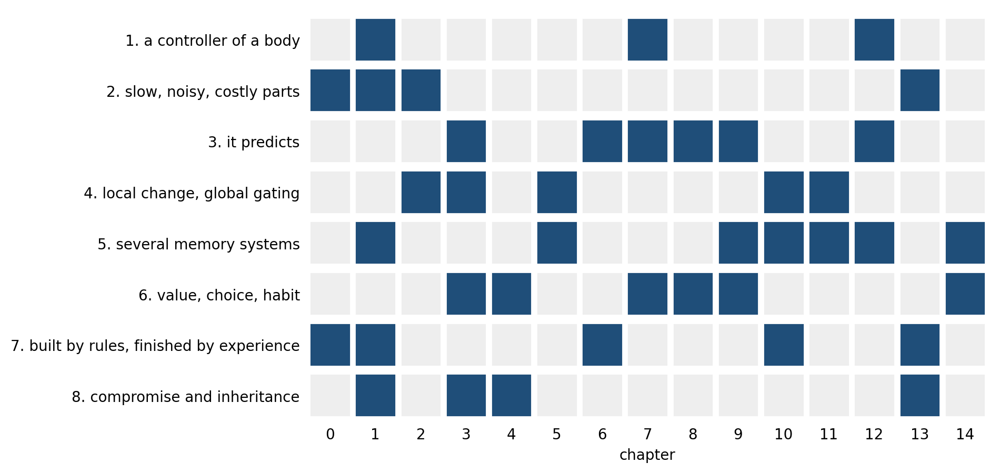
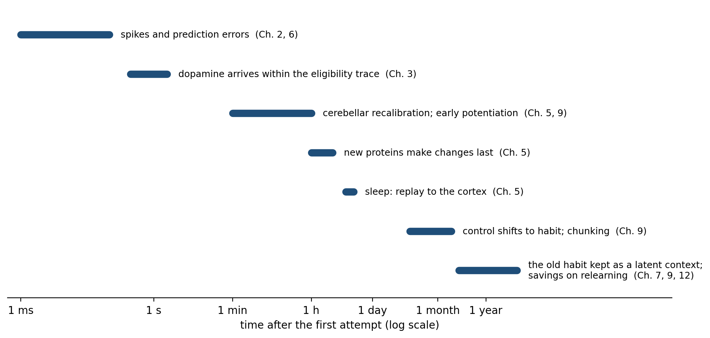
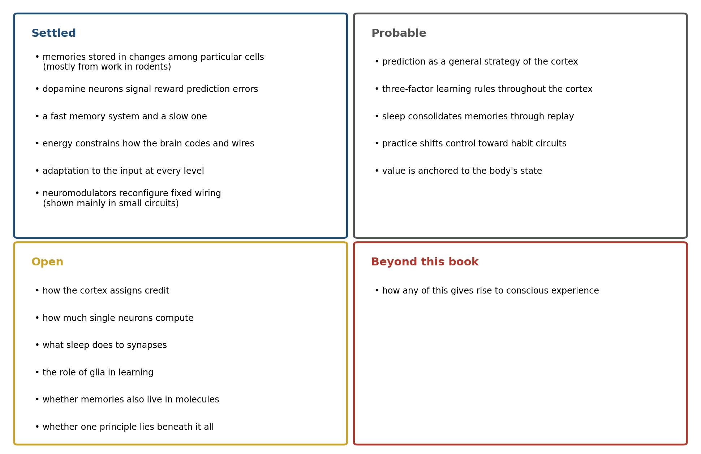

> *"Every man can, if he so desires, become the sculptor of his own brain."*
>
> --- Santiago Ramón y Cajal, *Reglas y consejos sobre investigación científica* (preface to the second edition, 1898)

# A Neuroscientist Studies a Microprocessor

In 2017 Eric Jonas and Konrad Kording tried an experiment on their own field. They took a microprocessor whose workings are completely known, the MOS 6502, the chip inside the Apple I and the Commodore 64, a near-identical version of which ran the Atari video game console, and asked whether the methods neuroscientists use on brains would reveal how it worked. They had a complete wiring diagram of its 3,510 transistors, a simulator that recorded every transistor's state at every moment, and three "behaviors": the games Donkey Kong, Space Invaders, and Pitfall. They then did to the chip what neuroscientists do to brains. They lesioned each transistor in turn, mapped the "tuning" of transistors to the brightness of pixels on the screen, computed the statistics of their firing, recorded the equivalent of local field potentials, searched for causal influences between regions, and reduced the activity to a few dimensions.[^1]

The analyses produced findings that looked like neuroscience. Some transistors, when removed, abolished one game but not the others: "perhaps there is a Donkey Kong transistor or a Space Invaders transistor," the authors wrote, before adding that "this finding of course is grossly misleading. The transistors are not specific to any one behavior or game but rather implement simple functions, like full adders." None of the methods revealed what any student of electrical engineering knows about the chip: that it has registers, an arithmetic unit, and a clock, organized in a hierarchy of functions. The data were complete, and they were not enough. Fifteen years earlier the biologist Yuri Lazebnik had made the same point with a satire, describing how biologists would study a broken radio by removing components one at a time and naming each "the most important component," and arguing that what engineers have and biologists lack is a formal language that says how the parts work together.[^2]

The lesson of both papers is that understanding a system requires a model of how its parts relate, not only more data about the parts. This book has gathered the parts one chapter at a time: cells and their chemistry, signals and synapses, neuromodulators, circuits, plasticity, perception, emotion, decision, habit, the comparison with machines, prediction, constraint, and the consequences for daily life. This last chapter assembles them into a single model of how the brain learns. The model is not an equation. It is a small set of claims about how the parts fit together, each of which can be checked against the evidence of the earlier chapters and each of which could turn out to be wrong.

# A Model Built Over a Century

The pieces of the model were not found in order, and most were found by people looking for something else. Santiago Ramón y Cajal's drawings in the 1880s and 1890s established that the nervous system is made of separate cells, the neurons, which Wilhelm Waldeyer named in 1891 (Chapter 2). Hermann von Helmholtz had already argued in 1867 that perception is an unconscious inference from inadequate evidence (Chapters 1 and 6), and Walter Cannon in the 1920s and W. Ross Ashby in the 1950s described the body and brain as systems that hold essential variables within bounds (Chapters 1 and 7). Kenneth Craik proposed in 1943 that a brain carries a working model of the world and runs it ahead of events (Chapter 12).

The mechanisms came later. Donald Hebb proposed in 1949 that connections between cells that fire together are strengthened, and in 1973 Timothy Bliss and Terje Lømo found such strengthening in the hippocampus (Chapter 5). Alan Hodgkin and Andrew Huxley showed in 1952 that the nerve impulse is nothing but the physics of a membrane (Chapters 1 and 2). David Hubel and Torsten Wiesel found in the 1960s that early visual experience sets the wiring of the cortex for life (Chapters 1 and 6). In the 1990s Wolfram Schultz's recordings of dopamine neurons in monkeys turned out to match a learning rule that computer scientists had written down independently (Chapter 3), and James McClelland, Bruce McNaughton, and Randall O'Reilly explained why a brain needs both a fast memory and a slow one by asking what goes wrong in a network that has only one (Chapters 1 and 5).

What is striking is how well the pieces fit, though they came from anatomy, physics, physiology, psychology, engineering, and computer science, over more than a century. Helmholtz's inference became the predictions of Chapter 12; Cannon's regulation became the anchor of value in Chapter 7; Hebb's rule, with Schultz's dopamine added as a third factor, became the learning rule of Chapter 3. A model assembled from such different directions is more likely to be right than one built from a single starting point, because each piece was tested by people who were not trying to make it fit the others.

# The Model in Eight Statements

Figure 15.1 draws the model, and Figure 15.2 shows which chapters supply the evidence for each part. In words, it comes to eight statements.

![Figure 15.1. The model in one picture. A body in a world (bottom) supplies the brain's purposes and its input. Within the brain, predictions meet input and produce errors; errors of several kinds, broadcast by neuromodulators, gate local plasticity; a fast memory store and slow cortical learning are linked by offline replay; values anchored to the body drive choices, and repeated choices become habits. Constraints of energy, space, time, noise, and the genome (left) and an evolutionary history (top) shape every part.](images/fig_model.png)

First, the brain serves a body. Its job is to keep the body's essential variables within bounds in a world that changes, and everything else it does serves that end (Chapters 1 and 7). Value is anchored there: food is worth more to a hungry animal, and fear is a forecast of harm to the body. Even the regulation looks ahead: thirst neurons in the mouse fall silent within seconds of drinking, long before the water could reach the blood (Chapter 12).

Second, it is built from poor parts. They are slow, noisy, and expensive: neurons fail, fire unreliably, and cost energy for every spike, so the brain computes with populations, signals over distance with spikes, and keeps most of its neurons quiet most of the time (Chapters 0, 1, 2, and 13). Peter Lennie's estimate that the cortex can afford only about one neuron in a hundred firing at any moment is a fact about energy that shapes everything built on it.

Third, it predicts. At many levels, from the retina to the frontal cortex, circuits compare what they expect with what arrives and pass on, or learn from, the difference (Chapters 6 and 12). A mouse running through a virtual corridor has neurons in its visual cortex that fire when the corridor stops moving: they respond not to anything on the screen but to the absence of the motion its running had predicted.

Fourth, it learns locally and keeps globally. A synapse changes according to the activity on its two sides, as Hebb proposed, but whether the change is kept depends on a third factor, a broadcast signal of surprise, reward, or importance carried by dopamine, norepinephrine, acetylcholine, or serotonin, arriving while a trace of the recent activity remains (Chapters 3 and 5). In slices of mouse striatum, a single dendritic spine that had just been active enlarged only if dopamine arrived between about 0.3 and 2 seconds later; earlier or later, nothing happened.

Fifth, it remembers on several clocks. Memory is not one system but several: a fast store in the hippocampus captures single episodes; the cortex learns slowly, extracting what is general; sleep replays the one into the other; and practice moves skills from deliberate control to habit (Chapters 5, 9, and 12). The division between fast and lasting change appears even in a sea slug, whose reflex is strengthened for minutes by one shock and for days by five spaced shocks that switch on genes (Chapter 1).

Sixth, it turns value into action, and action into habit. It accumulates evidence until it is sure enough, weighs costs against rewards, explores when it is uncertain, and caches what it has learned as habits that run without deliberation (Chapters 8 and 9). A rat that has pressed a lever many times keeps pressing after the reward has been made worthless, the signature of a habit that no longer consults the value it was built on.

Seventh, it is grown, not specified. The genome sets up cell types, gradients, and learning rules, and development and experience supply the rest, which is why early experience matters so much and why learning is not optional (Chapters 0, 1, and 13). The genome falls short of listing the human brain's connections by a factor of more than half a million, and a kitten whose eye was sutured closed for its first months never recovers the use of it, however good the rules that built its cortex.

Eighth, it is a compromise and an inheritance. The brain sits on fronts between goals it cannot all maximize, moves along them with its neuromodulators as conditions change, and does so with parts inherited from ancestors that solved different problems (Chapter 13). Light still crosses the wiring of the vertebrate retina to reach the photoreceptors behind it, a layout that costs every vertebrate a blind spot and that no vertebrate has undone.

One thread runs through several of them: much of what a person learns comes from other people, whose responses supply both the errors and the value, as Kuhl's infants showed in Chapter 14. None of the eight statements is new to this chapter; each was argued, with evidence, earlier. What the model adds is the claim that they belong together. Prediction supplies the errors that neuromodulators broadcast; the broadcast gates the plasticity that stores memories; the memory systems shape what is predicted next; the body sets what counts as an error worth learning from; and the constraints decide how all of this can be built at all. The clearest way to see the parts working together is to follow a single piece of learning through them.

# One Afternoon, Every Level

Consider an American who moves to Ireland and drives for the first time on the left side of the road. The example is illustrative rather than an experiment, but every step in it rests on mechanisms described earlier, and Figure 15.3 lays out the timescales on which they operate.

In the first seconds, predictions fail everywhere. The driver's visual system expects oncoming traffic on the left and finds it on the right; the arm reaches for a gear lever on the wrong side; at the first roundabout the eyes look the wrong way. Each failure is a prediction error, in sensory cortex, in the cerebellum, and in the circuits of choice (Chapters 6, 9, and 12). Norepinephrine rises with the surprise and with the stress of a narrow road and a lorry behind, raising the learning rate and narrowing attention, which helps at first and hurts if it climbs too far (Chapters 3, 7, and 12). The limited budget of attention described in Chapter 14 is spent quickly, and by the end of the afternoon the driver is tired in a way that a familiar drive never produces.

Within minutes, some things are already changing. The cerebellum recalibrates the reach toward the gear lever through the same error-driven adaptation that Chapter 9 measured when people learned to move in a force field. When a turn goes well, a burst of dopamine marks it as better than expected and strengthens the synapses whose eligibility traces were still active, and when it goes badly, a dip weakens them (Chapters 3 and 8). In the hippocampus, place cells and their partners encode the new route and its landmarks in a single exposure, and the early phase of long-term potentiation holds those changes for the next few hours (Chapters 4 and 5).

That night, sleep does work the driver will never notice. During deep sleep the hippocampus replays the day's sequences in compressed form, and the cortex begins to absorb them; whether sleep also scales down the synapses strengthened during the day, as one hypothesis holds, is still debated (Chapter 5, and below). Proteins are made that turn the early, fragile changes into lasting ones.

Over the following weeks, the driving moves from deliberation to habit. What required attention on the first day runs on its own by the second month, as control shifts from the circuits of goal-directed action toward those of habit and the movements are chunked into sequences (Chapter 9). The driver can now talk while driving, and the attention that was consumed is free again.

Months later, on a visit home, the driver steps into a car on the familiar side of the road and, at the first junction, glances the wrong way. The old habit was not erased; it was overlaid. Samuel Gershman, David Blei, and Yael Niv have argued that the brain treats such episodes as evidence about hidden causes, so that a new context is learned as a new cause rather than by rewriting the old one, and returning to the old context brings back the old learning.[^3] The same logic explains why extinguished fears return in their original context (Chapter 7) and it may help explain why a skill relearned after a long break comes back faster than it was first acquired (Chapter 9). The brain did not replace one way of driving with another; it kept both and learned when to use each.

Nearly every statement of the model appears in this one afternoon and its sequel. The body and its safety set what mattered; slow, noisy parts made the learning gradual; prediction errors drove it; neuromodulators decided what was kept; the fast and slow memory systems divided the work; choice became habit; and the constraints of energy and attention set the pace.

# The Levels Talk to Each Other

A model with levels invites the assumption that each level can be understood on its own and the results stacked. The evidence of this book points the other way. The levels constantly change one another, and that is where much of the brain's flexibility comes from.

Neuromodulators are the clearest case. Eve Marder spent decades on a circuit of about 30 neurons in the stomach of crabs and lobsters whose wiring is completely known, and found that neuromodulators "reconfigure neuronal circuits, often massively altering their output. Thus, the anatomical connectome provides a minimal structure and the neuromodulatory environment constructs and specifies the functional circuits that give rise to behavior."[^4] Cornelia Bargmann reached the same conclusion from the nematode worm: "each ultrastructural connectivity map encodes multiple circuits, some of which are active and some of which are latent at any given time."[^5] The same wiring computes different things in different chemical states, which is how the brain can move along the trade-offs of Chapter 13 without rebuilding itself.

The body reaches into every level as well. Chapter 7 described how hunger changes the value of food in the circuits of choice, and how stress shifts control from deliberation to habit. And learning changes the machinery of learning: a synapse's recent history alters how easily it will change again, and the neuromodulatory systems that gate plasticity are themselves shaped by experience.

Recent recordings of the whole brain have made the point vivid. The International Brain Laboratory, a collaboration of 12 laboratories, recorded from 621,733 units, with 75,708 well-isolated neurons among them, across 279 brain areas in 139 mice performing the same decision task. Signals about the stimulus appeared first in the visual areas, as a textbook pipeline would predict, but activity related to the upcoming movement appeared "almost everywhere in the brain," and responses to reward were also widespread.[^6] A companion study found that the animals' expectation about which side would be rewarded, their prior, was represented in at least a fifth to a third of the regions recorded, from early visual areas to motor cortex, which the authors argued fits a model of inference carried out in loops between areas rather than in a single decision center.[^7]

Danielle Bassett and Olaf Sporns have argued that understanding such a system requires studying the interactions across its scales, from molecules to social groups, rather than any one level alone.[^8] The brain is not a stack of modules passing results upward; it is a set of loops in which every level is in contact with every other.

# When the Model Breaks

A model earns its keep by explaining failures as well as successes, and many disorders of the brain can be read as failures of particular parts of this one.

Parkinson's disease is the loss of the dopamine neurons that feed the striatum, and its defining effects fall on the selection and vigor of movement, the part of the model in which value becomes action (Chapters 3, 4, and 9). The most vivid demonstration came in 1969, when Oliver Sacks began giving L-dopa, the chemical precursor of dopamine, to patients in a New York hospital who had been frozen for decades by the aftermath of the epidemic of encephalitis lethargica that followed the First World War. Many woke into movement and speech; many then developed tics, sudden swings between frozen and frantic states, and other complications as the treatment continued.[^9] The patients' movement had failed, been restored, and then overshot. Addiction has been described as a habit gone wrong, in which a drug that acts directly on the dopamine signal teaches the circuits of habit a lesson no natural reward could, although Chapter 9 noted that the habit account is disputed.

Fear that returns after therapy is the model's memory systems working as designed: extinction lays down a second memory beside the first rather than erasing it, so the old fear can come back in a new context (Chapter 7), exactly as the latent-cause account predicts. Hallucinations can be read as the prediction machinery giving too much weight to its expectations: Albert Powers and his colleagues showed that people who hear voices are especially prone to hearing tones that conditioning has led them to expect (Chapter 12). And in Alzheimer's disease the damage falls disproportionately on the brain's hubs, the costly long-range connections of Chapters 4 and 13, while in mouse models of its early stages memories that can no longer be recalled naturally can still be retrieved by stimulating the cells that hold them, suggesting that some early losses are failures of retrieval rather than of storage.[^10]

Each of these is far more complicated than a sentence can say, and none is fully explained by the model. But each falls naturally at a particular place in it, and the place suggests where to look: at the dopamine signal, at the competition between memories, at the weighting of prediction against evidence, at the costliest wiring. A model that located every disorder in the same place, or in none, would be less useful.

# The Wiring Diagram Arrives

In 1979 Francis Crick, surveying what neuroscience could hope to learn, wrote that "it is no use asking for the impossible, such as, say, the exact wiring diagram for a cubic millimetre of brain tissue and the way all its neurons are firing."[^11] Within half a century the impossible had been done, more than once.

In 2024 the FlyWire consortium published the complete wiring diagram of an adult fruit fly's brain: 139,255 neurons and 54.5 million synapses between them, reconstructed from electron micrographs of a single female fly, with 8,453 types of cell identified.[^12] In 2025 the MICrONS consortium reconstructed a cubic millimeter of a mouse's visual cortex, more than 200,000 cells and about half a billion synapses, after recording the activity of about 75,000 of its neurons while the mouse watched films, so that, for the first time, the wiring and the firing of the same neurons could be compared.[^13]

Alexander Shapson-Coe, Jeff Lichtman, and their colleagues reconstructed a cubic millimeter of human temporal cortex, removed during surgery for epilepsy: about 57,000 cells, some 16,000 of them neurons, and 150 million synapses, in 1.4 petabytes of data. Glia outnumbered neurons two to one, and while almost all connections between an axon and a neuron consisted of a single synapse, a rare few axons made up to 50 synapses onto the same target.[^14] A census of the human brain's cell types, based on more than three million nuclei, distinguished 3,313 subclusters of cells by the genes they express.[^15] The whole human brain, by comparison, has about 86 billion neurons and, in the neocortex alone, about 164 trillion synapses.[^16] Figure 15.4 sets these maps on a common scale.

These maps are among the great achievements of modern biology, and the model of this book suggests both what they will and will not reveal. They will constrain every theory of circuits: no model of how the fly navigates or the mouse sees can now ignore which neurons are actually connected. But the microprocessor already had a complete wiring diagram, and it did not explain the chip. Bargmann and Marder, reviewing what wiring diagrams had taught neuroscience, concluded that "anatomical inspection fails because each wiring diagram encodes many possible circuit outcomes."[^17] A map records which connections exist, not the neuromodulatory state that selects among them, nor the history of learning that set their strengths, nor the body whose needs gave that learning its purpose. As Chapter 13 noted, the wiring of a human brain cannot be specified by its genome; it is a record of a life. A full map of one brain would be a snapshot of one history, and understanding it would still need the model.

# No Two Brains Alike

The model describes how brains in general learn, but no brain is a brain in general. Chapter 1 described degeneracy, the capacity of different combinations of parts to produce the same function, and Chapter 13 described how very different mixtures of ion channels and synapses can produce the same rhythm in a small circuit. The same is true of whole brains. Two people who have learned the same skill have learned it with different synapses, in brains whose wiring was shaped by different childhoods; Chapter 14's London taxi drivers grew their posterior hippocampi through years of a particular kind of work, and the trainees who failed did not. Each of the great wiring diagrams described above comes from a single animal or a single person, and the next brain mapped will differ from it in detail everywhere.

Even identical genes and an identical world do not prevent it. Julia Freund, Gerd Kempermann, and their colleagues housed 40 genetically identical female mice together for three months in a large enclosure with several levels, and tracked each one with radio tags. Over time the mice diverged: the differences among them in how widely they explored grew about 22-fold, and the mice that roamed most widely tended to have made the most new neurons in the hippocampus.[^18] Same genes, same world, and still 40 different animals.

This is not a flaw in the model but one of its predictions. A system that learns by local changes gated by its own history of surprise and reward, starting from rules rather than a blueprint, must end up unique. The model describes the rules by which every brain is built and changed; the particular brain that results is always one of a kind, and it is still changing.

# What Is Settled and What Is Open

A model is only as good as the evidence for its parts, and the evidence is uneven. Figure 15.5 sorts the main claims of this book by how firmly they are established.

Some things are settled as firmly as anything in biology. Memories are stored, at least in part, in changes to synapses among particular sets of neurons, and in mice those sets can be labeled, silenced, and reactivated to suppress or call up a memory; Sheena Josselyn and Susumu Tonegawa's review of this work notes that it comes almost entirely from rodents and mostly from fear learning, but the core finding has been reproduced many times.[^19] Dopamine neurons signal errors in the prediction of reward. The brain keeps a fast memory system and a slow one, and damage to the first spares the second. Energy constrains everything, and adaptation to the input runs through every level. Prediction as a general strategy belongs a step lower, among the probable claims: Chapter 12 found it everywhere in the brain's behavior but found the evidence for its specific cortical form, predictive coding, mixed.

Other questions are genuinely open, and the model would change depending on their answers.

The first is how the cortex assigns credit, a question Chapters 3, 10, and 11 returned to repeatedly. Timothy Lillicrap, Geoffrey Hinton, and their colleagues have proposed that feedback connections might produce differences in activity that carry error information, approximating backpropagation, and theorists have shown how bursts of spikes or the separate compartments of a pyramidal neuron's dendrites could carry such signals.[^20] These are models and simulations; no experiment has yet shown the cortex doing it.

The second is what single neurons compute. Chapter 2 described the dendritic calcium spikes that Albert Gidon, Matthew Larkum, and their colleagues recorded in human cortical neurons, which, on the evidence of modeling based on the recordings, could let a single neuron compute exclusive or.[^21] The result does not yet appear to have been independently replicated, and neurons in a different layer of the human cortex turn out to have dendrites that are, if anything, more isolated from the cell body than a rat's.[^22] How much computation happens inside a single cell, and how much this differs across species, is not known.

The third is what sleep does to synapses. Giulio Tononi and Chiara Cirelli have argued that "sleep is the price the brain pays for plasticity," a period in which synapses strengthened during the day are scaled back so that the brain does not saturate, and electron microscopy of mouse cortex found the contacts between axons and spines about 18 percent smaller after sleep than after waking.[^23] Other work finds sleep strengthening and building particular synapses after learning.[^24] Sleep may do both, to different synapses, but the balance is unresolved.

The fourth is the role of the brain's other cells. Glia outnumber neurons in the human sample described above, and Adar Adamsky, Inbal Goshen, and their colleagues found that activating astrocytes in the mouse hippocampus could induce long-lasting potentiation and enhance memory, while other laboratories using related methods found that astrocyte signaling did not affect plasticity.[^25] Whether glia are partners in learning or only its support staff is still disputed.

The fifth is where, exactly, a memory is stored. The engram studies point to synapses among particular cells, but Johannes Langille and Randy Gallistel have argued that the evidence is also consistent with information stored in molecules inside cells, with synaptic change serving to read it out.[^26] The view is a minority one, but it shows that even the most settled part of the model rests on an inference that could be revised.

And some questions lie beyond this book altogether. Chapter 12 asked whether a single principle, such as the minimization of free energy, underlies the brain's mechanisms, and found the evidence weak. How any of these mechanisms gives rise to conscious experience is a question this book has not tried to answer, because the evidence does not yet allow an answer of the kind the earlier chapters could give.

# Implications for Artificial Intelligence

Chapters 10 and 11 compared the brain with the machines built in its image. The model of this chapter turns that comparison into a short list. Current artificial systems share three of its features in some form: they learn from prediction errors, they represent the world in learned hierarchies, and the largest of them, as Chapter 13 noted, have converged on activating only a small fraction of their parts at a time.

They lack five. They have no body whose state gives value its meaning, and so no anchor for what they should want (statements one and six). They learn mostly in one phase and are then frozen, without the fast store, the offline replay, and the many timescales of statement five. They learn by a single global error rather than by local changes gated by several broadcast signals (statement four). They do not reconfigure a single network into many with something like neuromodulation, which lets the brain move along its trade-offs as conditions change (statement eight). And they are not built under a constraint of energy that forces economy in every part (statement two). Whether a machine needs all five to learn as flexibly as a child is an open question, and Chapter 11 described the attempts to supply each. The model at least makes clear what the question is.

# The Central Lesson

The brain learns by changing its own physical structure, in a body, under constraint. It predicts what will happen and learns from the difference between prediction and outcome; it keeps the changes that broadcast signals of surprise and value mark as important; it divides the work between a fast memory that captures episodes and a slow one that extracts what is general, and lets sleep pass between them; it turns choices into habits so that attention is free for what is new; and it does all of this with parts that are slow, noisy, and expensive, built by a genome that could only supply the rules, inherited from ancestors that faced different problems. These are not separate facts but parts of one design, and they explain one another: the constraints explain the mechanisms, the mechanisms explain the behavior, and the behavior explains why the brain needs a body and a world to learn from at all.

Jonas and Kording's microprocessor had a complete wiring diagram and yielded no understanding without a model. The model in this book is a first draft of one for the brain, and parts of it will be revised as the open questions are answered. Its central claim is the one with which this book began, and which Cajal made at the end of the nineteenth century, when almost none of the mechanisms in this book were known: that each brain is built, in large part, by what it does. Every lesson learned, every habit formed, and every night of sleep leaves a physical trace, and the brain that results is the record of a life. The work of understanding it is to read that record by the principles that wrote it.

# References and Attribution

## Figure Attribution

Figures 15.1 to 15.5 were drawn for this book. Figure 15.4 plots published counts: the nematode worm's 302 neurons and about 7,000 synapses; the fruit fly brain of Dorkenwald et al. (2024); the cubic millimeter of mouse visual cortex of the MICrONS Consortium (2025), for which the count is of all cells; the cubic millimeter of human temporal cortex of Shapson-Coe et al. (2024), for which the count is of neurons; and estimates for the whole human brain from Azevedo et al. (2009) for neurons and Tang et al. (2001) for synapses in the neocortex. Figures 15.1, 15.2, 15.3, and 15.5 are schematic; the assignments in Figures 15.2 and 15.5 are the author's judgment of the evidence presented across the book.

## Epigraph

Santiago Ramón y Cajal, *Reglas y consejos sobre investigación científica*, preface to the second edition (dated Madrid, 20 December 1898): "todo hombre puede ser, si se lo propone, escultor de su propio cerebro." Translated for this book. An English translation of the whole work is *Advice for a Young Investigator*, translated by Neely Swanson and Larry W. Swanson (MIT Press, 1999).

## References

Adamsky, A., Kol, A., Kreisel, T., Doron, A., Ozeri-Engelhard, N., Melcer, T., Refaeli, R., Horn, H., Regev, L., Groysman, M., London, M., & Goshen, I. (2018). Astrocytic activation generates de novo neuronal potentiation and memory enhancement. *Cell*, 174(1), 59–71.e14.

Agulhon, C., Fiacco, T. A., & McCarthy, K. D. (2010). Hippocampal short- and long-term plasticity are not modulated by astrocyte Ca2+ signaling. *Science*, 327(5970), 1250–1254.

Azevedo, F. A. C., Carvalho, L. R. B., Grinberg, L. T., Farfel, J. M., Ferretti, R. E. L., Leite, R. E. P., Jacob Filho, W., Lent, R., & Herculano-Houzel, S. (2009). Equal numbers of neuronal and nonneuronal cells make the human brain an isometrically scaled-up primate brain. *Journal of Comparative Neurology*, 513(5), 532–541.

Bargmann, C. I. (2012). Beyond the connectome: How neuromodulators shape neural circuits. *BioEssays*, 34(6), 458–465.

Bargmann, C. I., & Marder, E. (2013). From the connectome to brain function. *Nature Methods*, 10(6), 483–490.

Bassett, D. S., & Sporns, O. (2017). Network neuroscience. *Nature Neuroscience*, 20(3), 353–364.

Beaulieu-Laroche, L., Toloza, E. H. S., van der Goes, M.-S., Lafourcade, M., Barnagian, D., Williams, Z. M., Eskandar, E. N., Frosch, M. P., Cash, S. S., & Harnett, M. T. (2018). Enhanced dendritic compartmentalization in human cortical neurons. *Cell*, 175(3), 643–651.e14.

Crick, F. H. C. (1979). Thinking about the brain. *Scientific American*, 241(3), 219–232.

de Vivo, L., Bellesi, M., Marshall, W., Bushong, E. A., Ellisman, M. H., Tononi, G., & Cirelli, C. (2017). Ultrastructural evidence for synaptic scaling across the wake/sleep cycle. *Science*, 355(6324), 507–510.

Dorkenwald, S., Matsliah, A., Sterling, A. R., Schlegel, P., Yu, S.-C., McKellar, C. E., Lin, A., Costa, M., Eichler, K., Yin, Y., Silversmith, W., Schneider-Mizell, C., Jordan, C. S., Brittain, D., Halageri, A., Kuehner, K., Ogedengbe, O., Morey, R., Gager, J., ... Murthy, M. (2024). Neuronal wiring diagram of an adult brain. *Nature*, 634(8032), 124–138.

Findling, C., Hubert, F., International Brain Laboratory, Acerbi, L., Benson, B., Benson, J., Birman, D., Bonacchi, N., Buchanan, E. K., Bruijns, S., Carandini, M., Catarino, J. A., Chapuis, G. A., Churchland, A. K., Dan, Y., Davatolhagh, F., DeWitt, E. E. J., Engel, T. A., Fabbri, M., ... Pouget, A. (2025). Brain-wide representations of prior information in mouse decision-making. *Nature*, 645(8079), 192–200.

Freund, J., Brandmaier, A. M., Lewejohann, L., Kirste, I., Kritzler, M., Krüger, A., Sachser, N., Lindenberger, U., & Kempermann, G. (2013). Emergence of individuality in genetically identical mice. *Science*, 340(6133), 756–759.

Gershman, S. J., Blei, D. M., & Niv, Y. (2010). Context, learning, and extinction. *Psychological Review*, 117(1), 197–209.

Gidon, A., Zolnik, T. A., Fidzinski, P., Bolduan, F., Papoutsi, A., Poirazi, P., Holtkamp, M., Vida, I., & Larkum, M. E. (2020). Dendritic action potentials and computation in human layer 2/3 cortical neurons. *Science*, 367(6473), 83–87.

International Brain Laboratory, Meshulam, L., Angelaki, D., Benson, J., McRoberts, I., Noel, J., Arlandis, J., Bonacchi, N., Bougrova, K., Catarino, J. A., Cazettes, F., Crombie, D., DeWitt, E. E., Freitas-Silva, L., Laranjeira, I. C., Mainen, Z. F., Meijer, G. T., Rai, P., Raiser, G., ... Witten, I. B. (2025). A brain-wide map of neural activity during complex behaviour. *Nature*, 645(8079), 177–191.

Jonas, E., & Kording, K. P. (2017). Could a neuroscientist understand a microprocessor? *PLoS Computational Biology*, 13(1), e1005268.

Josselyn, S. A., & Tonegawa, S. (2020). Memory engrams: Recalling the past and imagining the future. *Science*, 367(6473), eaaw4325.

Langille, J. J., & Gallistel, C. R. (2020). Locating the engram: Should we look for plastic synapses or information-storing molecules? *Neurobiology of Learning and Memory*, 169, 107164.

Lazebnik, Y. (2002). Can a biologist fix a radio?—Or, what I learned while studying apoptosis. *Cancer Cell*, 2(3), 179–182.

Lillicrap, T. P., Santoro, A., Marris, L., Akerman, C. J., & Hinton, G. (2020). Backpropagation and the brain. *Nature Reviews Neuroscience*, 21(6), 335–346.

Marder, E. (2012). Neuromodulation of neuronal circuits: Back to the future. *Neuron*, 76(1), 1–11.

MICrONS Consortium. (2025). Functional connectomics spanning multiple areas of mouse visual cortex. *Nature*, 640(8058), 435–447.

Payeur, A., Guerguiev, J., Zenke, F., Richards, B. A., & Naud, R. (2021). Burst-dependent synaptic plasticity can coordinate learning in hierarchical circuits. *Nature Neuroscience*, 24(7), 1010–1019.

Sacks, O. (1990). *Awakenings* (Rev. ed.). HarperPerennial. (Original work published 1973)

Sacks, O. W., Kohl, M., Schwartz, W., & Messeloff, C. (1970). Side-effects of L-dopa in postencephalitic parkinsonism. *The Lancet*, 295(7654), 1006.

Schlegel, P., Yin, Y., Bates, A. S., Dorkenwald, S., Eichler, K., Brooks, P., Han, D. S., Gkantia, M., dos Santos, M., Munnelly, E. J., Badalamente, G., Serratosa Capdevila, L., Sane, V. A., Fragniere, A. M. C., Kiassat, L., Pleijzier, M. W., Stürner, T., Tamimi, I. F. M., Dunne, C. R., ... Jefferis, G. S. X. E. (2024). Whole-brain annotation and multi-connectome cell typing of Drosophila. *Nature*, 634(8032), 139–152.

Shapson-Coe, A., Januszewski, M., Berger, D. R., Pope, A., Wu, Y., Blakely, T., Schalek, R. L., Li, P. H., Wang, S., Maitin-Shepard, J., Karlupia, N., Dorkenwald, S., Sjostedt, E., Leavitt, L., Lee, D., Troidl, J., Collman, F., Bailey, L., Fitzmaurice, A., ... Lichtman, J. W. (2024). A petavoxel fragment of human cerebral cortex reconstructed at nanoscale resolution. *Science*, 384(6696), eadk4858.

Siletti, K., Hodge, R., Mossi Albiach, A., Lee, K. W., Ding, S.-L., Hu, L., Lönnerberg, P., Bakken, T., Casper, T., Clark, M., Dee, N., Gloe, J., Hirschstein, D., Shapovalova, N. V., Keene, C. D., Nyhus, J., Tung, H., Yanny, A. M., Arenas, E., ... Linnarsson, S. (2023). Transcriptomic diversity of cell types across the adult human brain. *Science*, 382(6667), eadd7046.

Tang, Y., Nyengaard, J. R., De Groot, D. M. G., & Gundersen, H. J. G. (2001). Total regional and global number of synapses in the human brain neocortex. *Synapse*, 41(3), 258–273.

Tononi, G., & Cirelli, C. (2014). Sleep and the price of plasticity: From synaptic and cellular homeostasis to memory consolidation and integration. *Neuron*, 81(1), 12–34.

Yang, G., Lai, C. S. W., Cichon, J., Ma, L., Li, W., & Gan, W.-B. (2014). Sleep promotes branch-specific formation of dendritic spines after learning. *Science*, 344(6188), 1173–1178.

[^1]: Jonas, E., & Kording, K. P. (2017). Could a neuroscientist understand a microprocessor? *PLoS Computational Biology*, 13(1), e1005268.

[^2]: Lazebnik, Y. (2002). Can a biologist fix a radio?—Or, what I learned while studying apoptosis. *Cancer Cell*, 2(3), 179–182.

[^3]: Gershman, S. J., Blei, D. M., & Niv, Y. (2010). Context, learning, and extinction. *Psychological Review*, 117(1), 197–209.

[^4]: Marder, E. (2012). Neuromodulation of neuronal circuits: Back to the future. *Neuron*, 76(1), 1–11.

[^5]: Bargmann, C. I. (2012). Beyond the connectome: How neuromodulators shape neural circuits. *BioEssays*, 34(6), 458–465.

[^6]: International Brain Laboratory, Meshulam, L., Angelaki, D., Benson, J., McRoberts, I., Noel, J., Arlandis, J., Bonacchi, N., Bougrova, K., Catarino, J. A., Cazettes, F., Crombie, D., DeWitt, E. E., Freitas-Silva, L., Laranjeira, I. C., Mainen, Z. F., Meijer, G. T., Rai, P., Raiser, G., ... Witten, I. B. (2025). A brain-wide map of neural activity during complex behaviour. *Nature*, 645(8079), 177–191.

[^7]: Findling, C., Hubert, F., International Brain Laboratory, Acerbi, L., Benson, B., Benson, J., Birman, D., Bonacchi, N., Buchanan, E. K., Bruijns, S., Carandini, M., Catarino, J. A., Chapuis, G. A., Churchland, A. K., Dan, Y., Davatolhagh, F., DeWitt, E. E. J., Engel, T. A., Fabbri, M., ... Pouget, A. (2025). Brain-wide representations of prior information in mouse decision-making. *Nature*, 645(8079), 192–200.

[^8]: Bassett, D. S., & Sporns, O. (2017). Network neuroscience. *Nature Neuroscience*, 20(3), 353–364.

[^9]: Sacks, O. W., Kohl, M., Schwartz, W., & Messeloff, C. (1970). Side-effects of L-dopa in postencephalitic parkinsonism. *The Lancet*, 295(7654), 1006; Sacks, O. (1990). *Awakenings* (Rev. ed.). HarperPerennial. (Original work published 1973).

[^10]: Josselyn, S. A., & Tonegawa, S. (2020). Memory engrams: Recalling the past and imagining the future. *Science*, 367(6473), eaaw4325.

[^11]: Crick, F. H. C. (1979). Thinking about the brain. *Scientific American*, 241(3), 219–232.

[^12]: Dorkenwald, S., Matsliah, A., Sterling, A. R., Schlegel, P., Yu, S.-C., McKellar, C. E., Lin, A., Costa, M., Eichler, K., Yin, Y., Silversmith, W., Schneider-Mizell, C., Jordan, C. S., Brittain, D., Halageri, A., Kuehner, K., Ogedengbe, O., Morey, R., Gager, J., ... Murthy, M. (2024). Neuronal wiring diagram of an adult brain. *Nature*, 634(8032), 124–138; Schlegel, P., Yin, Y., Bates, A. S., Dorkenwald, S., Eichler, K., Brooks, P., Han, D. S., Gkantia, M., dos Santos, M., Munnelly, E. J., Badalamente, G., Serratosa Capdevila, L., Sane, V. A., Fragniere, A. M. C., Kiassat, L., Pleijzier, M. W., Stürner, T., Tamimi, I. F. M., Dunne, C. R., ... Jefferis, G. S. X. E. (2024). Whole-brain annotation and multi-connectome cell typing of Drosophila. *Nature*, 634(8032), 139–152.

[^13]: MICrONS Consortium. (2025). Functional connectomics spanning multiple areas of mouse visual cortex. *Nature*, 640(8058), 435–447.

[^14]: Shapson-Coe, A., Januszewski, M., Berger, D. R., Pope, A., Wu, Y., Blakely, T., Schalek, R. L., Li, P. H., Wang, S., Maitin-Shepard, J., Karlupia, N., Dorkenwald, S., Sjostedt, E., Leavitt, L., Lee, D., Troidl, J., Collman, F., Bailey, L., Fitzmaurice, A., ... Lichtman, J. W. (2024). A petavoxel fragment of human cerebral cortex reconstructed at nanoscale resolution. *Science*, 384(6696), eadk4858.

[^15]: Siletti, K., Hodge, R., Mossi Albiach, A., Lee, K. W., Ding, S.-L., Hu, L., Lönnerberg, P., Bakken, T., Casper, T., Clark, M., Dee, N., Gloe, J., Hirschstein, D., Shapovalova, N. V., Keene, C. D., Nyhus, J., Tung, H., Yanny, A. M., Arenas, E., ... Linnarsson, S. (2023). Transcriptomic diversity of cell types across the adult human brain. *Science*, 382(6667), eadd7046.

[^16]: Azevedo, F. A. C., Carvalho, L. R. B., Grinberg, L. T., Farfel, J. M., Ferretti, R. E. L., Leite, R. E. P., Jacob Filho, W., Lent, R., & Herculano-Houzel, S. (2009). Equal numbers of neuronal and nonneuronal cells make the human brain an isometrically scaled-up primate brain. *Journal of Comparative Neurology*, 513(5), 532–541; Tang, Y., Nyengaard, J. R., De Groot, D. M. G., & Gundersen, H. J. G. (2001). Total regional and global number of synapses in the human brain neocortex. *Synapse*, 41(3), 258–273.

[^17]: Bargmann, C. I., & Marder, E. (2013). From the connectome to brain function. *Nature Methods*, 10(6), 483–490.

[^18]: Freund, J., Brandmaier, A. M., Lewejohann, L., Kirste, I., Kritzler, M., Krüger, A., Sachser, N., Lindenberger, U., & Kempermann, G. (2013). Emergence of individuality in genetically identical mice. *Science*, 340(6133), 756–759.

[^19]: Josselyn, S. A., & Tonegawa, S. (2020). Memory engrams: Recalling the past and imagining the future. *Science*, 367(6473), eaaw4325.

[^20]: Lillicrap, T. P., Santoro, A., Marris, L., Akerman, C. J., & Hinton, G. (2020). Backpropagation and the brain. *Nature Reviews Neuroscience*, 21(6), 335–346; Payeur, A., Guerguiev, J., Zenke, F., Richards, B. A., & Naud, R. (2021). Burst-dependent synaptic plasticity can coordinate learning in hierarchical circuits. *Nature Neuroscience*, 24(7), 1010–1019.

[^21]: Gidon, A., Zolnik, T. A., Fidzinski, P., Bolduan, F., Papoutsi, A., Poirazi, P., Holtkamp, M., Vida, I., & Larkum, M. E. (2020). Dendritic action potentials and computation in human layer 2/3 cortical neurons. *Science*, 367(6473), 83–87.

[^22]: Beaulieu-Laroche, L., Toloza, E. H. S., van der Goes, M.-S., Lafourcade, M., Barnagian, D., Williams, Z. M., Eskandar, E. N., Frosch, M. P., Cash, S. S., & Harnett, M. T. (2018). Enhanced dendritic compartmentalization in human cortical neurons. *Cell*, 175(3), 643–651.e14.

[^23]: Tononi, G., & Cirelli, C. (2014). Sleep and the price of plasticity: From synaptic and cellular homeostasis to memory consolidation and integration. *Neuron*, 81(1), 12–34; de Vivo, L., Bellesi, M., Marshall, W., Bushong, E. A., Ellisman, M. H., Tononi, G., & Cirelli, C. (2017). Ultrastructural evidence for synaptic scaling across the wake/sleep cycle. *Science*, 355(6324), 507–510.

[^24]: Yang, G., Lai, C. S. W., Cichon, J., Ma, L., Li, W., & Gan, W.-B. (2014). Sleep promotes branch-specific formation of dendritic spines after learning. *Science*, 344(6188), 1173–1178.

[^25]: Adamsky, A., Kol, A., Kreisel, T., Doron, A., Ozeri-Engelhard, N., Melcer, T., Refaeli, R., Horn, H., Regev, L., Groysman, M., London, M., & Goshen, I. (2018). Astrocytic activation generates de novo neuronal potentiation and memory enhancement. *Cell*, 174(1), 59–71.e14; Agulhon, C., Fiacco, T. A., & McCarthy, K. D. (2010). Hippocampal short- and long-term plasticity are not modulated by astrocyte Ca2+ signaling. *Science*, 327(5970), 1250–1254.

[^26]: Langille, J. J., & Gallistel, C. R. (2020). Locating the engram: Should we look for plastic synapses or information-storing molecules? *Neurobiology of Learning and Memory*, 169, 107164.
