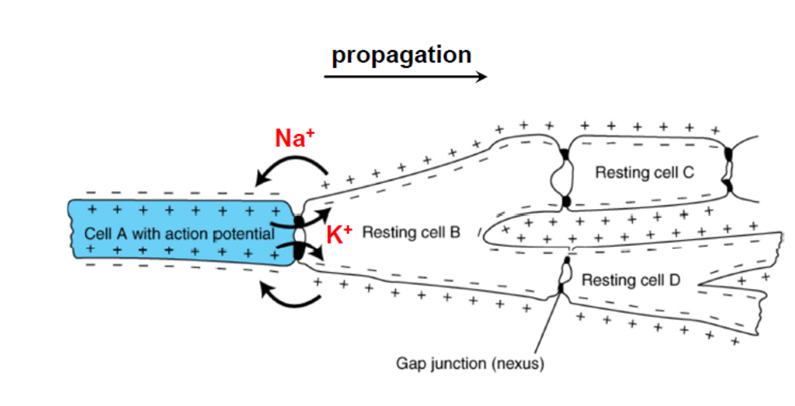
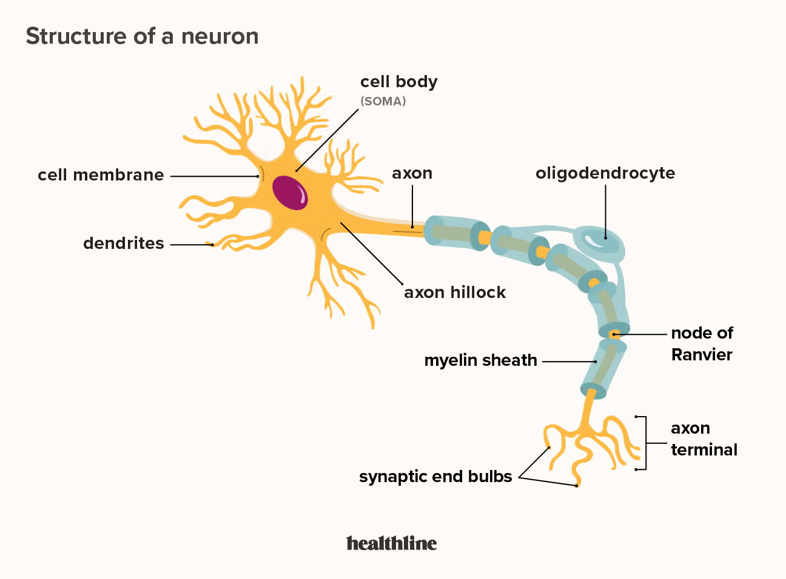
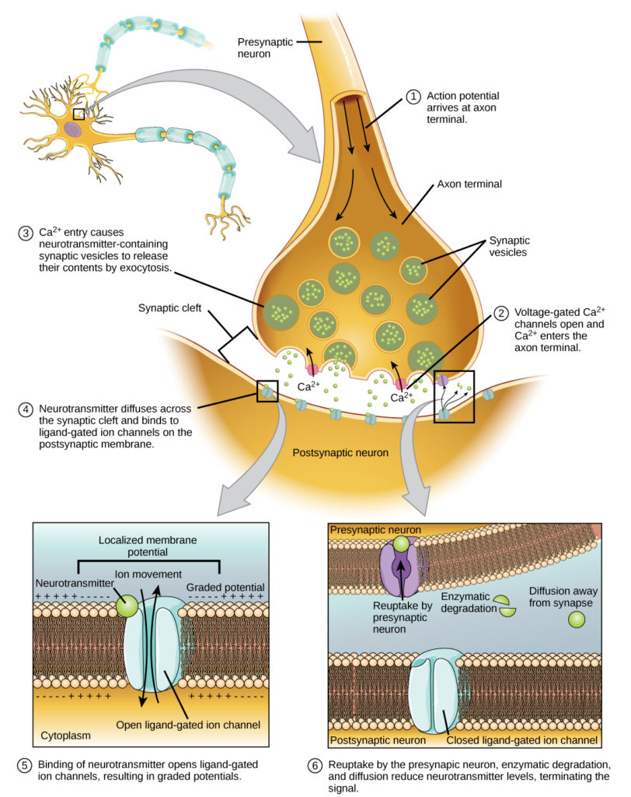
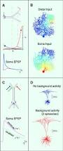
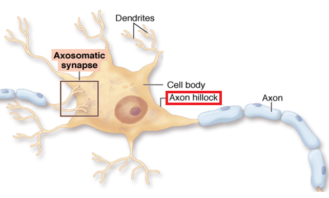
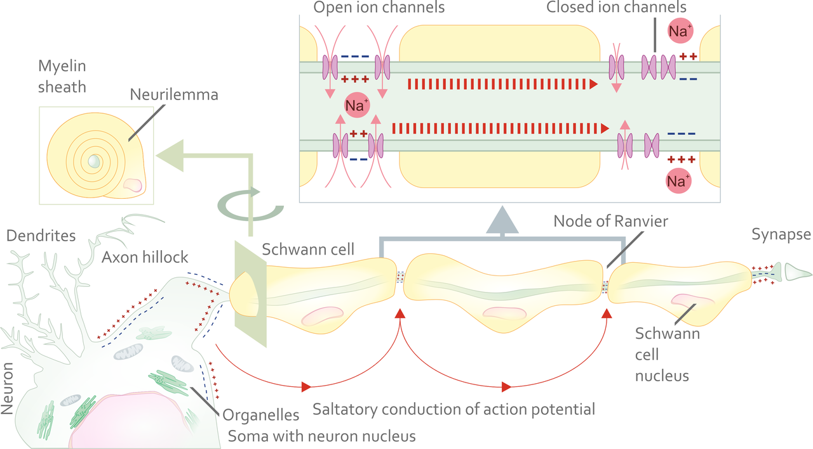
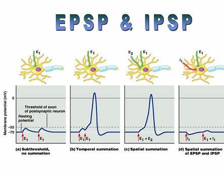
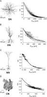
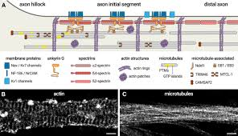

# Introduction

In the previous chapter, we argued that the brain is not a digital computer, but a physical, biological system shaped by evolutionary constraint. That argument now demands specificity. If cognition arises from matter, what kind of matter can support perception, memory, and action?

The answer is deceptively simple: the neuron.

Neurons are not abstract processing units. They are living cells, governed by the same physical and chemical laws as every other biological system. They consume energy, maintain internal order, respond to stress, and eventually fail. And yet, when organized in vast networks, they give rise to perception, memory, emotion, and thought.

This chapter introduces neurons not as symbols or algorithms, but as physical signaling systems whose structure and limitations shape everything the brain can do.

# What a Neuron Is --- and What It Is Not

A neuron is a cell. That statement is easy to say and easy to forget.

Neurons are not logic gates. They do not execute instructions, store variables, or manipulate symbols. Those descriptions are metaphors imposed at higher levels of analysis. At the level of mechanism, neurons integrate physical inputs and generate physical outputs according to biophysical rules.

Like all cells, neurons are bounded by a membrane. Inside that membrane is a dense molecular environment filled with proteins, structural elements, and chemical machinery. Energy is consumed continuously simply to maintain this ordered state against entropy.

What distinguishes neurons from most other cells is excitability: the ability to generate electrical signals, transmit them over distance, influence other cells, and modify those influences over time.

# The Polarized Structure of Neurons

Despite their diversity, most neurons share a common structural plan that immediately constrains how information can flow.

At one end are dendrites: branching structures that receive signals from other neurons. These inputs are local, chemical, and numerous. A single neuron may receive thousands of such inputs.

At the center is the cell body, or soma. This is where incoming signals are integrated and where the cell's metabolic machinery resides.

Extending from the soma is the axon, a long, thin projection capable of transmitting electrical signals over distance. At its far end, the axon branches into terminals that form connections with other cells.

This polarized structure---many inputs, one output---is fundamental.

# The Physical Form of Inputs to a Neuron

Neurons receive their inputs primarily on dendrites, through specialized junctions called synapses.

At a typical chemical synapse, an incoming action potential in a presynaptic neuron triggers the release of neurotransmitter molecules into a tiny gap. These molecules diffuse across the gap and bind to receptors on the dendritic membrane of the receiving neuron.

The crucial point is this: the immediate input to a neuron is not an electrical spike, but a small, local chemical event that produces a graded electrical change.

# Excitatory and Inhibitory Postsynaptic Potentials (EPSPs and IPSPs)

Not all synaptic inputs push a neuron toward firing. Some do the opposite.

When a neurotransmitter binds to receptors on a dendrite or soma, it changes the permeability of the membrane to specific ions. The direction of this change determines whether the synapse is excitatory or inhibitory.

An excitatory postsynaptic potential (EPSP) slightly depolarizes the membrane, moving it closer to the threshold required to trigger an action potential at the axon initial segment. EPSPs are commonly produced by synapses that allow positive ions, such as sodium, to enter the cell.

An inhibitory postsynaptic potential (IPSP) hyperpolarizes the membrane or stabilizes it against depolarization. IPSPs move the membrane potential farther from threshold and reduce the likelihood that the neuron will fire. These effects are often mediated by chloride or potassium ions.

EPSPs and IPSPs are graded, local, and short-lived. Neurons continuously sum thousands of such inputs across their dendritic tree and soma. Firing reflects the balance of excitation and inhibition over time.

# Dendrites and Soma: Passive Integration

The electrical changes produced at synapses spread through the dendrites and into the soma. This spread is passive.

Voltage changes weaken with distance and time. No new electrical signal is regenerated. The soma acts as an integrator, summing excitatory and inhibitory influences across space and time.

Importantly, the soma does not normally propagate action potentials.

# The Axon Initial Segment: Where Spikes Begin

Just beyond the soma lies the axon initial segment.

This region is densely packed with voltage-gated sodium channels. If the integrated voltage arriving from the soma exceeds threshold here, an action potential is triggered.

This is the transformation from graded input to discrete output.

# How the Action Potential Propagates

Once initiated, the action potential propagates along the axon.

Each segment of axon opens sodium channels, injecting current into neighboring regions. Those regions reach threshold and regenerate the spike using their own ion gradients.

Nothing travels the length of the axon except causation.

# Why the Soma Does Not Propagate Spikes

The soma lacks the channel density required for reliable propagation. It is optimized for integration, not transmission.

Evolution separated integration, decision, and transmission into distinct regions.

# Timing, Not Amplitude, Carries Information

Action potentials are uniform in size. Information is encoded in timing, firing rate, and coordination across neurons.

# Plasticity: Learning as Physical Change

Synapses strengthen or weaken with use. Learning is physical reconfiguration, not information storage.

# Why Neurons Look Inefficient --- and Why They Are Not

Neurons are slow, noisy, and metabolically expensive. These properties enable robustness and adaptability.

# Looking Ahead

Neurons do not operate in a fixed mode. Their behavior is shaped by chemical context.

The next chapter introduces neuromodulators---signals that change how neurons operate, learn, and adapt.

Next Chapter: Chapter 3 --- Neuromodulation: How Chemical Context Shapes Neural Behavior

