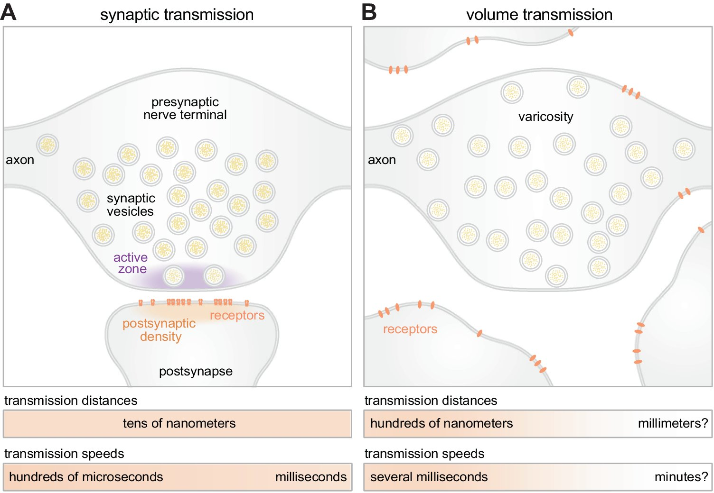
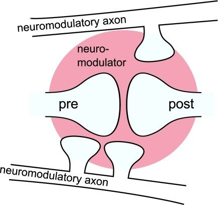
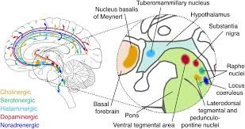
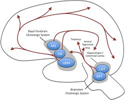
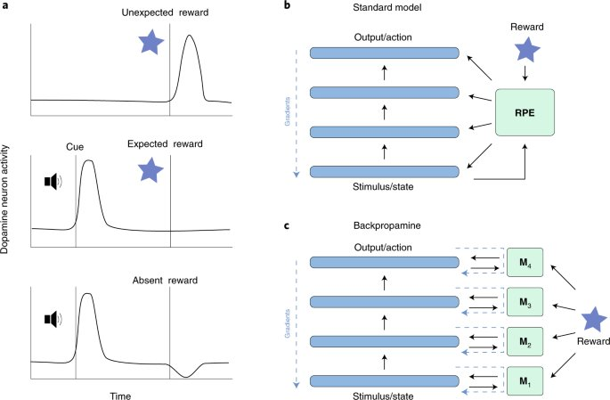
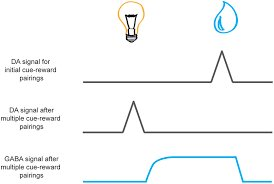
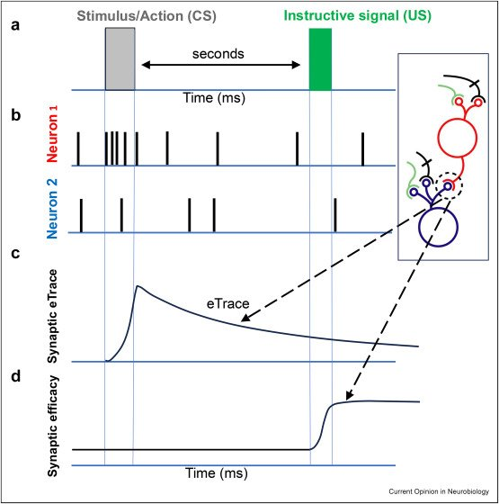
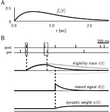
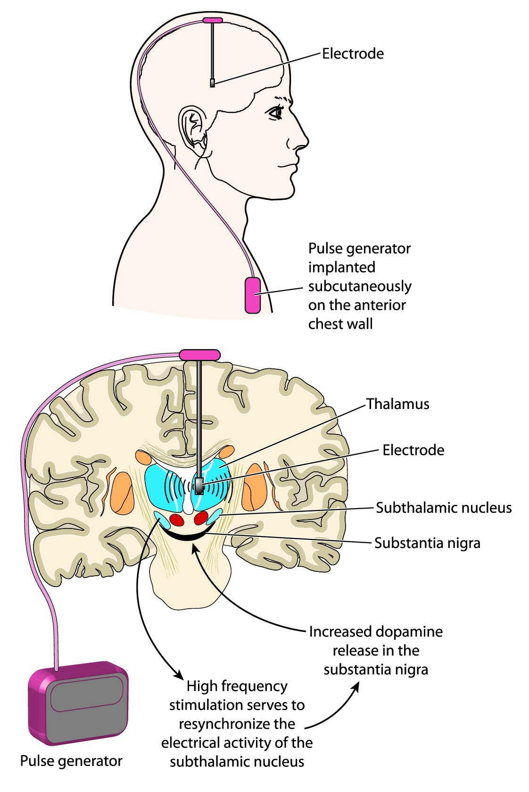
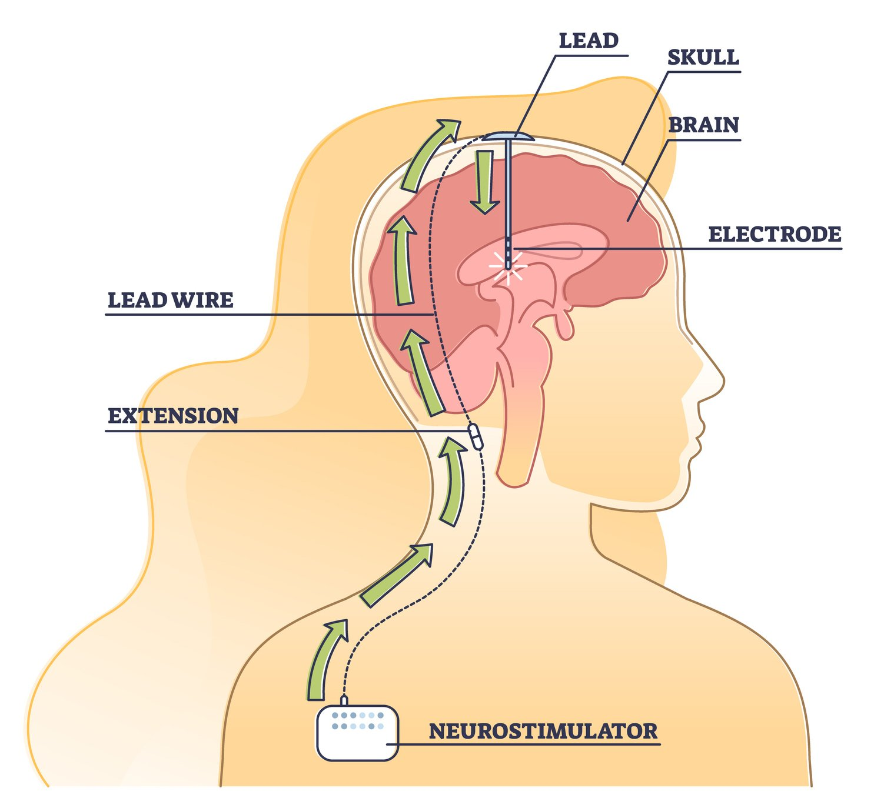

> *"The brain is a world consisting of a number of unexplored continents and great stretches of unknown territory."*
>
> --- Santiago Ramón y Cajal

# Why Neurons Alone Are Not Enough

In the previous chapters, we described neurons as electrically excitable cells. They receive inputs, integrate those inputs within the soma, and---when a threshold is crossed---emit action potentials that propagate along axons and influence other neurons through synapses. This description captures how information moves through the brain on very short timescales.

It does not explain learning.

If neural function were entirely determined by fast electrical signaling and fixed synaptic wiring, the brain would behave like a complex but rigid machine. The same sensory input would reliably produce the same output. Learning would occur whenever neurons fired. Internal state would play only a minor role.

This is not what we observe.

In real organisms, identical sensory inputs can produce radically different outcomes depending on context. A sound may be ignored in one moment and trigger rapid learning in another. A mistake may be shrugged off today and permanently reshape behavior tomorrow. Even when the same neurons fire in similar patterns, learning may or may not occur.

Electrical signaling explains how neurons communicate, but not when learning happens, what is worth learning, or why internal state matters so profoundly. To answer those questions, we must consider the chemical environment in which neural activity unfolds.[^1]

That environment is shaped by neuromodulation.

# Fast Signals and Slow Control

Neural communication operates on multiple timescales.

At the fastest scale, action potentials propagate in milliseconds. Synaptic transmission is brief, spatially precise, and localized. These fast signals support perception, reflexes, and moment-to-moment decision-making.

Learning, however, is not fast. Learning requires stability. It requires that some experiences leave lasting traces while others do not. If every neural fluctuation produced learning, the system would be unstable.[^2]

Neuromodulators operate on slower timescales---seconds to minutes, sometimes longer.[^3] They do not carry detailed sensory information. Instead, they regulate how neural circuits respond to information. They alter excitability, bias competition between neural pathways, and gate whether synapses are permitted to change.[^4]

This separation between fast signaling and slow control allows the same neural circuitry to behave very differently depending on internal state.

# A Note on Neurotransmitter-Based Naming

Neurons communicate using chemical messengers called neurotransmitters. When a neuron fires, it releases neurotransmitter molecules into the synapse, where they bind to receptors on a neighboring neuron and alter that neuron\'s behavior.

Neuroscientists often classify neurons by which neurotransmitter they primarily release. The suffix \"-ergic\" simply means using or releasing.

Thus:

- dopaminergic neurons release dopamine
- noradrenergic neurons release norepinephrine
- serotonergic neurons release serotonin
- cholinergic neurons release acetylcholine

These terms do not describe what a neuron \"represents.\" They describe the chemical influence it exerts on other neurons.

# Why Neuromodulatory Systems Are Diffuse

Neuromodulatory neurons are few in number but extraordinarily influential.

Small clusters of cells---often located in the brainstem or basal forebrain---send axons that project widely across the cortex, hippocampus, basal ganglia, and other regions.[^5] A single neuromodulatory neuron can influence tens of thousands of synapses.[^6]

From an engineering perspective, this architecture may seem inefficient. Why broadcast a signal so broadly rather than target specific circuits?

The answer is that neuromodulators provide global context, not local instruction. They signal whether the organism is safe or threatened, whether outcomes are better or worse than expected, whether the environment is stable or unpredictable.[^7]

Diffuse projection allows a small number of neurons to coordinate the behavior of millions without centralized control.[^8]

# Dopamine: Learning, Prediction, and Value

Dopamine is often described as a \"reward\" or \"pleasure\" chemical. This description is misleading.[^9]

Dopamine encodes prediction error---the difference between what was expected and what actually occurred.[^10]

When outcomes are better than expected, dopamine activity increases. When outcomes are worse than expected, dopamine activity decreases. When expectations are met, dopamine remains near baseline.[^11]

Learning depends on surprise. If the world unfolds exactly as predicted, there is nothing new to learn. Dopamine marks the moments when predictions fail.[^12]

Crucially, dopamine does not specify what should be learned. It does not identify which neurons were responsible. It signals only that learning should occur now.[^13]

# Credit Assignment: What Should Change?

At the heart of learning lies a deceptively simple question: what should change?

When an action leads to success or failure, a learning system must determine which internal components deserve credit or blame. This is known as the credit assignment problem.[^14]

In engineered systems, credit assignment is deliberately made solvable. In digital neural networks, the architecture is explicit, the objective function is known, and an error signal can be computed by comparing outputs to correct answers. Algorithms such as backpropagation propagate this error backward through the network, assigning each weight a precise update proportional to its contribution.[^15]

The brain cannot do this.[^16]

# Why the Brain Cannot Solve Credit Assignment Precisely

The brain does not receive labeled data. It is not told the correct answer. Outcomes are delayed, noisy, and ambiguous. Neural circuits are recurrent and overlapping rather than neatly layered. Neurons participate in many functions simultaneously. There is no central controller that can trace an outcome backward through the system.

By the time an outcome becomes apparent, the detailed causal chain that produced it has already been overwritten by ongoing activity.[^17]

In many cases, the question \"which synapse caused this outcome?\" has no well-defined answer. Credit assignment in biological systems is not merely difficult---it is physically ill-posed.

# Learning Under Uncertainty

Because the brain cannot identify exact causes, it must learn under uncertainty.

It does not know which synapse mattered or which action was decisive. It only knows that something important just happened.

Neuromodulatory systems provide an approximate solution. When outcomes are better or worse than expected, dopamine broadcasts a global signal marking the recent past as significant. Synapses that were active shortly before this signal become eligible for modification.[^18]

The resulting changes are small and probabilistic. No single update is guaranteed to be correct.

# Eligibility Traces: A Physical Solution

Synapses maintain short-lived biochemical states known as eligibility traces.[^19]

When a synapse is active, molecular processes place it into a transient modifiable state. These traces decay over seconds.[^20] If a neuromodulatory signal arrives while the trace persists, the synapse is modified. If not, the trace fades without lasting effect.

Eligibility traces allow learning to bridge the temporal gap between action and outcome without explicit causal knowledge.

# Bias as a Learning Strategy

Over time, these small probabilistic updates accumulate.

Patterns of activity that tend to precede successful outcomes become more likely. Patterns of activity that tend to precede failure become less likely.[^21] The system develops biases---statistical tendencies that guide future behavior.

Bias here does not mean error. It means gradual shaping of probability under uncertainty.

Biological systems do not optimize a loss function. They adapt.

# Other Neuromodulators: Regulating State and Strategy

Dopamine is not alone.

Noradrenergic systems increase alertness and responsiveness under uncertainty.[^22] Serotonergic systems promote stability and dampen impulsive reactions.[^23] Cholinergic systems regulate attention and influence whether the brain encodes new information or recalls existing knowledge.[^24]

Together, these systems regulate not what the brain thinks, but how it thinks.

# What Changes When a Synapse Changes

A synapse is not merely a gap. It is a complex molecular structure.

Learning can alter receptor density, neurotransmitter release probability, protein scaffolding, dendritic spine shape, and gene expression. Memory is stored in altered structure and altered probability.[^25]

# Neuromodulation as the Gatekeeper of Plasticity

If synapses changed whenever neurons fired, the brain would be unstable.

Neuromodulation gates plasticity so that learning occurs only when conditions warrant change.[^26] This separation between activity and learning is a fundamental design principle of biological intelligence.

# Clinical Evidence

Pharmacology, neuromodulatory disorders, and interventions such as deep brain stimulation demonstrate that altering neuromodulatory tone can profoundly change learning and behavior without rewiring underlying circuitry.[^27]

# Implications for Artificial Intelligence

Modern artificial neural networks are extraordinarily powerful within the constraints they were designed for. They learn quickly when objectives are explicit, feedback is immediate, and architectures are fixed. Under these conditions, precise credit assignment through backpropagation is not only possible but optimal.

Biological intelligence evolved under none of these assumptions.

Real organisms learn in environments where goals are ambiguous, feedback is delayed, and the causal structure of outcomes is opaque. The brain\'s learning mechanisms reflect this reality. Rather than computing exact gradients, it relies on global modulatory signals, local eligibility traces, and incremental biasing of behavior over time.

This has several implications for AI design.

First, it suggests that separating activity from learning---as the brain does---can dramatically improve stability. In most artificial systems, every forward pass is also a learning opportunity. In biological systems, learning is gated. Nothing changes unless the context says it should.

Second, it highlights the importance of state-dependent learning. Neuromodulators alter how the same neural activity is interpreted. For artificial agents operating in non-stationary environments, this suggests architectures in which learning rules themselves are modulated by internal state, uncertainty, or novelty.[^28]

Third, biological systems show that approximate credit assignment can be sufficient. Precise attribution is not always necessary for useful adaptation.[^29] Over time, probabilistic biasing can produce robust behavior without brittle optimization.

Finally, neuromodulation reframes the goal of learning. The brain is not optimizing a loss function. It is maintaining viability under uncertainty.[^30] Success is defined operationally, not mathematically.

As artificial systems move out of curated datasets and into open-ended interaction with the world, these principles may prove more important than further refinements of gradient descent.

# The Central Lesson

Because the brain cannot identify exact causes, learning occurs through small probabilistic adjustments that gradually bias neural activity and behavior toward patterns that tend to succeed.

# Next Chapter

Chapter 4: Circuits, Networks, and Coordinated Behavior

# References and Attribution

## Figure Attribution

Figures 3.1 to 3.10 were supplied by the author. Their original sources have not been identified in this edition and must be confirmed, with reproduction permission where required, before publication. Several appear to be reproduced from published work: Figure 3.1 (synaptic versus volume transmission) and Figure 3.3 (the neuromodulatory systems) have the form of journal review figures; Figure 3.5 (panels a–c, including the "Backpropamine" scheme) appears to come from a paper on neuromodulated plasticity; Figure 3.7 carries a *Current Opinion in Neurobiology* imprint; and Figure 3.8 uses the notation of the reward-modulated spike-timing-dependent plasticity models of Izhikevich (2007) and Frémaux and Gerstner (2016). Figures 3.9 and 3.10 are medical illustrations of deep brain stimulation of unidentified origin.

## Epigraph

Attributed to Santiago Ramón y Cajal. The wording is widely quoted but a primary source has not been verified for this edition.

## References

Abraham, W. C., & Robins, A. (2005). Memory retention: The synaptic stability versus plasticity dilemma. *Trends in Neurosciences*, 28(2), 73–78.

Ashby, W. R. (1952). *Design for a Brain*. Chapman & Hall.

Aston-Jones, G., & Cohen, J. D. (2005). An integrative theory of locus coeruleus–norepinephrine function: Adaptive gain and optimal performance. *Annual Review of Neuroscience*, 28, 403–450.

Bao, S., Chan, V. T., & Merzenich, M. M. (2001). Cortical remodelling induced by activity of ventral tegmental dopamine neurons. *Nature*, 412(6842), 79–83.

Bargmann, C. I. (2012). Beyond the connectome: How neuromodulators shape neural circuits. *BioEssays*, 34(6), 458–465.

Bayer, H. M., & Glimcher, P. W. (2005). Midbrain dopamine neurons encode a quantitative reward prediction error signal. *Neuron*, 47(1), 129–141.

Bear, M. F., & Singer, W. (1986). Modulation of visual cortical plasticity by acetylcholine and noradrenaline. *Nature*, 320(6058), 172–176.

Benabid, A. L., Pollak, P., Gervason, C., Hoffmann, D., Gao, D. M., Hommel, M., Perret, J. E., & de Rougemont, J. (1991). Long-term suppression of tremor by chronic stimulation of the ventral intermediate thalamic nucleus. *The Lancet*, 337(8738), 403–406.

Berridge, K. C., & Robinson, T. E. (1998). What is the role of dopamine in reward: Hedonic impact, reward learning, or incentive salience? *Brain Research Reviews*, 28(3), 309–369.

Brzosko, Z., Schultz, W., & Paulsen, O. (2015). Retroactive modulation of spike timing-dependent plasticity by dopamine. *eLife*, 4, e09685.

Carpenter, G. A., & Grossberg, S. (1988). The ART of adaptive pattern recognition by a self-organizing neural network. *Computer*, 21(3), 77–88.

Cools, R., Roberts, A. C., & Robbins, T. W. (2008). Serotoninergic regulation of emotional and behavioural control processes. *Trends in Cognitive Sciences*, 12(1), 31–40.

Crick, F. (1989). The recent excitement about neural networks. *Nature*, 337(6203), 129–132.

Dahlström, A., & Fuxe, K. (1964). Evidence for the existence of monoamine-containing neurons in the central nervous system. I. Demonstration of monoamines in the cell bodies of brain stem neurons. *Acta Physiologica Scandinavica*, 62, Supplement 232, 1–55.

Dayan, P. (2012). Twenty-five lessons from computational neuromodulation. *Neuron*, 76(1), 240–256.

Dayan, P., & Huys, Q. J. M. (2009). Serotonin in affective control. *Annual Review of Neuroscience*, 32, 95–126.

Doya, K. (2002). Metalearning and neuromodulation. *Neural Networks*, 15(4–6), 495–506.

Ehringer, H., & Hornykiewicz, O. (1960). Verteilung von Noradrenalin und Dopamin (3-Hydroxytyramin) im Gehirn des Menschen und ihr Verhalten bei Erkrankungen des extrapyramidalen Systems. *Klinische Wochenschrift*, 38, 1236–1239.

Eshel, N., Bukwich, M., Rao, V., Hemmelder, V., Tian, J., & Uchida, N. (2015). Arithmetic and local circuitry underlying dopamine prediction errors. *Nature*, 525(7568), 243–246.

Frank, M. J., Seeberger, L. C., & O'Reilly, R. C. (2004). By carrot or by stick: Cognitive reinforcement learning in parkinsonism. *Science*, 306(5703), 1940–1943.

Frémaux, N., & Gerstner, W. (2016). Neuromodulated spike-timing-dependent plasticity, and theory of three-factor learning rules. *Frontiers in Neural Circuits*, 9, 85.

Fuxe, K., Dahlström, A. B., Jonsson, G., Marcellino, D., Guescini, M., Dam, M., Manger, P., & Agnati, L. (2010). The discovery of central monoamine neurons gave volume transmission to the wired brain. *Progress in Neurobiology*, 90(2), 82–100.

Gerstner, W., Lehmann, M., Liakoni, V., Corneil, D., & Brea, J. (2018). Eligibility traces and plasticity on behavioral time scales: Experimental support of neoHebbian three-factor learning rules. *Frontiers in Neural Circuits*, 12, 53.

Hasselmo, M. E. (2006). The role of acetylcholine in learning and memory. *Current Opinion in Neurobiology*, 16(6), 710–715.

Hasselmo, M. E., & Bower, J. M. (1993). Acetylcholine and memory. *Trends in Neurosciences*, 16(6), 218–222.

He, K., Huertas, M., Hong, S. Z., Tie, X., Hell, J. W., Shouval, H., & Kirkwood, A. (2015). Distinct eligibility traces for LTP and LTD in cortical synapses. *Neuron*, 88(3), 528–538.

Izhikevich, E. M. (2007). Solving the distal reward problem through linkage of STDP and dopamine signaling. *Cerebral Cortex*, 17(10), 2443–2452.

Kandel, E. R. (2001). The molecular biology of memory storage: A dialogue between genes and synapses. *Science*, 294(5544), 1030–1038.

Kilgard, M. P., & Merzenich, M. M. (1998). Cortical map reorganization enabled by nucleus basalis activity. *Science*, 279(5357), 1714–1718.

Klopf, A. H. (1982). *The Hedonistic Neuron: A Theory of Memory, Learning, and Intelligence*. Hemisphere.

Lee, S.-H., & Dan, Y. (2012). Neuromodulation of brain states. *Neuron*, 76(1), 209–222.

Lillicrap, T. P., Cownden, D., Tweed, D. B., & Akerman, C. J. (2016). Random synaptic feedback weights support error backpropagation for deep learning. *Nature Communications*, 7, 13276.

Lillicrap, T. P., Santoro, A., Marris, L., Akerman, C. J., & Hinton, G. (2020). Backpropagation and the brain. *Nature Reviews Neuroscience*, 21(6), 335–346.

Limousin, P., Krack, P., Pollak, P., Benazzouz, A., Ardouin, C., Hoffmann, D., & Benabid, A.-L. (1998). Electrical stimulation of the subthalamic nucleus in advanced Parkinson's disease. *New England Journal of Medicine*, 339(16), 1105–1111.

Malenka, R. C., & Bear, M. F. (2004). LTP and LTD: An embarrassment of riches. *Neuron*, 44(1), 5–21.

Marder, E. (2012). Neuromodulation of neuronal circuits: Back to the future. *Neuron*, 76(1), 1–11.

Matsuda, W., Furuta, T., Nakamura, K. C., Hioki, H., Fujiyama, F., Arai, R., & Kaneko, T. (2009). Single nigrostriatal dopaminergic neurons form widely spread and highly dense axonal arborizations in the neostriatum. *Journal of Neuroscience*, 29(2), 444–453.

Mesulam, M.-M., Mufson, E. J., Wainer, B. H., & Levey, A. I. (1983). Central cholinergic pathways in the rat: An overview based on an alternative nomenclature (Ch1–Ch6). *Neuroscience*, 10(4), 1185–1201.

Miconi, T., Rawal, A., Clune, J., & Stanley, K. O. (2019). Backpropamine: Training self-modifying neural networks with differentiable neuromodulated plasticity. *International Conference on Learning Representations (ICLR)*.

Minsky, M. (1961). Steps toward artificial intelligence. *Proceedings of the IRE*, 49(1), 8–30.

Montague, P. R., Dayan, P., & Sejnowski, T. J. (1996). A framework for mesencephalic dopamine systems based on predictive Hebbian learning. *Journal of Neuroscience*, 16(5), 1936–1947.

Nadim, F., & Bucher, D. (2014). Neuromodulation of neurons and synapses. *Current Opinion in Neurobiology*, 29, 48–56.

Rescorla, R. A., & Wagner, A. R. (1972). A theory of Pavlovian conditioning: Variations in the effectiveness of reinforcement and nonreinforcement. In A. H. Black & W. F. Prokasy (Eds.), *Classical Conditioning II: Current Research and Theory* (pp. 64–99). Appleton-Century-Crofts.

Reynolds, J. N. J., Hyland, B. I., & Wickens, J. R. (2001). A cellular mechanism of reward-related learning. *Nature*, 413(6851), 67–70.

Rumelhart, D. E., Hinton, G. E., & Williams, R. J. (1986). Learning representations by back-propagating errors. *Nature*, 323(6088), 533–536.

Sara, S. J. (2009). The locus coeruleus and noradrenergic modulation of cognition. *Nature Reviews Neuroscience*, 10(3), 211–223.

Schultz, W. (1998). Predictive reward signal of dopamine neurons. *Journal of Neurophysiology*, 80(1), 1–27.

Schultz, W., Dayan, P., & Montague, P. R. (1997). A neural substrate of prediction and reward. *Science*, 275(5306), 1593–1599.

Sutton, R. S. (1988). Learning to predict by the methods of temporal differences. *Machine Learning*, 3(1), 9–44.

Sutton, R. S., & Barto, A. G. (2018). *Reinforcement Learning: An Introduction* (2nd ed.). MIT Press.

Thorndike, E. L. (1911). *Animal Intelligence: Experimental Studies*. Macmillan.

Wang, J. X., Kurth-Nelson, Z., Kumaran, D., Tirumala, D., Soyer, H., Leibo, J. Z., Hassabis, D., & Botvinick, M. (2018). Prefrontal cortex as a meta-reinforcement learning system. *Nature Neuroscience*, 21(6), 860–868.

Wise, R. A. (2004). Dopamine, learning and motivation. *Nature Reviews Neuroscience*, 5(6), 483–494.

Yagishita, S., Hayashi-Takagi, A., Ellis-Davies, G. C. R., Urakubo, H., Ishii, S., & Kasai, H. (2014). A critical time window for dopamine actions on the structural plasticity of dendritic spines. *Science*, 345(6204), 1616–1620.

Yu, A. J., & Dayan, P. (2005). Uncertainty, neuromodulation, and attention. *Neuron*, 46(4), 681–692.

[^1]: Marder, E. (2012). Neuromodulation of neuronal circuits: Back to the future. *Neuron*, 76(1), 1–11; Dayan, P. (2012). Twenty-five lessons from computational neuromodulation. *Neuron*, 76(1), 240–256.

[^2]: Carpenter, G. A., & Grossberg, S. (1988). The ART of adaptive pattern recognition by a self-organizing neural network. *Computer*, 21(3), 77–88; Abraham, W. C., & Robins, A. (2005). Memory retention: The synaptic stability versus plasticity dilemma. *Trends in Neurosciences*, 28(2), 73–78. This is the stability–plasticity dilemma, to which Chapter 5 returns.

[^3]: Nadim, F., & Bucher, D. (2014). Neuromodulation of neurons and synapses. *Current Opinion in Neurobiology*, 29, 48–56; Fuxe, K., Dahlström, A. B., Jonsson, G., Marcellino, D., Guescini, M., Dam, M., Manger, P., & Agnati, L. (2010). The discovery of central monoamine neurons gave volume transmission to the wired brain. *Progress in Neurobiology*, 90(2), 82–100. On volume transmission (Figure 3.1B) see Fuxe et al.

[^4]: Bargmann, C. I. (2012). Beyond the connectome: How neuromodulators shape neural circuits. *BioEssays*, 34(6), 458–465.

[^5]: Dahlström, A., & Fuxe, K. (1964). Evidence for the existence of monoamine-containing neurons in the central nervous system. I. Demonstration of monoamines in the cell bodies of brain stem neurons. *Acta Physiologica Scandinavica*, 62, Supplement 232, 1–55; Mesulam, M.-M., Mufson, E. J., Wainer, B. H., & Levey, A. I. (1983). Central cholinergic pathways in the rat: An overview based on an alternative nomenclature (Ch1–Ch6). *Neuroscience*, 10(4), 1185–1201. The monoamine cell groups of the brainstem were mapped by Dahlström and Fuxe; the cholinergic groups of the basal forebrain and brainstem by Mesulam and colleagues.

[^6]: Matsuda, W., Furuta, T., Nakamura, K. C., Hioki, H., Fujiyama, F., Arai, R., & Kaneko, T. (2009). Single nigrostriatal dopaminergic neurons form widely spread and highly dense axonal arborizations in the neostriatum. *Journal of Neuroscience*, 29(2), 444–453. A single rat nigrostriatal dopamine neuron was found to have an axonal arbor of roughly half a meter in total length, spanning about 6 percent of the striatum.

[^7]: Yu, A. J., & Dayan, P. (2005). Uncertainty, neuromodulation, and attention. *Neuron*, 46(4), 681–692; Doya, K. (2002). Metalearning and neuromodulation. *Neural Networks*, 15(4–6), 495–506; Dayan, P. (2012). Twenty-five lessons from computational neuromodulation. *Neuron*, 76(1), 240–256.

[^8]: Lee, S.-H., & Dan, Y. (2012). Neuromodulation of brain states. *Neuron*, 76(1), 209–222.

[^9]: Berridge, K. C., & Robinson, T. E. (1998). What is the role of dopamine in reward: Hedonic impact, reward learning, or incentive salience? *Brain Research Reviews*, 28(3), 309–369; Wise, R. A. (2004). Dopamine, learning and motivation. *Nature Reviews Neuroscience*, 5(6), 483–494.

[^10]: Schultz, W., Dayan, P., & Montague, P. R. (1997). A neural substrate of prediction and reward. *Science*, 275(5306), 1593–1599; Montague, P. R., Dayan, P., & Sejnowski, T. J. (1996). A framework for mesencephalic dopamine systems based on predictive Hebbian learning. *Journal of Neuroscience*, 16(5), 1936–1947.

[^11]: Schultz, W. (1998). Predictive reward signal of dopamine neurons. *Journal of Neurophysiology*, 80(1), 1–27; Bayer, H. M., & Glimcher, P. W. (2005). Midbrain dopamine neurons encode a quantitative reward prediction error signal. *Neuron*, 47(1), 129–141; Eshel, N., Bukwich, M., Rao, V., Hemmelder, V., Tian, J., & Uchida, N. (2015). Arithmetic and local circuitry underlying dopamine prediction errors. *Nature*, 525(7568), 243–246.

[^12]: Rescorla, R. A., & Wagner, A. R. (1972). A theory of Pavlovian conditioning: Variations in the effectiveness of reinforcement and nonreinforcement. In A. H. Black & W. F. Prokasy (Eds.), *Classical Conditioning II: Current Research and Theory* (pp. 64–99). Appleton-Century-Crofts; Sutton, R. S. (1988). Learning to predict by the methods of temporal differences. *Machine Learning*, 3(1), 9–44; Sutton, R. S., & Barto, A. G. (2018). *Reinforcement Learning: An Introduction* (2nd ed.). MIT Press. The shift of the dopamine response from the reward to the predictive cue (Figure 3.6) is the signature of temporal-difference learning.

[^13]: Reynolds, J. N. J., Hyland, B. I., & Wickens, J. R. (2001). A cellular mechanism of reward-related learning. *Nature*, 413(6851), 67–70; Yagishita, S., Hayashi-Takagi, A., Ellis-Davies, G. C. R., Urakubo, H., Ishii, S., & Kasai, H. (2014). A critical time window for dopamine actions on the structural plasticity of dendritic spines. *Science*, 345(6204), 1616–1620.

[^14]: Minsky, M. (1961). Steps toward artificial intelligence. *Proceedings of the IRE*, 49(1), 8–30.

[^15]: Rumelhart, D. E., Hinton, G. E., & Williams, R. J. (1986). Learning representations by back-propagating errors. *Nature*, 323(6088), 533–536.

[^16]: Crick, F. (1989). The recent excitement about neural networks. *Nature*, 337(6203), 129–132; Lillicrap, T. P., Santoro, A., Marris, L., Akerman, C. J., & Hinton, G. (2020). Backpropagation and the brain. *Nature Reviews Neuroscience*, 21(6), 335–346.

[^17]: Izhikevich, E. M. (2007). Solving the distal reward problem through linkage of STDP and dopamine signaling. *Cerebral Cortex*, 17(10), 2443–2452. Izhikevich calls this the distal reward problem.

[^18]: Frémaux, N., & Gerstner, W. (2016). Neuromodulated spike-timing-dependent plasticity, and theory of three-factor learning rules. *Frontiers in Neural Circuits*, 9, 85; Gerstner, W., Lehmann, M., Liakoni, V., Corneil, D., & Brea, J. (2018). Eligibility traces and plasticity on behavioral time scales: Experimental support of neoHebbian three-factor learning rules. *Frontiers in Neural Circuits*, 12, 53.

[^19]: Klopf, A. H. (1982). *The Hedonistic Neuron: A Theory of Memory, Learning, and Intelligence*. Hemisphere; Sutton, R. S., & Barto, A. G. (2018). *Reinforcement Learning: An Introduction* (2nd ed.). MIT Press. The term comes from reinforcement learning; Klopf proposed a synaptic version in 1982.

[^20]: Yagishita, S., Hayashi-Takagi, A., Ellis-Davies, G. C. R., Urakubo, H., Ishii, S., & Kasai, H. (2014). A critical time window for dopamine actions on the structural plasticity of dendritic spines. *Science*, 345(6204), 1616–1620; He, K., Huertas, M., Hong, S. Z., Tie, X., Hell, J. W., Shouval, H., & Kirkwood, A. (2015). Distinct eligibility traces for LTP and LTD in cortical synapses. *Neuron*, 88(3), 528–538; Brzosko, Z., Schultz, W., & Paulsen, O. (2015). Retroactive modulation of spike timing-dependent plasticity by dopamine. *eLife*, 4, e09685. Measured windows run from about one second for dopamine action on spines to a few seconds in cortical and hippocampal synapses.

[^21]: Thorndike, E. L. (1911). *Animal Intelligence: Experimental Studies*. Macmillan; Sutton, R. S., & Barto, A. G. (2018). *Reinforcement Learning: An Introduction* (2nd ed.). MIT Press.

[^22]: Aston-Jones, G., & Cohen, J. D. (2005). An integrative theory of locus coeruleus–norepinephrine function: Adaptive gain and optimal performance. *Annual Review of Neuroscience*, 28, 403–450; Sara, S. J. (2009). The locus coeruleus and noradrenergic modulation of cognition. *Nature Reviews Neuroscience*, 10(3), 211–223; Yu, A. J., & Dayan, P. (2005). Uncertainty, neuromodulation, and attention. *Neuron*, 46(4), 681–692.

[^23]: Dayan, P., & Huys, Q. J. M. (2009). Serotonin in affective control. *Annual Review of Neuroscience*, 32, 95–126; Cools, R., Roberts, A. C., & Robbins, T. W. (2008). Serotoninergic regulation of emotional and behavioural control processes. *Trends in Cognitive Sciences*, 12(1), 31–40.

[^24]: Hasselmo, M. E., & Bower, J. M. (1993). Acetylcholine and memory. *Trends in Neurosciences*, 16(6), 218–222; Hasselmo, M. E. (2006). The role of acetylcholine in learning and memory. *Current Opinion in Neurobiology*, 16(6), 710–715.

[^25]: Kandel, E. R. (2001). The molecular biology of memory storage: A dialogue between genes and synapses. *Science*, 294(5544), 1030–1038; Malenka, R. C., & Bear, M. F. (2004). LTP and LTD: An embarrassment of riches. *Neuron*, 44(1), 5–21.

[^26]: Bear, M. F., & Singer, W. (1986). Modulation of visual cortical plasticity by acetylcholine and noradrenaline. *Nature*, 320(6058), 172–176; Kilgard, M. P., & Merzenich, M. M. (1998). Cortical map reorganization enabled by nucleus basalis activity. *Science*, 279(5357), 1714–1718; Bao, S., Chan, V. T., & Merzenich, M. M. (2001). Cortical remodelling induced by activity of ventral tegmental dopamine neurons. *Nature*, 412(6842), 79–83.

[^27]: Ehringer, H., & Hornykiewicz, O. (1960). Verteilung von Noradrenalin und Dopamin (3-Hydroxytyramin) im Gehirn des Menschen und ihr Verhalten bei Erkrankungen des extrapyramidalen Systems. *Klinische Wochenschrift*, 38, 1236–1239; Frank, M. J., Seeberger, L. C., & O'Reilly, R. C. (2004). By carrot or by stick: Cognitive reinforcement learning in parkinsonism. *Science*, 306(5703), 1940–1943; Benabid, A. L., Pollak, P., Gervason, C., Hoffmann, D., Gao, D. M., Hommel, M., Perret, J. E., & de Rougemont, J. (1991). Long-term suppression of tremor by chronic stimulation of the ventral intermediate thalamic nucleus. *The Lancet*, 337(8738), 403–406; Limousin, P., Krack, P., Pollak, P., Benazzouz, A., Ardouin, C., Hoffmann, D., & Benabid, A.-L. (1998). Electrical stimulation of the subthalamic nucleus in advanced Parkinson's disease. *New England Journal of Medicine*, 339(16), 1105–1111. The loss of striatal dopamine in Parkinson's disease, its effect on reinforcement learning under medication and off it, and the first clinical reports of deep brain stimulation (Figures 3.9 and 3.10).

[^28]: Doya, K. (2002). Metalearning and neuromodulation. *Neural Networks*, 15(4–6), 495–506; Miconi, T., Rawal, A., Clune, J., & Stanley, K. O. (2019). Backpropamine: Training self-modifying neural networks with differentiable neuromodulated plasticity. *International Conference on Learning Representations (ICLR)*; Wang, J. X., Kurth-Nelson, Z., Kumaran, D., Tirumala, D., Soyer, H., Leibo, J. Z., Hassabis, D., & Botvinick, M. (2018). Prefrontal cortex as a meta-reinforcement learning system. *Nature Neuroscience*, 21(6), 860–868.

[^29]: Lillicrap, T. P., Cownden, D., Tweed, D. B., & Akerman, C. J. (2016). Random synaptic feedback weights support error backpropagation for deep learning. *Nature Communications*, 7, 13276.

[^30]: Ashby, W. R. (1952). *Design for a Brain*. Chapman & Hall.
