**Chapter 4**

Circuits, Networks, and Coordinated Behavior

> *"... an enchanted loom where millions of flashing shuttles weave a dissolving pattern, always a meaningful pattern though never an abiding one."*

--- Charles Sherrington, *Man on His Nature* (1940)

## From Cells to Circuits

The previous chapters built a neuron and then surrounded it with chemical context. A neuron integrates inputs, fires when a threshold is crossed, and changes physically when neuromodulators permit. That account is complete at the level of the cell. It explains almost nothing about behavior.

A single neuron cannot walk, breathe, decide, or remember. It cannot even compute a difference between two inputs in a way that outlasts the inputs themselves. Every capacity that we recognize as behavior belongs to groups of neurons connected in particular ways. The unit of function in the nervous system is not the neuron. It is the circuit.

This creates a problem of description. The human brain contains on the order of 86 billion neurons and hundreds of trillions of synapses. No account at the level of individual connections is possible, and none would be illuminating if it were. What makes circuits intelligible is that the nervous system reuses a small number of wiring patterns, at every scale, in every region. Learn the patterns and the regions become variations on a theme.

This chapter is about those patterns, the ways they are stacked into larger structures, and the rhythms that coordinate them. It ends where Chapter 1 began: with a system that produces coordinated behavior without anyone in charge.

## The Simplest Circuit

Sherrington's reflex arc remains the clearest place to start. A sensory neuron in a muscle spindle detects stretch. Its axon enters the spinal cord and synapses directly on a motor neuron, which contracts the same muscle. Tap the tendon below the kneecap, the quadriceps stretches, and the leg kicks. Two neurons, one synapse, no brain required.

Even this minimal circuit contains a second element that is easy to overlook. The same sensory axon also excites an inhibitory interneuron, which suppresses the motor neurons of the opposing muscle. The quadriceps contracts while the hamstring is actively prevented from resisting. This is reciprocal inhibition, and it is the first lesson of circuit organization: useful behavior requires turning things off as much as turning them on.

Reflexes are not primitive leftovers. They are the fastest and most reliable components of the motor system, and nearly everything the brain does with movement is built by modulating them.

## A Small Vocabulary of Motifs

Across the nervous system, a handful of wiring motifs recur. Figure 4.1 shows six of them. Each buys the organism something specific.

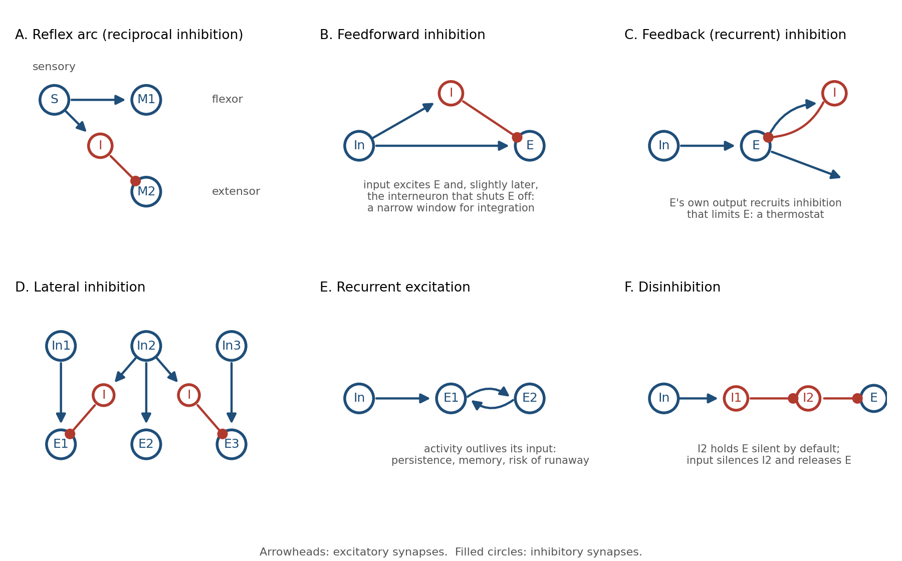{width="6.3in"}

*Figure 4.1. Six circuit motifs that recur throughout the nervous system. Arrowheads mark excitatory synapses, filled circles inhibitory ones.*

Feedforward excitation is the trivial case: a signal passes from one neuron to the next. Chains of it carry information from the senses toward the muscles. On its own it transmits but does not shape.

Feedforward inhibition adds a branch. The input excites a target neuron and, through an interneuron, inhibits the same target a millisecond or two later. The effect is a narrow window: the target can respond only to inputs that arrive close together in time. Inputs that straggle are cancelled. This motif turns a sluggish integrator into a coincidence detector, and it appears wherever timing precision matters, from the cerebellum to the auditory brainstem.

Feedback inhibition closes a loop. The target's own output recruits an interneuron that inhibits the target. The harder the population fires, the harder it is suppressed. This is a thermostat, and it is the primary reason cortical activity does not explode.

Lateral inhibition lets neighbors suppress one another. The neuron receiving the strongest input wins and silences its competitors. The consequences include sharpened contrast, winner-take-all selection, and the ability to represent a stimulus by which neuron is active rather than by how active everything is.

Recurrent excitation lets activity feed back on itself. A pattern of firing can be sustained after its input has gone, which is the basis of working memory and of pattern completion. It is also the most dangerous motif in the brain. Without inhibition to contain it, recurrent excitation is a seizure.

Disinhibition is inhibition of an inhibitor. A target is held silent by default; an input that suppresses the inhibitor releases the target. This sounds like a roundabout way to excite something, but it has a property direct excitation lacks: the default state is off, so nothing happens unless the circuit is explicitly opened. The basal ganglia, discussed below, are built almost entirely from it.

## Inhibition Is Not the Opposite of Excitation

Engineers encountering these motifs tend to file inhibition under "negative weights" and move on. That misses most of what inhibition does.

Roughly one in five cortical neurons is inhibitory, and those neurons come in dozens of types, each targeting a different part of the excitatory cell: the dendrites, the soma, the axon initial segment, or other interneurons. Because they target different compartments, they do different jobs. Inhibition at the dendrite vetoes particular inputs. Inhibition at the soma vetoes output. Inhibition at the axon initial segment controls exactly when a spike may leave.

Most importantly, excitation and inhibition are balanced. In an awake cortex, every excitatory input to a neuron is tracked by a nearly equal inhibitory input arriving a few milliseconds later. The neuron lives close to threshold, held there by two large forces that almost cancel. Small changes in either one move it across the line.

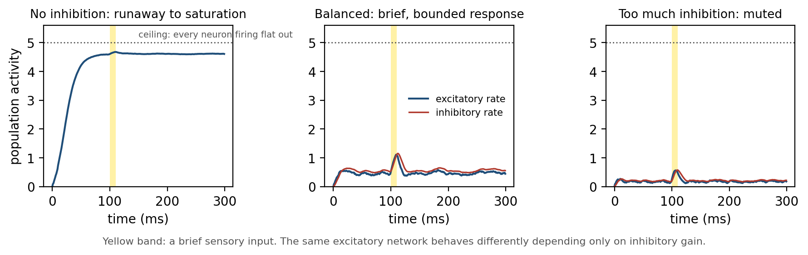{width="6.3in"}

*Figure 4.2. A simulated population of excitatory neurons receiving a brief input (yellow). With no inhibition, recurrent excitation drives the population to its ceiling. With balanced inhibition, the response is brief and proportionate. With excessive inhibition, the input barely registers.*

Figure 4.2 shows why this arrangement is worth its cost. A recurrently connected excitatory population with no inhibition does not respond to an input; it runs away until every cell is firing flat out. Add inhibition that tracks the excitation and the same population produces a brief, bounded response that ends when the input ends. Add too much and the response is muted. The balanced regime is expensive, because two large currents are spent to produce a small net effect, and it is the only regime in which the circuit is both sensitive and stable.

Balance is also what makes the circuit fast. A neuron held near threshold by opposing forces can be flipped by a single well-timed input. A neuron resting far below threshold must be dragged up first. Inhibition is not the brake on the system. It is what makes the system responsive.

## Computation Before the Brain

The retina shows how much can be done with these motifs before any signal reaches the cortex.

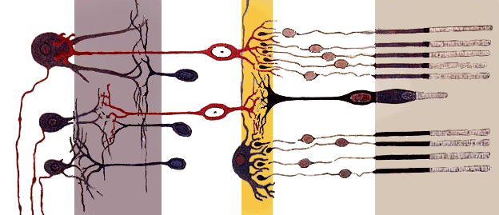{width="5.5in"}

*Figure 4.3. Santiago Ramón y Cajal's drawing of the vertebrate retina. Light enters from the left and crosses several layers of neurons before reaching the photoreceptors at the right; the processed signal leaves through the ganglion cell axons at the far left.*

Light falls on photoreceptors, but the signal that leaves the eye has already passed through three layers of circuitry. Horizontal cells implement lateral inhibition across the photoreceptor layer, so a uniformly lit region produces little output while an edge produces a strong one. Amacrine cells add feedforward and feedback inhibition that make ganglion cells sensitive to change in time as well as space. By the time the optic nerve leaves the eye, the image has been converted into a map of edges and changes. Uniform brightness, which carries no information, has been largely discarded.

The familiar illusion of Mach bands, in which a gradient appears to have bright and dark fringes at its boundaries, is lateral inhibition made visible. It is not an error. It is the signature of a circuit that trades a faithful copy of the input for an informative one, under a strict budget of axons.

## Circuits That Generate Their Own Rhythm

Some circuits do not wait for input at all.

Walking, swimming, breathing, chewing, and the peristalsis of the gut are rhythmic, and the rhythm is generated by small networks in the spinal cord and brainstem called central pattern generators. The surprising fact, established in the early twentieth century and confirmed many times since, is that these networks produce their rhythm without any rhythmic input. A spinal cord isolated from the brain and from sensory feedback will still generate the alternating pattern of locomotion when given a steady chemical or electrical drive.

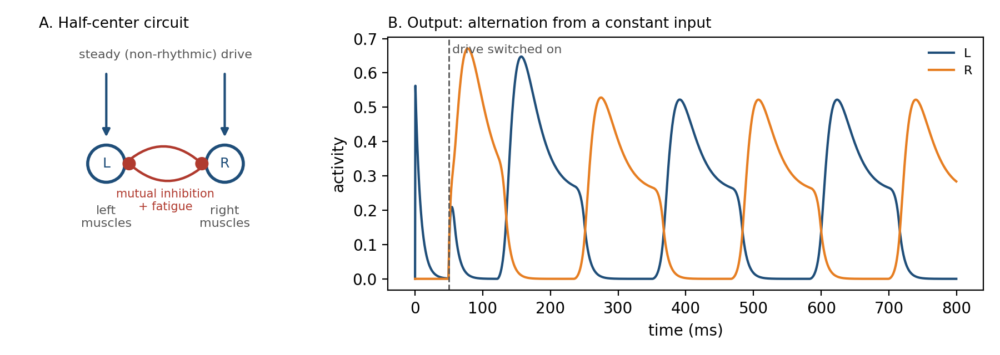{width="6.3in"}

*Figure 4.4. A half-center oscillator. Two populations inhibit each other and each fatigues while active. Given a constant drive, they alternate: the active side tires, the suppressed side escapes, and the cycle repeats.*

The minimal pattern generator is the half-center oscillator in Figure 4.4. Two populations inhibit each other, so only one can be active at a time. Each population also fatigues while active, through adaptation in its neurons or depression at its synapses. The active side weakens, its grip on the other side loosens, the other side escapes and takes over, and the cycle repeats. Mutual inhibition plus fatigue produces alternation from a constant input.

Sensory feedback does not drive the rhythm; it tunes it. Signals from the limbs adjust timing and amplitude so that a walking pattern survives a stone underfoot. The division of labor is the one Chapter 1 proposed: the controller generates, the world corrects.

## The Cortical Microcircuit

The cerebral cortex is a sheet a few millimeters thick, folded to fit the skull. Across its entire surface it is built from the same six-layered circuit, repeated millions of times.

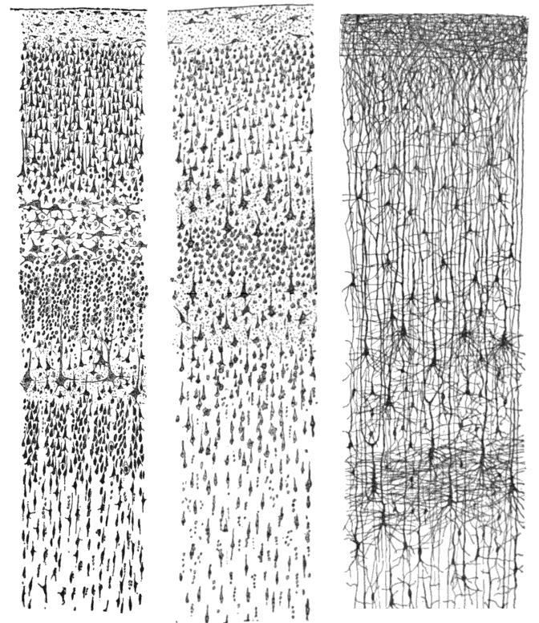{width="4.6in"}

*Figure 4.5. Three of Cajal's drawings of the cerebral cortex, stained to show cell bodies (left), the full extent of a few neurons (center), and the fibers connecting layers (right). The six layers are visible as bands of differing cell density.*

Input from the thalamus, the cortex's gateway for the senses, arrives mainly in layer 4. Layer 4 neurons project upward to layers 2 and 3, where most local processing and most connections to other cortical areas occur. Layers 2 and 3 project down to layer 5, which sends the cortex's output to the brainstem, spinal cord, and basal ganglia. Layer 6 projects back to the thalamus, closing a loop that lets the cortex modulate its own input.

Within this stack, every motif from Figure 4.1 is present. Feedforward inhibition sharpens the timing of thalamic input. Recurrent excitation among layer 2 and 3 neurons sustains and amplifies patterns. Feedback and lateral inhibition keep the amplification bounded. The whole arrangement has been called the canonical microcircuit, and it is approximately the same whether the cortex in question is processing vision, sound, touch, language, or plans.

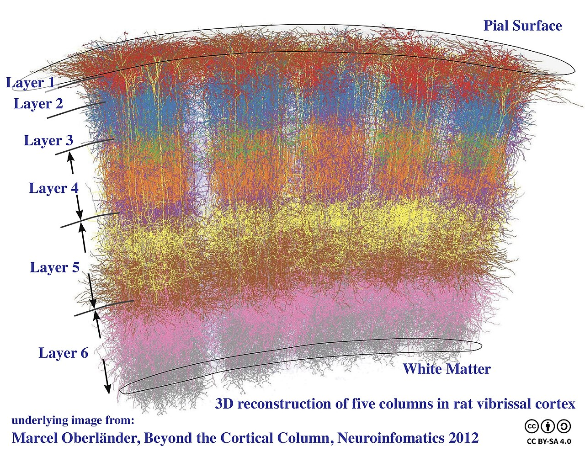{width="5.5in"}

*Figure 4.6. A three-dimensional reconstruction of five neighboring columns in rat somatosensory cortex, each corresponding to one whisker. The six layers run horizontally; the columns run vertically through all of them.*

Vertically, neurons that share a layer stack also share their inputs, forming columns like those in Figure 4.6. A column in visual cortex responds to one orientation at one location; a column in somatosensory cortex responds to one whisker. The column is not a rigid unit, and its boundaries blur in many species, but the principle is robust: the cortex is a tiled array of nearly identical circuits, differing mostly in what they are connected to.

This is the strongest hint in neuroanatomy that cortical computation is general. The same circuit learns to see or to hear depending on where its input comes from, which is why, in a famous series of experiments, visual input rerouted to auditory cortex during development produced a cortex that could see.

## Two Loops for Action

The cortex proposes. Two subcortical systems dispose, in different ways.

The basal ganglia solve the problem of selection. At any moment the cortex represents many candidate actions in parallel, and the body can perform only one. The basal ganglia are built almost entirely from the disinhibition motif. Their output nuclei fire continuously, holding the thalamus and brainstem motor circuits under tonic inhibition, so that by default no action is released. A cortical pattern that excites the striatum, the input stage, inhibits the inhibitors covering one action, and that action alone is freed.

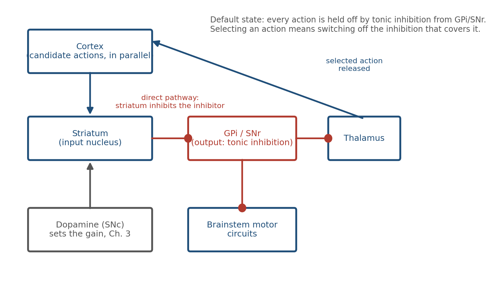{width="5.8in"}

*Figure 4.7. The direct pathway through the basal ganglia. Output nuclei inhibit motor targets by default; the striatum selects an action by inhibiting the inhibition that covers it. Dopamine sets how readily the striatum does this.*

The design has two features that matter. Because the default is off, the system fails safe: damage tends to produce too little movement, as in Parkinson's disease, rather than uncontrolled movement. And because dopamine acts on the striatum, the prediction error of Chapter 3 arrives at exactly the synapses that decide which action is released. The basal ganglia are where "learning should happen now" meets "this is what was chosen." Habits are the result.

The cerebellum solves a different problem: precision. It contains more neurons than the rest of the brain combined, arranged in a circuit of striking regularity. Each Purkinje cell receives about two hundred thousand weak inputs from parallel fibers, carrying the current state of the body and the current motor command, and a single powerful input from one climbing fiber, which fires when a movement goes wrong.

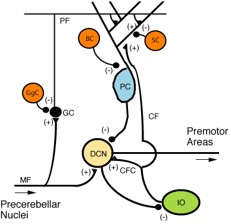{width="4.6in"}

*Figure 4.8. The cerebellar microcircuit. Mossy fibers (MF) and parallel fibers (PF) carry context to the Purkinje cell (PC); a single climbing fiber (CF) from the inferior olive (IO) carries an error signal. Purkinje cells inhibit the deep cerebellar nuclei (DCN), the cerebellum's output.*

The climbing fiber is a teaching signal. When it fires, the parallel fiber synapses that were recently active are weakened, which is an eligibility trace mechanism of the kind Chapter 3 described, implemented in a circuit so regular that it was one of the first to be modeled mathematically. Over repetitions, the cerebellum learns to predict the sensory consequences of a command and to issue corrections before errors occur. Reaching, balance, eye movements, and the timing of speech all depend on it. Its lesions do not abolish movement; they make movement clumsy.

## The Hippocampal Loop

The hippocampus is the circuit most closely identified with memory, and its anatomy is a chain of the motifs already described.

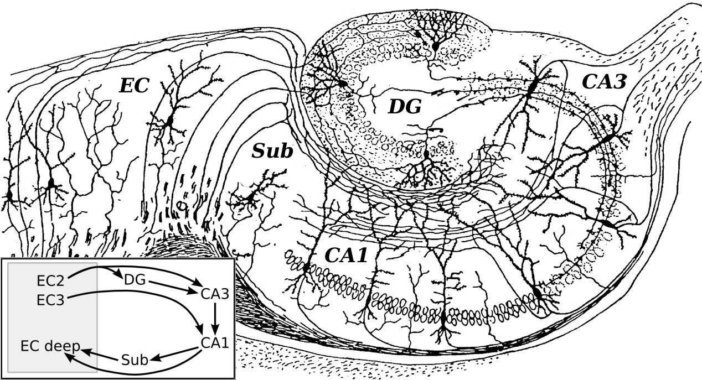{width="5.8in"}

*Figure 4.9. Cajal's drawing of the hippocampal formation, with a modern summary of its main pathway: entorhinal cortex (EC) to dentate gyrus (DG) to CA3 to CA1 and back to entorhinal cortex.*

Cortical input enters through the entorhinal cortex and passes to the dentate gyrus, whose sparse, strongly inhibited granule cells make similar inputs less similar, a process called pattern separation. The dentate projects to CA3, whose pyramidal cells are densely connected to one another: recurrent excitation on a large scale. A partial cue that activates some CA3 cells can regenerate the whole pattern, which is pattern completion. CA3 projects to CA1, which compares the retrieved pattern with the current input and returns the result to the cortex.

Separation, storage, completion, and comparison, in that order, each implemented by a motif from Figure 4.1. The circuit is described here only in outline; Chapter 5 returns to how its synapses change.

## Rhythms

If circuits are the brain's structure, rhythms are its timing.

Record from the scalp and you see oscillations: slow waves during deep sleep, theta during exploration and memory tasks, alpha over idle cortex, beta while a posture or a plan is held, and fast gamma wherever local processing is intense. Figure 4.10 shows one second of each.

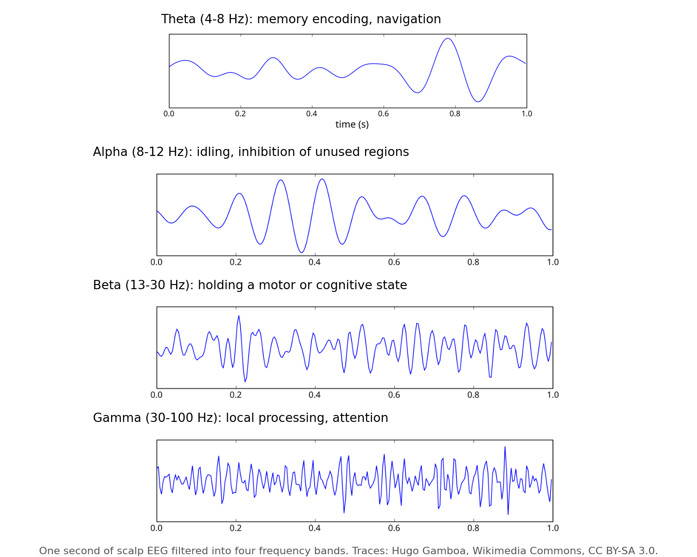{width="5.8in"}

*Figure 4.10. One second of scalp EEG filtered into four frequency bands. Each band is associated with a characteristic behavioral state, though the associations are statistical rather than exclusive.*

Oscillations are the collective behavior of circuits built from the motifs above. Feedback inhibition is intrinsically rhythmic: excitation recruits inhibition, inhibition silences excitation, inhibition decays, excitation recovers. A population of excitatory cells coupled to a population of fast interneurons oscillates in the gamma range for exactly this reason.

Rhythms do work. A neuron is most excitable at one phase of the oscillation and least at the opposite phase, so a shared rhythm creates windows during which inputs are effective. Two regions oscillating in phase can communicate; two regions out of phase cannot, even if they are wired together. Changing the phase relation changes the effective wiring without changing a synapse. This is the brain's answer to a problem every large network has: how to route information through fixed connections.

Rhythms also coordinate learning. In the hippocampus, place cells fire at progressively earlier phases of the theta cycle as an animal crosses a location, compressing a sequence of seconds into a sequence of tens of milliseconds. That compressed sequence falls within the window in which synapses can change. The rhythm converts experience into a format plasticity can use.

## The Architecture of the Whole

Step back from any single region and the brain is a network of regions. Its wiring is neither random nor fully regular, and the compromise it strikes is the same one found in power grids, social networks, and the internet.

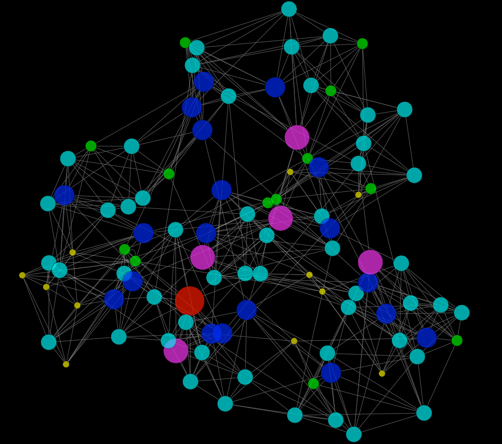{width="4.3in"}

*Figure 4.11. A small-world network: most connections are local, a few are long-range. The result is dense local clustering with short paths between any two nodes.*

Most connections are short, linking neighbors into dense clusters. A minority are long, linking clusters to one another. The result is a small-world network: any two neurons are only a few synapses apart, yet almost all wiring is local and cheap. Long axons are metabolically expensive, occupy volume, and slow signals, so the brain uses as few of them as it can while keeping the path length between regions short.

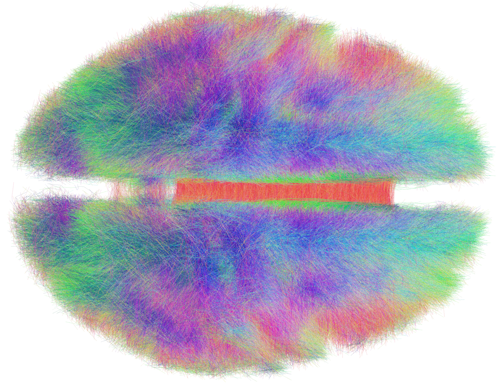{width="5.5in"}

*Figure 4.12. Long-range fiber tracts of the human brain reconstructed from diffusion MRI, viewed from above. Colors indicate fiber direction.*

A few regions are hubs with far more long-range connections than average, and these hubs are disproportionately connected to one another, forming a core through which most long-distance traffic passes. The arrangement is efficient and fragile in the same way an airline network is: it makes the system fast, and it makes damage to a hub far more consequential than damage elsewhere. Several neurological and psychiatric conditions are now described, at least in part, as disorders of the hubs.

## Coordination Without a Conductor

Chapter 1 claimed that the brain has no central controller. This chapter has described the machinery that makes a controller unnecessary.

Reflexes handle the fastest demands locally. Pattern generators produce rhythmic behavior on their own and accept correction from the body. Balanced inhibition keeps every circuit sensitive without letting it run away. The basal ganglia release one action at a time by default silence. The cerebellum corrects movements before errors are felt. Rhythms decide which regions can talk to which, moment by moment. A small-world wiring plan keeps all of this within a few synapses of everything else.

No component sees the whole. Each solves a local problem using the same small vocabulary of motifs, and the behavior of the animal is what those local solutions add up to. The pattern is meaningful, as Sherrington said, and never abiding: it is re-created from moment to moment by circuits that were never designed to produce it.

## Implications for Artificial Intelligence

Artificial neural networks borrowed the neuron and left the circuit behind. Several of this chapter's lessons bear directly on how that might be repaired.

First, inhibition is not a negative weight. In most artificial networks a unit's output can be positive or negative, and nothing enforces balance. Biological circuits maintain excitation and inhibition as separate populations and keep them in near-cancellation, which buys speed, stability, and sensitivity at once. Architectures that enforce this division are a largely unexplored design space.

Second, selection by disinhibition is a different control strategy from choosing the largest output. The basal ganglia hold all actions off by default and release one. The default of silence makes the system fail safe and makes "do nothing" a first-class action, which is often what an agent in an uncertain environment should do.

Third, rhythm is a routing mechanism. Fixed weights cannot change which parts of a network talk to each other, so artificial systems add attention mechanisms to do it. The brain does it with phase. Oscillatory gating offers a way to reconfigure effective connectivity without changing parameters, at low cost.

Fourth, the brain's wiring budget shapes its architecture. Small-world organization, local clustering, and sparse long-range connections are consequences of paying for every axon. Artificial networks pay nothing for connections and are correspondingly dense. As energy becomes the binding constraint on large models, the brain's economies are worth studying.

Finally, the cortex suggests that general computation can come from a single repeated circuit with different inputs. The question of what that circuit is doing, in a form abstract enough to transfer, remains open. It is one of the most important open problems in both neuroscience and machine learning.

## The Central Lesson

Behavior belongs to circuits, not cells. The nervous system builds its circuits from a small vocabulary of motifs in which inhibition does most of the shaping, stacks them into regions that each solve one kind of problem, and coordinates the regions through rhythm and a wiring plan that keeps everything close. No part is in charge. Coordinated behavior is what the parts produce together.

## Next Chapter

Chapter 5: Plasticity and Memory --- How Experience Becomes Structure

## Figure Credits

Figures 4.1, 4.2, 4.4, and 4.7 were drawn for this book. Figure 4.2 and the output trace in Figure 4.4 are simulations of simple rate models.

Figure 4.3: Santiago Ramón y Cajal, structure of the mammalian retina (1900), public domain, via Wikimedia Commons.

Figure 4.5: Santiago Ramón y Cajal, drawings of the cerebral cortex (1899), public domain, via Wikimedia Commons.

Figure 4.6: "Cortical Columns," underlying image from Marcel Oberländer, Beyond the Cortical Column, Neuroinformatics 2012; composite by Wikimedia Commons user Bodysurfinyon, CC BY-SA 4.0.

Figure 4.8: "CerebCircuit" by Wikipedia user Nrets, CC BY-SA 3.0, via Wikimedia Commons.

Figure 4.9: Santiago Ramón y Cajal, drawing of the hippocampus (1911), public domain, with circuit inset added by Wikimedia Commons contributors.

Figure 4.10: EEG band traces by Hugo Gamboa, CC BY-SA 3.0, via Wikimedia Commons; composite drawn for this book.

Figure 4.11: "Watts-Strogatz small-world model, 100 nodes" by Wikimedia Commons user Keiono, CC BY-SA 3.0.

Figure 4.12: "The Human Connectome" by Wikimedia Commons user Andreashorn, CC BY-SA 4.0.
