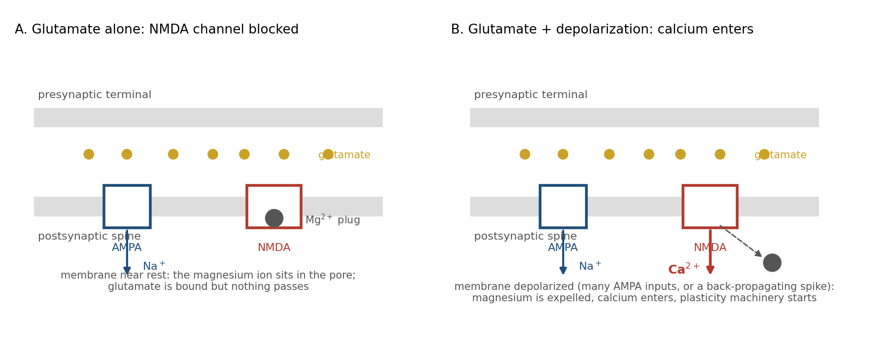
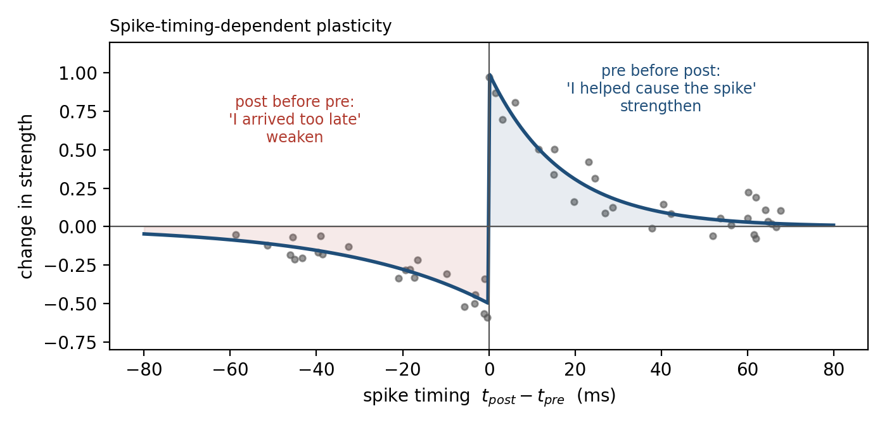
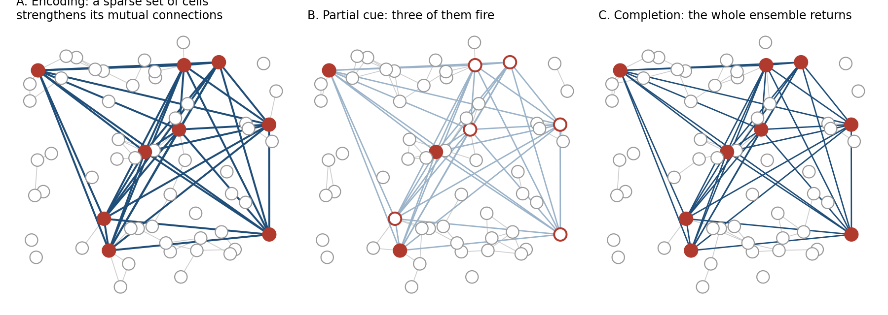
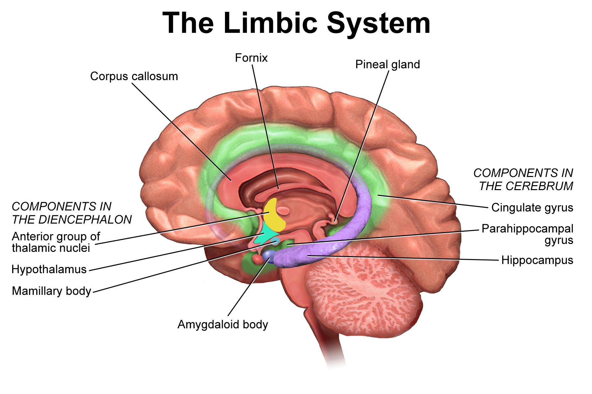
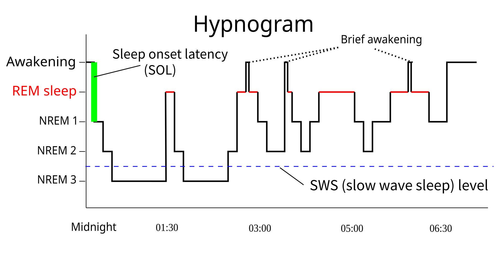
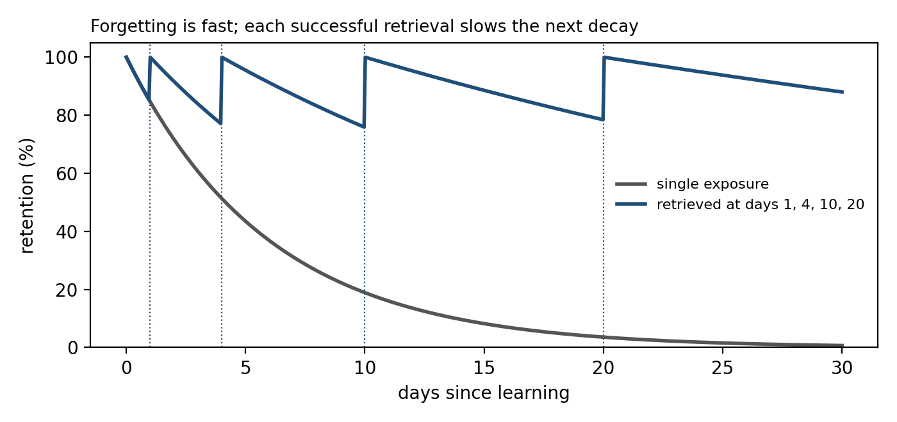
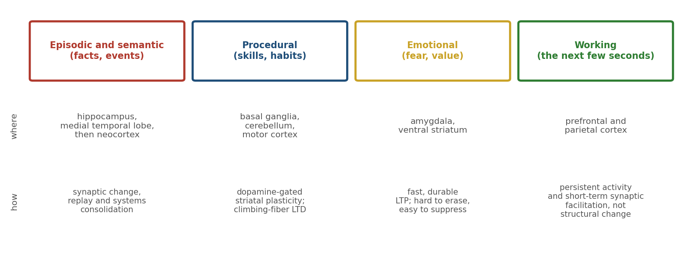

> *"When an axon of cell A is near enough to excite a cell B and repeatedly or persistently takes part in firing it, some growth process or metabolic change takes place in one or both cells such that A's efficiency, as one of the cells firing B, is increased."*
>
> --- Donald Hebb, *The Organization of Behavior* (1949)

# Memory Is Not Storage

Every chapter so far has ended at the same door. Chapter 1 said that the brain has no reset button because every experience leaves a trace. Chapter 2 said that a neuron cannot hold a variable, so learning must be physical change. Chapter 3 said that neuromodulators decide when that change is permitted. Chapter 4 said that the hippocampus separates, stores, completes, and compares, and deferred the question of how its synapses change. This chapter walks through the door.

The first thing to leave behind is the vocabulary of storage. A computer writes a value to an address and reads it back unchanged. Nothing in the brain does this. There is no address, no write operation, and no read that leaves the record as it found it. What there is instead is a system whose physical structure is altered by use, so that the next time similar activity arrives it unfolds differently. Memory is not something the brain has. It is something the brain's tissue has become.

This reframing is not a philosophical nicety. It predicts most of what follows: why learning is slow, why memories blur into one another, why recalling a memory can change it, why sleep matters, and why forgetting is a mechanism rather than a malfunction.

# What Can Change

Hebb's postulate, quoted above, is the founding statement of the field, and it is deliberately vague about mechanism: "some growth process or metabolic change."[^1] Seventy-five years later the list of things that can change is long. The important ones fall into four groups.

The strength of an existing synapse can change. On the presynaptic side, the probability that an action potential releases neurotransmitter can rise or fall. On the postsynaptic side, the number of receptors in the membrane can be increased or reduced within minutes, by inserting or removing receptor proteins from a reserve just beneath the surface. A synapse that doubles its receptors roughly doubles its effect.[^2]

The structure of the synapse can change. Most excitatory synapses on cortical neurons sit on dendritic spines, small protrusions a micrometer long. Spines grow, shrink, appear, and vanish. A spine that enlarges carries a stronger synapse; a spine that disappears takes its synapse with it. Imaging the same neurons over weeks shows a population of spines in constant slow turnover, with a stable core that persists for the life of the animal and a changeable fringe that reflects recent experience.[^3]

The neuron's own excitability can change. The density and type of ion channels in the membrane are adjusted by activity, so that the same synaptic input produces more or fewer spikes. This is plasticity of the cell rather than of the connection, and it is less specific but often faster.[^4]

Finally, new synapses can form between neurons that were not connected, and in a few regions, chiefly the dentate gyrus of the hippocampus, new neurons are born throughout life.[^5] These are the slowest changes and the ones most clearly tied to structural growth.

All four share a property that distinguishes them from writing to memory: they are modifications of machinery that is also doing something else. The synapse that is strengthened is still transmitting. The spine that grows is still part of a dendrite that integrates thousands of inputs. There is no separate medium.

# Hebb's Rule and Its Problem

Hebb's postulate says that cells that fire together wire together. The strength of a synapse should increase when the presynaptic and postsynaptic neurons are active at the same time.

This rule is attractive because it is local. Each synapse needs only information available at the synapse itself, the activity of the two cells it joins, and no global error signal. It also has an immediate problem, which the first computational models exposed in the 1970s: it only goes up.[^6] A synapse strengthened by correlated activity makes that correlation more likely, which strengthens it further. Left alone, Hebbian learning drives every active synapse to its ceiling and erases whatever selectivity it began with.

A working learning rule therefore needs three things Hebb did not specify: a way to weaken synapses, a bound on how strong they can become, and a criterion for which correlations count. The biology supplies all three, and the rest of this chapter is largely an account of how.

# The Coincidence Detector

The mechanism that implements Hebb's "fire together" is a single protein, the NMDA receptor.

Most fast excitatory transmission uses AMPA receptors: glutamate binds, the channel opens, sodium enters, the membrane depolarizes. The NMDA receptor also binds glutamate and also conducts, but at the resting membrane potential its pore is plugged by a magnesium ion from outside the cell.[^7] Glutamate alone opens nothing. The plug is expelled only when the membrane is already depolarized, by many simultaneous AMPA inputs or by an action potential propagating back from the soma into the dendrite.[^8]

So the NMDA receptor conducts only when two conditions hold at once: the presynaptic neuron has released glutamate, and the postsynaptic neuron is depolarized. It is a molecular AND gate for the two halves of Hebb's rule. What passes through it when it opens is calcium, and calcium is the signal that sets the plasticity machinery in motion.[^9]

Figure 5.1 shows the two states. In the first, glutamate is bound but the magnesium plug holds and nothing passes. In the second, depolarization has removed the plug, calcium enters, and a cascade of enzymes begins that can last for hours.

# LTP and LTD

The two outcomes of that cascade are long-term potentiation, a lasting increase in synaptic strength, and long-term depression, a lasting decrease. LTP was first measured in the hippocampus in 1973; LTD was established in the cerebellum in 1982 and in the hippocampus a decade after LTP. Both are now known throughout the brain.[^10]

What decides the direction is the calcium signal itself. A large, brief rise in calcium, the kind produced by strong input coinciding with postsynaptic spikes, activates kinases, which add phosphate groups to proteins and drive extra AMPA receptors into the synapse. A smaller, more prolonged rise, the kind produced by weak or poorly timed input, preferentially activates phosphatases, which remove phosphate groups and pull receptors out. The same ion in different amounts produces opposite results (Figure 5.2A).[^11]

Experimentally, a second of stimulation at 100 Hz potentiates a synapse within minutes and the potentiation persists for hours in a slice and for weeks or longer in a living animal. Fifteen minutes at 1 Hz depresses the same synapse (Figure 5.2B).[^12] Neither effect requires anything from outside the synapse and its immediate neighborhood. Hebb's growth process is real, and so is its opposite.

LTP has two phases. Early LTP, lasting an hour or two, uses proteins already present in the spine. Late LTP requires new protein synthesis and gene expression in the nucleus, and it is accompanied by visible enlargement of the spine. Block protein synthesis within an hour of learning and the memory forms but does not last.[^13] This is the first of the chapter's two consolidation clocks.

# Timing Is Causation

Hebb's phrase "takes part in firing" contains a subtlety that the rate-based LTP experiments missed. For cell A to take part in firing cell B, A must fire first.

Experiments in the late 1990s, pairing single presynaptic and postsynaptic spikes at controlled intervals, showed that the synapse respects this order. If the presynaptic spike precedes the postsynaptic spike by a few milliseconds to a few tens of milliseconds, the synapse strengthens. If the order is reversed, it weakens. The effect falls off exponentially with the interval and is negligible beyond about 50 ms in either direction (Figure 5.3).[^14]

This is spike-timing-dependent plasticity, and its logic is causal. A synapse whose input arrived just before the neuron fired may have helped cause the spike, and it is rewarded. A synapse whose input arrived just after the spike could not have contributed, and it is penalized. The window is set by the kinetics of the NMDA receptor: a back-propagating spike that arrives while glutamate is still bound expels the magnesium and admits a large calcium pulse; one that arrives before the glutamate finds the receptor closed, and the glutamate that follows meets a membrane that has already repolarized, producing only a small, slow calcium signal.[^15]

The timing rule does two things rate-based Hebbian learning cannot. It strengthens chains of neurons that fire in sequence, which is how a circuit can learn an ordered pattern. And it provides the weakening that Hebb's rule lacked, applied precisely to the connections that fire out of order.[^16]

# Keeping the Whole Neuron Stable

Local rules, even with weakening built in, do not by themselves keep a neuron's total input within a usable range. A neuron whose synapses have all been potentiated fires to everything; one whose synapses have all been depressed fires to nothing. Two further mechanisms, operating on the whole cell rather than the single synapse, prevent this.

The first adjusts the rule itself. The calcium threshold that separates LTD from LTP is not fixed; it slides with the neuron's recent average activity. After a period of intense firing the threshold rises, so that the same input now produces depression where before it produced potentiation. After a quiet period it falls. This sliding threshold, proposed by Bienenstock, Cooper, and Munro in 1982, makes the neuron self-correcting: the more it fires, the harder it becomes to strengthen its inputs (Figure 5.4A).[^17]

The second adjusts all the synapses at once. If a neuron's firing stays too high for hours, every excitatory synapse on it is scaled down by the same factor; if too low, all are scaled up. Because the scaling is multiplicative, the ratios between synapses, which is where the learned information lives, are preserved (Figure 5.4B). This synaptic scaling is slow, on the order of a day, and it is the cellular counterpart of the excitation-inhibition balance of Chapter 4.[^18]

Inhibitory synapses are plastic too, and their plasticity is largely homeostatic: inhibition onto a neuron grows in step with the excitation it receives.[^19] Between the sliding threshold, scaling, and inhibitory plasticity, the brain solves the stability problem that a pure Hebbian rule creates, and it does so without a global supervisor.

# The Third Factor

Chapter 3 described a three-factor rule: a synapse changes when it was recently active, when its neuron fired, and when a neuromodulatory signal arrives saying that something significant happened. The mechanisms in this chapter supply the first two factors. The third plugs into them in a specific place.[^20]

Early LTP sets a tag at the synapse, a transient biochemical mark lasting an hour or two. Late LTP requires proteins that are made in the cell body and shipped to every dendrite. Only tagged synapses capture them. A weak stimulus that sets a tag but does not trigger protein synthesis produces LTP that fades, unless, within the tag's lifetime, something else triggers synthesis. Dopamine, acting on the cell, is one of the things that can.[^21] The result is that a synapse activated during an unremarkable event can be consolidated retroactively by a reward that arrives an hour later. This is synaptic tagging and capture, and it is the eligibility trace of Chapter 3 seen at the level of molecules.[^22]

# From Synapse to Engram

A memory is not a synapse. It is a pattern of strengthened connections among a set of neurons, and the set is sparse: in the hippocampus and amygdala, a few percent of the cells in a region take part in encoding any particular event.[^23]

The word for this set is the engram, a term coined in 1904 for a hypothetical physical trace of memory.[^24] For a century the engram was an inference. In the last fifteen years it has become an experimental object. Neurons that are active during a learning event can be labeled genetically and later made to fire with light. Reactivating them, in the absence of any cue, produces the behavior the animal learned, such as freezing in a chamber where it was once shocked. Silencing them prevents recall even when the cue is present. And activating the engram of one place while an animal is being shocked in another creates a memory of a fear that never happened: the animal later freezes in the first place.[^25]

These experiments establish that a specific, identifiable set of cells and connections is both necessary and sufficient for a specific memory.[^26] They also show the mechanism of recall that Chapter 4 called pattern completion. The engram cells are connected to one another more strongly than to their neighbors, as in Figure 5.5. A cue that activates a few of them drives the rest through those connections, and the whole pattern returns. Recall is a dynamical event, not a lookup.[^27]

# Two Clocks

A memory that has been encoded is not yet durable. It becomes durable through two processes on very different timescales (Figure 5.7A).

Synaptic consolidation is the hour-scale transition from early to late LTP described above: protein synthesis, spine growth, and the structural stabilization of the changed synapses. During this window the memory can be blocked by drugs, by a second competing experience, or by a blow to the head. After it, the memory survives these insults.[^28]

Systems consolidation is the transfer, over weeks to years, of the memory from dependence on the hippocampus to independence from it. Patients with hippocampal damage lose the ability to form new episodic memories and lose recent memories, but retain old ones, with the boundary falling years before the injury.[^29] The hippocampus, on this account, holds a rapidly formed index that binds together the cortical regions that represented the experience. Over time, repeated reactivation strengthens the direct cortical connections until the index is no longer needed.[^30]

The theory that explains why the brain would bother with two systems was set out in 1995 by McClelland, McNaughton, and O'Reilly, and it is the most important idea in this chapter for readers from machine learning. A single network that learns fast enough to capture a single experience will overwrite what it already knows; this is catastrophic interference, and it is a mathematical property of distributed representations, not a biological quirk.[^31] A network that learns slowly enough to avoid interference cannot capture a single experience at all. The solution is two networks: a fast, sparse hippocampal learner that stores each day's events with minimal overlap, and a slow cortical learner that extracts their statistical structure. The fast one trains the slow one gradually, by replaying its contents interleaved with everything else (Figure 5.7B).[^32]

# Sleep

The replay is real, and it happens mainly during sleep.[^33]

Place cells in the hippocampus fire in sequence as an animal runs along a track. During the slow-wave sleep that follows, the same cells fire in the same sequence, compressed roughly twentyfold, during brief high-frequency events called sharp-wave ripples.[^34] The ripples drive cortical activity.[^35] Disrupt them selectively and the animal's memory of the track is impaired; prolong them and it improves.[^36] Cue a memory during sleep, with an odor or a sound that was present during learning, and that memory is preferentially strengthened.[^37]

Sleep also appears to do a complementary job: scaling down. Synapses strengthened during the day make the cortex progressively more excitable and more expensive to run. Across a night of slow-wave sleep the average synaptic strength falls, by the homeostatic mechanisms of the previous section. The net effect is to preserve the ratios that encode what was learned while returning the total to a sustainable baseline. On this view sleep is not a pause in learning but its second half.[^38]

# Recall Changes the Record

Because recall is reactivation of the engram, and reactivation reopens the window of synaptic plasticity, recalling a memory makes it labile again. For some hours after retrieval, a consolidated memory can be strengthened, weakened, or altered, and must be reconsolidated to persist. Block protein synthesis in that window and the memory, which was stable the day before, is lost.[^39]

This reconsolidation is the mechanism behind two things that look like faults from the storage point of view. Memories drift: each recall is an opportunity for the present context to be blended into the trace, and eyewitnesses who have told their story many times are confident and wrong in ways that match what they have been told since.[^40] And memories can be revised: a fear memory reactivated and then given corrective information in the reconsolidation window is weakened more durably than one treated outside it, which is the basis of several clinical approaches to trauma.[^41]

A record that changes when read is a bad database. It is a good adaptive system, because the point of a memory is not fidelity to the past but usefulness in the future, and the future keeps changing.

# Forgetting Is a Mechanism

The default fate of a memory is to be lost. Ebbinghaus measured the forgetting curve in 1885 on himself and lists of nonsense syllables; it has been replicated for every kind of material since.[^42] Retention drops steeply in the first hours and days and then more slowly, and the curve is roughly the same whether the material is nonsense or meaningful. What changes with meaning is the starting point, not the shape.

Three things slow the curve. Retrieval slows it: a memory that is actively recalled, rather than re-read, decays more slowly afterward, and the effect grows when the retrievals are spaced out (Figure 5.9).[^43] Sleep slows it, through the consolidation above. And emotional significance slows it, through the third factor.[^44]

Forgetting is also actively produced. The dentate gyrus grows new neurons throughout life, and their integration rewires existing circuits; increasing neurogenesis in mice accelerates the loss of recent memories, and suppressing it preserves them.[^45] Small signaling proteins in the spine actively shrink synapses that are not being used.[^46] These mechanisms cost energy, which is the strongest evidence that forgetting is not decay but function. A system that must remain flexible cannot afford to keep everything, and what it keeps must be generalized, which means the specifics must go.[^47]

# Kinds of Memory, Kinds of Circuit

Psychology distinguishes many kinds of memory: episodic and semantic, procedural, emotional, working. The distinction is real, but it is not a hierarchy of storage tiers. Each kind is a different circuit using a different physical mechanism (Figure 5.10).[^48]

Episodic and semantic memory, the memory for events and facts, depend on the hippocampus and its systems consolidation into cortex. Procedural memory, for skills and habits, lives in the basal ganglia and cerebellum of Chapter 4, where dopamine-gated striatal plasticity and climbing-fiber-driven cerebellar LTD change what the body does without any episode being recalled.[^49] Emotional memory depends on the amygdala, where LTP is fast, durable, and notoriously hard to erase, which is why fear is easily learned and rarely unlearned, only suppressed.[^50] Working memory, the few seconds of holding a number in mind, is not synaptic change at all but persistent activity in prefrontal and parietal circuits, sustained by the recurrent excitation of Chapter 4 and by short-term facilitation of synapses that lasts seconds and leaves no structural trace.[^51]

A patient can lose one of these without the others. The amnesic patient H. M., who could form no new episodic memories after his hippocampi were removed, learned to trace a star in a mirror as well as anyone, improving day by day while denying each day that he had ever seen the task. His skill was in a circuit his lesion had not touched.[^52]

# Why Learning Is Slow

Chapter 1 promised that learning is slow because physical change is slow. This chapter has shown the detail. Early LTP takes minutes; late LTP takes hours and new protein; systems consolidation takes weeks; a skill takes thousands of repetitions because striatal and cerebellar synapses change by small increments gated by a scarce teaching signal.

But the chapter has also shown that the slowness is not only a limitation of the hardware. It is a design requirement. The stability-plasticity dilemma, the fact that a system cannot both change quickly and retain what it knows, is solved by learning slowly in the cortex and letting the hippocampus take the speed.[^53] Fast learning is quarantined to a structure built for it, and everything else changes at a pace that protects what is already there. Slowness is the price of not overwriting yourself, which, for a system without a reset button, is the price of staying coherent.

# Implications for Artificial Intelligence

Memory is where biological and artificial learning differ most, and where the biology has the most to offer.

First, catastrophic interference is the central unsolved problem of continual learning in artificial networks, and the brain's solution is architectural: two learners with different rates, and replay to interleave them. Experience replay in reinforcement learning is a direct borrowing. Systems that train a fast episodic store and distill it gradually into slow weights are the closest artificial analog of consolidation.[^54]

Second, local rules can be enough. Backpropagation needs a global error signal delivered to every weight. LTP, LTD, and timing-dependent plasticity need only what is present at the synapse plus a broadcast modulator. Whether local three-factor rules can match gradient descent on hard problems is open, but the brain is an existence proof that they can learn language, motor skill, and science.[^55]

Third, stability must be engineered. Pure Hebbian learning runs away, and the brain's answer is a sliding threshold, synaptic scaling, and inhibitory plasticity. Normalization layers and weight decay are rough analogs; a homeostatic mechanism that adapts to each unit's own history is closer to the biology and less explored.[^56]

Fourth, forgetting should be a mechanism, not an accident. A model that stores everything generalizes poorly and grows without bound. The brain spends energy to remove specifics and keep gist. Artificial systems mostly have no equivalent to deliberate, selective forgetting.

Finally, a memory that changes when read is a feature. Artificial retrieval systems return the stored record unchanged. Biological recall reconsolidates, blending the record with the present. That costs fidelity and buys relevance. For agents that must act in a changing world, the trade is worth considering.

# The Central Lesson

Experience becomes structure. A coincidence detector at the synapse turns correlated activity into calcium, calcium into receptor traffic and spine growth, and spine growth into a lasting change in what the circuit does next. Whole-cell mechanisms keep the process stable, neuromodulators decide when it counts, and two consolidation clocks turn a day's traces into durable knowledge without overwriting the knowledge that was there. Recall reopens the trace, and forgetting prunes it. Nothing is stored. Everything is rebuilt.

# Next Chapter

Chapter 6: Perception as Inference --- How the Brain Sees What It Expects

# References and Attribution

## Figure Attribution

Figures 5.1, 5.2, 5.3, 5.4, 5.5, 5.7, 5.9, and 5.10 were drawn for this book. The traces in Figure 5.2B and the curves in Figures 5.3 and 5.9 are illustrative simulations, not data.

Figure 5.6: "Limbic System" by BruceBlaus (Blausen.com staff, "Medical gallery of Blausen Medical 2014," WikiJournal of Medicine), CC BY 3.0, via Wikimedia Commons.

Figure 5.8: "Sleep Hypnogram" by Wikimedia Commons user RazerM, CC BY-SA 3.0; composited on a white background.

## Epigraph

Donald O. Hebb, *The Organization of Behavior: A Neuropsychological Theory* (Wiley, 1949), p. 62.

## References

Abraham, W. C., & Robins, A. (2005). Memory retention: The synaptic stability versus plasticity dilemma. *Trends in Neurosciences*, 28(2), 73–78.

Abraham, W. C., Logan, B., Greenwood, J. M., & Dragunow, M. (2002). Induction and experience-dependent consolidation of stable long-term potentiation lasting months in the hippocampus. *Journal of Neuroscience*, 22(21), 9626–9634.

Akers, K. G., Martinez-Canabal, A., Restivo, L., Yiu, A. P., De Cristofaro, A., Hsiang, H.-L., Wheeler, A. L., Guskjolen, A., Niibori, Y., Shoji, H., Ohira, K., Richards, B. A., Miyakawa, T., Josselyn, S. A., & Frankland, P. W. (2014). Hippocampal neurogenesis regulates forgetting during adulthood and infancy. *Science*, 344(6184), 598–602.

Altman, J., & Das, G. D. (1965). Autoradiographic and histological evidence of postnatal hippocampal neurogenesis in rats. *Journal of Comparative Neurology*, 124(3), 319–335.

Artola, A., & Singer, W. (1993). Long-term depression of excitatory synaptic transmission and its relationship to long-term potentiation. *Trends in Neurosciences*, 16(11), 480–487.

Bi, G.-Q., & Poo, M.-M. (1998). Synaptic modifications in cultured hippocampal neurons: Dependence on spike timing, synaptic strength, and postsynaptic cell type. *Journal of Neuroscience*, 18(24), 10464–10472.

Bienenstock, E. L., Cooper, L. N., & Munro, P. W. (1982). Theory for the development of neuron selectivity: Orientation specificity and binocular interaction in visual cortex. *Journal of Neuroscience*, 2(1), 32–48.

Bliss, T. V. P., & Collingridge, G. L. (1993). A synaptic model of memory: Long-term potentiation in the hippocampus. *Nature*, 361, 31–39.

Bliss, T. V. P., & Lømo, T. (1973). Long-lasting potentiation of synaptic transmission in the dentate area of the anaesthetized rabbit following stimulation of the perforant path. *Journal of Physiology*, 232(2), 331–356.

Bouton, M. E. (2004). Context and behavioral processes in extinction. *Learning & Memory*, 11(5), 485–494.

Brunet, A., Orr, S. P., Tremblay, J., Robertson, K., Nader, K., & Pitman, R. K. (2008). Effect of post-retrieval propranolol on psychophysiologic responding during subsequent script-driven traumatic imagery in post-traumatic stress disorder. *Journal of Psychiatric Research*, 42(6), 503–506.

Buzsáki, G. (2015). Hippocampal sharp wave-ripple: A cognitive biomarker for episodic memory and planning. *Hippocampus*, 25(10), 1073–1188.

Caporale, N., & Dan, Y. (2008). Spike timing-dependent plasticity: A Hebbian learning rule. *Annual Review of Neuroscience*, 31, 25–46.

Cepeda, N. J., Pashler, H., Vul, E., Wixted, J. T., & Rohrer, D. (2006). Distributed practice in verbal recall tasks: A review and quantitative synthesis. *Psychological Bulletin*, 132(3), 354–380.

Corkin, S. (2002). What's new with the amnesic patient H.M.? *Nature Reviews Neuroscience*, 3(2), 153–160.

Davis, R. L., & Zhong, Y. (2017). The biology of forgetting: A perspective. *Neuron*, 95(3), 490–503.

de Vivo, L., Bellesi, M., Marshall, W., Bushong, E. A., Ellisman, M. H., Tononi, G., & Cirelli, C. (2017). Ultrastructural evidence for synaptic scaling across the wake/sleep cycle. *Science*, 355(6324), 507–510.

Denny, C. A., Kheirbek, M. A., Alba, E. L., Tanaka, K. F., Brachman, R. A., Laughman, K. B., Tomm, N. K., Turi, G. F., Losonczy, A., & Hen, R. (2014). Hippocampal memory traces are differentially modulated by experience, time, and adult neurogenesis. *Neuron*, 83(1), 189–201.

Diering, G. H., Nirujogi, R. S., Roth, R. H., Worley, P. F., Pandey, A., & Huganir, R. L. (2017). Homer1a drives homeostatic scaling-down of excitatory synapses during sleep. *Science*, 355(6324), 511–515.

Dudek, S. M., & Bear, M. F. (1992). Homosynaptic long-term depression in area CA1 of hippocampus and effects of N-methyl-D-aspartate receptor blockade. *Proceedings of the National Academy of Sciences*, 89(10), 4363–4367.

Ebbinghaus, H. (1885). *Über das Gedächtnis: Untersuchungen zur experimentellen Psychologie*. Leipzig: Duncker & Humblot. English edition: *Memory: A Contribution to Experimental Psychology*, trans. H. A. Ruger & C. E. Bussenius (Teachers College, Columbia University, 1913).

Ego-Stengel, V., & Wilson, M. A. (2010). Disruption of ripple-associated hippocampal activity during rest impairs spatial learning in the rat. *Hippocampus*, 20(1), 1–10.

Eriksson, P. S., Perfilieva, E., Björk-Eriksson, T., Alborn, A.-M., Nordborg, C., Peterson, D. A., & Gage, F. H. (1998). Neurogenesis in the adult human hippocampus. *Nature Medicine*, 4(11), 1313–1317.

Feldman, D. E. (2012). The spike-timing dependence of plasticity. *Neuron*, 75(4), 556–571.

Fernández-Ruiz, A., Oliva, A., Fermino de Oliveira, E., Rocha-Almeida, F., Tingley, D., & Buzsáki, G. (2019). Long-duration hippocampal sharp wave ripples improve memory. *Science*, 364(6445), 1082–1086.

Flexner, J. B., Flexner, L. B., & Stellar, E. (1963). Memory in mice as affected by intracerebral puromycin. *Science*, 141(3575), 57–59.

Frankland, P. W., & Bontempi, B. (2005). The organization of recent and remote memories. *Nature Reviews Neuroscience*, 6(2), 119–130.

French, R. M. (1999). Catastrophic forgetting in connectionist networks. *Trends in Cognitive Sciences*, 3(4), 128–135.

Frey, U., & Morris, R. G. M. (1997). Synaptic tagging and long-term potentiation. *Nature*, 385, 533–536.

Frey, U., Krug, M., Reymann, K. G., & Matthies, H. (1988). Anisomycin, an inhibitor of protein synthesis, blocks late phases of LTP phenomena in the hippocampal CA1 region in vitro. *Brain Research*, 452(1–2), 57–65.

Frey, U., Schroeder, H., & Matthies, H. (1990). Dopaminergic antagonists prevent long-term maintenance of posttetanic LTP in the CA1 region of rat hippocampal slices. *Brain Research*, 522(1), 69–75.

Frémaux, N., & Gerstner, W. (2016). Neuromodulated spike-timing-dependent plasticity, and theory of three-factor learning rules. *Frontiers in Neural Circuits*, 9, 85.

Funahashi, S., Bruce, C. J., & Goldman-Rakic, P. S. (1989). Mnemonic coding of visual space in the monkey's dorsolateral prefrontal cortex. *Journal of Neurophysiology*, 61(2), 331–349.

Gerstner, W., Kempter, R., van Hemmen, J. L., & Wagner, H. (1996). A neuronal learning rule for sub-millisecond temporal coding. *Nature*, 383, 76–81.

Gerstner, W., Lehmann, M., Liakoni, V., Corneil, D., & Brea, J. (2018). Eligibility traces and plasticity on behavioral time scales: Experimental support of neoHebbian three-factor learning rules. *Frontiers in Neural Circuits*, 12, 53.

Girardeau, G., Benchenane, K., Wiener, S. I., Buzsáki, G., & Zugaro, M. B. (2009). Selective suppression of hippocampal ripples impairs spatial memory. *Nature Neuroscience*, 12(10), 1222–1223.

Goldman-Rakic, P. S. (1995). Cellular basis of working memory. *Neuron*, 14(3), 477–485.

Grossberg, S. (1980). How does a brain build a cognitive code? *Psychological Review*, 87(1), 1–51.

Grutzendler, J., Kasthuri, N., & Gan, W.-B. (2002). Long-term dendritic spine stability in the adult cortex. *Nature*, 420, 812–816.

Han, J.-H., Kushner, S. A., Yiu, A. P., Cole, C. J., Matynia, A., Brown, R. A., Neve, R. L., Guzowski, J. F., Silva, A. J., & Josselyn, S. A. (2007). Neuronal competition and selection during memory formation. *Science*, 316(5823), 457–460.

Han, J.-H., Kushner, S. A., Yiu, A. P., Hsiang, H.-L., Buch, T., Waisman, A., Bontempi, B., Neve, R. L., Frankland, P. W., & Josselyn, S. A. (2009). Selective erasure of a fear memory. *Science*, 323(5920), 1492–1496.

Hardt, O., Nader, K., & Nadel, L. (2013). Decay happens: The role of active forgetting in memory. *Trends in Cognitive Sciences*, 17(3), 111–120.

Hebb, D. O. (1949). *The Organization of Behavior: A Neuropsychological Theory*. Wiley.

Holtmaat, A., & Svoboda, K. (2009). Experience-dependent structural synaptic plasticity in the mammalian brain. *Nature Reviews Neuroscience*, 10(9), 647–658.

Hopfield, J. J. (1982). Neural networks and physical systems with emergent collective computational abilities. *Proceedings of the National Academy of Sciences*, 79(8), 2554–2558.

Ioffe, S., & Szegedy, C. (2015). Batch normalization: Accelerating deep network training by reducing internal covariate shift. *Proceedings of the 32nd International Conference on Machine Learning (ICML)*, 448–456.

Ito, M. (2001). Cerebellar long-term depression: Characterization, signal transduction, and functional roles. *Physiological Reviews*, 81(3), 1143–1195.

Ito, M., Sakurai, M., & Tongroach, P. (1982). Climbing fibre induced depression of both mossy fibre responsiveness and glutamate sensitivity of cerebellar Purkinje cells. *Journal of Physiology*, 324, 113–134.

Ji, D., & Wilson, M. A. (2007). Coordinated memory replay in the visual cortex and hippocampus during sleep. *Nature Neuroscience*, 10(1), 100–107.

Josselyn, S. A., & Tonegawa, S. (2020). Memory engrams: Recalling the past and imagining the future. *Science*, 367(6473), eaaw4325.

Josselyn, S. A., Köhler, S., & Frankland, P. W. (2015). Finding the engram. *Nature Reviews Neuroscience*, 16(9), 521–534.

Kandel, E. R. (2001). The molecular biology of memory storage: A dialogue between genes and synapses. *Science*, 294(5544), 1030–1038.

Karpicke, J. D., & Roediger, H. L. (2008). The critical importance of retrieval for learning. *Science*, 319(5865), 966–968.

Kirkpatrick, J., Pascanu, R., Rabinowitz, N., Veness, J., Desjardins, G., Rusu, A. A., Milan, K., Quan, J., Ramalho, T., Grabska-Barwinska, A., Hassabis, D., Clopath, C., Kumaran, D., & Hadsell, R. (2017). Overcoming catastrophic forgetting in neural networks. *Proceedings of the National Academy of Sciences*, 114(13), 3521–3526.

Kirkwood, A., Rioult, M. G., & Bear, M. F. (1996). Experience-dependent modification of synaptic plasticity in visual cortex. *Nature*, 381, 526–528.

Kitamura, T., Ogawa, S. K., Roy, D. S., Okuyama, T., Morrissey, M. D., Smith, L. M., Redondo, R. L., & Tonegawa, S. (2017). Engrams and circuits crucial for systems consolidation of a memory. *Science*, 356(6333), 73–78.

Krogh, A., & Hertz, J. A. (1992). A simple weight decay can improve generalization. *Advances in Neural Information Processing Systems*, 4, 950–957.

Kumaran, D., Hassabis, D., & McClelland, J. L. (2016). What learning systems do intelligent agents need? Complementary learning systems theory updated. *Trends in Cognitive Sciences*, 20(7), 512–534.

LeDoux, J. E. (2000). Emotion circuits in the brain. *Annual Review of Neuroscience*, 23, 155–184.

Lee, A. K., & Wilson, M. A. (2002). Memory of sequential experience in the hippocampus during slow wave sleep. *Neuron*, 36(6), 1183–1194.

Lillicrap, T. P., Santoro, A., Marris, L., Akerman, C. J., & Hinton, G. (2020). Backpropagation and the brain. *Nature Reviews Neuroscience*, 21(6), 335–346.

Lin, L.-J. (1992). Self-improving reactive agents based on reinforcement learning, planning and teaching. *Machine Learning*, 8(3–4), 293–321.

Lisman, J. (1989). A mechanism for the Hebb and the anti-Hebb processes underlying learning and memory. *Proceedings of the National Academy of Sciences*, 86(23), 9574–9578.

Lisman, J., Grace, A. A., & Duzel, E. (2011). A neoHebbian framework for episodic memory; role of dopamine-dependent late LTP. *Trends in Neurosciences*, 34(10), 536–547.

Liu, X., Ramirez, S., Pang, P. T., Puryear, C. B., Govindarajan, A., Deisseroth, K., & Tonegawa, S. (2012). Optogenetic stimulation of a hippocampal engram activates fear memory recall. *Nature*, 484, 381–385.

Loftus, E. F. (2005). Planting misinformation in the human mind: A 30-year investigation of the malleability of memory. *Learning & Memory*, 12(4), 361–366.

Loftus, E. F., & Palmer, J. C. (1974). Reconstruction of automobile destruction: An example of the interaction between language and memory. *Journal of Verbal Learning and Verbal Behavior*, 13(5), 585–589.

Lynch, G., Larson, J., Kelso, S., Barrionuevo, G., & Schottler, F. (1983). Intracellular injections of EGTA block induction of hippocampal long-term potentiation. *Nature*, 305, 719–721.

Magee, J. C., & Johnston, D. (1997). A synaptically controlled, associative signal for Hebbian plasticity in hippocampal neurons. *Science*, 275(5297), 209–213.

Malenka, R. C., & Bear, M. F. (2004). LTP and LTD: An embarrassment of riches. *Neuron*, 44(1), 5–21.

Malinow, R., & Malenka, R. C. (2002). AMPA receptor trafficking and synaptic plasticity. *Annual Review of Neuroscience*, 25, 103–126.

Markram, H., Lübke, J., Frotscher, M., & Sakmann, B. (1997). Regulation of synaptic efficacy by coincidence of postsynaptic APs and EPSPs. *Science*, 275(5297), 213–215.

Marr, D. (1971). Simple memory: A theory for archicortex. *Philosophical Transactions of the Royal Society B*, 262(841), 23–81.

Matsuzaki, M., Honkura, N., Ellis-Davies, G. C. R., & Kasai, H. (2004). Structural basis of long-term potentiation in single dendritic spines. *Nature*, 429, 761–766.

Mayer, M. L., Westbrook, G. L., & Guthrie, P. B. (1984). Voltage-dependent block by Mg2+ of NMDA responses in spinal cord neurones. *Nature*, 309, 261–263.

McClelland, J. L., McNaughton, B. L., & O'Reilly, R. C. (1995). Why there are complementary learning systems in the hippocampus and neocortex: Insights from the successes and failures of connectionist models of learning and memory. *Psychological Review*, 102(3), 419–457.

McCloskey, M., & Cohen, N. J. (1989). Catastrophic interference in connectionist networks: The sequential learning problem. *Psychology of Learning and Motivation*, 24, 109–165.

McGaugh, J. L. (2000). Memory: A century of consolidation. *Science*, 287(5451), 248–251.

McGaugh, J. L. (2004). The amygdala modulates the consolidation of memories of emotionally arousing experiences. *Annual Review of Neuroscience*, 27, 1–28.

Milner, B. (1962). Les troubles de la mémoire accompagnant des lésions hippocampiques bilatérales. In P. Passouant (Ed.), *Physiologie de l'hippocampe* (pp. 257–272). Paris: Centre National de la Recherche Scientifique.

Milner, B., Corkin, S., & Teuber, H.-L. (1968). Further analysis of the hippocampal amnesic syndrome: 14-year follow-up study of H.M. *Neuropsychologia*, 6(3), 215–234.

Misanin, J. R., Miller, R. R., & Lewis, D. J. (1968). Retrograde amnesia produced by electroconvulsive shock after reactivation of a consolidated memory trace. *Science*, 160(3827), 554–555.

Mnih, V., Kavukcuoglu, K., Silver, D., Rusu, A. A., Veness, J., Bellemare, M. G., Graves, A., Riedmiller, M., Fidjeland, A. K., Ostrovski, G., Petersen, S., Beattie, C., Sadik, A., Antonoglou, I., King, H., Kumaran, D., Wierstra, D., Legg, S., & Hassabis, D. (2015). Human-level control through deep reinforcement learning. *Nature*, 518, 529–533.

Monfils, M.-H., Cowansage, K. K., Klann, E., & LeDoux, J. E. (2009). Extinction-reconsolidation boundaries: Key to persistent attenuation of fear memories. *Science*, 324(5929), 951–955.

Mongillo, G., Barak, O., & Tsodyks, M. (2008). Synaptic theory of working memory. *Science*, 319(5869), 1543–1546.

Mulkey, R. M., & Malenka, R. C. (1992). Mechanisms underlying induction of homosynaptic long-term depression in area CA1 of the hippocampus. *Neuron*, 9(5), 967–975.

Murre, J. M. J., & Dros, J. (2015). Replication and analysis of Ebbinghaus' forgetting curve. *PLoS ONE*, 10(7), e0120644.

Müller, G. E., & Pilzecker, A. (1900). Experimentelle Beiträge zur Lehre vom Gedächtnis. *Zeitschrift für Psychologie und Physiologie der Sinnesorgane*, Ergänzungsband 1, 1–300.

Nader, K., Schafe, G. E., & LeDoux, J. E. (2000). Fear memories require protein synthesis in the amygdala for reconsolidation after retrieval. *Nature*, 406, 722–726.

Nakazawa, K., Quirk, M. C., Chitwood, R. A., Watanabe, M., Yeckel, M. F., Sun, L. D., Kato, A., Carr, C. A., Johnston, D., Wilson, M. A., & Tonegawa, S. (2002). Requirement for hippocampal CA3 NMDA receptors in associative memory recall. *Science*, 297(5579), 211–218.

Nowak, L., Bregestovski, P., Ascher, P., Herbet, A., & Prochiantz, A. (1984). Magnesium gates glutamate-activated channels in mouse central neurones. *Nature*, 307, 462–465.

Oja, E. (1982). A simplified neuron model as a principal component analyzer. *Journal of Mathematical Biology*, 15(3), 267–273.

Parisi, G. I., Kemker, R., Part, J. L., Kanan, C., & Wermter, S. (2019). Continual lifelong learning with neural networks: A review. *Neural Networks*, 113, 54–71.

Ramirez, S., Liu, X., Lin, P.-A., Suh, J., Pignatelli, M., Redondo, R. L., Ryan, T. J., & Tonegawa, S. (2013). Creating a false memory in the hippocampus. *Science*, 341(6144), 387–391.

Rasch, B., & Born, J. (2013). About sleep's role in memory. *Physiological Reviews*, 93(2), 681–766.

Rasch, B., Büchel, C., Gais, S., & Born, J. (2007). Odor cues during slow-wave sleep prompt declarative memory consolidation. *Science*, 315(5817), 1426–1429.

Redondo, R. L., & Morris, R. G. M. (2011). Making memories last: The synaptic tagging and capture hypothesis. *Nature Reviews Neuroscience*, 12(1), 17–30.

Reijmers, L. G., Perkins, B. L., Matsuo, N., & Mayford, M. (2007). Localization of a stable neural correlate of associative memory. *Science*, 317(5842), 1230–1233.

Richards, B. A., & Frankland, P. W. (2017). The persistence and transience of memory. *Neuron*, 94(6), 1071–1084.

Roediger, H. L., & Karpicke, J. D. (2006). Test-enhanced learning: Taking memory tests improves long-term retention. *Psychological Science*, 17(3), 249–255.

Rogan, M. T., Stäubli, U. V., & LeDoux, J. E. (1997). Fear conditioning induces associative long-term potentiation in the amygdala. *Nature*, 390, 604–607.

Rudoy, J. D., Voss, J. L., Westerberg, C. E., & Paller, K. A. (2009). Strengthening individual memories by reactivating them during sleep. *Science*, 326(5956), 1079.

Schiller, D., Monfils, M.-H., Raio, C. M., Johnson, D. C., LeDoux, J. E., & Phelps, E. A. (2010). Preventing the return of fear in humans using reconsolidation update mechanisms. *Nature*, 463, 49–53.

Scoville, W. B., & Milner, B. (1957). Loss of recent memory after bilateral hippocampal lesions. *Journal of Neurology, Neurosurgery & Psychiatry*, 20(1), 11–21.

Semon, R. (1904). *Die Mneme als erhaltendes Prinzip im Wechsel des organischen Geschehens*. Leipzig: Engelmann.

Shuai, Y., Lu, B., Hu, Y., Wang, L., Sun, K., & Zhong, Y. (2010). Forgetting is regulated through Rac activity in Drosophila. *Cell*, 140(4), 579–589.

Siapas, A. G., & Wilson, M. A. (1998). Coordinated interactions between hippocampal ripples and cortical spindles during slow-wave sleep. *Neuron*, 21(5), 1123–1128.

Song, S., Miller, K. D., & Abbott, L. F. (2000). Competitive Hebbian learning through spike-timing-dependent synaptic plasticity. *Nature Neuroscience*, 3(9), 919–926.

Squire, L. R. (2004). Memory systems of the brain: A brief history and current perspective. *Neurobiology of Learning and Memory*, 82(3), 171–177.

Squire, L. R., & Alvarez, P. (1995). Retrograde amnesia and memory consolidation: A neurobiological perspective. *Current Opinion in Neurobiology*, 5(2), 169–177.

Stuart, G. J., & Sakmann, B. (1994). Active propagation of somatic action potentials into neocortical pyramidal cell dendrites. *Nature*, 367, 69–72.

Teyler, T. J., & DiScenna, P. (1986). The hippocampal memory indexing theory. *Behavioral Neuroscience*, 100(2), 147–154.

Tonegawa, S., Liu, X., Ramirez, S., & Redondo, R. (2015). Memory engram cells have come of age. *Neuron*, 87(5), 918–931.

Tononi, G., & Cirelli, C. (2014). Sleep and the price of plasticity: From synaptic and cellular homeostasis to memory consolidation and integration. *Neuron*, 81(1), 12–34.

Turrigiano, G. G. (2008). The self-tuning neuron: Synaptic scaling of excitatory synapses. *Cell*, 135(3), 422–435.

Turrigiano, G. G., Leslie, K. R., Desai, N. S., Rutherford, L. C., & Nelson, S. B. (1998). Activity-dependent scaling of quantal amplitude in neocortical neurons. *Nature*, 391, 892–896.

Vogels, T. P., Sprekeler, H., Zenke, F., Clopath, C., & Gerstner, W. (2011). Inhibitory plasticity balances excitation and inhibition in sensory pathways and memory networks. *Science*, 334(6062), 1569–1573.

von der Malsburg, C. (1973). Self-organization of orientation sensitive cells in the striate cortex. *Kybernetik*, 14(2), 85–100.

Wang, S.-H., Redondo, R. L., & Morris, R. G. M. (2010). Relevance of synaptic tagging and capture to the persistence of long-term potentiation and everyday spatial memory. *Proceedings of the National Academy of Sciences*, 107(45), 19537–19542.

Wilson, M. A., & McNaughton, B. L. (1994). Reactivation of hippocampal ensemble memories during sleep. *Science*, 265(5172), 676–679.

Xue, M., Atallah, B. V., & Scanziani, M. (2014). Equalizing excitation–inhibition ratios across visual cortical neurons. *Nature*, 511, 596–600.

Yang, G., Pan, F., & Gan, W.-B. (2009). Stably maintained dendritic spines are associated with lifelong memories. *Nature*, 462, 920–924.

Yin, H. H., & Knowlton, B. J. (2006). The role of the basal ganglia in habit formation. *Nature Reviews Neuroscience*, 7(6), 464–476.

Zhang, W., & Linden, D. J. (2003). The other side of the engram: Experience-driven changes in neuronal intrinsic excitability. *Nature Reviews Neuroscience*, 4(11), 885–900.

[^1]: Hebb, D. O. (1949). *The Organization of Behavior: A Neuropsychological Theory*. Wiley. The postulate appears on p. 62.

[^2]: Malinow, R., & Malenka, R. C. (2002). AMPA receptor trafficking and synaptic plasticity. *Annual Review of Neuroscience*, 25, 103–126; Malenka, R. C., & Bear, M. F. (2004). LTP and LTD: An embarrassment of riches. *Neuron*, 44(1), 5–21.

[^3]: Grutzendler, J., Kasthuri, N., & Gan, W.-B. (2002). Long-term dendritic spine stability in the adult cortex. *Nature*, 420, 812–816; Holtmaat, A., & Svoboda, K. (2009). Experience-dependent structural synaptic plasticity in the mammalian brain. *Nature Reviews Neuroscience*, 10(9), 647–658; Yang, G., Pan, F., & Gan, W.-B. (2009). Stably maintained dendritic spines are associated with lifelong memories. *Nature*, 462, 920–924.

[^4]: Zhang, W., & Linden, D. J. (2003). The other side of the engram: Experience-driven changes in neuronal intrinsic excitability. *Nature Reviews Neuroscience*, 4(11), 885–900.

[^5]: Altman, J., & Das, G. D. (1965). Autoradiographic and histological evidence of postnatal hippocampal neurogenesis in rats. *Journal of Comparative Neurology*, 124(3), 319–335; Eriksson, P. S., Perfilieva, E., Björk-Eriksson, T., Alborn, A.-M., Nordborg, C., Peterson, D. A., & Gage, F. H. (1998). Neurogenesis in the adult human hippocampus. *Nature Medicine*, 4(11), 1313–1317.

[^6]: von der Malsburg, C. (1973). Self-organization of orientation sensitive cells in the striate cortex. *Kybernetik*, 14(2), 85–100; Oja, E. (1982). A simplified neuron model as a principal component analyzer. *Journal of Mathematical Biology*, 15(3), 267–273. Oja's 1982 rule is the standard remedy: a normalizing term that bounds the total weight.

[^7]: Nowak, L., Bregestovski, P., Ascher, P., Herbet, A., & Prochiantz, A. (1984). Magnesium gates glutamate-activated channels in mouse central neurones. *Nature*, 307, 462–465; Mayer, M. L., Westbrook, G. L., & Guthrie, P. B. (1984). Voltage-dependent block by Mg2+ of NMDA responses in spinal cord neurones. *Nature*, 309, 261–263.

[^8]: Stuart, G. J., & Sakmann, B. (1994). Active propagation of somatic action potentials into neocortical pyramidal cell dendrites. *Nature*, 367, 69–72.

[^9]: Lynch, G., Larson, J., Kelso, S., Barrionuevo, G., & Schottler, F. (1983). Intracellular injections of EGTA block induction of hippocampal long-term potentiation. *Nature*, 305, 719–721; Bliss, T. V. P., & Collingridge, G. L. (1993). A synaptic model of memory: Long-term potentiation in the hippocampus. *Nature*, 361, 31–39.

[^10]: Bliss, T. V. P., & Lømo, T. (1973). Long-lasting potentiation of synaptic transmission in the dentate area of the anaesthetized rabbit following stimulation of the perforant path. *Journal of Physiology*, 232(2), 331–356; Ito, M., Sakurai, M., & Tongroach, P. (1982). Climbing fibre induced depression of both mossy fibre responsiveness and glutamate sensitivity of cerebellar Purkinje cells. *Journal of Physiology*, 324, 113–134; Dudek, S. M., & Bear, M. F. (1992). Homosynaptic long-term depression in area CA1 of hippocampus and effects of N-methyl-D-aspartate receptor blockade. *Proceedings of the National Academy of Sciences*, 89(10), 4363–4367; Mulkey, R. M., & Malenka, R. C. (1992). Mechanisms underlying induction of homosynaptic long-term depression in area CA1 of the hippocampus. *Neuron*, 9(5), 967–975. Long-term depression was first established in the cerebellum (Ito, Sakurai, and Tongroach, 1982); the hippocampal form was characterized in 1992.

[^11]: Lisman, J. (1989). A mechanism for the Hebb and the anti-Hebb processes underlying learning and memory. *Proceedings of the National Academy of Sciences*, 86(23), 9574–9578; Artola, A., & Singer, W. (1993). Long-term depression of excitatory synaptic transmission and its relationship to long-term potentiation. *Trends in Neurosciences*, 16(11), 480–487; Malenka, R. C., & Bear, M. F. (2004). LTP and LTD: An embarrassment of riches. *Neuron*, 44(1), 5–21.

[^12]: Dudek, S. M., & Bear, M. F. (1992). Homosynaptic long-term depression in area CA1 of hippocampus and effects of N-methyl-D-aspartate receptor blockade. *Proceedings of the National Academy of Sciences*, 89(10), 4363–4367; Abraham, W. C., Logan, B., Greenwood, J. M., & Dragunow, M. (2002). Induction and experience-dependent consolidation of stable long-term potentiation lasting months in the hippocampus. *Journal of Neuroscience*, 22(21), 9626–9634. The standard low-frequency protocol is 900 pulses at 1 Hz; Abraham and colleagues followed potentiation in freely moving rats for months.

[^13]: Flexner, J. B., Flexner, L. B., & Stellar, E. (1963). Memory in mice as affected by intracerebral puromycin. *Science*, 141(3575), 57–59; Frey, U., Krug, M., Reymann, K. G., & Matthies, H. (1988). Anisomycin, an inhibitor of protein synthesis, blocks late phases of LTP phenomena in the hippocampal CA1 region in vitro. *Brain Research*, 452(1–2), 57–65; Kandel, E. R. (2001). The molecular biology of memory storage: A dialogue between genes and synapses. *Science*, 294(5544), 1030–1038; Matsuzaki, M., Honkura, N., Ellis-Davies, G. C. R., & Kasai, H. (2004). Structural basis of long-term potentiation in single dendritic spines. *Nature*, 429, 761–766.

[^14]: Markram, H., Lübke, J., Frotscher, M., & Sakmann, B. (1997). Regulation of synaptic efficacy by coincidence of postsynaptic APs and EPSPs. *Science*, 275(5297), 213–215; Magee, J. C., & Johnston, D. (1997). A synaptically controlled, associative signal for Hebbian plasticity in hippocampal neurons. *Science*, 275(5297), 209–213; Bi, G.-Q., & Poo, M.-M. (1998). Synaptic modifications in cultured hippocampal neurons: Dependence on spike timing, synaptic strength, and postsynaptic cell type. *Journal of Neuroscience*, 18(24), 10464–10472.

[^15]: Caporale, N., & Dan, Y. (2008). Spike timing-dependent plasticity: A Hebbian learning rule. *Annual Review of Neuroscience*, 31, 25–46; Feldman, D. E. (2012). The spike-timing dependence of plasticity. *Neuron*, 75(4), 556–571.

[^16]: Gerstner, W., Kempter, R., van Hemmen, J. L., & Wagner, H. (1996). A neuronal learning rule for sub-millisecond temporal coding. *Nature*, 383, 76–81; Song, S., Miller, K. D., & Abbott, L. F. (2000). Competitive Hebbian learning through spike-timing-dependent synaptic plasticity. *Nature Neuroscience*, 3(9), 919–926.

[^17]: Bienenstock, E. L., Cooper, L. N., & Munro, P. W. (1982). Theory for the development of neuron selectivity: Orientation specificity and binocular interaction in visual cortex. *Journal of Neuroscience*, 2(1), 32–48; Kirkwood, A., Rioult, M. G., & Bear, M. F. (1996). Experience-dependent modification of synaptic plasticity in visual cortex. *Nature*, 381, 526–528.

[^18]: Turrigiano, G. G., Leslie, K. R., Desai, N. S., Rutherford, L. C., & Nelson, S. B. (1998). Activity-dependent scaling of quantal amplitude in neocortical neurons. *Nature*, 391, 892–896; Turrigiano, G. G. (2008). The self-tuning neuron: Synaptic scaling of excitatory synapses. *Cell*, 135(3), 422–435.

[^19]: Vogels, T. P., Sprekeler, H., Zenke, F., Clopath, C., & Gerstner, W. (2011). Inhibitory plasticity balances excitation and inhibition in sensory pathways and memory networks. *Science*, 334(6062), 1569–1573; Xue, M., Atallah, B. V., & Scanziani, M. (2014). Equalizing excitation–inhibition ratios across visual cortical neurons. *Nature*, 511, 596–600.

[^20]: Frémaux, N., & Gerstner, W. (2016). Neuromodulated spike-timing-dependent plasticity, and theory of three-factor learning rules. *Frontiers in Neural Circuits*, 9, 85; Gerstner, W., Lehmann, M., Liakoni, V., Corneil, D., & Brea, J. (2018). Eligibility traces and plasticity on behavioral time scales: Experimental support of neoHebbian three-factor learning rules. *Frontiers in Neural Circuits*, 12, 53.

[^21]: Frey, U., Schroeder, H., & Matthies, H. (1990). Dopaminergic antagonists prevent long-term maintenance of posttetanic LTP in the CA1 region of rat hippocampal slices. *Brain Research*, 522(1), 69–75; Wang, S.-H., Redondo, R. L., & Morris, R. G. M. (2010). Relevance of synaptic tagging and capture to the persistence of long-term potentiation and everyday spatial memory. *Proceedings of the National Academy of Sciences*, 107(45), 19537–19542.

[^22]: Frey, U., & Morris, R. G. M. (1997). Synaptic tagging and long-term potentiation. *Nature*, 385, 533–536; Redondo, R. L., & Morris, R. G. M. (2011). Making memories last: The synaptic tagging and capture hypothesis. *Nature Reviews Neuroscience*, 12(1), 17–30; Lisman, J., Grace, A. A., & Duzel, E. (2011). A neoHebbian framework for episodic memory; role of dopamine-dependent late LTP. *Trends in Neurosciences*, 34(10), 536–547.

[^23]: Han, J.-H., Kushner, S. A., Yiu, A. P., Cole, C. J., Matynia, A., Brown, R. A., Neve, R. L., Guzowski, J. F., Silva, A. J., & Josselyn, S. A. (2007). Neuronal competition and selection during memory formation. *Science*, 316(5823), 457–460; Reijmers, L. G., Perkins, B. L., Matsuo, N., & Mayford, M. (2007). Localization of a stable neural correlate of associative memory. *Science*, 317(5842), 1230–1233.

[^24]: Semon, R. (1904). *Die Mneme als erhaltendes Prinzip im Wechsel des organischen Geschehens*. Leipzig: Engelmann; Josselyn, S. A., Köhler, S., & Frankland, P. W. (2015). Finding the engram. *Nature Reviews Neuroscience*, 16(9), 521–534.

[^25]: Liu, X., Ramirez, S., Pang, P. T., Puryear, C. B., Govindarajan, A., Deisseroth, K., & Tonegawa, S. (2012). Optogenetic stimulation of a hippocampal engram activates fear memory recall. *Nature*, 484, 381–385; Han, J.-H., Kushner, S. A., Yiu, A. P., Hsiang, H.-L., Buch, T., Waisman, A., Bontempi, B., Neve, R. L., Frankland, P. W., & Josselyn, S. A. (2009). Selective erasure of a fear memory. *Science*, 323(5920), 1492–1496; Denny, C. A., Kheirbek, M. A., Alba, E. L., Tanaka, K. F., Brachman, R. A., Laughman, K. B., Tomm, N. K., Turi, G. F., Losonczy, A., & Hen, R. (2014). Hippocampal memory traces are differentially modulated by experience, time, and adult neurogenesis. *Neuron*, 83(1), 189–201; Ramirez, S., Liu, X., Lin, P.-A., Suh, J., Pignatelli, M., Redondo, R. L., Ryan, T. J., & Tonegawa, S. (2013). Creating a false memory in the hippocampus. *Science*, 341(6144), 387–391; Tonegawa, S., Liu, X., Ramirez, S., & Redondo, R. (2015). Memory engram cells have come of age. *Neuron*, 87(5), 918–931.

[^26]: Josselyn, S. A., & Tonegawa, S. (2020). Memory engrams: Recalling the past and imagining the future. *Science*, 367(6473), eaaw4325.

[^27]: Marr, D. (1971). Simple memory: A theory for archicortex. *Philosophical Transactions of the Royal Society B*, 262(841), 23–81; Hopfield, J. J. (1982). Neural networks and physical systems with emergent collective computational abilities. *Proceedings of the National Academy of Sciences*, 79(8), 2554–2558; Nakazawa, K., Quirk, M. C., Chitwood, R. A., Watanabe, M., Yeckel, M. F., Sun, L. D., Kato, A., Carr, C. A., Johnston, D., Wilson, M. A., & Tonegawa, S. (2002). Requirement for hippocampal CA3 NMDA receptors in associative memory recall. *Science*, 297(5579), 211–218.

[^28]: Müller, G. E., & Pilzecker, A. (1900). Experimentelle Beiträge zur Lehre vom Gedächtnis. *Zeitschrift für Psychologie und Physiologie der Sinnesorgane*, Ergänzungsband 1, 1–300; McGaugh, J. L. (2000). Memory: A century of consolidation. *Science*, 287(5451), 248–251.

[^29]: Scoville, W. B., & Milner, B. (1957). Loss of recent memory after bilateral hippocampal lesions. *Journal of Neurology, Neurosurgery & Psychiatry*, 20(1), 11–21; Squire, L. R., & Alvarez, P. (1995). Retrograde amnesia and memory consolidation: A neurobiological perspective. *Current Opinion in Neurobiology*, 5(2), 169–177; Frankland, P. W., & Bontempi, B. (2005). The organization of recent and remote memories. *Nature Reviews Neuroscience*, 6(2), 119–130.

[^30]: Teyler, T. J., & DiScenna, P. (1986). The hippocampal memory indexing theory. *Behavioral Neuroscience*, 100(2), 147–154; Kitamura, T., Ogawa, S. K., Roy, D. S., Okuyama, T., Morrissey, M. D., Smith, L. M., Redondo, R. L., & Tonegawa, S. (2017). Engrams and circuits crucial for systems consolidation of a memory. *Science*, 356(6333), 73–78.

[^31]: McCloskey, M., & Cohen, N. J. (1989). Catastrophic interference in connectionist networks: The sequential learning problem. *Psychology of Learning and Motivation*, 24, 109–165; French, R. M. (1999). Catastrophic forgetting in connectionist networks. *Trends in Cognitive Sciences*, 3(4), 128–135.

[^32]: McClelland, J. L., McNaughton, B. L., & O'Reilly, R. C. (1995). Why there are complementary learning systems in the hippocampus and neocortex: Insights from the successes and failures of connectionist models of learning and memory. *Psychological Review*, 102(3), 419–457; Kumaran, D., Hassabis, D., & McClelland, J. L. (2016). What learning systems do intelligent agents need? Complementary learning systems theory updated. *Trends in Cognitive Sciences*, 20(7), 512–534.

[^33]: Rasch, B., & Born, J. (2013). About sleep's role in memory. *Physiological Reviews*, 93(2), 681–766.

[^34]: Wilson, M. A., & McNaughton, B. L. (1994). Reactivation of hippocampal ensemble memories during sleep. *Science*, 265(5172), 676–679; Lee, A. K., & Wilson, M. A. (2002). Memory of sequential experience in the hippocampus during slow wave sleep. *Neuron*, 36(6), 1183–1194; Buzsáki, G. (2015). Hippocampal sharp wave-ripple: A cognitive biomarker for episodic memory and planning. *Hippocampus*, 25(10), 1073–1188.

[^35]: Siapas, A. G., & Wilson, M. A. (1998). Coordinated interactions between hippocampal ripples and cortical spindles during slow-wave sleep. *Neuron*, 21(5), 1123–1128; Ji, D., & Wilson, M. A. (2007). Coordinated memory replay in the visual cortex and hippocampus during sleep. *Nature Neuroscience*, 10(1), 100–107.

[^36]: Girardeau, G., Benchenane, K., Wiener, S. I., Buzsáki, G., & Zugaro, M. B. (2009). Selective suppression of hippocampal ripples impairs spatial memory. *Nature Neuroscience*, 12(10), 1222–1223; Ego-Stengel, V., & Wilson, M. A. (2010). Disruption of ripple-associated hippocampal activity during rest impairs spatial learning in the rat. *Hippocampus*, 20(1), 1–10; Fernández-Ruiz, A., Oliva, A., Fermino de Oliveira, E., Rocha-Almeida, F., Tingley, D., & Buzsáki, G. (2019). Long-duration hippocampal sharp wave ripples improve memory. *Science*, 364(6445), 1082–1086.

[^37]: Rasch, B., Büchel, C., Gais, S., & Born, J. (2007). Odor cues during slow-wave sleep prompt declarative memory consolidation. *Science*, 315(5817), 1426–1429; Rudoy, J. D., Voss, J. L., Westerberg, C. E., & Paller, K. A. (2009). Strengthening individual memories by reactivating them during sleep. *Science*, 326(5956), 1079.

[^38]: Tononi, G., & Cirelli, C. (2014). Sleep and the price of plasticity: From synaptic and cellular homeostasis to memory consolidation and integration. *Neuron*, 81(1), 12–34; de Vivo, L., Bellesi, M., Marshall, W., Bushong, E. A., Ellisman, M. H., Tononi, G., & Cirelli, C. (2017). Ultrastructural evidence for synaptic scaling across the wake/sleep cycle. *Science*, 355(6324), 507–510; Diering, G. H., Nirujogi, R. S., Roth, R. H., Worley, P. F., Pandey, A., & Huganir, R. L. (2017). Homer1a drives homeostatic scaling-down of excitatory synapses during sleep. *Science*, 355(6324), 511–515.

[^39]: Misanin, J. R., Miller, R. R., & Lewis, D. J. (1968). Retrograde amnesia produced by electroconvulsive shock after reactivation of a consolidated memory trace. *Science*, 160(3827), 554–555; Nader, K., Schafe, G. E., & LeDoux, J. E. (2000). Fear memories require protein synthesis in the amygdala for reconsolidation after retrieval. *Nature*, 406, 722–726.

[^40]: Loftus, E. F., & Palmer, J. C. (1974). Reconstruction of automobile destruction: An example of the interaction between language and memory. *Journal of Verbal Learning and Verbal Behavior*, 13(5), 585–589; Loftus, E. F. (2005). Planting misinformation in the human mind: A 30-year investigation of the malleability of memory. *Learning & Memory*, 12(4), 361–366.

[^41]: Monfils, M.-H., Cowansage, K. K., Klann, E., & LeDoux, J. E. (2009). Extinction-reconsolidation boundaries: Key to persistent attenuation of fear memories. *Science*, 324(5929), 951–955; Schiller, D., Monfils, M.-H., Raio, C. M., Johnson, D. C., LeDoux, J. E., & Phelps, E. A. (2010). Preventing the return of fear in humans using reconsolidation update mechanisms. *Nature*, 463, 49–53; Brunet, A., Orr, S. P., Tremblay, J., Robertson, K., Nader, K., & Pitman, R. K. (2008). Effect of post-retrieval propranolol on psychophysiologic responding during subsequent script-driven traumatic imagery in post-traumatic stress disorder. *Journal of Psychiatric Research*, 42(6), 503–506.

[^42]: Ebbinghaus, H. (1885). *Über das Gedächtnis: Untersuchungen zur experimentellen Psychologie*. Leipzig: Duncker & Humblot. English edition: *Memory: A Contribution to Experimental Psychology*, trans. H. A. Ruger & C. E. Bussenius (Teachers College, Columbia University, 1913); Murre, J. M. J., & Dros, J. (2015). Replication and analysis of Ebbinghaus' forgetting curve. *PLoS ONE*, 10(7), e0120644.

[^43]: Roediger, H. L., & Karpicke, J. D. (2006). Test-enhanced learning: Taking memory tests improves long-term retention. *Psychological Science*, 17(3), 249–255; Karpicke, J. D., & Roediger, H. L. (2008). The critical importance of retrieval for learning. *Science*, 319(5865), 966–968; Cepeda, N. J., Pashler, H., Vul, E., Wixted, J. T., & Rohrer, D. (2006). Distributed practice in verbal recall tasks: A review and quantitative synthesis. *Psychological Bulletin*, 132(3), 354–380.

[^44]: McGaugh, J. L. (2004). The amygdala modulates the consolidation of memories of emotionally arousing experiences. *Annual Review of Neuroscience*, 27, 1–28.

[^45]: Akers, K. G., Martinez-Canabal, A., Restivo, L., Yiu, A. P., De Cristofaro, A., Hsiang, H.-L., Wheeler, A. L., Guskjolen, A., Niibori, Y., Shoji, H., Ohira, K., Richards, B. A., Miyakawa, T., Josselyn, S. A., & Frankland, P. W. (2014). Hippocampal neurogenesis regulates forgetting during adulthood and infancy. *Science*, 344(6184), 598–602.

[^46]: Shuai, Y., Lu, B., Hu, Y., Wang, L., Sun, K., & Zhong, Y. (2010). Forgetting is regulated through Rac activity in Drosophila. *Cell*, 140(4), 579–589; Davis, R. L., & Zhong, Y. (2017). The biology of forgetting: A perspective. *Neuron*, 95(3), 490–503.

[^47]: Hardt, O., Nader, K., & Nadel, L. (2013). Decay happens: The role of active forgetting in memory. *Trends in Cognitive Sciences*, 17(3), 111–120; Richards, B. A., & Frankland, P. W. (2017). The persistence and transience of memory. *Neuron*, 94(6), 1071–1084.

[^48]: Squire, L. R. (2004). Memory systems of the brain: A brief history and current perspective. *Neurobiology of Learning and Memory*, 82(3), 171–177.

[^49]: Yin, H. H., & Knowlton, B. J. (2006). The role of the basal ganglia in habit formation. *Nature Reviews Neuroscience*, 7(6), 464–476; Ito, M. (2001). Cerebellar long-term depression: Characterization, signal transduction, and functional roles. *Physiological Reviews*, 81(3), 1143–1195.

[^50]: Rogan, M. T., Stäubli, U. V., & LeDoux, J. E. (1997). Fear conditioning induces associative long-term potentiation in the amygdala. *Nature*, 390, 604–607; LeDoux, J. E. (2000). Emotion circuits in the brain. *Annual Review of Neuroscience*, 23, 155–184; Bouton, M. E. (2004). Context and behavioral processes in extinction. *Learning & Memory*, 11(5), 485–494.

[^51]: Funahashi, S., Bruce, C. J., & Goldman-Rakic, P. S. (1989). Mnemonic coding of visual space in the monkey's dorsolateral prefrontal cortex. *Journal of Neurophysiology*, 61(2), 331–349; Goldman-Rakic, P. S. (1995). Cellular basis of working memory. *Neuron*, 14(3), 477–485; Mongillo, G., Barak, O., & Tsodyks, M. (2008). Synaptic theory of working memory. *Science*, 319(5869), 1543–1546.

[^52]: Scoville, W. B., & Milner, B. (1957). Loss of recent memory after bilateral hippocampal lesions. *Journal of Neurology, Neurosurgery & Psychiatry*, 20(1), 11–21; Milner, B. (1962). Les troubles de la mémoire accompagnant des lésions hippocampiques bilatérales. In P. Passouant (Ed.), *Physiologie de l'hippocampe* (pp. 257–272). Paris: Centre National de la Recherche Scientifique; Milner, B., Corkin, S., & Teuber, H.-L. (1968). Further analysis of the hippocampal amnesic syndrome: 14-year follow-up study of H.M. *Neuropsychologia*, 6(3), 215–234; Corkin, S. (2002). What's new with the amnesic patient H.M.? *Nature Reviews Neuroscience*, 3(2), 153–160.

[^53]: Grossberg, S. (1980). How does a brain build a cognitive code? *Psychological Review*, 87(1), 1–51; Abraham, W. C., & Robins, A. (2005). Memory retention: The synaptic stability versus plasticity dilemma. *Trends in Neurosciences*, 28(2), 73–78.

[^54]: Lin, L.-J. (1992). Self-improving reactive agents based on reinforcement learning, planning and teaching. *Machine Learning*, 8(3–4), 293–321; Mnih, V., Kavukcuoglu, K., Silver, D., Rusu, A. A., Veness, J., Bellemare, M. G., Graves, A., Riedmiller, M., Fidjeland, A. K., Ostrovski, G., Petersen, S., Beattie, C., Sadik, A., Antonoglou, I., King, H., Kumaran, D., Wierstra, D., Legg, S., & Hassabis, D. (2015). Human-level control through deep reinforcement learning. *Nature*, 518, 529–533; Kirkpatrick, J., Pascanu, R., Rabinowitz, N., Veness, J., Desjardins, G., Rusu, A. A., Milan, K., Quan, J., Ramalho, T., Grabska-Barwinska, A., Hassabis, D., Clopath, C., Kumaran, D., & Hadsell, R. (2017). Overcoming catastrophic forgetting in neural networks. *Proceedings of the National Academy of Sciences*, 114(13), 3521–3526; Parisi, G. I., Kemker, R., Part, J. L., Kanan, C., & Wermter, S. (2019). Continual lifelong learning with neural networks: A review. *Neural Networks*, 113, 54–71.

[^55]: Lillicrap, T. P., Santoro, A., Marris, L., Akerman, C. J., & Hinton, G. (2020). Backpropagation and the brain. *Nature Reviews Neuroscience*, 21(6), 335–346; Frémaux, N., & Gerstner, W. (2016). Neuromodulated spike-timing-dependent plasticity, and theory of three-factor learning rules. *Frontiers in Neural Circuits*, 9, 85.

[^56]: Ioffe, S., & Szegedy, C. (2015). Batch normalization: Accelerating deep network training by reducing internal covariate shift. *Proceedings of the 32nd International Conference on Machine Learning (ICML)*, 448–456; Krogh, A., & Hertz, J. A. (1992). A simple weight decay can improve generalization. *Advances in Neural Information Processing Systems*, 4, 950–957.
