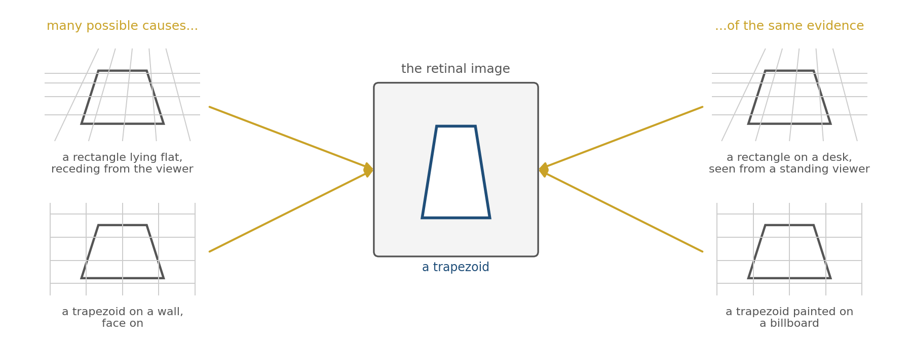
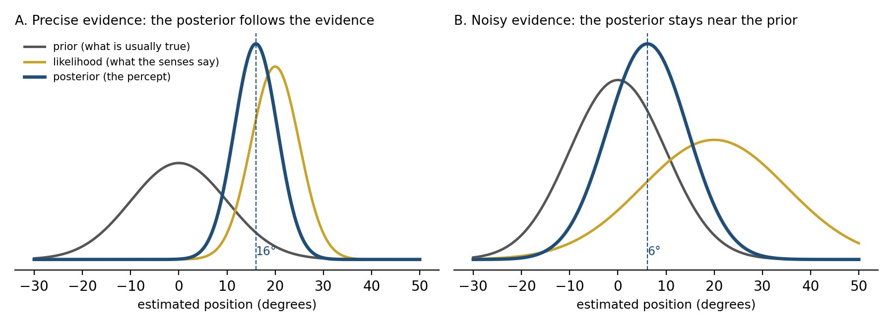
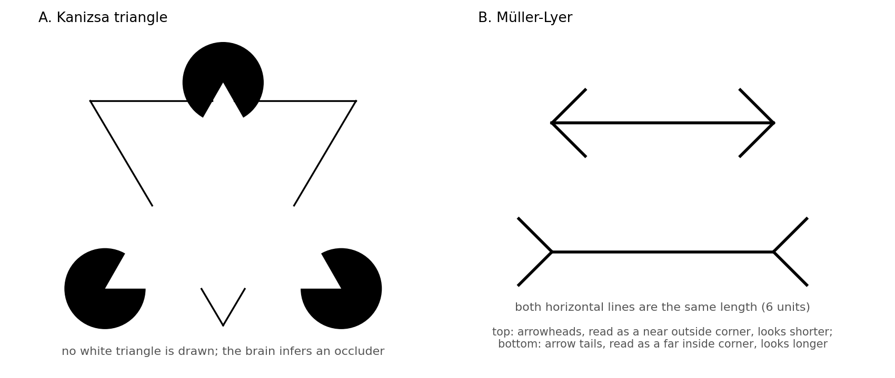
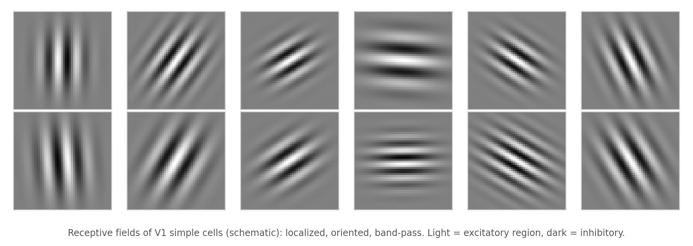

> *"Such objects are always imagined as being present in the field of vision as would have to be there in order to produce the same impression on the nervous mechanism, the eyes being used under ordinary normal conditions."*
>
> --- Hermann von Helmholtz, *Treatise on Physiological Optics* (1867)

# The Problem Perception Solves

Chapter 1 said, almost in passing, that perception is an active process of inference shaped by prior experience. Every chapter since has built the machinery that makes the sentence true: neurons that integrate evidence, circuits that amplify and compare, neuromodulators that set the context, and synapses that turn experience into structure. This chapter uses that machinery to answer a question that sounds too simple to need one. When you open your eyes, why do you see a world rather than a pattern of light?

The light that reaches the retina is not a world. It is a two-dimensional projection, blurred by the optics of the eye, sampled by a mosaic of receptors, and interrupted three times a second by eye movements. Worse, the projection is ambiguous in a way that no amount of resolution can fix. A trapezoid on the retina can be a trapezoid face on, a rectangle receding from the viewer, or a painted shape on a billboard; the retina cannot distinguish them, because they all produce the same image (Figure 6.1). A patch of grey can be a dark surface in bright light or a bright surface in shadow. A sound that grows louder can be a source approaching or a source turning toward you. Mathematically this is an inverse problem, and inverse problems of this kind are ill-posed: the evidence does not determine the answer.

Helmholtz saw this clearly in the 1860s and drew the only possible conclusion. If the evidence does not determine the answer and yet we perceive an answer, something must be supplying the rest. He called it unconscious inference: the perceptual system settles on the state of the world that, under ordinary conditions, would most probably have produced the sensations it is receiving. The judgment is not made by reasoning and cannot be overruled by it, which is why an illusion persists after you know it is an illusion. A century and a half later the idea has been made precise, mapped onto cortical anatomy, and measured with electrodes, and this chapter is an account of that work. The thesis can be stated in one sentence. Perception is not the reading of a signal but the construction of a hypothesis, built from what the senses report and from what the brain already expects, and weighted by how much each can be trusted.

# The Senses Deliver Evidence, Not Pictures

Begin with what the senses actually provide, because it is less than intuition suggests.

The human retina has roughly a hundred million rods and six million cones, but only about a million ganglion cell axons leave each eye. The retina therefore compresses by about a hundred to one before any signal reaches the brain, and Chapter 4 described what the compression keeps: contrast rather than brightness, change rather than steady state, edges rather than surfaces. Estimates of the information rate of the optic nerve are on the order of ten megabits per second, less than a single compressed video stream.

That capacity is not spread evenly. Fine resolution is confined to the fovea, a patch of densely packed cones covering about two degrees of the visual field, roughly the width of a thumbnail held at arm's length. Outside the fovea acuity collapses, and at fifteen degrees to one side there is a region with no receptors at all, where the optic nerve exits. This blind spot is about six degrees across, a dozen times the width of the full moon, and you have never seen it, because the brain fills it with whatever surrounds it.

Nor does the eye hold still. It jumps about three times a second in rapid movements called saccades, resting for a few hundred milliseconds between jumps. During each jump the image sweeps across the retina at hundreds of degrees per second and vision is suppressed. What arrives in the brain is not a stable, wide, high-resolution picture. It is a sequence of small, sharp, overlapping samples, each a fraction of a second long, separated by gaps, with a hole in each one. The stable scene you experience is not among the inputs. It is an output.

The same holds for the other senses. The cochlea delivers a running spectrum, not words. Touch delivers the deformation of skin, not the shape of the object. In every case the sense organ reports local physical quantities, and the rest is inference.

# Bayes in One Paragraph

The mathematics of inference under uncertainty was worked out in the eighteenth century and is short enough to state in full. Suppose the brain must estimate some quantity, say the direction of a sound. Before the sound arrives there is a prior: a distribution over directions that encodes what is usually true, built from a lifetime of sounds. When the sound arrives there is a likelihood: for each possible direction, how probable are these particular sensations? Bayes's rule says that the posterior, the distribution the brain should act on, is proportional to the prior multiplied by the likelihood. The prior says what to expect; the evidence says what was observed; the posterior is the compromise, and it leans toward whichever of the two is more precise.

Figure 6.2 shows the consequence for the simplest case, where both are bell curves. When the evidence is sharp, the posterior sits almost on the evidence, and the prior barely matters. When the evidence is noisy, the posterior sits near the prior, and the senses barely matter. Neither extreme is a failure. A system that always trusted its senses would be captured by every flicker of noise; a system that always trusted its prior would be blind. The optimal weighting is set by relative precision, and it changes from moment to moment as the quality of the evidence changes.

This is the sense in which perception is inference. The brain does not compute Bayes's rule symbolically any more than a thrown ball solves differential equations. But the system behaves, to a good approximation, as the rule says it should, and the rest of this chapter is about the machinery that produces that behavior and the places where the approximation shows.

Where do the priors come from? From Chapter 5. A prior is learned structure: the accumulated statistical regularities of a lifetime of input, written into synaptic weights by the plasticity mechanisms already described. The light-from-above prior is the clearest example. Light has come from above for the whole of evolutionary history and for the whole of each individual life, and the visual system assumes it. A disc shaded light on top is seen as a bump, a disc shaded light on the bottom as a dent, and turning the page swaps them (Figure 6.3). No one is taught this. It is in the weights.

# The Hierarchy

Perception is carried out by a hierarchy of cortical areas, and the visual hierarchy is the best understood (Figure 6.4). Retinal ganglion cells project to the lateral geniculate nucleus of the thalamus, the LGN, and the LGN projects to the primary visual cortex, V1, at the back of the brain. From V1 the signal passes to V2, V4, and the inferotemporal cortex, IT, along what is called the ventral stream, and in parallel to areas specialized for motion and location along the dorsal stream.

Two things change at each stage. The receptive field, the region of the visual field that can influence a neuron, grows, from a fraction of a degree in V1 to most of the visual field in IT. And the preferred stimulus becomes more abstract. A V1 neuron responds to an oriented edge at one place (Figure 6.10). A V4 neuron responds to a curved contour or a color in a larger region. An IT neuron responds to an object, a face, or a hand, more or less regardless of where it appears, how large it is, or how it is lit. The hierarchy builds invariance: the same thing is recognized as the same thing across the enormous variation in images that it can produce.

This feedforward sweep is fast. An image flashed for a few tens of milliseconds produces a selective response in IT about a hundred milliseconds later, and a human can categorize a scene as containing an animal or not in about a hundred and fifty milliseconds. Convolutional neural networks were modeled on this sweep, and the best of them predict the responses of IT neurons to novel images better than any model built by hand. This is the part of perception that artificial systems have reproduced.

But the sweep is not the whole hierarchy, nor even most of it. Feedback connections, running from each area back down to the areas below, outnumber the feedforward ones. The LGN, the thalamic relay that the retina feeds, receives only about a tenth of its synapses from the retina; the rest come from the cortex and the brainstem. Anatomically, the visual system is not a pipeline from eye to cortex. It is a loop, and the downward half is larger than the upward half. Any account of perception has to say what the downward half is for.

# Predictive Coding

The account that has organized the field for the last three decades is called predictive coding, and it is a direct implementation of Helmholtz's idea in the anatomy of Figure 6.4.

Each level of the hierarchy holds a hypothesis about what the level below is receiving. It sends that hypothesis downward as a prediction. The level below compares the prediction with what it actually has and sends upward only the difference, the prediction error. The level above uses the error to revise its hypothesis, sends a revised prediction, and the cycle repeats until the error is small. What ascends the hierarchy is not the image but the part of the image that was not expected (Figure 6.5A).

The scheme has three consequences that look surprising until the scheme is understood. The first is that an expected stimulus produces less cortical activity than an unexpected one. If the prediction is good, the error is small, and the error is what is transmitted. The second is that the absence of an expected stimulus produces activity: a prediction with nothing to cancel it is itself an error. The third is that what a neuron responds to depends on context, because the prediction arriving from above depends on everything the higher level knows.

All three are observed. A stimulus repeated several times evokes a smaller response each time, in single neurons and in whole-brain imaging; this is called repetition suppression, and it is the single most reproducible phenomenon in sensory cortex (Figure 6.5B). A tone omitted from a regular sequence evokes a response at the moment it should have occurred. The deviant tone in a sequence of standards evokes a distinctive electrical signature at the scalp, the mismatch negativity, about one to two hundred milliseconds after it arrives; it is present in sleeping adults and newborn infants and reflects a prediction being violated rather than anything about the tone itself. And neurons in V1 respond to a line most strongly when it ends inside their receptive field, a long-known puzzle called end-stopping, which the first predictive coding model of the visual cortex, published in 1999, reproduced without being designed to: a line that continues is predictable from its surroundings, and a line that stops is not.

The scheme also fits the microcircuit of Chapter 4 in a specific way. The superficial layers of cortex, which project forward, carry activity dominated by fast gamma rhythms; the deep layers, which project backward, carry activity dominated by the slower alpha and beta rhythms. Predictive coding proposes that the superficial layers hold the error units and the deep layers the prediction units, so that errors ascend on gamma and predictions descend on alpha and beta. Recordings from several areas at once support the direction of this traffic. It is a model, and the mapping is not settled, but it is the kind of model that could be wrong in detail, which is the kind worth having.

# Illusions Are Correct Answers

If perception is inference, illusions are what inference looks like when the prior is right about the world and wrong about the picture. They are the most direct evidence we have for which priors the visual system holds.

In Adelson's checker-shadow figure (Figure 6.6), the squares marked A and B are printed in exactly the same grey. They do not look it, and they will not look it after you have measured them. The visual system has inferred a cylinder, a light source, and a shadow, and it has discounted the shadow before reporting the surface color of B. That is the correct computation. In a real scene, a surface in shadow that reflects as much light as a surface in the open really is lighter, and a visual system that reported raw luminance would misjudge every surface that fell in shade. The figure defeats the system by presenting a shadow with nothing behind it.

The Kanizsa triangle (Figure 6.7A) contains no triangle. Three discs with wedges removed and three corner fragments are arranged so that the most probable cause of the image is a white triangle lying on top of three black discs and an outlined triangle. The visual system reports that cause, complete with edges that are not in the image and a surface that looks whiter than the identical white around it. Neurons in V2 respond to these illusory contours as if they were real, which, under the hypothesis, they are.

In the Müller-Lyer figure (Figure 6.7B) two equal lines look unequal. One explanation, due to Richard Gregory, is that the fins are read as the edges of corners in a carpentered world: arrowheads as the near corner of a building, arrow tails as the far corner of a room. A far corner that subtends the same angle as a near one must be longer, and the system scales accordingly. The explanation is debated, and that is the point. Each illusion is a probe, and arguments about illusions are arguments about which prior the system is using.

The hollow-mask illusion is the strongest of all. A face mask viewed from the inside, concave, is seen as convex, a normal face, even when it is slowly rotating and stereo vision and shading both report the truth. The prior that faces are convex is so strong that it overrides the evidence completely. The illusion weakens at close range, where stereo evidence becomes precise enough to win, and it is measurably weaker in people with schizophrenia, an observation to which the chapter returns.

What all of these show is that the output of the perceptual system is not the image and not the world but the posterior, and that the posterior can be moved by manipulating either the evidence or the prior.

# Attention as Precision

Bayes's rule weights evidence by its precision, and the brain cannot know the precision of a signal without estimating it. That estimate has to be represented somewhere and has to change what the circuit does. The proposal that follows from predictive coding is that this is what attention is: the gain applied to prediction errors, raised where the evidence is expected to be reliable and lowered where it is not.

The proposal unifies a great deal. Attention to a location increases the response of neurons whose receptive fields cover it and decreases the response of neighbors, which is the biased competition of Chapter 4's lateral inhibition with a top-down bias setting the winner. Attention increases the gamma synchrony of the attended population, which, through the oscillatory gating described in Chapter 4, lets its spikes arrive during the receptive phase of the next area and so increases their weight. And attention makes the attended evidence count for more in the posterior, which is what raising its precision means.

Precision also has a chemistry, and it is the chemistry of Chapter 3. Acetylcholine, released from the basal forebrain into cortex, increases the gain of feedforward sensory input relative to recurrent and feedback input; a cholinergic cortex trusts its senses more and its expectations less. One influential account assigns acetylcholine to expected uncertainty, the known unreliability of a familiar cue, and norepinephrine to unexpected uncertainty, the moment when the world changes and the current model should be discarded. The noradrenergic burst that accompanies a surprise is, on this reading, a global instruction to lower the precision of every prediction at once.

The cost of precision weighting is that what is not attended is barely seen. In the best-known demonstration, observers counting passes in a basketball video fail to notice a person in a gorilla suit walking through the middle of the scene. In change blindness, large alterations to a scene go unnoticed if they coincide with a blink or a cut. These are not failures of the eye; the gorilla was on the retina for several seconds. They are the consequence of a system that transmits only what it has been told to find surprising.

# Combining the Senses

The clearest quantitative test of the Bayesian account uses two senses at once. If the brain weights evidence by precision, then when vision and touch both report the width of an object, the combined estimate should lie between them, closer to the more reliable sense, and should be more precise than either alone. The weights can be computed exactly from the reliability of each sense measured separately.

In 2002 Marc Ernst and Martin Banks did this experiment with a bar that observers could see and feel at the same time, degrading vision by adding noise to the display. With clear vision, the estimate followed the eyes. As the visual noise increased, the weight shifted toward touch, and at every noise level the observed weights matched the computed optimum (Figure 6.8). The brain was not favoring vision as a rule. It was favoring whichever sense was more precise, trial by trial.

Everyday perception is full of the same computation. The ventriloquist's voice appears to come from the dummy's mouth because vision locates things more precisely than hearing, so the posterior for the sound's location follows the visible moving mouth. In the McGurk effect, a recording of one syllable dubbed onto a face mouthing a different syllable is heard as a third syllable, a compromise between what was heard and what was seen. The senses are not separate channels to a central viewer. They are sources of evidence, pooled in proportion to how much each can be trusted.

# Perception Is Active

Chapter 1 said that the brain generates and the world corrects, and the account so far has treated the brain as if it sat still and waited for evidence. It does not. It moves the sense organs to get the evidence it wants, and that changes the problem in two ways.

The first is that the brain must distinguish sensation caused by the world from sensation caused by its own movement. When the eye jumps ten degrees, the image sweeps ten degrees across the retina, exactly as it would if the world had jumped. It does not look that way. The solution, proposed independently by von Holst and by Sperry in 1950, is that every motor command is copied and sent to the sensory system, which uses it to predict the sensory consequence of the movement and subtract it. The copy is called the efference copy, the prediction is a forward model, and the comparison is shown in Figure 6.9. If the predicted slip matches the actual slip, the world is reported as stationary. Press gently on your eyelid and move the eye by hand: there is no command, no prediction, nothing is subtracted, and the world lurches. The cerebellum of Chapter 4, which learns to predict the sensory consequences of commands, is a principal site of this forward model. The same mechanism is why you cannot tickle yourself: the sensation is predicted and cancelled before it is felt.

The second is that movement is itself a tool of inference. A saccade is a decision about where evidence is most needed, and the sequence of fixations on a scene depends on the question being asked. A rat sweeps its whiskers across an object at a rate it controls; a dog sniffs in bursts timed to its uncertainty; a reader's eyes land on the words that the sentence so far has made least predictable. In each case the organism is not receiving evidence but sampling it, choosing the sample that will reduce its uncertainty most. Perception and action, kept apart in the textbooks, are two halves of one loop: the hypothesis determines where to look, and what is seen revises the hypothesis. Some theorists go further and treat action as inference too, the body moving so as to make the brain's predictions come true. Whether or not one accepts that framing, the practical lesson is secure. An observer that cannot act is solving a harder problem than any brain has ever had to solve.

# Learning the Priors

If perception rests on priors, the question of where they come from is the question of how perception is learned, and the answer connects this chapter to the last.

Some priors are built in. Newborns orient to face-like patterns within hours, and the light-from-above assumption is present in several species that have never been taught it. But most of the structure of sensory cortex is learned from the statistics of the input, and the learning has the properties Chapter 5 would predict. It is slow, it is gated, and it has a window.

The window was discovered by Hubel and Wiesel in the 1960s. A kitten with one eye closed for a few weeks early in life loses, permanently, the cortical representation of that eye; the same closure in an adult does nothing. The period during which experience can reorganize the visual cortex is called the critical period, and it closes, in the cat, after a few months and in humans after a few years. Kittens raised in environments containing only vertical stripes grew up with cortices in which almost no neuron responded to horizontal edges, and they bumped into horizontal bars. The critical period opens and closes under the control of inhibitory maturation and of the neuromodulators of Chapter 3; it is a time when the plasticity rules of Chapter 5 are turned up, and its closing is what makes adult perception stable and adult perceptual learning slow.

What is learned during the window is the statistics of natural images, and that can be shown directly. In 1996 Olshausen and Field trained a simple model to represent patches of photographs using as few active units as possible. The units it learned were localized, oriented, band-pass filters, Figure 6.10, essentially the receptive fields that Hubel and Wiesel had found in V1 thirty years earlier. Nothing about edges was built in. Edges are what the world contains, and a system that learns to predict the world ends up with detectors for them. The same procedure applied to natural sounds produces filters resembling those of the auditory nerve. The receptive fields of sensory cortex are, to a first approximation, the priors of the natural world made into tissue.

This learning never fully stops. Wear prism goggles that shift the world sideways and reaching errors vanish in minutes, as the cerebellar forward model relearns. Wear goggles that invert the world and within days it begins to look upright again. Spend a month in a room lit by a single color and color constancy recalibrates. The adult perceptual system is a model under continual revision, slow in its deep layers and fast at its edges, exactly as the two consolidation clocks of Chapter 5 would suggest.

# When Inference Goes Wrong

A system that constructs its percepts from priors and evidence can fail in two directions, and both are seen in the clinic.

When the evidence is removed, the priors run unopposed. People who lose their vision late in life through disease of the eye frequently begin to see vivid, detailed hallucinations, faces, patterns, figures in period dress, while knowing perfectly well that nothing is there; the condition is named for Charles Bonnet, who described it in his grandfather in 1760. A visual cortex that has lost its input does not go silent. It continues to generate hypotheses, and with no error signal to correct them they are experienced as sight. Phantom limbs are the same phenomenon in another modality: the body model persists after the body part is gone, and its predictions, unanswered, are felt.

When the precision of evidence and prior is misweighted, perception bends. The hollow-mask illusion is weaker in schizophrenia, which suggests that priors there have lost some of their grip; at the same time, hallucinations and delusions can be understood as priors with too much precision, or as noise in the error channel that is read as signal. The two readings are not contradictory; a system can weight its priors too strongly at one level and too weakly at another. One account of autistic perception proposes the opposite imbalance, sensory precision too high relative to the priors, so that the world is experienced in unfiltered detail and small deviations from expectation are overwhelming. All of these are hypotheses, not settled findings, and they are offered here because they show what the framework buys: a vocabulary in which disorders of perception are disorders of weighting, and the weights are set by mechanisms, inhibition, acetylcholine, dopamine, and oscillatory gain, that are known and can be measured.

# Implications for Artificial Intelligence

Perception is the domain in which artificial systems most clearly match the brain and in which the comparison is most instructive about what they lack.

First, the feedforward sweep has been reproduced. Deep convolutional networks trained to classify images develop a hierarchy of features, from oriented edges to object parts, that resembles the ventral stream closely enough to predict the responses of its neurons. The resemblance is not a coincidence; both are solutions to the same statistical problem, and the fact that gradient descent and evolution arrived at the same place is evidence that the place is not arbitrary.

Second, the loops have not been. Standard networks have no feedback, no prediction, and no error signal at inference time; they map an input to an output in one pass. The brain spends most of its visual anatomy on the other direction. Adversarial examples, in which an imperceptible change to an image produces a confident misclassification, are what a system looks like when it has evidence but no priors with which to check it. A brain confronted with such an image would predict a cat, compare, find the error large, and look again.

Third, precision is missing. The attention mechanism of transformers weights inputs by learned relevance, which is a cousin of precision weighting, but there is nothing in most artificial systems that estimates how reliable each input is and discounts it accordingly, nor a global signal, like norepinephrine, that says the model should be distrusted now. Systems that must operate on degraded sensors, in fog or in noise, need exactly this.

Fourth, generative models are the right direction. A network that can generate the data it classifies has, in effect, a prior and a likelihood and can compute something like a posterior; variational autoencoders and diffusion models are explicit attempts to build such machinery, and the best current explanations of cortex are, in essence, hierarchical generative models trained by prediction error. Whether predictive coding can replace backpropagation as a learning rule is an open research question with a biological existence proof on one side.

Fifth, perception should be active. A system that chooses where to sample is solving an easier problem than one that must process everything, and robotics has begun to borrow the saccade, the forward model, and the efference copy for exactly the reasons the brain uses them. An agent that cannot predict the sensory consequences of its own actions cannot tell what it did from what the world did, and that is a fatal confusion for anything that must learn from experience.

# The Central Lesson

The senses deliver evidence that does not determine the world, and the brain supplies the rest. It holds a model of what is usually true, written into its synapses by the plasticity of Chapter 5, and it combines that model with the incoming evidence in proportion to how much each can be trusted. The combination is carried out by a hierarchy in which predictions descend and errors ascend, so that what the cortex transmits is not the image but its surprise. Attention sets the trust, the neuromodulators of Chapter 3 set the attention, and action chooses what evidence to gather next. Illusions, hallucinations, and the stability of the visual world are all the same mechanism seen from different sides. You do not see what is there. You see your best current hypothesis about what is there, and most of the time it is right.

# Next Chapter

Chapter 7: Emotion and the Body --- How Internal States Tell the Brain What Matters

# Figure Credits

Figures 6.1, 6.2, 6.3, 6.4, 6.5, 6.7, 6.8, 6.9, and 6.10 were drawn for this book. The curves in Figures 6.3 and 6.8, the error trace in Figure 6.5B, and the receptive fields in Figure 6.10 are illustrative computations, not recorded data.

Figure 6.6: "Checker shadow illusion" by Edward H. Adelson, vectorized by Wikimedia Commons user Pbroks13, CC BY-SA 4.0, via Wikimedia Commons.
