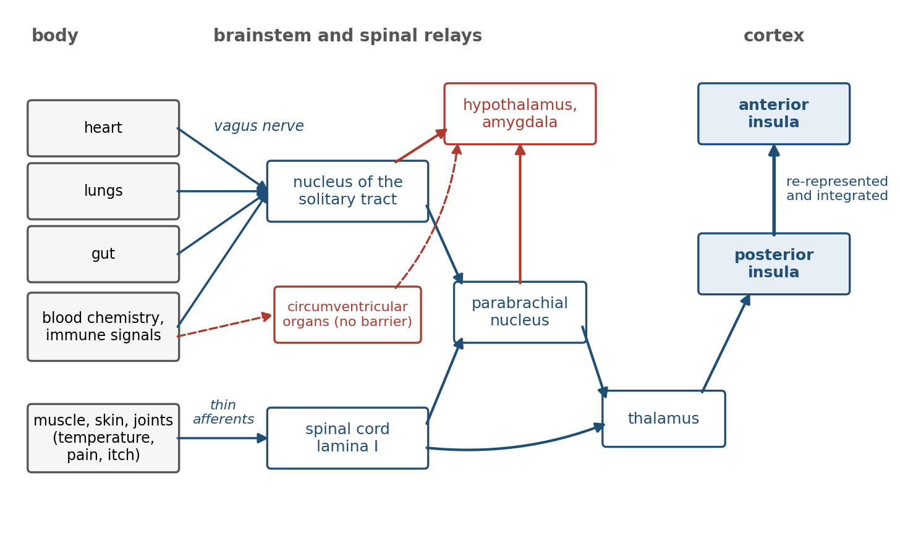
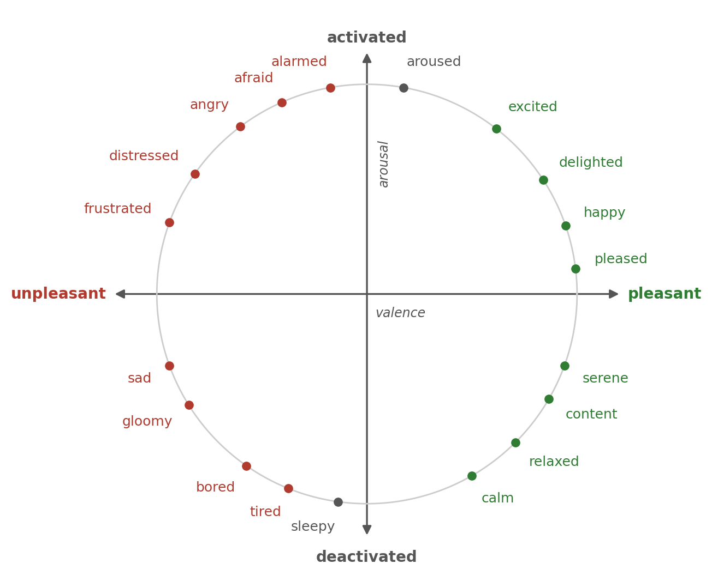
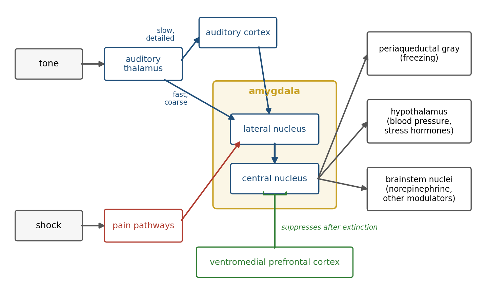
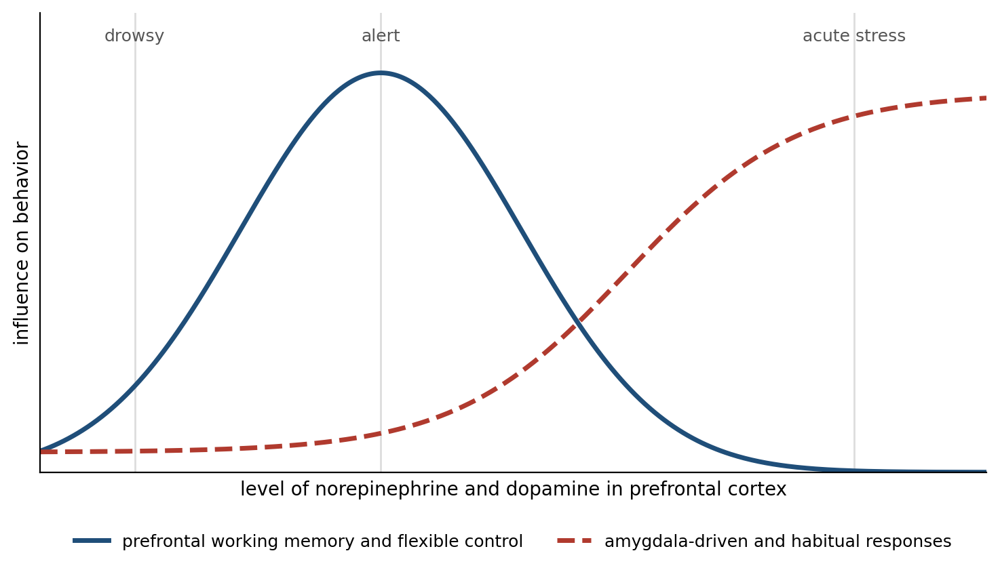

> *"If we fancy some strong emotion, and then try to abstract from our consciousness of it all the feelings of its characteristic bodily symptoms, we find we have nothing left behind, no 'mind-stuff' out of which the emotion can be constituted, and that a cold and neutral state of intellectual perception is all that remains."*
>
> --- William James, "What Is an Emotion?" (1884)

# What Perception Leaves Out

Chapter 6 ended with a brain that builds its best current hypothesis about the world from noisy evidence and learned expectation. That brain can tell a face from a mask, but nothing in its machinery says whether the face belongs to a friend or a threat. Perception answers the question of what is out there. It does not answer the question every animal must answer next, which is whether what is out there matters, and how much.

The answer has to come from the one thing the brain is built to protect, the body that carries it. Food matters to a hungry animal and not to a sated one, and a stranger matters more at night than at noon, because value is relative to the state of the body and its prospects. The brain therefore needs a second model alongside its model of the world: a model of the body itself, of how it stands now and where it is heading. Chapter 1 described the brain as a controller that keeps a body's internal variables within bounds; this chapter takes the description literally.

The argument of the chapter, which most of the competing theories of emotion can accept, is that emotions are at their core the brain's running estimate of the state of the body and of what the current situation means for it. They do three jobs at once: they prepare the body for what is predicted to come, they rank the options for action, and they tell the machinery of learning described in Chapters 3 and 5 which experiences are worth keeping.

# Keeping the Body in Bounds

In the 1850s and 1860s the French physiologist Claude Bernard argued that the cells of a complex animal do not live in the outside world at all. They live in the fluid that bathes them, the *milieu intérieur*, and, in his phrase, the condition of a free and independent life is that this inner environment be held constant while the outer one varies.[^1] Walter Cannon gave the idea its modern name in the 1920s. He called it homeostasis, the maintenance of the body's internal variables near stable values by mechanisms that detect deviations and act to reverse them.[^2]

The ranges are narrow. Core body temperature in a healthy adult stays within about a degree of 37 degrees Celsius; a rise to 41 degrees is a medical emergency, and a fall below 35 degrees is hypothermia. Arterial blood is held between pH 7.35 and 7.45. Fasting blood glucose sits around 4 to 6 millimoles per liter, and the brain, which in the fed state runs mostly on glucose and stores very little, begins to fail within minutes if it falls far below that.[^3] Each of these variables is defended by a negative feedback loop of the kind an engineer would recognize: a sensor, a comparison with a set point, and an effector that pushes the variable back.

The hub of those loops in the brain is the hypothalamus, a structure of about four grams at the base of the forebrain. Its neurons sense blood temperature, glucose, and osmolarity (the concentration of salts and other solutes), and it receives signals from the gut, the heart, and the immune system. It corrects through three channels: the autonomic nervous system, whose sympathetic and parasympathetic branches speed and slow the heart, the blood vessels, and digestion; the pituitary gland, which controls the hormones of stress, growth, reproduction, and water balance; and behavior, by making the animal hungry, thirsty, or cold enough to fix the problem itself.[^4]

That third channel is where regulation becomes emotion. In the 1920s Cannon and Sydney Britton found that cats whose cerebral cortex had been removed flew into fits of rage at the slightest touch, hissing, their hearts racing. They named the display sham rage, because it looked like anger without any sign of an object.[^5] In 1928 Philip Bard showed that the display disappeared only when the posterior hypothalamus was removed as well.[^6] More than 80 years later David Anderson's laboratory found a small population of neurons in the ventromedial hypothalamus of male mice that, when stimulated with light, made the animal attack whatever was in front of it, including a female or an inflated rubber glove.[^7] The hypothalamus contains circuits for the whole-body programs of attack, flight, mating, and feeding, which are the oldest forms of emotional behavior.

# Regulation by Prediction

A thermostat waits for the room to get cold. Much of the body's regulation works the same way: when you stand up, a reflex driven by pressure sensors in the great arteries, the baroreflex, detects the fall in blood pressure and corrects it within a heartbeat or two. But the body also regulates ahead of need. In 1913 August Krogh and Johannes Lindhard showed that heart rate and breathing rise within a second or two of the start of exercise, sooner than any chemical change in the blood could signal the need.[^8] The command to the heart goes out with the command to the legs.

In 1988 Peter Sterling and Joseph Eyer called this predictive regulation allostasis, stability through change: the brain anticipates what the body will need and adjusts its physiology in advance, rather than waiting for an error and correcting it.[^9] Douglas Ramsay and Stephen Woods argue that this is homeostasis with good forecasting rather than a new principle, since anticipatory responses still defend set points.[^10] Both sides accept that the brain regulates the body largely by learned prediction, the strategy Chapter 6 described for perception, turned inward.

Eating is the clearest example. The sight, smell, and taste of food release insulin before any glucose has been absorbed. This is a cephalic phase response, so called because it starts in the head, and Woods argued that eating would be dangerously destabilizing without it: a meal is a large disturbance, and the body tolerates it only because the brain prepares for it.[^11] Figure 7.1 shows the difference prediction makes: a controller that releases insulin on the cue that a meal is coming acts before the disturbance arrives, while a purely reactive one lets glucose swing far from its set point.

The anticipation reaches into the circuits that drive behavior. Hunger in the mouse is promoted by a small population of neurons in the arcuate nucleus of the hypothalamus that express a peptide called AgRP. Zachary Knight's laboratory imaged these neurons and found that their activity fell within seconds of a hungry mouse seeing or smelling food, before it had eaten anything, and that the size of the fall depended on how hungry the mouse was and how palatable the food.[^12] The hunger signal does not track the body's present state. It tracks the state the brain predicts.

Prediction has a cost when it fails, and the clearest demonstration is a grim one. Shepard Siegel gave rats a series of heroin injections in one room and then a large test dose in the same room or a different one. Of rats that had never had heroin, 96 percent died; of experienced rats, 32 percent died in the familiar room and 64 percent in an unfamiliar one.[^13] Part of tolerance is learned anticipation: familiar cues tell the body the drug is coming, and without them the body is unprepared, which is thought to contribute to overdoses in people who take a familiar dose in an unfamiliar place.

# Sensing the Inside

A controller needs measurements, and the body supplies them through a sense that receives far less attention than vision or hearing. Charles Sherrington called the senses of the viscera interoceptive in 1906,[^14] and the word now covers the sensing of the whole body's condition: heartbeat, breathing, stretch of the stomach and bladder, temperature, blood chemistry, inflammation, itch, and pain.[^15]

The signals reach the brain by the routes shown in Figure 7.2. The vagus nerve, which wanders from the brainstem to the heart, lungs, and gut, is mostly sensory: roughly four of every five of its fibers carry signals toward the brain rather than away from it.[^16] Its sensory fibers end in the nucleus of the solitary tract in the brainstem. A second route runs through the spinal cord, where thin fibers from the tissues of the body end in the dorsal horn, many of them in its most superficial layer, lamina I. A third bypasses nerves altogether: at a few small sites where the blood-brain barrier is leaky, called circumventricular organs, the brain samples the blood directly. These streams pass through relays in the brainstem and thalamus, feeding the hypothalamus and amygdala on the way.

Their cortical target is the insula, a lobe of cortex folded deep inside the lateral fissure. Arthur Craig proposed that the posterior insula holds a primary map of the body's internal state, and that the map is re-represented, step by step, toward the front of the insula, where it is combined with information about the environment, motivation, and social context.[^17]

How well people sense their own bodies can be measured, and it varies widely. In the heartbeat counting task devised by Rainer Schandry, participants silently count their heartbeats over a short interval without touching their pulse; some are nearly exact and others miss half their beats.[^18] Hugo Critchley and colleagues found that the activity and the gray matter volume of the right anterior insula predicted how accurately people performed a related task.[^19] The measures are imperfect, since counting can be done partly by estimating time, and accuracy and confidence need not agree.[^20]

Interoception carries chemistry as well as mechanics. When the body fights an infection, immune cells release signaling proteins called cytokines that reach the brain through the vagus nerve and through the circumventricular organs. The result is sickness behavior: fatigue, loss of appetite and of pleasure, withdrawal from company, and heightened pain.[^21] Benjamin Hart argued that this is a strategy, not a weakness: the brain redirects energy toward fever and repair by changing what feels worth doing.[^22]

Like every other sense, interoception is an inference, and the brain's expectations shape what it reports. In 1978 Jon Levine, Newton Gordon, and Howard Fields gave patients who had just had wisdom teeth removed, and who knew that they might receive a placebo, an injection of saline. Some reported less pain, and in them the relief was reversed by naloxone, a drug that blocks opioid receptors.[^23] The expectation of relief had released the brain's own opioids and turned down the pain signal on its way to the brain.

Anil Seth and, separately, Lisa Feldman Barrett and Kyle Simmons have extended the predictive coding account of Chapter 6 to interoception. On their view, regions that regulate the body continuously predict its state, and the insula compares the predictions with the signals arriving from the viscera, so that what is felt is the brain's best estimate rather than a direct reading.[^24] The proposal is less tested than its counterpart in vision, though Ian Kleckner and colleagues have traced a cingulate and insular network that both regulates the viscera and hears back from them.[^25]

# What an Emotion Is

William James asked the question in 1884 and answered it in a way that still provokes. Common sense says that we meet a bear, feel afraid, and run. James said the order was wrong: the perception of the bear sets off the bodily changes directly, the pounding heart, the tensed muscles, the flight, and the feeling of fear is our perception of those changes as they occur. "We feel sorry because we cry, angry because we strike, afraid because we tremble." Subtract the body, James argued, and the emotion has nothing left to be made of.[^26] Carl Lange made a similar proposal the next year, hence the James-Lange theory.

Cannon attacked it in 1927. Cutting the nerves between viscera and brain does not abolish emotional behavior; the same visceral changes accompany different emotions, and states that are not emotions at all, such as fever and exercise; the viscera are poorly innervated and slow; and an injection of epinephrine (also called adrenaline), the adrenal hormone and a close chemical relative of Chapter 3's norepinephrine, makes people feel as if they were afraid without making them afraid.[^27]

Most of the objections have since been qualified: visceral feedback is not too slow for a feeling that rises over seconds, and the viscera are richly supplied with sensory fibers that Cannon could not see. The most direct modern test of James comes from a mouse. Karl Deisseroth's laboratory paced the hearts of freely moving mice with light, through a light-sensitive channel expressed in heart muscle, raising the heart rate without touching the brain. In risky situations, though not in safe ones, the mice became more anxious, and the effect depended on the posterior insula.[^28]

In people, Sarah Garfinkel and colleagues found that fearful faces flashed at the moment the heart contracts are detected more readily and judged more intense than the same faces shown between beats.[^29] Tests in people that remove or impose bodily signals have given smaller and less consistent effects. People with high spinal cord injuries, whose brains hear little from the body below the neck, were once reported to feel emotions less intensely, but a better-controlled study found little reduction.[^30] And the claim that a forced smile makes cartoons funnier failed a replication run in 17 laboratories, although a meta-analysis finds a small effect of facial feedback across many studies.[^31] The body is not the whole of an emotion, but signals from it change both what is felt and what is perceived, and the context decides what they mean.

If the body supplies arousal, something else must say what it is about. In 1962 Stanley Schachter and Jerome Singer injected volunteers with epinephrine, told some of them what side effects to expect and others nothing, and left each with a confederate who acted either euphoric or angry. The uninformed volunteers, who had no explanation for their racing hearts, tended to take on the mood of the confederate.[^32] Later attempts found weaker effects, and unexplained arousal tended simply to feel unpleasant.[^33] But the idea that arousal is interpreted survived. On the Capilano suspension bridge in Vancouver, 70 meters above a river, Donald Dutton and Arthur Aron had a female interviewer give men her phone number; half of the men who took the number on the bridge called her, against about one in eight of those interviewed on a low, solid bridge upstream.[^34]

Three positions on what an emotion is now compete. On the basic emotion view, associated with Paul Ekman, there is a small set of emotions (fear, anger, disgust, sadness, happiness, and surprise among them), each an evolved program with its own bodily pattern and a facial expression recognizable across cultures.[^35] On the constructionist view, developed by Barrett, there are no dedicated emotion programs; the brain continuously predicts and regulates the state of the body, and a particular emotion is the brain's categorization of that state in context, using concepts learned from experience and culture.[^36]

A meta-analysis of more than 200 studies by Erika Siegel and colleagues found that the autonomic measures recorded during different emotions overlapped too much to identify the emotion reliably, which favors the constructionist account.[^37] A review led by Barrett, with coauthors from both sides of the debate, concluded that facial movements are weak signs of emotion: people scowl when angry more often than at other times, but only in a minority of instances, and they scowl in many states that are not anger.[^38]

The third position, argued by Joseph LeDoux, separates what is under dispute from what is not. Brains contain survival circuits (for defense, feeding, reproduction, and fluid balance) that detect relevant situations and organize the body's response, and these are well studied in animals. Whether a freezing rat feels fear as a person does is a different question, and LeDoux keeps the word fear for the conscious feeling, which in humans depends on cortical circuits that interpret the survival circuits.[^39]

All three positions can accept, as a description, the map of Figure 7.3. James Russell found in 1980 that people's ratings of emotion words fall on a circle whose axes are valence, how pleasant or unpleasant a state is, and arousal, how activated or calm.[^40] These two dimensions, often called core affect, are where the interoceptive estimate of the body is most directly felt.

# Value Depends on the Body

If emotions report what matters to the body, then the value of anything should change when the body's state changes, and it does. In 1971 Michel Cabanac had fasting volunteers taste a sweet solution and rate how pleasant it was. They liked it. Then they drank a load of glucose, and the same solution, tasted again, was rated unpleasant.[^41] Cabanac called this alliesthesia: the pleasure of a stimulus is not a property of the stimulus but of its usefulness to the body at that moment. Within a meal, the food being eaten loses its pleasantness faster than foods not yet eaten, which Barbara Rolls and colleagues called sensory-specific satiety and which is why there is room for dessert.[^42]

Internal state also supplies the brain with teaching signals. Scott Sternson's laboratory found that the AgRP hunger neurons and their counterparts for thirst carry a negative signal: mice learn to avoid a flavor or a place that has been paired with stimulation of these neurons, as if the hunger state itself were aversive, and eating, which silences the neurons, is reinforcing partly because it ends that state.[^43] The reward prediction error of Chapter 3 is computed against outcomes whose value depends on the state of the body: a drop of juice is a large reward to a thirsty monkey and a small one to a sated monkey.

Reward itself has more than one part. Rats whose dopamine had been almost entirely depleted no longer worked for food but still made the facial reactions of liking when sugar was placed in their mouths. On this evidence Kent Berridge and Terry Robinson proposed separating wanting, the dopamine-dependent pull of a cue, from liking, the pleasure of the reward itself, which survives the loss of dopamine.[^44] Wanting and liking usually move together, and their divergence, in addiction especially, is one way that what an animal pursues can come apart from what it enjoys.

# The Amygdala and Learned Threat

Much of what matters to an animal is not in its body yet. A sound in the grass is harmless in itself, but if a predator makes it, the body should be ready before the predator arrives. Learning such predictions is the business of a small cluster of nuclei deep in the temporal lobe, the amygdala, named from the Greek for almond.

Its importance was first seen in its absence. In 1939 Heinrich Klüver and Paul Bucy removed the temporal lobes of normally wary rhesus monkeys and found them transformed: tame, unafraid of snakes or of people, putting everything in their mouths, and repeatedly approaching things that had hurt them.[^45] Later work narrowed much of the change in fear to the amygdala, and its mechanism was worked out in the rat by LeDoux and others using fear conditioning, a form of Pavlovian learning in which a tone is followed by a mild shock to the feet. After a few pairings the tone alone makes the rat freeze, its blood pressure rise, and its stress hormones flow.[^46]

Figure 7.4 shows the circuit. The tone reaches the lateral nucleus of the amygdala through two routes: directly from the auditory thalamus, a short path that carries a coarse signal, and through the auditory cortex, a longer path that carries a detailed one. The shock reaches the same neurons through pain pathways. Where the two converge, the synapses carrying the tone are strengthened by the associative long-term potentiation, or LTP, of Chapter 5, and the tone acquires the power to drive the amygdala on its own. The lateral nucleus passes the signal to the central nucleus, whose outputs, directly or through relays, reach the targets that make up the defensive response: the periaqueductal gray of the midbrain for freezing, the hypothalamus for the rise in blood pressure and for the stress hormones, and the brainstem nuclei that release the neuromodulators of Chapter 3.[^47]

The short route became famous as a low road that lets fear outrun thought. In rats either route alone suffices for simple tone conditioning.[^48] Luiz Pessoa and Ralph Adolphs argue that in primates the subcortical route has not been shown to be faster in practice or capable of fine discrimination, and that the amygdala is one hub among many roads by which the brain evaluates significance.[^49] On the other side, electrodes in the amygdalae of epilepsy patients recorded responses to fearful faces about 74 milliseconds after the image appeared, driven by the coarse features a fast route would carry.[^50] Both routes exist; how much the short one contributes in humans is unsettled.

The amygdala is not a fear center. In monkeys whose visual cues predicted juice or an air puff, Daniel Salzman's laboratory found amygdala cells signaling positive value and cells signaling negative value, each changing its response when the meaning of the cue was reversed.[^51] It learns the value of cues in both directions, and fear is its best studied use rather than its only one.[^52] Nor does it work alone. A brief, cued fear depends on the central nucleus, but a sustained state of anxiety about threats that are uncertain or distant depends more on a neighboring structure, the bed nucleus of the stria terminalis.[^53]

The most instructive human evidence comes from a woman known as S.M., whose amygdalae were destroyed on both sides by a rare genetic disease, Urbach-Wiethe disease. Justin Feinstein and colleagues took her to an exotic pet store, where she handled snakes she had said she disliked, to a haunted house, where she frightened the actors, and through horror films, and she showed and reported almost no fear.[^54]

Later, the same group had S.M. and two other patients with damage to both amygdalae inhale air containing 35 percent carbon dioxide, which acidifies the blood and triggers a strong sensation of suffocation. All three had a panic attack, while only three of 12 healthy volunteers did.[^55] The amygdala is needed for fear of threats from outside the body. A threat from inside the body, detected by chemical sensors outside the amygdala, probably in the brainstem, produces fear without it.

# Unlearning Fear

A threat prediction that could only be learned would be a trap, since the world changes. If the tone is played many times without shock, the rat stops freezing, a process called extinction. Extinction is not forgetting. Mark Bouton showed that an extinguished fear returns in a different context, with the passage of time, or after an unsignaled shock, so the original association must still be there.[^56] Extinction is new learning: a second memory, that the tone is now safe in this place, that competes with the first. Exposure therapy for phobias is extinction carried out in the clinic, and it shares extinction's weakness: the fear can come back.

The second memory has its own circuit. Mohammed Milad and Gregory Quirk recorded in the infralimbic region of the rat's medial prefrontal cortex and found neurons that fired to the tone on the day after extinction in proportion to how well the extinction was remembered; stimulating the region while playing the tone reduced freezing in rats that had never been extinguished.[^57] In people the corresponding area, the ventromedial prefrontal cortex, is engaged when an extinguished fear is recalled the next day.[^58] The prefrontal cortex mostly inhibits the expression of the amygdala's memory rather than erasing it, which is why, as Chapter 5 noted, fear is easily learned and rarely unlearned, only suppressed.

People also regulate emotion deliberately. In a study led by Kevin Ochsner, participants who reinterpreted distressing photographs in less negative terms, a strategy called reappraisal, reported less negative feeling and showed more activity in the lateral and medial prefrontal cortex and less in the amygdala.[^59] Reappraisal acts early, by changing what the situation means, rather than by suppressing the response once it is under way;[^60] it is extinction made voluntary.

# The Chemistry of Stress

When the brain predicts a demand, it prepares the body through two chemical systems, which act on two timescales (Figure 7.5). The fast system is the sympathetic nervous system, which within seconds raises heart rate and blood pressure, opens the airways, and signals the adrenal medulla, the core of the adrenal gland above each kidney, to release epinephrine into the blood. The slow system is the hypothalamic-pituitary-adrenal axis, a three-step hormonal relay from the hypothalamus through the pituitary to the adrenal cortex, which releases cortisol. Cortisol peaks tens of minutes after a stressor begins, mobilizes glucose, alters immune function and memory, and acts back on the hypothalamus, pituitary, and hippocampus to shut its own release down.[^61]

Hans Selye discovered the generality of this response in 1936: rats exposed to cold, injury, toxins, or forced exercise all developed the same enlarged adrenal glands, shrunken thymus, and stomach ulcers.[^62] Robert Sapolsky and colleagues showed that some of cortisol's actions prepare the body for demand while others, arriving later, restrain the stress response itself before it does damage.[^63] And the response is directed by the cortex, not only by the hypothalamus. Peter Strick's laboratory traced the control of the adrenal medulla in monkeys back through several synapses to motor areas of the cortex, especially those for the trunk and posture, and to cingulate regions involved in cognition and affect.[^64] Thought, movement, and the stress response are a few synapses apart.

The settings of this system are shaped by experience, starting early. Rat pups whose mothers licked and groomed them more in the first days of life grow up with more of the receptors through which cortisol acts in the hippocampus, stronger feedback, and smaller stress responses.[^65] Its response in the moment also depends on company: women in an MRI scanner who were threatened with a mild shock showed less activity in threat-related regions while holding their husband's hand.[^66]

The chemistry of stress acts on the brain as well as the body, and its effects follow an inverted U. In 1908 Robert Yerkes and John Dodson trained mice to choose between a light and a dark box, with an electric shock for mistakes, and found that for a hard discrimination a moderate shock produced faster learning than a weak one or a strong one.[^67] They varied shock and task difficulty, not arousal, and it was later writers who turned their curve into a law of arousal.

Amy Arnsten has given an inverted U a mechanism in the prefrontal cortex. Moderate levels of norepinephrine and dopamine strengthen the recurrent excitation that holds information in working memory, but the high levels released under acute stress act on different receptors that weaken prefrontal networks, while strengthening the amygdala and the habit circuits of the basal ganglia.[^68] Cortisol has an inverted U of its own: it acts through one receptor occupied even at rest and another engaged only under stress, and memory is best when the first is filled and the second moderately engaged.[^69] Figure 7.6 shows the shape for norepinephrine and dopamine. Under acute stress control shifts from deliberation to fast, practiced, defensive responses, the right trade in an emergency and the wrong one in an examination.

What helps over minutes harms over months. Bruce McEwen called the cumulative cost of chronically activated stress responses allostatic load.[^70] In rats, three weeks of daily restraint stress shrinks the apical dendrites of pyramidal neurons in the CA3 region of the hippocampus.[^71] Sumantra Chattarji's laboratory found that the same kind of chronic stress has the opposite effect in the basolateral amygdala (the lateral nucleus and its neighbors), where dendrites grow.[^72] Prolonged stress thus removes structure from a region for flexible, contextual memory and adds it to a region for learned threat, and the two changes differ in how long they last. In rodents much of the hippocampal shrinkage reverses when the stress ends, but the growth in the amygdala, and the anxious behavior that goes with it, persists at least three weeks into recovery.[^73]

# When Regulation Goes Wrong

If emotion is the brain's estimate of the body's state and prospects, then some disorders of emotion should be disorders of that estimate. This is now a working hypothesis in psychiatry, though not a demonstrated one.[^74] Panic disorder is the clearest case. Donald Klein proposed in 1993 that spontaneous panic attacks are false suffocation alarms: a suffocation monitor, set too sensitive, signals that the body is running out of air when it is not.[^75] S.M.'s carbon dioxide panic fits this account. Martin Paulus and Murray Stein proposed more generally that anxiety is an inflated interoceptive prediction error in the insula, a body persistently predicted to be in more trouble than it is.[^76]

Barrett and colleagues have proposed that depression is in part a disorder of allostasis, in which the brain predicts a body that needs to conserve energy and produces the fatigue, withdrawal, and loss of pleasure that conserving energy requires, whether or not the body needs it.[^77] Depression's overlap with the sickness behavior that inflammation induces is one reason the proposal is taken seriously.[^78] And alexithymia, a difficulty in identifying one's own feelings, has been linked with poorer interoception across many kinds of bodily signal.[^79]

The evidence for these hypotheses is largely correlational, but treatments with good evidence behind them, such as exposure therapy and the reappraisal practiced in cognitive behavioral therapy, can be read as ways of correcting errors of estimation. Not every treatment the account suggests has worked: propranolol, which blocks the body's response to epinephrine, is often prescribed for stage fright, but a systematic review found the evidence insufficient to support its routine use for any anxiety disorder.[^80]

# Emotion Marks What to Remember

Chapter 5 described how consolidation decides which synaptic changes last, and emotion is one of the main things that decides. People remember emotionally charged events better than neutral ones, and James McGaugh spent five decades establishing why.[^81]

The first clue came from injections. In 1975 Paul Gold and Roderick van Buskirk trained rats on an avoidance task and injected epinephrine immediately afterward; the rats remembered the task better, but only at moderate doses, with too much as unhelpful as too little.[^82] Given after the training, the injection could not have changed what the rats experienced, only what they kept. Epinephrine does not readily enter the brain; McGaugh's laboratory showed that its effect is relayed, at least in part, by the vagus nerve, the interoceptive pathway of Figure 7.2, to release norepinephrine in the basolateral amygdala, which then modulates consolidation in the hippocampus, striatum, and cortex where the memories are stored.[^83]

The human version is just as direct. Larry Cahill and colleagues showed volunteers a narrated slide show that was neutral at the beginning and end and upsetting in the middle, when a boy is badly injured in an accident. A week later, people who had taken a placebo remembered the upsetting middle better than the rest. People who had taken propranolol an hour before the slides remembered the middle no better than the neutral parts, while their memory for those neutral parts was unaffected.[^84] Because the drug was present during the story as well as after it, this study cannot separate encoding from consolidation; the animal work does that.

A patient whose amygdalae had been damaged by Urbach-Wiethe disease showed the same absence of emotional enhancement without any drug.[^85] Emotional arousal acts much like the third factor of Chapter 3's three-factor learning rule: the event writes its traces, and the arousal, signaled by norepinephrine acting in the amygdala, helps decide how strongly they are kept.

The enhancement strengthens the conviction of memory more than its accuracy. Roger Brown and James Kulik called the vivid recollection of where one heard shocking news a flashbulb memory.[^86] The morning after the Challenger shuttle exploded in 1986, Ulric Neisser and Nicole Harsch asked students how they had heard the news. Two and a half years later, many gave different accounts and held them with high confidence.[^87] Jennifer Talarico and David Rubin repeated the design the day after the attacks of September 11, 2001, with an ordinary event from the same week as a control; over the following months the memories of the attacks lost consistency as fast as the ordinary ones. What distinguished them was that people went on believing them.[^88] Emotion tells the brain to keep a memory and to trust it, which is not the same as keeping it accurately, and the reconsolidation of Chapter 5 gives each retelling a chance to change it.

# Feeling and Choosing

The next chapter is about decision, and this one ends by handing over a problem. If emotion ranks options, what happens to choice without it?

The classic case is Phineas Gage, the railroad foreman whose left frontal lobe was pierced in 1848 by an iron rod driven through his cheek and out of the top of his skull by an accidental blast. He survived. Twenty years later his physician, John Harlow, reported that he had become "a child in his intellectual capacity" with "the animal passions of a strong man," and that his friends said he was "no longer Gage."[^89] Earlier reports had described a good recovery, and in the years before Harlow wrote, Gage drove stagecoaches in Chile; much of what is told about him is embellishment.[^90] Reconstructions from his skull, preserved at Harvard, place the damage in the ventromedial prefrontal cortex and the fiber tracts beneath it, more on the left than the right.[^91]

Antonio Damasio described a cleaner modern case, a patient he called Elliot, who after surgery for a tumor in the same region scored normally on tests of intelligence and memory and could reason through a problem in detail, yet made one disastrous decision after another in his life and his business, recounting his losses with little feeling.[^92] Damasio proposed the somatic marker hypothesis to explain such cases: options that have led to good or bad outcomes come to evoke bodily states, the somatic markers, and anticipating these states biases choice before reasoning finishes.[^93]

To test it, Antoine Bechara and colleagues devised the Iowa gambling task, shown in Figure 7.7. The player draws cards from four decks. Two decks pay 100 dollars of play money per card but carry occasional large penalties, for a net loss of 250 dollars over every ten cards; the other two pay 50 dollars per card with small penalties, for a net gain of 250. Healthy players gradually shift to the good decks, while patients with ventromedial prefrontal damage keep drawing from the bad ones.[^94]

In a later study, healthy players produced skin conductance responses, small bursts of sweating measured on the fingers, just before choosing from a bad deck, and started avoiding the bad decks, all before they could say which decks were bad. The patients never developed the anticipatory responses, and some of them went on choosing badly after they had worked out which decks were bad.[^95]

The interpretation has not held up well. Tiago Maia and James McClelland asked players more detailed questions and found that they knew which decks were good about as soon as they began to choose them; there is no clear period in which the body knows and the mind does not.[^96] Patients with pure autonomic failure, whose brains receive almost no feedback from the body's autonomic responses, play the task normally.[^97] And Lesley Fellows and Martha Farah found that the patients' difficulty is largely one of reversal learning: the bad decks pay well at first, the patients fail to switch when they turn bad, and when the early run of large rewards was removed their deficit shrank.[^98] A review by Barnaby Dunn and colleagues concluded that the hypothesis needs more support to remain tenable.[^99]

What survives is that damage to the ventromedial prefrontal cortex leaves reasoning largely intact and choice impaired, and that this region links value with the body, receiving interoceptive signals and commanding the hypothalamus and brainstem. Whether bodily feedback is needed for good choices is doubtful; that the value signals guiding choice are tied to the regulation of the body is not. How those signals are combined, weighed against uncertainty, and turned into a decision is the subject of Chapter 8.

# Implications for Artificial Intelligence

Most artificial intelligence has no body and nothing to protect, and in that sense no emotion. The comparison is still instructive, because artificial systems face the problems emotion solves for brains, and solve them, when they do, by hand.

First, value comes from outside. A reinforcement learning agent maximizes a reward that its designers specify. An animal's rewards are generated by the state of its body, as Cabanac's sweet solution showed, and change as the state changes. Mehdi Keramati and Boris Gutkin formalized this as homeostatic reinforcement learning, in which the reward for an outcome is the reduction it produces in the distance between the internal state and its set point, and showed that the model accounts for anticipatory responding and for the dependence of value on need.[^100] Satinder Singh and colleagues showed that an agent often learns better from an internal reward that differs from the external goal it serves, which is what evolution appears to have built.[^101]

Second, a fixed external reward can be gamed. Agents that optimize a specified reward find unintended ways to maximize it, a failure known as reward hacking that is one of the central problems of AI safety.[^102] Animals are not immune; addiction is a form of reward hacking. But an animal's values are anchored to a body that the brain must keep within bounds and cannot redefine, which limits how far they drift. Whether such anchoring can or should be built into an artificial agent is an open question.

Third, emotions are global modes. In 1967 Herbert Simon argued that any system pursuing goals one at a time in an uncertain world needs an interrupt that can seize control when something urgent happens, and that emotions are that interrupt in humans.[^103] Arousal changes many parameters at once: how widely to attend, how fast to learn, how much to explore. Kenji Doya proposed that the neuromodulators of Chapter 3 set exactly these metaparameters, the settings that govern learning itself, with dopamine carrying the prediction error, serotonin the time horizon, norepinephrine the balance between exploring and exploiting, and acetylcholine the learning rate.[^104] Later work, described in Chapter 12, suggests that they divide the learning rate between them: norepinephrine raises it when the world has changed, and acetylcholine weights incoming evidence when the world is noisy but stable. Artificial agents mostly fix such parameters by hand before training.

Fourth, importance should decide what is learned. A brain does not store all experience equally; arousal decides what is consolidated. Prioritized experience replay in reinforcement learning, which replays the transitions with the largest prediction errors more often, is a step in this direction,[^105] but artificial systems rarely have any signal that marks an experience as significant to the agent rather than merely surprising.

Fifth, reading emotion is not the same as having it. Affective computing, a field Rosalind Picard named in the mid-1990s, builds systems that detect human emotion, often from faces,[^106] and the review by Barrett and colleagues is a warning: a system that reads a scowl as anger will often be wrong.[^107]

# The Central Lesson

The brain's first job is not to know the world but to keep a body alive in it, and emotion is how that job reaches every other. The brain regulates the body largely by prediction and senses it as it senses the world, by combining what arrives with what is expected. The result, felt as valence and arousal and named, in people, as fear, anger, or relief, is an estimate of what the present situation means for the body. That estimate sets the value of every option, prepares the body, and tells the plasticity of Chapter 5 what to keep. It is the part of the brain's model that says what matters, and without it reason has nothing to work for.

# Next Chapter

Chapter 8: Decision-Making Under Uncertainty: How the Brain Chooses When It Cannot Be Sure

# References and Attribution

## Figure Attribution

Figures 7.1 to 7.7 were drawn for this book. The glucose traces in Figure 7.1, the curves in Figure 7.6, and the choice curves in Figure 7.7B are illustrative computations, not recorded data; the positions of emotion words in Figure 7.3 are approximate. The payoff schedule in Figure 7.7A follows Bechara and colleagues (1994).

## Epigraph

William James, "What Is an Emotion?", *Mind*, 9(34), 188–205 (1884).

## References

Amodei, D., Olah, C., Steinhardt, J., Christiano, P., Schulman, J., & Mané, D. (2016). Concrete problems in AI safety. *arXiv*, 1606.06565.

Arnsten, A. F. T. (2009). Stress signalling pathways that impair prefrontal cortex structure and function. *Nature Reviews Neuroscience*, 10(6), 410–422.

Bard, P. (1928). A diencephalic mechanism for the expression of rage with special reference to the sympathetic nervous system. *American Journal of Physiology*, 84(3), 490–515.

Barrett, L. F. (2017). The theory of constructed emotion: An active inference account of interoception and categorization. *Social Cognitive and Affective Neuroscience*, 12(1), 1–23.

Barrett, L. F., & Simmons, W. K. (2015). Interoceptive predictions in the brain. *Nature Reviews Neuroscience*, 16(7), 419–429.

Barrett, L. F., Adolphs, R., Marsella, S., Martinez, A. M., & Pollak, S. D. (2019). Emotional expressions reconsidered: Challenges to inferring emotion from human facial movements. *Psychological Science in the Public Interest*, 20(1), 1–68.

Barrett, L. F., Quigley, K. S., & Hamilton, P. (2016). An active inference theory of allostasis and interoception in depression. *Philosophical Transactions of the Royal Society B*, 371(1708), 20160011.

Bechara, A., Damasio, A. R., Damasio, H., & Anderson, S. W. (1994). Insensitivity to future consequences following damage to human prefrontal cortex. *Cognition*, 50(1–3), 7–15.

Bechara, A., Damasio, H., Tranel, D., & Damasio, A. R. (1997). Deciding advantageously before knowing the advantageous strategy. *Science*, 275(5304), 1293–1295.

Berridge, K. C., & Robinson, T. E. (1998). What is the role of dopamine in reward: Hedonic impact, reward learning, or incentive salience? *Brain Research Reviews*, 28(3), 309–369.

Berthoud, H.-R., & Neuhuber, W. L. (2000). Functional and chemical anatomy of the afferent vagal system. *Autonomic Neuroscience*, 85(1–3), 1–17.

Betley, J. N., Xu, S., Cao, Z. F. H., Gong, R., Magnus, C. J., Yu, Y., & Sternson, S. M. (2015). Neurons for hunger and thirst transmit a negative-valence teaching signal. *Nature*, 521(7551), 180–185.

Bouton, M. E. (2004). Context and behavioral processes in extinction. *Learning & Memory*, 11(5), 485–494.

Brewer, R., Cook, R., & Bird, G. (2016). Alexithymia: A general deficit of interoception. *Royal Society Open Science*, 3(10), 150664.

Brown, R., & Kulik, J. (1977). Flashbulb memories. *Cognition*, 5(1), 73–99.

Cabanac, M. (1971). Physiological role of pleasure. *Science*, 173(4002), 1103–1107.

Cahill, L., Babinsky, R., Markowitsch, H. J., & McGaugh, J. L. (1995). The amygdala and emotional memory. *Nature*, 377(6547), 295–296.

Cahill, L., Prins, B., Weber, M., & McGaugh, J. L. (1994). β-Adrenergic activation and memory for emotional events. *Nature*, 371(6499), 702–704.

Cannon, W. B. (1927). The James-Lange theory of emotions: A critical examination and an alternative theory. *American Journal of Psychology*, 39(1/4), 106–124.

Cannon, W. B. (1929). Organization for physiological homeostasis. *Physiological Reviews*, 9(3), 399–431.

Cannon, W. B. (1932). *The Wisdom of the Body*. W. W. Norton.

Cannon, W. B., & Britton, S. W. (1925). Studies on the conditions of activity in endocrine glands: XV. Pseudaffective medulliadrenal secretion. *American Journal of Physiology*, 72(2), 283–294.

Chen, W. G., Schloesser, D., Arensdorf, A. M., Simmons, J. M., Cui, C., Valentino, R., Gnadt, J. W., Nielsen, L., Hillaire-Clarke, C. St., Spruance, V., Horowitz, T. S., Vallejo, Y. F., & Langevin, H. M. (2021). The emerging science of interoception: Sensing, integrating, interpreting, and regulating signals within the self. *Trends in Neurosciences*, 44(1), 3–16.

Chen, Y., Lin, Y.-C., Kuo, T.-W., & Knight, Z. A. (2015). Sensory detection of food rapidly modulates arcuate feeding circuits. *Cell*, 160(5), 829–841.

Chwalisz, K., Diener, E., & Gallagher, D. (1988). Autonomic arousal feedback and emotional experience: Evidence from the spinal cord injured. *Journal of Personality and Social Psychology*, 54(5), 820–828.

Coan, J. A., Schaefer, H. S., & Davidson, R. J. (2006). Lending a hand: Social regulation of the neural response to threat. *Psychological Science*, 17(12), 1032–1039.

Coles, N. A., Larsen, J. T., & Lench, H. C. (2019). A meta-analysis of the facial feedback literature: Effects of facial feedback on emotional experience are small and variable. *Psychological Bulletin*, 145(6), 610–651.

Craig, A. D. (2002). How do you feel? Interoception: The sense of the physiological condition of the body. *Nature Reviews Neuroscience*, 3(8), 655–666.

Craig, A. D. (2009). How do you feel—now? The anterior insula and human awareness. *Nature Reviews Neuroscience*, 10(1), 59–70.

Critchley, H. D., Wiens, S., Rotshtein, P., Öhman, A., & Dolan, R. J. (2004). Neural systems supporting interoceptive awareness. *Nature Neuroscience*, 7(2), 189–195.

Damasio, A. R. (1994). *Descartes' Error: Emotion, Reason, and the Human Brain*. G. P. Putnam's Sons.

Damasio, H., Grabowski, T., Frank, R., Galaburda, A. M., & Damasio, A. R. (1994). The return of Phineas Gage: Clues about the brain from the skull of a famous patient. *Science*, 264(5162), 1102–1105.

Dantzer, R., O'Connor, J. C., Freund, G. G., Johnson, R. W., & Kelley, K. W. (2008). From inflammation to sickness and depression: When the immune system subjugates the brain. *Nature Reviews Neuroscience*, 9(1), 46–56.

Davis, M., Walker, D. L., Miles, L., & Grillon, C. (2010). Phasic vs sustained fear in rats and humans: Role of the extended amygdala in fear vs anxiety. *Neuropsychopharmacology*, 35(1), 105–135.

de Kloet, E. R., Joëls, M., & Holsboer, F. (2005). Stress and the brain: From adaptation to disease. *Nature Reviews Neuroscience*, 6(6), 463–475.

Doya, K. (2002). Metalearning and neuromodulation. *Neural Networks*, 15(4–6), 495–506.

Dum, R. P., Levinthal, D. J., & Strick, P. L. (2019). The mind–body problem: Circuits that link the cerebral cortex to the adrenal medulla. *Proceedings of the National Academy of Sciences*, 116(52), 26321–26328.

Dunn, B. D., Dalgleish, T., & Lawrence, A. D. (2006). The somatic marker hypothesis: A critical evaluation. *Neuroscience & Biobehavioral Reviews*, 30(2), 239–271.

Dutton, D. G., & Aron, A. P. (1974). Some evidence for heightened sexual attraction under conditions of high anxiety. *Journal of Personality and Social Psychology*, 30(4), 510–517.

Ekman, P. (1992). An argument for basic emotions. *Cognition and Emotion*, 6(3–4), 169–200.

Feinstein, J. S., Adolphs, R., Damasio, A., & Tranel, D. (2011). The human amygdala and the induction and experience of fear. *Current Biology*, 21(1), 34–38.

Feinstein, J. S., Buzza, C., Hurlemann, R., Follmer, R. L., Dahdaleh, N. S., Coryell, W. H., Welsh, M. J., Tranel, D., & Wemmie, J. A. (2013). Fear and panic in humans with bilateral amygdala damage. *Nature Neuroscience*, 16(3), 270–272.

Fellows, L. K., & Farah, M. J. (2005). Different underlying impairments in decision-making following ventromedial and dorsolateral frontal lobe damage in humans. *Cerebral Cortex*, 15(1), 58–63.

Garfinkel, S. N., Minati, L., Gray, M. A., Seth, A. K., Dolan, R. J., & Critchley, H. D. (2014). Fear from the heart: Sensitivity to fear stimuli depends on individual heartbeats. *Journal of Neuroscience*, 34(19), 6573–6582.

Garfinkel, S. N., Seth, A. K., Barrett, A. B., Suzuki, K., & Critchley, H. D. (2015). Knowing your own heart: Distinguishing interoceptive accuracy from interoceptive awareness. *Biological Psychology*, 104, 65–74.

Gold, P. E., & van Buskirk, R. B. (1975). Facilitation of time-dependent memory processes with posttrial epinephrine injections. *Behavioral Biology*, 13(2), 145–153.

Gross, C. G. (1998). Claude Bernard and the constancy of the internal environment. *The Neuroscientist*, 4(5), 380–385.

Gross, J. J. (1998). The emerging field of emotion regulation: An integrative review. *Review of General Psychology*, 2(3), 271–299.

Harlow, J. M. (1868). Recovery from the passage of an iron bar through the head. *Publications of the Massachusetts Medical Society*, 2, 327–347.

Hart, B. L. (1988). Biological basis of the behavior of sick animals. *Neuroscience & Biobehavioral Reviews*, 12(2), 123–137.

Heims, H. C., Critchley, H. D., Dolan, R., Mathias, C. J., & Cipolotti, L. (2004). Social and motivational functioning is not critically dependent on feedback of autonomic responses: Neuropsychological evidence from patients with pure autonomic failure. *Neuropsychologia*, 42(14), 1979–1988.

Hsueh, B., Chen, R., Jo, Y., Tang, D., Raffiee, M., Kim, Y. S., Inoue, M., Randles, S., Ramakrishnan, C., Patel, S., Kim, D. K., Liu, T. X., Kim, S. H., Tan, L., Mortazavi, L., Cordero, A., Shi, J., Zhao, M., Ho, T. T., … Deisseroth, K. (2023). Cardiogenic control of affective behavioural state. *Nature*, 615(7951), 292–299.

James, W. (1884). What is an emotion? *Mind*, 9(34), 188–205.

Janak, P. H., & Tye, K. M. (2015). From circuits to behaviour in the amygdala. *Nature*, 517(7534), 284–292.

Kandel, E. R., Koester, J. D., Mack, S. H., & Siegelbaum, S. A. (Eds.). (2021). *Principles of Neural Science* (6th ed.). McGraw-Hill.

Keramati, M., & Gutkin, B. (2014). Homeostatic reinforcement learning for integrating reward collection and physiological stability. *eLife*, 3, e04811.

Khalsa, S. S., Adolphs, R., Cameron, O. G., Critchley, H. D., Davenport, P. W., Feinstein, J. S., Feusner, J. D., Garfinkel, S. N., Lane, R. D., Mehling, W. E., Meuret, A. E., Nemeroff, C. B., Oppenheimer, S., Petzschner, F. H., Pollatos, O., Rhudy, J. L., Schramm, L. P., Simmons, W. K., Stein, M. B., … Zucker, N. (2018). Interoception and mental health: A roadmap. *Biological Psychiatry: Cognitive Neuroscience and Neuroimaging*, 3(6), 501–513.

Kleckner, I. R., Zhang, J., Touroutoglou, A., Chanes, L., Xia, C., Simmons, W. K., Quigley, K. S., Dickerson, B. C., & Barrett, L. F. (2017). Evidence for a large-scale brain system supporting allostasis and interoception in humans. *Nature Human Behaviour*, 1(5), 0069.

Klein, D. F. (1993). False suffocation alarms, spontaneous panics, and related conditions: An integrative hypothesis. *Archives of General Psychiatry*, 50(4), 306–317.

Klüver, H., & Bucy, P. C. (1939). Preliminary analysis of functions of the temporal lobes in monkeys. *Archives of Neurology and Psychiatry*, 42(6), 979–1000.

Krogh, A., & Lindhard, J. (1913). The regulation of respiration and circulation during the initial stages of muscular work. *Journal of Physiology*, 47(1–2), 112–136.

LeDoux, J. (2012). Rethinking the emotional brain. *Neuron*, 73(4), 653–676.

LeDoux, J. E. (2000). Emotion circuits in the brain. *Annual Review of Neuroscience*, 23, 155–184.

LeDoux, J. E., & Pine, D. S. (2016). Using neuroscience to help understand fear and anxiety: A two-system framework. *American Journal of Psychiatry*, 173(11), 1083–1093.

Levine, J. D., Gordon, N. C., & Fields, H. L. (1978). The mechanism of placebo analgesia. *The Lancet*, 312(8091), 654–657.

Lin, D., Boyle, M. P., Dollar, P., Lee, H., Lein, E. S., Perona, P., & Anderson, D. J. (2011). Functional identification of an aggression locus in the mouse hypothalamus. *Nature*, 470(7333), 221–226.

Liu, D., Diorio, J., Tannenbaum, B., Caldji, C., Francis, D., Freedman, A., Sharma, S., Pearson, D., Plotsky, P. M., & Meaney, M. J. (1997). Maternal care, hippocampal glucocorticoid receptors, and hypothalamic-pituitary-adrenal responses to stress. *Science*, 277(5332), 1659–1662.

Macmillan, M. (2000). *An Odd Kind of Fame: Stories of Phineas Gage*. MIT Press.

Magariños, A. M., & McEwen, B. S. (1995). Stress-induced atrophy of apical dendrites of hippocampal CA3c neurons: Comparison of stressors. *Neuroscience*, 69(1), 83–88.

Maia, T. V., & McClelland, J. L. (2004). A reexamination of the evidence for the somatic marker hypothesis: What participants really know in the Iowa gambling task. *Proceedings of the National Academy of Sciences*, 101(45), 16075–16080.

Marshall, G. D., & Zimbardo, P. G. (1979). Affective consequences of inadequately explained physiological arousal. *Journal of Personality and Social Psychology*, 37(6), 970–988.

McEwen, B. S. (1998). Protective and damaging effects of stress mediators. *New England Journal of Medicine*, 338(3), 171–179.

McEwen, B. S., & Stellar, E. (1993). Stress and the individual: Mechanisms leading to disease. *Archives of Internal Medicine*, 153(18), 2093–2101.

McGaugh, J. L. (2004). The amygdala modulates the consolidation of memories of emotionally arousing experiences. *Annual Review of Neuroscience*, 27, 1–28.

Milad, M. R., & Quirk, G. J. (2002). Neurons in medial prefrontal cortex signal memory for fear extinction. *Nature*, 420(6911), 70–74.

Méndez-Bértolo, C., Moratti, S., Toledano, R., Lopez-Sosa, F., Martínez-Alvarez, R., Mah, Y. H., Vuilleumier, P., Gil-Nagel, A., & Strange, B. A. (2016). A fast pathway for fear in human amygdala. *Nature Neuroscience*, 19(8), 1041–1049.

Neisser, U., & Harsch, N. (1992). Phantom flashbulbs: False recollections of hearing the news about Challenger. In E. Winograd & U. Neisser (Eds.), *Affect and Accuracy in Recall: Studies of "Flashbulb" Memories* (pp. 9–31). Cambridge University Press.

Ochsner, K. N., Bunge, S. A., Gross, J. J., & Gabrieli, J. D. E. (2002). Rethinking feelings: An fMRI study of the cognitive regulation of emotion. *Journal of Cognitive Neuroscience*, 14(8), 1215–1229.

Paton, J. J., Belova, M. A., Morrison, S. E., & Salzman, C. D. (2006). The primate amygdala represents the positive and negative value of visual stimuli during learning. *Nature*, 439(7078), 865–870.

Paulus, M. P., & Stein, M. B. (2006). An insular view of anxiety. *Biological Psychiatry*, 60(4), 383–387.

Pessoa, L., & Adolphs, R. (2010). Emotion processing and the amygdala: From a 'low road' to 'many roads' of evaluating biological significance. *Nature Reviews Neuroscience*, 11(11), 773–782.

Phelps, E. A., Delgado, M. R., Nearing, K. I., & LeDoux, J. E. (2004). Extinction learning in humans: Role of the amygdala and vmPFC. *Neuron*, 43(6), 897–905.

Picard, R. W. (1997). *Affective Computing*. MIT Press.

Ramsay, D. S., & Woods, S. C. (2014). Clarifying the roles of homeostasis and allostasis in physiological regulation. *Psychological Review*, 121(2), 225–247.

Rolls, B. J., Rolls, E. T., Rowe, E. A., & Sweeney, K. (1981). Sensory specific satiety in man. *Physiology & Behavior*, 27(1), 137–142.

Romanski, L. M., & LeDoux, J. E. (1992). Equipotentiality of thalamo-amygdala and thalamo-cortico-amygdala circuits in auditory fear conditioning. *Journal of Neuroscience*, 12(11), 4501–4509.

Russell, J. A. (1980). A circumplex model of affect. *Journal of Personality and Social Psychology*, 39(6), 1161–1178.

Sapolsky, R. M., Romero, L. M., & Munck, A. U. (2000). How do glucocorticoids influence stress responses? Integrating permissive, suppressive, stimulatory, and preparative actions. *Endocrine Reviews*, 21(1), 55–89.

Schachter, S., & Singer, J. E. (1962). Cognitive, social, and physiological determinants of emotional state. *Psychological Review*, 69(5), 379–399.

Schandry, R. (1981). Heart beat perception and emotional experience. *Psychophysiology*, 18(4), 483–488.

Schaul, T., Quan, J., Antonoglou, I., & Silver, D. (2016). Prioritized experience replay. *International Conference on Learning Representations*. arXiv:1511.05952.

Selye, H. (1936). A syndrome produced by diverse nocuous agents. *Nature*, 138(3479), 32.

Seth, A. K. (2013). Interoceptive inference, emotion, and the embodied self. *Trends in Cognitive Sciences*, 17(11), 565–573.

Sherrington, C. S. (1906). *The Integrative Action of the Nervous System*. Charles Scribner's Sons.

Siegel, E. H., Sands, M. K., Van den Noortgate, W., Condon, P., Chang, Y., Dy, J., Quigley, K. S., & Barrett, L. F. (2018). Emotion fingerprints or emotion populations? A meta-analytic investigation of autonomic features of emotion categories. *Psychological Bulletin*, 144(4), 343–393.

Siegel, S., Hinson, R. E., Krank, M. D., & McCully, J. (1982). Heroin "overdose" death: Contribution of drug-associated environmental cues. *Science*, 216(4544), 436–437.

Simon, H. A. (1967). Motivational and emotional controls of cognition. *Psychological Review*, 74(1), 29–39.

Singh, S., Lewis, R. L., Barto, A. G., & Sorg, J. (2010). Intrinsically motivated reinforcement learning: An evolutionary perspective. *IEEE Transactions on Autonomous Mental Development*, 2(2), 70–82.

Steenen, S. A., van Wijk, A. J., van der Heijden, G. J. M. G., van Westrhenen, R., de Lange, J., & de Jongh, A. (2016). Propranolol for the treatment of anxiety disorders: Systematic review and meta-analysis. *Journal of Psychopharmacology*, 30(2), 128–139.

Sterling, P. (2012). Allostasis: A model of predictive regulation. *Physiology & Behavior*, 106(1), 5–15.

Sterling, P., & Eyer, J. (1988). Allostasis: A new paradigm to explain arousal pathology. In S. Fisher & J. Reason (Eds.), *Handbook of Life Stress, Cognition and Health* (pp. 629–649). John Wiley & Sons.

Talarico, J. M., & Rubin, D. C. (2003). Confidence, not consistency, characterizes flashbulb memories. *Psychological Science*, 14(5), 455–461.

Tovote, P., Fadok, J. P., & Lüthi, A. (2015). Neuronal circuits for fear and anxiety. *Nature Reviews Neuroscience*, 16(6), 317–331.

Van Horn, J. D., Irimia, A., Torgerson, C. M., Chambers, M. C., Kikinis, R., & Toga, A. W. (2012). Mapping connectivity damage in the case of Phineas Gage. *PLoS ONE*, 7(5), e37454.

Vyas, A., Mitra, R., Shankaranarayana Rao, B. S., & Chattarji, S. (2002). Chronic stress induces contrasting patterns of dendritic remodeling in hippocampal and amygdaloid neurons. *Journal of Neuroscience*, 22(15), 6810–6818.

Vyas, A., Pillai, A. G., & Chattarji, S. (2004). Recovery after chronic stress fails to reverse amygdaloid neuronal hypertrophy and enhanced anxiety-like behavior. *Neuroscience*, 128(4), 667–673.

Wagenmakers, E.-J., Beek, T., Dijkhoff, L., Gronau, Q. F., Acosta, A., Adams, R. B., Jr., … Zwaan, R. A. (2016). Registered replication report: Strack, Martin, & Stepper (1988). *Perspectives on Psychological Science*, 11(6), 917–928.

Williams, C. L., & McGaugh, J. L. (1993). Reversible lesions of the nucleus of the solitary tract attenuate the memory-modulating effects of posttraining epinephrine. *Behavioral Neuroscience*, 107(6), 955–962.

Woods, S. C. (1991). The eating paradox: How we tolerate food. *Psychological Review*, 98(4), 488–505.

Yerkes, R. M., & Dodson, J. D. (1908). The relation of strength of stimulus to rapidity of habit-formation. *Journal of Comparative Neurology and Psychology*, 18(5), 459–482.

[^1]: Gross, C. G. (1998). Claude Bernard and the constancy of the internal environment. *The Neuroscientist*, 4(5), 380–385.

[^2]: Cannon, W. B. (1929). Organization for physiological homeostasis. *Physiological Reviews*, 9(3), 399–431; Cannon, W. B. (1932). *The Wisdom of the Body*. W. W. Norton.

[^3]: Kandel, E. R., Koester, J. D., Mack, S. H., & Siegelbaum, S. A. (Eds.). (2021). *Principles of Neural Science* (6th ed.). McGraw-Hill. Kandel and colleagues, the chapter on the hypothalamus.

[^4]: Kandel, E. R., Koester, J. D., Mack, S. H., & Siegelbaum, S. A. (Eds.). (2021). *Principles of Neural Science* (6th ed.). McGraw-Hill. Kandel and colleagues, the chapter on the hypothalamus.

[^5]: Cannon, W. B., & Britton, S. W. (1925). Studies on the conditions of activity in endocrine glands: XV. Pseudaffective medulliadrenal secretion. *American Journal of Physiology*, 72(2), 283–294.

[^6]: Bard, P. (1928). A diencephalic mechanism for the expression of rage with special reference to the sympathetic nervous system. *American Journal of Physiology*, 84(3), 490–515.

[^7]: Lin, D., Boyle, M. P., Dollar, P., Lee, H., Lein, E. S., Perona, P., & Anderson, D. J. (2011). Functional identification of an aggression locus in the mouse hypothalamus. *Nature*, 470(7333), 221–226.

[^8]: Krogh, A., & Lindhard, J. (1913). The regulation of respiration and circulation during the initial stages of muscular work. *Journal of Physiology*, 47(1–2), 112–136.

[^9]: Sterling, P., & Eyer, J. (1988). Allostasis: A new paradigm to explain arousal pathology. In S. Fisher & J. Reason (Eds.), *Handbook of Life Stress, Cognition and Health* (pp. 629–649). John Wiley & Sons; Sterling, P. (2012). Allostasis: A model of predictive regulation. *Physiology & Behavior*, 106(1), 5–15.

[^10]: Ramsay, D. S., & Woods, S. C. (2014). Clarifying the roles of homeostasis and allostasis in physiological regulation. *Psychological Review*, 121(2), 225–247.

[^11]: Woods, S. C. (1991). The eating paradox: How we tolerate food. *Psychological Review*, 98(4), 488–505.

[^12]: Chen, Y., Lin, Y.-C., Kuo, T.-W., & Knight, Z. A. (2015). Sensory detection of food rapidly modulates arcuate feeding circuits. *Cell*, 160(5), 829–841.

[^13]: Siegel, S., Hinson, R. E., Krank, M. D., & McCully, J. (1982). Heroin "overdose" death: Contribution of drug-associated environmental cues. *Science*, 216(4544), 436–437.

[^14]: Sherrington, C. S. (1906). *The Integrative Action of the Nervous System*. Charles Scribner's Sons.

[^15]: Craig, A. D. (2002). How do you feel? Interoception: The sense of the physiological condition of the body. *Nature Reviews Neuroscience*, 3(8), 655–666; Chen, W. G., Schloesser, D., Arensdorf, A. M., Simmons, J. M., Cui, C., Valentino, R., Gnadt, J. W., Nielsen, L., Hillaire-Clarke, C. St., Spruance, V., Horowitz, T. S., Vallejo, Y. F., & Langevin, H. M. (2021). The emerging science of interoception: Sensing, integrating, interpreting, and regulating signals within the self. *Trends in Neurosciences*, 44(1), 3–16.

[^16]: Berthoud, H.-R., & Neuhuber, W. L. (2000). Functional and chemical anatomy of the afferent vagal system. *Autonomic Neuroscience*, 85(1–3), 1–17.

[^17]: Craig, A. D. (2002). How do you feel? Interoception: The sense of the physiological condition of the body. *Nature Reviews Neuroscience*, 3(8), 655–666; Craig, A. D. (2009). How do you feel—now? The anterior insula and human awareness. *Nature Reviews Neuroscience*, 10(1), 59–70.

[^18]: Schandry, R. (1981). Heart beat perception and emotional experience. *Psychophysiology*, 18(4), 483–488.

[^19]: Critchley, H. D., Wiens, S., Rotshtein, P., Öhman, A., & Dolan, R. J. (2004). Neural systems supporting interoceptive awareness. *Nature Neuroscience*, 7(2), 189–195.

[^20]: Garfinkel, S. N., Seth, A. K., Barrett, A. B., Suzuki, K., & Critchley, H. D. (2015). Knowing your own heart: Distinguishing interoceptive accuracy from interoceptive awareness. *Biological Psychology*, 104, 65–74.

[^21]: Dantzer, R., O'Connor, J. C., Freund, G. G., Johnson, R. W., & Kelley, K. W. (2008). From inflammation to sickness and depression: When the immune system subjugates the brain. *Nature Reviews Neuroscience*, 9(1), 46–56.

[^22]: Hart, B. L. (1988). Biological basis of the behavior of sick animals. *Neuroscience & Biobehavioral Reviews*, 12(2), 123–137.

[^23]: Levine, J. D., Gordon, N. C., & Fields, H. L. (1978). The mechanism of placebo analgesia. *The Lancet*, 312(8091), 654–657.

[^24]: Seth, A. K. (2013). Interoceptive inference, emotion, and the embodied self. *Trends in Cognitive Sciences*, 17(11), 565–573; Barrett, L. F., & Simmons, W. K. (2015). Interoceptive predictions in the brain. *Nature Reviews Neuroscience*, 16(7), 419–429.

[^25]: Kleckner, I. R., Zhang, J., Touroutoglou, A., Chanes, L., Xia, C., Simmons, W. K., Quigley, K. S., Dickerson, B. C., & Barrett, L. F. (2017). Evidence for a large-scale brain system supporting allostasis and interoception in humans. *Nature Human Behaviour*, 1(5), 0069.

[^26]: James, W. (1884). What is an emotion? *Mind*, 9(34), 188–205.

[^27]: Cannon, W. B. (1927). The James-Lange theory of emotions: A critical examination and an alternative theory. *American Journal of Psychology*, 39(1/4), 106–124.

[^28]: Hsueh, B., Chen, R., Jo, Y., Tang, D., Raffiee, M., Kim, Y. S., Inoue, M., Randles, S., Ramakrishnan, C., Patel, S., Kim, D. K., Liu, T. X., Kim, S. H., Tan, L., Mortazavi, L., Cordero, A., Shi, J., Zhao, M., Ho, T. T., … Deisseroth, K. (2023). Cardiogenic control of affective behavioural state. *Nature*, 615(7951), 292–299.

[^29]: Garfinkel, S. N., Minati, L., Gray, M. A., Seth, A. K., Dolan, R. J., & Critchley, H. D. (2014). Fear from the heart: Sensitivity to fear stimuli depends on individual heartbeats. *Journal of Neuroscience*, 34(19), 6573–6582.

[^30]: Chwalisz, K., Diener, E., & Gallagher, D. (1988). Autonomic arousal feedback and emotional experience: Evidence from the spinal cord injured. *Journal of Personality and Social Psychology*, 54(5), 820–828.

[^31]: Wagenmakers, E.-J., Beek, T., Dijkhoff, L., Gronau, Q. F., Acosta, A., Adams, R. B., Jr., … Zwaan, R. A. (2016). Registered replication report: Strack, Martin, & Stepper (1988). *Perspectives on Psychological Science*, 11(6), 917–928; Coles, N. A., Larsen, J. T., & Lench, H. C. (2019). A meta-analysis of the facial feedback literature: Effects of facial feedback on emotional experience are small and variable. *Psychological Bulletin*, 145(6), 610–651.

[^32]: Schachter, S., & Singer, J. E. (1962). Cognitive, social, and physiological determinants of emotional state. *Psychological Review*, 69(5), 379–399.

[^33]: Marshall, G. D., & Zimbardo, P. G. (1979). Affective consequences of inadequately explained physiological arousal. *Journal of Personality and Social Psychology*, 37(6), 970–988.

[^34]: Dutton, D. G., & Aron, A. P. (1974). Some evidence for heightened sexual attraction under conditions of high anxiety. *Journal of Personality and Social Psychology*, 30(4), 510–517.

[^35]: Ekman, P. (1992). An argument for basic emotions. *Cognition and Emotion*, 6(3–4), 169–200.

[^36]: Barrett, L. F. (2017). The theory of constructed emotion: An active inference account of interoception and categorization. *Social Cognitive and Affective Neuroscience*, 12(1), 1–23.

[^37]: Siegel, E. H., Sands, M. K., Van den Noortgate, W., Condon, P., Chang, Y., Dy, J., Quigley, K. S., & Barrett, L. F. (2018). Emotion fingerprints or emotion populations? A meta-analytic investigation of autonomic features of emotion categories. *Psychological Bulletin*, 144(4), 343–393.

[^38]: Barrett, L. F., Adolphs, R., Marsella, S., Martinez, A. M., & Pollak, S. D. (2019). Emotional expressions reconsidered: Challenges to inferring emotion from human facial movements. *Psychological Science in the Public Interest*, 20(1), 1–68.

[^39]: LeDoux, J. (2012). Rethinking the emotional brain. *Neuron*, 73(4), 653–676; LeDoux, J. E., & Pine, D. S. (2016). Using neuroscience to help understand fear and anxiety: A two-system framework. *American Journal of Psychiatry*, 173(11), 1083–1093.

[^40]: Russell, J. A. (1980). A circumplex model of affect. *Journal of Personality and Social Psychology*, 39(6), 1161–1178.

[^41]: Cabanac, M. (1971). Physiological role of pleasure. *Science*, 173(4002), 1103–1107.

[^42]: Rolls, B. J., Rolls, E. T., Rowe, E. A., & Sweeney, K. (1981). Sensory specific satiety in man. *Physiology & Behavior*, 27(1), 137–142.

[^43]: Betley, J. N., Xu, S., Cao, Z. F. H., Gong, R., Magnus, C. J., Yu, Y., & Sternson, S. M. (2015). Neurons for hunger and thirst transmit a negative-valence teaching signal. *Nature*, 521(7551), 180–185.

[^44]: Berridge, K. C., & Robinson, T. E. (1998). What is the role of dopamine in reward: Hedonic impact, reward learning, or incentive salience? *Brain Research Reviews*, 28(3), 309–369.

[^45]: Klüver, H., & Bucy, P. C. (1939). Preliminary analysis of functions of the temporal lobes in monkeys. *Archives of Neurology and Psychiatry*, 42(6), 979–1000.

[^46]: LeDoux, J. E. (2000). Emotion circuits in the brain. *Annual Review of Neuroscience*, 23, 155–184.

[^47]: LeDoux, J. E. (2000). Emotion circuits in the brain. *Annual Review of Neuroscience*, 23, 155–184; Tovote, P., Fadok, J. P., & Lüthi, A. (2015). Neuronal circuits for fear and anxiety. *Nature Reviews Neuroscience*, 16(6), 317–331.

[^48]: Romanski, L. M., & LeDoux, J. E. (1992). Equipotentiality of thalamo-amygdala and thalamo-cortico-amygdala circuits in auditory fear conditioning. *Journal of Neuroscience*, 12(11), 4501–4509.

[^49]: Pessoa, L., & Adolphs, R. (2010). Emotion processing and the amygdala: From a 'low road' to 'many roads' of evaluating biological significance. *Nature Reviews Neuroscience*, 11(11), 773–782.

[^50]: Méndez-Bértolo, C., Moratti, S., Toledano, R., Lopez-Sosa, F., Martínez-Alvarez, R., Mah, Y. H., Vuilleumier, P., Gil-Nagel, A., & Strange, B. A. (2016). A fast pathway for fear in human amygdala. *Nature Neuroscience*, 19(8), 1041–1049.

[^51]: Paton, J. J., Belova, M. A., Morrison, S. E., & Salzman, C. D. (2006). The primate amygdala represents the positive and negative value of visual stimuli during learning. *Nature*, 439(7078), 865–870.

[^52]: Janak, P. H., & Tye, K. M. (2015). From circuits to behaviour in the amygdala. *Nature*, 517(7534), 284–292.

[^53]: Davis, M., Walker, D. L., Miles, L., & Grillon, C. (2010). Phasic vs sustained fear in rats and humans: Role of the extended amygdala in fear vs anxiety. *Neuropsychopharmacology*, 35(1), 105–135.

[^54]: Feinstein, J. S., Adolphs, R., Damasio, A., & Tranel, D. (2011). The human amygdala and the induction and experience of fear. *Current Biology*, 21(1), 34–38.

[^55]: Feinstein, J. S., Buzza, C., Hurlemann, R., Follmer, R. L., Dahdaleh, N. S., Coryell, W. H., Welsh, M. J., Tranel, D., & Wemmie, J. A. (2013). Fear and panic in humans with bilateral amygdala damage. *Nature Neuroscience*, 16(3), 270–272.

[^56]: Bouton, M. E. (2004). Context and behavioral processes in extinction. *Learning & Memory*, 11(5), 485–494.

[^57]: Milad, M. R., & Quirk, G. J. (2002). Neurons in medial prefrontal cortex signal memory for fear extinction. *Nature*, 420(6911), 70–74.

[^58]: Phelps, E. A., Delgado, M. R., Nearing, K. I., & LeDoux, J. E. (2004). Extinction learning in humans: Role of the amygdala and vmPFC. *Neuron*, 43(6), 897–905.

[^59]: Ochsner, K. N., Bunge, S. A., Gross, J. J., & Gabrieli, J. D. E. (2002). Rethinking feelings: An fMRI study of the cognitive regulation of emotion. *Journal of Cognitive Neuroscience*, 14(8), 1215–1229.

[^60]: Gross, J. J. (1998). The emerging field of emotion regulation: An integrative review. *Review of General Psychology*, 2(3), 271–299.

[^61]: Sapolsky, R. M., Romero, L. M., & Munck, A. U. (2000). How do glucocorticoids influence stress responses? Integrating permissive, suppressive, stimulatory, and preparative actions. *Endocrine Reviews*, 21(1), 55–89.

[^62]: Selye, H. (1936). A syndrome produced by diverse nocuous agents. *Nature*, 138(3479), 32.

[^63]: Sapolsky, R. M., Romero, L. M., & Munck, A. U. (2000). How do glucocorticoids influence stress responses? Integrating permissive, suppressive, stimulatory, and preparative actions. *Endocrine Reviews*, 21(1), 55–89.

[^64]: Dum, R. P., Levinthal, D. J., & Strick, P. L. (2019). The mind–body problem: Circuits that link the cerebral cortex to the adrenal medulla. *Proceedings of the National Academy of Sciences*, 116(52), 26321–26328.

[^65]: Liu, D., Diorio, J., Tannenbaum, B., Caldji, C., Francis, D., Freedman, A., Sharma, S., Pearson, D., Plotsky, P. M., & Meaney, M. J. (1997). Maternal care, hippocampal glucocorticoid receptors, and hypothalamic-pituitary-adrenal responses to stress. *Science*, 277(5332), 1659–1662.

[^66]: Coan, J. A., Schaefer, H. S., & Davidson, R. J. (2006). Lending a hand: Social regulation of the neural response to threat. *Psychological Science*, 17(12), 1032–1039.

[^67]: Yerkes, R. M., & Dodson, J. D. (1908). The relation of strength of stimulus to rapidity of habit-formation. *Journal of Comparative Neurology and Psychology*, 18(5), 459–482.

[^68]: Arnsten, A. F. T. (2009). Stress signalling pathways that impair prefrontal cortex structure and function. *Nature Reviews Neuroscience*, 10(6), 410–422.

[^69]: de Kloet, E. R., Joëls, M., & Holsboer, F. (2005). Stress and the brain: From adaptation to disease. *Nature Reviews Neuroscience*, 6(6), 463–475.

[^70]: McEwen, B. S., & Stellar, E. (1993). Stress and the individual: Mechanisms leading to disease. *Archives of Internal Medicine*, 153(18), 2093–2101; McEwen, B. S. (1998). Protective and damaging effects of stress mediators. *New England Journal of Medicine*, 338(3), 171–179.

[^71]: Magariños, A. M., & McEwen, B. S. (1995). Stress-induced atrophy of apical dendrites of hippocampal CA3c neurons: Comparison of stressors. *Neuroscience*, 69(1), 83–88.

[^72]: Vyas, A., Mitra, R., Shankaranarayana Rao, B. S., & Chattarji, S. (2002). Chronic stress induces contrasting patterns of dendritic remodeling in hippocampal and amygdaloid neurons. *Journal of Neuroscience*, 22(15), 6810–6818.

[^73]: McEwen, B. S. (1998). Protective and damaging effects of stress mediators. *New England Journal of Medicine*, 338(3), 171–179; Vyas, A., Pillai, A. G., & Chattarji, S. (2004). Recovery after chronic stress fails to reverse amygdaloid neuronal hypertrophy and enhanced anxiety-like behavior. *Neuroscience*, 128(4), 667–673.

[^74]: Khalsa, S. S., Adolphs, R., Cameron, O. G., Critchley, H. D., Davenport, P. W., Feinstein, J. S., Feusner, J. D., Garfinkel, S. N., Lane, R. D., Mehling, W. E., Meuret, A. E., Nemeroff, C. B., Oppenheimer, S., Petzschner, F. H., Pollatos, O., Rhudy, J. L., Schramm, L. P., Simmons, W. K., Stein, M. B., … Zucker, N. (2018). Interoception and mental health: A roadmap. *Biological Psychiatry: Cognitive Neuroscience and Neuroimaging*, 3(6), 501–513.

[^75]: Klein, D. F. (1993). False suffocation alarms, spontaneous panics, and related conditions: An integrative hypothesis. *Archives of General Psychiatry*, 50(4), 306–317.

[^76]: Paulus, M. P., & Stein, M. B. (2006). An insular view of anxiety. *Biological Psychiatry*, 60(4), 383–387.

[^77]: Barrett, L. F., Quigley, K. S., & Hamilton, P. (2016). An active inference theory of allostasis and interoception in depression. *Philosophical Transactions of the Royal Society B*, 371(1708), 20160011.

[^78]: Dantzer, R., O'Connor, J. C., Freund, G. G., Johnson, R. W., & Kelley, K. W. (2008). From inflammation to sickness and depression: When the immune system subjugates the brain. *Nature Reviews Neuroscience*, 9(1), 46–56.

[^79]: Brewer, R., Cook, R., & Bird, G. (2016). Alexithymia: A general deficit of interoception. *Royal Society Open Science*, 3(10), 150664.

[^80]: Steenen, S. A., van Wijk, A. J., van der Heijden, G. J. M. G., van Westrhenen, R., de Lange, J., & de Jongh, A. (2016). Propranolol for the treatment of anxiety disorders: Systematic review and meta-analysis. *Journal of Psychopharmacology*, 30(2), 128–139.

[^81]: McGaugh, J. L. (2004). The amygdala modulates the consolidation of memories of emotionally arousing experiences. *Annual Review of Neuroscience*, 27, 1–28.

[^82]: Gold, P. E., & van Buskirk, R. B. (1975). Facilitation of time-dependent memory processes with posttrial epinephrine injections. *Behavioral Biology*, 13(2), 145–153.

[^83]: Williams, C. L., & McGaugh, J. L. (1993). Reversible lesions of the nucleus of the solitary tract attenuate the memory-modulating effects of posttraining epinephrine. *Behavioral Neuroscience*, 107(6), 955–962; McGaugh, J. L. (2004). The amygdala modulates the consolidation of memories of emotionally arousing experiences. *Annual Review of Neuroscience*, 27, 1–28.

[^84]: Cahill, L., Prins, B., Weber, M., & McGaugh, J. L. (1994). β-Adrenergic activation and memory for emotional events. *Nature*, 371(6499), 702–704.

[^85]: Cahill, L., Babinsky, R., Markowitsch, H. J., & McGaugh, J. L. (1995). The amygdala and emotional memory. *Nature*, 377(6547), 295–296.

[^86]: Brown, R., & Kulik, J. (1977). Flashbulb memories. *Cognition*, 5(1), 73–99.

[^87]: Neisser, U., & Harsch, N. (1992). Phantom flashbulbs: False recollections of hearing the news about Challenger. In E. Winograd & U. Neisser (Eds.), *Affect and Accuracy in Recall: Studies of "Flashbulb" Memories* (pp. 9–31). Cambridge University Press.

[^88]: Talarico, J. M., & Rubin, D. C. (2003). Confidence, not consistency, characterizes flashbulb memories. *Psychological Science*, 14(5), 455–461.

[^89]: Harlow, J. M. (1868). Recovery from the passage of an iron bar through the head. *Publications of the Massachusetts Medical Society*, 2, 327–347.

[^90]: Macmillan, M. (2000). *An Odd Kind of Fame: Stories of Phineas Gage*. MIT Press.

[^91]: Damasio, H., Grabowski, T., Frank, R., Galaburda, A. M., & Damasio, A. R. (1994). The return of Phineas Gage: Clues about the brain from the skull of a famous patient. *Science*, 264(5162), 1102–1105; Van Horn, J. D., Irimia, A., Torgerson, C. M., Chambers, M. C., Kikinis, R., & Toga, A. W. (2012). Mapping connectivity damage in the case of Phineas Gage. *PLoS ONE*, 7(5), e37454.

[^92]: Damasio, A. R. (1994). *Descartes' Error: Emotion, Reason, and the Human Brain*. G. P. Putnam's Sons.

[^93]: Damasio, A. R. (1994). *Descartes' Error: Emotion, Reason, and the Human Brain*. G. P. Putnam's Sons.

[^94]: Bechara, A., Damasio, A. R., Damasio, H., & Anderson, S. W. (1994). Insensitivity to future consequences following damage to human prefrontal cortex. *Cognition*, 50(1–3), 7–15.

[^95]: Bechara, A., Damasio, H., Tranel, D., & Damasio, A. R. (1997). Deciding advantageously before knowing the advantageous strategy. *Science*, 275(5304), 1293–1295.

[^96]: Maia, T. V., & McClelland, J. L. (2004). A reexamination of the evidence for the somatic marker hypothesis: What participants really know in the Iowa gambling task. *Proceedings of the National Academy of Sciences*, 101(45), 16075–16080.

[^97]: Heims, H. C., Critchley, H. D., Dolan, R., Mathias, C. J., & Cipolotti, L. (2004). Social and motivational functioning is not critically dependent on feedback of autonomic responses: Neuropsychological evidence from patients with pure autonomic failure. *Neuropsychologia*, 42(14), 1979–1988.

[^98]: Fellows, L. K., & Farah, M. J. (2005). Different underlying impairments in decision-making following ventromedial and dorsolateral frontal lobe damage in humans. *Cerebral Cortex*, 15(1), 58–63.

[^99]: Dunn, B. D., Dalgleish, T., & Lawrence, A. D. (2006). The somatic marker hypothesis: A critical evaluation. *Neuroscience & Biobehavioral Reviews*, 30(2), 239–271.

[^100]: Keramati, M., & Gutkin, B. (2014). Homeostatic reinforcement learning for integrating reward collection and physiological stability. *eLife*, 3, e04811.

[^101]: Singh, S., Lewis, R. L., Barto, A. G., & Sorg, J. (2010). Intrinsically motivated reinforcement learning: An evolutionary perspective. *IEEE Transactions on Autonomous Mental Development*, 2(2), 70–82.

[^102]: Amodei, D., Olah, C., Steinhardt, J., Christiano, P., Schulman, J., & Mané, D. (2016). Concrete problems in AI safety. *arXiv*, 1606.06565.

[^103]: Simon, H. A. (1967). Motivational and emotional controls of cognition. *Psychological Review*, 74(1), 29–39.

[^104]: Doya, K. (2002). Metalearning and neuromodulation. *Neural Networks*, 15(4–6), 495–506.

[^105]: Schaul, T., Quan, J., Antonoglou, I., & Silver, D. (2016). Prioritized experience replay. *International Conference on Learning Representations*. arXiv:1511.05952.

[^106]: Picard, R. W. (1997). *Affective Computing*. MIT Press.

[^107]: Barrett, L. F., Adolphs, R., Marsella, S., Martinez, A. M., & Pollak, S. D. (2019). Emotional expressions reconsidered: Challenges to inferring emotion from human facial movements. *Psychological Science in the Public Interest*, 20(1), 1–68.
