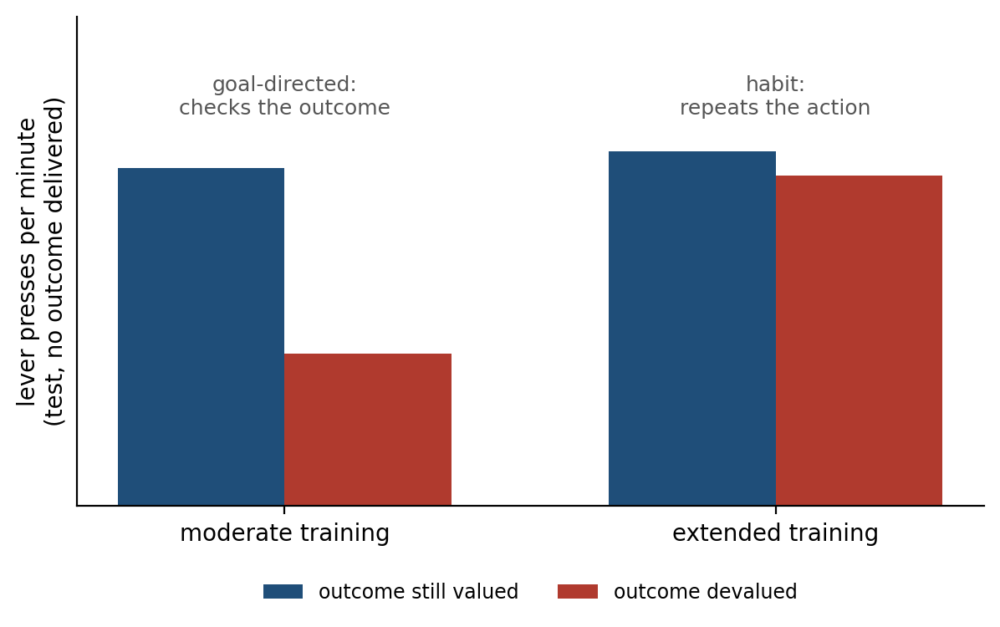

> *"The heart has its reasons, which reason does not know."*
>
> --- Blaise Pascal, *Pensées* (1670)

# The Problem Decision Solves

Chapter 7 ended with a player at a table of four card decks and a region of the frontal lobe that, when damaged, leaves reasoning intact and choice impaired. The patients could describe the game and still lose at it. Whatever choosing well requires, it is not the ability to state the rules. This chapter asks what it is.

Every decision answers two questions at once. The first is what the world is like: whether the dots on the screen are drifting left or right, whether the deck is good or bad, whether the rustle in the grass is wind or a snake. The second is what each option is worth, given the answer to the first and given the state of the body that Chapter 7 described. Neither answer is ever certain. Evidence arrives noisily and over time, values must be learned from outcomes that are themselves variable, and the act of choosing has its own costs: time spent deliberating is time not spent acting, and an option never tried is an option never learned about.

The argument of this chapter is that the brain meets these problems with a small set of mechanisms that can be described precisely and have been recorded in neurons. It accumulates evidence until it is sure enough, where "enough" is set by the cost of waiting and the cost of being wrong. It represents the value of options on a scale that lets unlike things be compared, and it bends that scale in ways that look irrational in the laboratory and often make sense in the world. It balances using what it knows against finding out more. And it runs more than one decision system at once, a deliberate one that plans from a model of the world and a fast one that repeats what has worked. Every one of these mechanisms is tuned by learning: the values, the bounds, the rate of exploration, and the balance between planning and habit are all set by outcomes. Figure 8.1 lays out the pieces, and the sections that follow take them in turn.

The idea of weighing outcomes by their chances is older than any of this. It begins with Blaise Pascal, whose letters with Pierre de Fermat in 1654, on how to divide the stakes of an unfinished game of chance, founded the theory of probability, and whose wager on the existence of God is often called the first argument in decision theory.[^1] The same Pascal wrote that the heart has its reasons. This chapter is about both halves of him.

# Accumulating Evidence

The best-studied decision in neuroscience is a monkey watching a cloud of moving dots. On each trial some fraction of the dots, the coherence, move in one direction and the rest move at random, and the monkey earns juice by moving its eyes in the direction of the coherent motion. At high coherence the task is easy; at low coherence the monkey must watch for a while, and it still makes mistakes.

William Newsome and his colleagues recorded from area MT, a visual region whose neurons respond to motion in a preferred direction, and found that single neurons were about as sensitive to weak motion as the monkey itself.[^2] Passing a small current through a cluster of neurons that preferred one direction made the monkey report that direction more often, so the signal was not only correlated with the choice but used for it.[^3] MT reports the momentary evidence. Where is it weighed?

Michael Shadlen and his colleagues found an answer in the lateral intraparietal area, LIP, a region of parietal cortex that helps plan eye movements. When the monkey was allowed to respond whenever it was ready, LIP neurons whose target lay in the chosen direction ramped up their firing during viewing, faster for stronger motion and slower for weaker, and the firing reached a common level about 70 milliseconds before the eyes began to move, whatever the strength of the motion (Figure 8.2).[^4] The ramp looks like a running total of evidence, and the common level looks like a threshold: the decision is made when enough evidence has piled up for one answer.

This is a process that mathematics had already described. During the Second World War, Abraham Wald worked out the sequential probability ratio test: take samples one at a time, add up the evidence each provides for one hypothesis over the other, and stop as soon as the total crosses a bound in either direction. Wald and Jacob Wolfowitz proved that no other procedure reaches a given accuracy with fewer samples on average.[^5] Alan Turing used the same principle at Bletchley Park to decide when enough evidence had accumulated about the setting of an Enigma machine.[^6] The evidence summed in Wald's test is the logarithm of a likelihood ratio, so the test is the Bayesian inference of Chapter 6 carried out one sample at a time. Chapter 6's eye movements are decisions of the same kind, each a choice of where to sample next.

Roger Ratcliff's drift diffusion model, developed in psychology for memory judgments, is the continuous version of Wald's test: a decision variable drifts toward one bound at a rate set by the strength of the evidence, jostled by noise, and the choice and the reaction time are both set by where and when it hits (Figure 8.3A).[^7] Rafal Bogacz and colleagues showed that, for a choice between two options whose evidence is of fixed strength, the diffusion model is therefore the optimal procedure.[^8]

The model explains one of the most general facts about choice, the trade-off between speed and accuracy. A low bound gives quick decisions and many errors; a high bound gives slow decisions and few errors (Figure 8.3B). In the model of the figure, with weak evidence, a bound that gives 70 percent correct answers in about half a second must be raised about two and a half times to give 90 percent, and the decisions then take about five times as long. Whether that is worth it depends on what an error costs and what a second is worth. People and monkeys move their bounds when the instructions or the rewards change, and the shapes of their reaction-time distributions, including the long tail of slow decisions, follow the model closely.[^9]

The brain also moves the bound when the choice is hard. When options conflict, an electrical rhythm of four to eight cycles a second, the theta rhythm, rises over the medial frontal cortex and decisions slow down. Michael Frank and colleagues studied patients with Parkinson's disease treated by deep brain stimulation, in which an implanted electrode delivers continuous pulses to the subthalamic nucleus, the relay of the hyperdirect path that Chapter 4 described as able to stop everything at once. With the stimulator on, the patients no longer slowed down when the options were close, and made hasty choices; James Cavanagh, Frank, and colleagues showed that stimulation reversed the link between the frontal theta rhythm and the height of the bound.[^10]

When the difficulty of the evidence varies from trial to trial, the optimal bound is not fixed but falls as time passes, and in some tasks the brain appears to add an urgency signal that grows with time.[^11] How often the brain uses collapsing bounds remains debated: a comparison of models across many data sets found that fixed bounds fit most human and monkey choices as well or better.[^12]

The picture is clean, and parts of it have been challenged and defended. Kenneth Latimer and colleagues analyzed single trials rather than averages and found that many LIP neurons were better described as jumping abruptly from one level to another at a random time than as ramping smoothly, the ramp being an artifact of averaging jumps that happen at different times.[^13] Leor Katz and colleagues silenced LIP with a drug and found that monkeys discriminated motion as well as before, while silencing MT impaired them.[^14] Later work pushed back. Recordings from hundreds of LIP neurons at once revealed a population signal that drifts and diffuses on single trials as the model requires, and inactivating LIP does impair decisions at first, before other areas compensate within and across sessions.[^15] LIP is probably one of several areas that keep the running total. The accumulation itself, as a description of how evidence and time trade off in behavior, is among the best-supported models in cognitive science.

# Knowing How Sure You Are

A decision comes with a sense of how likely it is to be right, and that sense is itself computed. Roozbeh Kiani and Shadlen gave monkeys a third option: after viewing the dots they could choose a "sure target" that paid a small reward for certain instead of gambling on the direction. The monkeys took the sure target more often when the motion was weak or brief, as an agent that knew its own uncertainty should, and the same LIP neurons that accumulated evidence predicted when they would do so.[^16]

Confidence is for acting on. Armin Lak, Adam Kepecs, and colleagues trained rats to judge which of two odors dominated a mixture and then to wait at a port for a reward that came after an unpredictable delay, and sometimes not at all. The rats were willing to wait longer when their choice was more likely to be correct, so that the time they invested tracked their own probability of being right; when the orbitofrontal cortex was silenced, they still chose as accurately but no longer waited in proportion to their confidence.[^17]

A decision, once committed, also stays open. In the model a choice is committed when a bound is crossed, but evidence already in the pipeline continues to arrive, and Arbora Resulaj and colleagues found that people who had started to move toward one answer sometimes reversed in mid-movement, and continued accumulation of the late evidence explained how often they did so.[^18] People also differ in how well their confidence tracks their accuracy, a capacity called metacognition, and Stephen Fleming and colleagues found that people with better metacognition had more gray matter in the anterior prefrontal cortex.[^19] The heartbeat-counting results of Chapter 7, in which accuracy and confidence came apart, are the same distinction in the interoceptive domain.

# A Common Currency

To choose between an apple and an orange, or between a job in one city and a job in another, the brain must put unlike things on one scale. Daniel Bernoulli proposed in 1738 that people value money not by its amount but by its usefulness to them, which he called utility, and John von Neumann and Oskar Morgenstern proved in 1947 that any chooser whose preferences obey a few consistency rules behaves as if it maximized some utility weighted by probability.[^20]

Neurons that behave like such a scale have been found. Camillo Padoa-Schioppa and John Assad offered thirsty monkeys choices between different amounts of two juices, measured how much of one the monkey would give up for the other, and recorded in the orbitofrontal cortex on the underside of the frontal lobe. Some neurons fired in proportion to the value of one particular juice on offer. Others fired in proportion to the value of whichever option the monkey chose, whatever the juice, measured in the monkey's own exchange rate: a signal on a common scale. Still others signaled which juice had been chosen.[^21]

In people, activity in the medial orbitofrontal cortex tracks how much they are willing to pay for a snack, and a meta-analysis of more than 200 imaging studies by Oscar Bartra, Joseph McGuire, and Joseph Kable found that this region and the ventral striatum track subjective value for both money and primary rewards such as food.[^22] The medial orbitofrontal cortex is part of the ventromedial prefrontal region whose damage, in Chapter 7, left choice impaired, and patients with such damage choose less consistently, preferring A to B and B to C and then C to A more often than others do.[^23]

The interpretation is contested. Dino Levy and Paul Glimcher argue that these signals are a common neural currency in which all options are priced before they are compared.[^24] Benjamin Hayden and Yael Niv argue that the evidence does not require a single value variable at all: the same neurons carry many other quantities, value-like signals appear everywhere once one looks for them, and choice could emerge from comparisons that never compute a price.[^25] What is not in dispute is that the brain represents what options are worth to the animal now, in regions tied to the body, and that damage to those regions disorganizes choice.

The scale may also be relative. Kenway Louie, Glimcher, and colleagues found that the value signals of parietal neurons are divisively normalized: each is divided by the total value on offer, so that adding a third option shrinks the signals for the first two. Divisive normalization is a computation that sensory circuits use to keep responses within range by dividing each one by the pooled activity of its neighbors, a cousin of the lateral inhibition of Chapter 4.[^26] Louie and colleagues proposed that it makes choices depend on context, so that an irrelevant third option makes people choose less consistently between the original two.[^27] Whether it does is disputed: a preregistered attempt to repeat the behavioral result did not find it.[^28]

# Learning What Options Are Worth

Values are not given; they are learned from outcomes, and the learning rule is the one Chapter 3 described. A large population of midbrain dopamine neurons signals the difference between the reward received and the reward predicted, and the error adjusts the predicted value of whatever was chosen, a little at a time, until predictions match outcomes on average.[^29] The rule has consequences that can be seen in behavior. In 1961 Richard Herrnstein let pigeons peck two keys that paid off on independent random schedules and found that, over a session, the birds divided their pecks between the keys in proportion to the rate at which each delivered food, a regularity he called the matching law.[^30] Leo Sugrue, Greg Corrado, and Newsome trained monkeys on a version of this task in which the richer option changed without warning, and found that the monkeys matched the rewards of the last several trials rather than the whole session, and that LIP neurons tracked each option's share of this recent income, as a learner with a short memory should.[^31]

A learned value is an average over a history, and it changes slowly when the world changes quickly. Chapter 7 left the Iowa patients with a problem of exactly this kind: the bad decks pay well at first and turn bad later, and Lesley Fellows and Martha Farah found that the patients' difficulty was largely explained by a failure to reverse what they had learned.[^32] The reason is now visible. The patients learned that the bad decks were good, and the region that should have revised the value when the losses began was the region that was damaged.

Value and evidence meet during the choice itself. When people choose between two snacks, the decision takes longer the closer the two values are, just as a motion decision takes longer the weaker the motion, and Ian Krajbich, Carrie Armel, and Antonio Rangel found that a diffusion model fitted these choices if the accumulation favored whichever item the person was looking at: people tended to choose the item they had looked at last and longest, even when it was not the one they valued more.[^33] Laurence Hunt and colleagues recorded the brain during such choices with magnetoencephalography, which detects the tiny magnetic fields produced by cortical currents from outside the head, and found a signal in ventromedial prefrontal cortex whose time course matched a network comparing the two values by mutual competition: the accumulation of the dots task, applied to worth rather than to motion.[^34]

# Risk, Loss, and Ambiguity

Once options carry uncertain outcomes, the question becomes how probabilities and payoffs combine. The simplest rule, expected value, says to multiply each payoff by its probability and add. Offered a coin flip that wins 110 dollars on heads and loses 100 on tails, a chooser following that rule accepts, since the gamble is worth 5 dollars on average; most people refuse.[^35] Expected utility theory can explain one refusal by a curved scale of utility, but Matthew Rabin showed that a person who refused this gamble at every level of wealth would, under the theory, also have to refuse a coin flip that loses 1,000 dollars or wins any amount at all, however large, which nobody does.[^36] Small refusals of this kind need a different explanation.

In 1979 Daniel Kahneman and Amos Tversky documented systematic departures from expected utility and proposed prospect theory to describe them.[^37] People evaluate outcomes as gains and losses relative to a reference point rather than as final states of wealth. For moderate and large probabilities they are risk averse for gains and risk seeking for losses. They weight losses more heavily than equal gains, by a factor of about two in Tversky and Kahneman's later estimates. And they treat probabilities nonlinearly, overweighting small ones and underweighting large ones, which is why the same people buy both lottery tickets and insurance (Figure 8.4).[^38]

The reference point can be moved by words alone. Tversky and Kahneman told people that an unusual disease was expected to kill 600 people and offered two programs. When the programs were described in terms of lives saved, 72 percent chose the one that saved 200 for certain over a gamble with the same expected outcome; when they were described in terms of lives lost, 78 percent chose the gamble over the certain death of 400, though the outcomes were identical.[^39] Benedetto De Martino and colleagues found that the amygdala was more active when people's choices followed the frame, and that people who resisted the frame had more activity in the orbital and medial prefrontal cortex.[^40]

The circuits of Chapter 7 appear here directly. Sabrina Tom and colleagues offered people gambles with an even chance of winning or losing various amounts and found that activity in the ventral striatum and ventromedial prefrontal cortex rose with potential gains and fell, more steeply, with potential losses, and that the asymmetry in each person's brain predicted the asymmetry in their choices; they found no region whose activity rose with losses.[^41] De Martino, Colin Camerer, and Ralph Adolphs tested two patients with amygdala damage on gambles of this kind, one of them S.M., the woman of Chapter 7 who felt almost no fear. Both accepted gambles that healthy people refused, and their loss aversion was sharply reduced.[^42] The amygdala's contribution may lie less in valuing losses than in making them matter to choice.

The size of loss aversion, and for some kinds of choice its existence, has been questioned by David Gal and Derek Rucker, who argue that many apparent cases have other explanations.[^43] A meta-analysis by Alexander Brown and colleagues found a typical value somewhat below two, with wide variation across studies, so the factor of two is better read as a typical finding than a constant of nature.[^44]

Prospect theory's overweighting of rare events also depends on how the odds are learned. When people are told the probabilities, they overweight rare outcomes; when they learn them by sampling outcomes one at a time, as animals always must, they underweight rare outcomes, because a rare event is usually absent from a short run of experience.[^45] The difference has come to be called the description-experience gap.

A further kind of uncertainty is not knowing the probabilities at all. Daniel Ellsberg asked people to bet on drawing a red ball from an urn with 50 red and 50 black balls, or from an urn with 100 balls in an unknown mix. Most preferred the known urn when betting on red and also preferred it when betting on black.[^46] Preferring the known urn for red implies a belief that red is less likely than half in the unknown urn, and preferring it for black implies the same of black, and both cannot be true; the preference, now called ambiguity aversion, is a dislike of unknown odds as such. Ming Hsu and colleagues found that ambiguous choices engaged the amygdala and orbitofrontal cortex more than risky ones with known odds, and that patients with orbitofrontal damage were less averse to both ambiguity and risk than healthy people.[^47] Ambiguity aversion makes sense for an animal whose ignorance often means that someone else knows more: the unknown urn may have been stacked.

# The Price of Waiting

Many choices trade a smaller reward now against a larger one later, and the value of a delayed reward is discounted. A rational agent with a constant risk of losing a future reward would discount it exponentially, by the same fraction for each unit of delay. People and animals do not. Their discounting is closer to hyperbolic, steep for short delays and shallow for long ones, so that the value of a reward of size A after delay D is roughly A/(1 + kD), where k measures impatience.[^48] Robert Strotz showed in 1955 that a chooser who discounts this way will not keep to its own plans, and George Ainslie made the consequence concrete: preferences reverse as time passes.[^49] An impatient enough person who prefers 110 dollars in 31 days to 100 dollars in 30 days will, 30 days later, prefer 100 dollars now to 110 tomorrow (Figure 8.5). The plans we make for the future and the choices we make when it arrives come from the same discounting curve, viewed from different distances.

Hyperbolic discounting is not obviously a mistake. Peter Sozou showed that if the risk of losing a future reward is itself uncertain, the rational discount curve is hyperbolic: the longer a promised reward has survived, the more likely it is to be one of the safe ones.[^50]

How the brain computes it is debated. Samuel McClure and colleagues found that choices involving an immediate reward engaged the ventral striatum and medial prefrontal cortex, while all choices engaged the lateral prefrontal and parietal cortex, and proposed what they described as an impatient, emotional system competing with a patient, deliberative one.[^51] Kable and Glimcher found instead that activity in the same valuation regions tracked each person's own hyperbolic discounted value at every delay, as a single system would.[^52] A third view treats patience as self-control rather than as a discount rate. Todd Hare, Camerer, and Rangel found that in dieters choosing between tasty and healthy foods, the dorsolateral prefrontal cortex did not compete with the valuation system but adjusted it, adding health to the value signal in those who chose well.[^53] The serotonin neurons of Chapter 3 are one candidate for a signal that sets patience: their firing rose while a rat waited for a delayed reward, and stimulating them with light made mice wait longer.[^54]

The most famous test of delay is the marshmallow test, in which Walter Mischel and colleagues left preschool children alone with one treat and the promise of two if they waited. Children who waited longer later scored higher on academic tests as adolescents.[^55] A larger replication by Tyler Watts, Greg Duncan, and Haonan Quan, in about 900 children of mothers without a college degree, found an association about half as large, and much of it disappeared once family background and early cognitive ability were taken into account.[^56] Celeste Kidd, Holly Palmeri, and Richard Aslin found, in 28 children, that those who had just seen the experimenter keep a promise waited about four times as long as those who had seen one broken.[^57] A later study of 149 children found no significant effect of the experimenter's trustworthiness on waiting, and a larger role for whether children were in the habit of waiting before they ate.[^58] Waiting is partly a judgment about how reliable the future is, and where promises are broken, taking the marshmallow can be the rational choice.

# Explore or Exploit

Every choice also decides what will be learned. An option never tried is an option whose value is never discovered, so an agent that always takes what currently looks best can lock onto a mediocre option forever. One that keeps sampling the alternatives pays for the information in rewards forgone. This is the explore-exploit dilemma, and it has no solution that is both general and practical. Its simplest version is a row of slot machines with fixed but unknown payoffs, called the multi-armed bandit problem after the casino's one-armed bandit. For this case John Gittins showed in 1979 that the optimal policy assigns each machine an index combining its estimated value with the value of what could be learned from it, and Peter Auer and colleagues later gave simpler rules, such as adding a bonus for uncertainty to each estimate, whose losses grow only slowly as play goes on (Figure 8.6).[^59]

There are two ways to explore: at random, by now and then choosing something other than the apparent best, or in a directed way, by choosing the option about which least is known. People do both. Nathaniel Daw and colleagues gave people a four-armed bandit whose payoffs drifted over time and found that their exploratory choices were best described as partly random, and that these choices engaged the frontopolar cortex at the front of the brain.[^60] Robert Wilson and colleagues separated the two by telling people how many more choices they had. With a longer horizon, when information was worth more, people chose the less-known option more often and also chose more randomly.[^61] How fast to learn should also depend on how fast the world is changing, and Timothy Behrens and colleagues found that people's learning rates rose when the payoffs of a task became more volatile, in step with activity in the anterior cingulate cortex, as the account of norepinephrine and unexpected uncertainty in Chapter 3 would predict, although the experiment did not measure norepinephrine.[^62]

Animals face the dilemma in its oldest form when foraging: stay in a patch that is being depleted or leave for one that might be better. Eric Charnov's marginal value theorem says to leave when the rate of reward in the current patch falls to the average rate available in the environment.[^63] Benjamin Hayden, John Pearson, and Michael Platt found neurons in the dorsal anterior cingulate cortex of monkeys whose firing rose with each harvest from a depleting patch and reached a threshold when the monkey left, and Nils Kolling and colleagues found that the same region in people tracked the value of searching elsewhere, although Amitai Shenhav and colleagues have argued that the signal reflects how difficult the choice is rather than the value of foraging.[^64] Foraging may be the template from which much of the brain's decision machinery evolved: a choice not between two options presented together, but between staying with what one has and looking for something better.

The average rate of reward also sets the cost of time itself. Yael Niv and colleagues proposed that the slow, tonic level of dopamine reports this average, so that a rich environment makes every moment of idleness expensive and every action faster, which may be part of why the dopamine-depleted patients of Chapter 4 move slowly.[^65]

# Goals and Habits

In 1948 Edward Tolman argued from experiments on rats in mazes that animals do not only learn which turns are rewarded; they learn a map of the maze and use it to plan.[^66] Whether a given action is planned in this way or merely repeated was given a sharp test by Christopher Adams and Anthony Dickinson in 1981, which Adams refined a year later. Rats learned to press a lever for sugar pellets. Then the sugar was devalued, paired with a mild illness so that the rats would no longer eat it, and the rats were tested on the lever with no pellets delivered, so that they could not learn the new value of the sugar from the lever itself. Rats that had been trained moderately pressed less, as if they consulted the outcome and found it no longer wanted. Rats that had been trained extensively kept pressing at the old rate, for an outcome they would not eat (Figure 8.7).[^67]

The two kinds of control use different circuits. Goal-directed actions depend on the dorsomedial striatum and the prefrontal cortex that projects to it; habits depend on the dorsolateral striatum, and Henry Yin, Barbara Knowlton, and Bernard Balleine found that rats with lesions there stayed goal-directed even on training schedules that make normal rats habitual.[^68] In people, Elizabeth Tricomi and colleagues reported that three days of training made responding insensitive to devaluation and engaged the corresponding part of the dorsal striatum, but Sanne de Wit and colleagues failed to produce the effect in five experiments, two of them direct replications of Tricomi's, so whether overtraining alone produces habits in people is uncertain.[^69]

Computational accounts give the distinction a principle. A model-based system learns how actions lead to outcomes and plans by simulating the consequences; it is flexible and expensive. A model-free system caches the value of each action from experience, through the dopamine prediction error of Chapter 3; it is fast and cheap and cannot adjust when an outcome's value changes until it has experienced the change. Daw, Niv, and Peter Dayan proposed that the brain runs both and gives control to whichever is less uncertain in the current situation, which would explain why habits take over with practice, when the cached values have become reliable.[^70] Kevin Miller, Amitai Shenhav, and Elliot Ludvig argue that habits are not cached values at all but actions strengthened simply by being repeated, which accounts for their insensitivity to devaluation just as well.[^71]

Daw and colleagues designed a two-step task to separate the systems. Each first choice led, usually but not always, to one of two further choices, and only a learner with a model of those transitions would treat a reward reached by the rare route differently from one reached by the common route. People's choices showed both influences at once, and even the striatal prediction error carried information that only a model could have supplied. Later analyses showed that some apparently model-based patterns can also be produced by sophisticated model-free strategies.[^72] Claire Gillan and colleagues tested more than 1,000 people online with this task and found that a dimension of compulsive symptoms, cutting across obsessive-compulsive disorder, addiction, and binge eating, was associated with weaker model-based control.[^73]

There is a third controller, older than both. Pavlovian responses (approach to cues that predict reward, withdrawal from cues that predict harm) are emitted whether or not they serve the animal. Keller and Marian Breland, training animals for advertisements, found that a raccoon taught to drop coins into a box began instead to rub them together and dip them, as raccoons do with food, and could not be trained out of it.[^74] David Williams and Harriet Williams found that pigeons kept pecking a lit key that predicted food even when pecking it canceled the food.[^75] Dayan, Niv, and colleagues argued, with models, that a Pavlovian controller of this kind can override instrumental learning, the learning of actions by their consequences, even when doing so costs reward, and that much of what looks like weakness of will is this override.[^76] How a choice repeated often enough stops being a choice at all, and how deliberate action becomes routine and skill, is the subject of Chapter 9.

# Thinking Is Costly

A brain that planned every choice from a full model of the world would be accurate and paralyzed. Herbert Simon argued in the 1950s that real choosers have bounded rationality: they satisfice, searching until they find an option good enough rather than the best, because search itself is expensive.[^77] The cheapest rules can be surprisingly good. Daniel Goldstein and Gerd Gigerenzer asked American and German students which of two American cities was larger, San Diego or San Antonio (San Diego, at the time). About 62 percent of the Americans, who knew both cities, answered correctly; every one of the Germans did, because most had heard of San Diego and not of San Antonio, and they chose the city they recognized.[^78] Recognition is a good cue to size because large cities are mentioned more, and knowing less let the German students use it. Gigerenzer and Goldstein showed that rules of this kind, which decide by the single most valid cue and ignore the rest, can match elaborate statistical methods.[^79]

Falk Lieder and Thomas Griffiths have generalized the point into a framework, resource rationality, in which many apparent biases are optimal once the cost of computation is counted.[^80] The brain may even estimate that cost: Shenhav, Matthew Botvinick, and Jonathan Cohen argue that the dorsal anterior cingulate cortex weighs the expected value of exerting control and decides whether a situation is worth thinking hard about.[^81] This reframes the biases of the previous sections. Loss aversion, ambiguity aversion, steep discounting, and habit are often treated as defects of a rational machine. Many of them make better sense as the policies of a machine that must decide quickly, with limited computation, in a world that is uncertain, changing, and sometimes adversarial. Some are miscalibrated for the modern world, where losses are rarely fatal and promises are often kept; few are arbitrary.

# Choosing Among Others

Other people are the most uncertain part of most environments, and they change the decision problem. In the ultimatum game, devised by Werner Güth and colleagues, one player proposes how to split a sum of money and the other accepts, in which case both are paid, or rejects, in which case neither is.[^82] A purely self-interested responder should accept any positive offer. In industrialized societies, offers below about a fifth of the sum are rejected roughly half the time, and proposers, anticipating this, typically offer 40 to 50 percent.[^83] Alan Sanfey and colleagues found that unfair offers engaged the anterior insula of Chapter 7, and that the stronger its response the more likely the offer was to be rejected.[^84]

Correlation does not show what the brain is doing, and a disruption can. Daria Knoch, Ernst Fehr, and colleagues used transcranial magnetic stimulation, a strong magnetic pulse applied through the scalp, to disrupt the right dorsolateral prefrontal cortex for several minutes. Their participants then accepted more unfair offers, while still judging the offers to be as unfair as before.[^85] The judgment was intact and the will to act on it was weakened: the Iowa patients' problem of knowing the rule and not acting on it, appearing in a social choice.

Joseph Henrich and colleagues ran the game in 15 small-scale societies and found mean offers ranging from about a quarter to more than half of the sum, varying with how integrated each society was into markets and how much its people gained from cooperating with one another.[^86] The sense of fairness that drives rejection is felt in the body and learned in a culture, and it lets a social animal enforce the cooperation it depends on.

# When Choice Goes Wrong

Because choice is built from identifiable components, its disorders can be traced to them. The loss of dopamine in Parkinson's disease changes learning as well as movement: as Chapter 3 described, patients off their medication learn better from bad outcomes than good ones, and on medication the bias reverses.[^87] Some patients treated with drugs that stimulate dopamine receptors develop compulsive gambling, shopping, or eating; in a study of more than 3,000 patients, Daniel Weintraub and colleagues found such impulse control disorders in about one in seven, with nearly three times the odds in those taking these drugs.[^88]

David Redish proposed that addiction exploits the learning rule itself. Natural rewards stop producing a prediction error once they are expected, which is what makes the dopamine signal of Chapter 3 a teacher. A drug that raises dopamine directly would produce a positive error every time, however well it was predicted, so the value of drug-seeking would grow without limit.[^89] Chapter 7 called addiction a form of reward hacking; this is how the hack might work. The idea is elegant but one of several, and one of its clearest predictions, that cues paired with cocaine should escape the normal rule by which an already predicted reward teaches nothing new, failed when tested in rats.[^90] With Gillan's compulsivity dimension it belongs to a broader program, computational psychiatry, that tries to describe disorders as specific failures of the machinery this chapter has described.[^91] In each case what fails is not reasoning but the learning that decides what to choose, and the most persistent of those failures are habits that have outlived their reasons.

# Implications for Artificial Intelligence

Decision-making under uncertainty is the field where neuroscience and artificial intelligence have exchanged the most, because reinforcement learning is a theory of both.[^92] The comparison is therefore less about what machines lack than about which of the brain's solutions they have already borrowed and which they have not.

First, accumulation to a bound has only recently begun to appear in artificial systems. Most networks still spend the same computation on every input, easy or hard, although methods for adapting computation to the input go back at least to Alex Graves's adaptive computation time.[^93] Language models that reason step by step before answering spend more on harder problems, a step toward the brain's practice, but they rarely have an explicit bound that moves with the stakes. The brain spends time in proportion to difficulty, stops when it is sure enough, and raises the bound when errors are expensive.

Second, calibrated confidence is hard to get. Chuan Guo and colleagues found that the deep networks of the mid-2010s were systematically overconfident, assigning high probability to answers that were often wrong, and that a simple rescaling fixed much of it.[^94] Newer architectures are better calibrated, and large language models can estimate fairly well which of their answers are right, but confidence that stays reliable when the input is unlike the training data remains elusive.[^95] Yarin Gal and Zoubin Ghahramani showed one way for a network to report its own uncertainty, by running it many times with random parts switched off.[^96] The monkey that takes the sure target when the dots are weak, and the rat that waits only as long as its confidence warrants, are doing what an artificial system must do to be trusted: knowing when it does not know, and acting on it.

Third, exploration is mostly set by hand. Research agents add bonuses for novelty and uncertainty, and the bonuses of the bandit literature are used in practice, but most agents explore on a schedule fixed in advance.[^97] People adjust exploration to the horizon and to the volatility of the world, and norepinephrine, on the account of Chapter 3, appears to help set the rate.

Fourth, the best artificial decision-makers already combine habit and planning. AlphaGo, the first program to beat a professional Go player on a full board without handicap, paired two networks, one trained to propose good moves at a glance and one to judge positions, with a search that simulated future play from a model of the game.[^98] That is a model-free and a model-based system working together. The brain's addition is arbitration: deciding, moment by moment, which system to trust and how much computation a choice deserves.

Fifth, the biases are not simply errors to remove. A system designed to maximize expected value in every choice will be exploited by any environment that is adversarial, nonstationary, or poorly described by its probabilities. Loss aversion, ambiguity aversion, and a preference for reliable options are protections as well as distortions, and an artificial agent that must act in the world may need versions of them.

# The Central Lesson

A decision is a bet placed before the evidence is complete, and the brain is built to place it well rather than to place it perfectly. It accumulates evidence until being wrong costs less than waiting, prices options on a scale set by the state of the body and the options on offer, weights losses and ambiguity more heavily than a calculator would, and keeps paying to learn about options it is not choosing. It runs a planner and a habit system side by side, under the pull of older Pavlovian reflexes. Every one of these settings is learned from outcomes. The Iowa patients could state the rules and still lose because the part of the brain that learns what options are worth, and revises that learning when the world changes, was damaged. Choosing well is not knowing the rules. It is knowing how sure you are, spending thought where thought pays, and learning from every outcome.

# Next Chapter

Chapter 9: Habits, Skills, and Automaticity: How Practice Turns Choices into Routines

# References and Attribution

## Figure Attribution

Figures 8.1 to 8.7 were drawn for this book. The firing rates in Figure 8.2 are illustrative, after the pattern reported by Roitman and Shadlen (2002), not recorded data. The traces and curves in Figure 8.3, the bandit results in Figure 8.6, and the curves in Figure 8.5 are simulations or computations. Figure 8.4 plots the functions of Tversky and Kahneman (1992) with their published parameter estimates. The bars in Figure 8.7 are illustrative, after the pattern reported by Adams (1982).

## Epigraph

Blaise Pascal, *Pensées*, §277, trans. W. F. Trotter (E. P. Dutton, 1958); first published in French in 1670.

## References

Adams, C. D. (1982). Variations in the sensitivity of instrumental responding to reinforcer devaluation. *Quarterly Journal of Experimental Psychology Section B*, 34(2), 77–98.

Adams, C. D., & Dickinson, A. (1981). Instrumental responding following reinforcer devaluation. *Quarterly Journal of Experimental Psychology Section B*, 33(2), 109–121.

Ainslie, G. (1975). Specious reward: A behavioral theory of impulsiveness and impulse control. *Psychological Bulletin*, 82(4), 463–496.

Akam, T., Costa, R., & Dayan, P. (2015). Simple plans or sophisticated habits? State, transition and learning interactions in the two-step task. *PLoS Computational Biology*, 11(12), e1004648.

Auer, P., Cesa-Bianchi, N., & Fischer, P. (2002). Finite-time analysis of the multiarmed bandit problem. *Machine Learning*, 47(2–3), 235–256.

Balleine, B. W., & O'Doherty, J. P. (2010). Human and rodent homologies in action control: Corticostriatal determinants of goal-directed and habitual action. *Neuropsychopharmacology*, 35(1), 48–69.

Bartra, O., McGuire, J. T., & Kable, J. W. (2013). The valuation system: A coordinate-based meta-analysis of BOLD fMRI experiments examining neural correlates of subjective value. *NeuroImage*, 76, 412–427.

Behrens, T. E. J., Woolrich, M. W., Walton, M. E., & Rushworth, M. F. S. (2007). Learning the value of information in an uncertain world. *Nature Neuroscience*, 10(9), 1214–1221.

Bellemare, M. G., Srinivasan, S., Ostrovski, G., Schaul, T., Saxton, D., & Munos, R. (2016). Unifying count-based exploration and intrinsic motivation. *Advances in Neural Information Processing Systems*, 29. arXiv:1606.01868.

Bernoulli, D. (1954). Exposition of a new theory on the measurement of risk (L. Sommer, Trans.). *Econometrica*, 22(1), 23–36.

Bogacz, R., Brown, E., Moehlis, J., Holmes, P., & Cohen, J. D. (2006). The physics of optimal decision making: A formal analysis of models of performance in two-alternative forced-choice tasks. *Psychological Review*, 113(4), 700–765.

Breland, K., & Breland, M. (1961). The misbehavior of organisms. *American Psychologist*, 16(11), 681–684.

Brown, A. L., Imai, T., Vieider, F. M., & Camerer, C. F. (2024). Meta-analysis of empirical estimates of loss aversion. *Journal of Economic Literature*, 62(2), 485–516.

Camille, N., Griffiths, C. A., Vo, K., Fellows, L. K., & Kable, J. W. (2011). Ventromedial frontal lobe damage disrupts value maximization in humans. *Journal of Neuroscience*, 31(20), 7527–7532.

Carandini, M., & Heeger, D. J. (2012). Normalization as a canonical neural computation. *Nature Reviews Neuroscience*, 13(1), 51–62.

Cavanagh, J. F., Wiecki, T. V., Cohen, M. X., Figueroa, C. M., Samanta, J., Sherman, S. J., & Frank, M. J. (2011). Subthalamic nucleus stimulation reverses mediofrontal influence over decision threshold. *Nature Neuroscience*, 14(11), 1462–1467.

Charnov, E. L. (1976). Optimal foraging, the marginal value theorem. *Theoretical Population Biology*, 9(2), 129–136.

Churchland, A. K., Kiani, R., & Shadlen, M. N. (2008). Decision-making with multiple alternatives. *Nature Neuroscience*, 11(6), 693–702.

Daw, N. D., Gershman, S. J., Seymour, B., Dayan, P., & Dolan, R. J. (2011). Model-based influences on humans' choices and striatal prediction errors. *Neuron*, 69(6), 1204–1215.

Daw, N. D., Niv, Y., & Dayan, P. (2005). Uncertainty-based competition between prefrontal and dorsolateral striatal systems for behavioral control. *Nature Neuroscience*, 8(12), 1704–1711.

Daw, N. D., O'Doherty, J. P., Dayan, P., Seymour, B., & Dolan, R. J. (2006). Cortical substrates for exploratory decisions in humans. *Nature*, 441(7095), 876–879.

Dayan, P., Niv, Y., Seymour, B., & Daw, N. D. (2006). The misbehavior of value and the discipline of the will. *Neural Networks*, 19(8), 1153–1160.

De Martino, B., Camerer, C. F., & Adolphs, R. (2010). Amygdala damage eliminates monetary loss aversion. *Proceedings of the National Academy of Sciences*, 107(8), 3788–3792.

De Martino, B., Kumaran, D., Seymour, B., & Dolan, R. J. (2006). Frames, biases, and rational decision-making in the human brain. *Science*, 313(5787), 684–687.

de Wit, S., Kindt, M., Knot, S. L., Verhoeven, A. A. C., Robbins, T. W., Gasull-Camos, J., Evans, M., Mirza, H., & Gillan, C. M. (2018). Shifting the balance between goals and habits: Five failures in experimental habit induction. *Journal of Experimental Psychology: General*, 147(7), 1043–1065.

Devlin, K. (2008). *The Unfinished Game: Pascal, Fermat, and the Seventeenth-Century Letter That Made the World Modern*. Basic Books.

Drugowitsch, J., Moreno-Bote, R., Churchland, A. K., Shadlen, M. N., & Pouget, A. (2012). The cost of accumulating evidence in perceptual decision making. *Journal of Neuroscience*, 32(11), 3612–3628.

Ellsberg, D. (1961). Risk, ambiguity, and the Savage axioms. *Quarterly Journal of Economics*, 75(4), 643–669.

Fellows, L. K., & Farah, M. J. (2005). Different underlying impairments in decision-making following ventromedial and dorsolateral frontal lobe damage in humans. *Cerebral Cortex*, 15(1), 58–63.

Fleming, S. M., Weil, R. S., Nagy, Z., Dolan, R. J., & Rees, G. (2010). Relating introspective accuracy to individual differences in brain structure. *Science*, 329(5998), 1541–1543.

Frank, M. J., Samanta, J., Moustafa, A. A., & Sherman, S. J. (2007). Hold your horses: Impulsivity, deep brain stimulation, and medication in parkinsonism. *Science*, 318(5854), 1309–1312.

Frank, M. J., Seeberger, L. C., & O'Reilly, R. C. (2004). By carrot or by stick: Cognitive reinforcement learning in parkinsonism. *Science*, 306(5703), 1940–1943.

Gal, D., & Rucker, D. D. (2018). The loss of loss aversion: Will it loom larger than its gain? *Journal of Consumer Psychology*, 28(3), 497–516.

Gal, Y., & Ghahramani, Z. (2016). Dropout as a Bayesian approximation: Representing model uncertainty in deep learning. *Proceedings of the 33rd International Conference on Machine Learning*, PMLR 48, 1050–1059.

Gigerenzer, G., & Goldstein, D. G. (1996). Reasoning the fast and frugal way: Models of bounded rationality. *Psychological Review*, 103(4), 650–669.

Gillan, C. M., Kosinski, M., Whelan, R., Phelps, E. A., & Daw, N. D. (2016). Characterizing a psychiatric symptom dimension related to deficits in goal-directed control. *eLife*, 5, e11305.

Gittins, J. C. (1979). Bandit processes and dynamic allocation indices. *Journal of the Royal Statistical Society: Series B*, 41(2), 148–177.

Gluth, S., Kern, N., Kortmann, M., & Vitali, C. L. (2020). Value-based attention but not divisive normalization influences decisions with multiple alternatives. *Nature Human Behaviour*, 4(6), 634–645.

Gold, J. I., & Shadlen, M. N. (2007). The neural basis of decision making. *Annual Review of Neuroscience*, 30, 535–574.

Goldstein, D. G., & Gigerenzer, G. (2002). Models of ecological rationality: The recognition heuristic. *Psychological Review*, 109(1), 75–90.

Graves, A. (2016). Adaptive computation time for recurrent neural networks. *arXiv*, 1603.08983.

Guo, C., Pleiss, G., Sun, Y., & Weinberger, K. Q. (2017). On calibration of modern neural networks. *Proceedings of the 34th International Conference on Machine Learning*, PMLR 70, 1321–1330.

Güth, W., Schmittberger, R., & Schwarze, B. (1982). An experimental analysis of ultimatum bargaining. *Journal of Economic Behavior & Organization*, 3(4), 367–388.

Hacking, I. (1972). The logic of Pascal's wager. *American Philosophical Quarterly*, 9(2), 186–192.

Hare, T. A., Camerer, C. F., & Rangel, A. (2009). Self-control in decision-making involves modulation of the vmPFC valuation system. *Science*, 324(5927), 646–648.

Hawkins, G. E., Forstmann, B. U., Wagenmakers, E.-J., Ratcliff, R., & Brown, S. D. (2015). Revisiting the evidence for collapsing boundaries and urgency signals in perceptual decision-making. *Journal of Neuroscience*, 35(6), 2476–2484.

Hayden, B. Y., & Niv, Y. (2021). The case against economic values in the orbitofrontal cortex (or anywhere else in the brain). *Behavioral Neuroscience*, 135(2), 192–201.

Hayden, B. Y., Pearson, J. M., & Platt, M. L. (2011). Neuronal basis of sequential foraging decisions in a patchy environment. *Nature Neuroscience*, 14(7), 933–939.

Henrich, J., Boyd, R., Bowles, S., Camerer, C., Fehr, E., Gintis, H., & McElreath, R. (2001). In search of Homo economicus: Behavioral experiments in 15 small-scale societies. *American Economic Review*, 91(2), 73–78.

Herrnstein, R. J. (1961). Relative and absolute strength of response as a function of frequency of reinforcement. *Journal of the Experimental Analysis of Behavior*, 4(3), 267–272.

Hertwig, R., Barron, G., Weber, E. U., & Erev, I. (2004). Decisions from experience and the effect of rare events in risky choice. *Psychological Science*, 15(8), 534–539.

Hsu, M., Bhatt, M., Adolphs, R., Tranel, D., & Camerer, C. F. (2005). Neural systems responding to degrees of uncertainty in human decision-making. *Science*, 310(5754), 1680–1683.

Hunt, L. T., Kolling, N., Soltani, A., Woolrich, M. W., Rushworth, M. F. S., & Behrens, T. E. J. (2012). Mechanisms underlying cortical activity during value-guided choice. *Nature Neuroscience*, 15(3), 470–476.

Huys, Q. J. M., Maia, T. V., & Frank, M. J. (2016). Computational psychiatry as a bridge from neuroscience to clinical applications. *Nature Neuroscience*, 19(3), 404–413.

Jeurissen, D., Shushruth, S., El-Shamayleh, Y., Horwitz, G. D., & Shadlen, M. N. (2022). Deficits in decision-making induced by parietal cortex inactivation are compensated at two timescales. *Neuron*, 110(12), 1924–1931.

Kable, J. W., & Glimcher, P. W. (2007). The neural correlates of subjective value during intertemporal choice. *Nature Neuroscience*, 10(12), 1625–1633.

Kadavath, S., Conerly, T., Askell, A., Henighan, T., Drain, D., Perez, E., … Kaplan, J. (2022). Language models (mostly) know what they know. *arXiv*, 2207.05221.

Kahneman, D., & Tversky, A. (1979). Prospect theory: An analysis of decision under risk. *Econometrica*, 47(2), 263–291.

Katz, L. N., Yates, J. L., Pillow, J. W., & Huk, A. C. (2016). Dissociated functional significance of decision-related activity in the primate dorsal stream. *Nature*, 535(7611), 285–288.

Kiani, R., & Shadlen, M. N. (2009). Representation of confidence associated with a decision by neurons in the parietal cortex. *Science*, 324(5928), 759–764.

Kidd, C., Palmeri, H., & Aslin, R. N. (2013). Rational snacking: Young children's decision-making on the marshmallow task is moderated by beliefs about environmental reliability. *Cognition*, 126(1), 109–114.

Knoch, D., Pascual-Leone, A., Meyer, K., Treyer, V., & Fehr, E. (2006). Diminishing reciprocal fairness by disrupting the right prefrontal cortex. *Science*, 314(5800), 829–832.

Kolling, N., Behrens, T. E. J., Mars, R. B., & Rushworth, M. F. S. (2012). Neural mechanisms of foraging. *Science*, 336(6077), 95–98.

Krajbich, I., Armel, C., & Rangel, A. (2010). Visual fixations and the computation and comparison of value in simple choice. *Nature Neuroscience*, 13(10), 1292–1298.

Lak, A., Costa, G. M., Romberg, E., Koulakov, A. A., Mainen, Z. F., & Kepecs, A. (2014). Orbitofrontal cortex is required for optimal waiting based on decision confidence. *Neuron*, 84(1), 190–201.

Latimer, K. W., Yates, J. L., Meister, M. L. R., Huk, A. C., & Pillow, J. W. (2015). Single-trial spike trains in parietal cortex reveal discrete steps during decision-making. *Science*, 349(6244), 184–187.

Levy, D. J., & Glimcher, P. W. (2012). The root of all value: A neural common currency for choice. *Current Opinion in Neurobiology*, 22(6), 1027–1038.

Lieder, F., & Griffiths, T. L. (2020). Resource-rational analysis: Understanding human cognition as the optimal use of limited computational resources. *Behavioral and Brain Sciences*, 43, e1.

Louie, K., Grattan, L. E., & Glimcher, P. W. (2011). Reward value-based gain control: Divisive normalization in parietal cortex. *Journal of Neuroscience*, 31(29), 10627–10639.

Louie, K., Khaw, M. W., & Glimcher, P. W. (2013). Normalization is a general neural mechanism for context-dependent decision making. *Proceedings of the National Academy of Sciences*, 110(15), 6139–6144.

Mazur, J. E. (1987). An adjusting procedure for studying delayed reinforcement. In M. L. Commons, J. E. Mazur, J. A. Nevin, & H. Rachlin (Eds.), *Quantitative Analyses of Behavior: Vol. 5. The Effect of Delay and of Intervening Events on Reinforcement Value* (pp. 55–73). Erlbaum.

McClure, S. M., Laibson, D. I., Loewenstein, G., & Cohen, J. D. (2004). Separate neural systems value immediate and delayed monetary rewards. *Science*, 306(5695), 503–507.

Miller, K. J., Shenhav, A., & Ludvig, E. A. (2019). Habits without values. *Psychological Review*, 126(2), 292–311.

Minderer, M., Djolonga, J., Romijnders, R., Hubis, F., Zhai, X., Houlsby, N., Tran, D., & Lucic, M. (2021). Revisiting the calibration of modern neural networks. *Advances in Neural Information Processing Systems*, 34. arXiv:2106.07998.

Mischel, W., Shoda, Y., & Rodriguez, M. L. (1989). Delay of gratification in children. *Science*, 244(4907), 933–938.

Miyazaki, K. W., Miyazaki, K., Tanaka, K. F., Yamanaka, A., Takahashi, A., Tabuchi, S., & Doya, K. (2014). Optogenetic activation of dorsal raphe serotonin neurons enhances patience for future rewards. *Current Biology*, 24(17), 2033–2040.

Newsome, W. T., Britten, K. H., & Movshon, J. A. (1989). Neuronal correlates of a perceptual decision. *Nature*, 341(6237), 52–54.

Niv, Y., Daw, N. D., Joel, D., & Dayan, P. (2007). Tonic dopamine: Opportunity costs and the control of response vigor. *Psychopharmacology*, 191(3), 507–520.

Padoa-Schioppa, C., & Assad, J. A. (2006). Neurons in the orbitofrontal cortex encode economic value. *Nature*, 441(7090), 223–226.

Panlilio, L. V., Thorndike, E. B., & Schindler, C. W. (2007). Blocking of conditioning to a cocaine-paired stimulus: Testing the hypothesis that cocaine perpetually produces a signal of larger-than-expected reward. *Pharmacology Biochemistry and Behavior*, 86(4), 774–777.

Plassmann, H., O'Doherty, J., & Rangel, A. (2007). Orbitofrontal cortex encodes willingness to pay in everyday economic transactions. *Journal of Neuroscience*, 27(37), 9984–9988.

Rabin, M. (2000). Risk aversion and expected-utility theory: A calibration theorem. *Econometrica*, 68(5), 1281–1292.

Ratcliff, R. (1978). A theory of memory retrieval. *Psychological Review*, 85(2), 59–108.

Ratcliff, R., & McKoon, G. (2008). The diffusion decision model: Theory and data for two-choice decision tasks. *Neural Computation*, 20(4), 873–922.

Redish, A. D. (2004). Addiction as a computational process gone awry. *Science*, 306(5703), 1944–1947.

Resulaj, A., Kiani, R., Wolpert, D. M., & Shadlen, M. N. (2009). Changes of mind in decision-making. *Nature*, 461(7261), 263–266.

Roitman, J. D., & Shadlen, M. N. (2002). Response of neurons in the lateral intraparietal area during a combined visual discrimination reaction time task. *Journal of Neuroscience*, 22(21), 9475–9489.

Salzman, C. D., Britten, K. H., & Newsome, W. T. (1990). Cortical microstimulation influences perceptual judgements of motion direction. *Nature*, 346(6280), 174–177.

Sanfey, A. G., Rilling, J. K., Aronson, J. A., Nystrom, L. E., & Cohen, J. D. (2003). The neural basis of economic decision-making in the Ultimatum Game. *Science*, 300(5626), 1755–1758.

Schultz, W., Dayan, P., & Montague, P. R. (1997). A neural substrate of prediction and reward. *Science*, 275(5306), 1593–1599.

Shadlen, M. N., & Newsome, W. T. (2001). Neural basis of a perceptual decision in the parietal cortex (area LIP) of the rhesus monkey. *Journal of Neurophysiology*, 86(4), 1916–1936.

Shenhav, A., Botvinick, M. M., & Cohen, J. D. (2013). The expected value of control: An integrative theory of anterior cingulate cortex function. *Neuron*, 79(2), 217–240.

Shenhav, A., Straccia, M. A., Cohen, J. D., & Botvinick, M. M. (2014). Anterior cingulate engagement in a foraging context reflects choice difficulty, not foraging value. *Nature Neuroscience*, 17(9), 1249–1254.

Shoda, Y., Mischel, W., & Peake, P. K. (1990). Predicting adolescent cognitive and self-regulatory competencies from preschool delay of gratification: Identifying diagnostic conditions. *Developmental Psychology*, 26(6), 978–986.

Silver, D., Huang, A., Maddison, C. J., Guez, A., Sifre, L., van den Driessche, G., Schrittwieser, J., Antonoglou, I., Panneershelvam, V., Lanctot, M., Dieleman, S., Grewe, D., Nham, J., Kalchbrenner, N., Sutskever, I., Lillicrap, T., Leach, M., Kavukcuoglu, K., Graepel, T., & Hassabis, D. (2016). Mastering the game of Go with deep neural networks and tree search. *Nature*, 529(7587), 484–489.

Simon, H. A. (1955). A behavioral model of rational choice. *Quarterly Journal of Economics*, 69(1), 99–118.

Simon, H. A. (1956). Rational choice and the structure of the environment. *Psychological Review*, 63(2), 129–138.

Sozou, P. D. (1998). On hyperbolic discounting and uncertain hazard rates. *Proceedings of the Royal Society B*, 265(1409), 2015–2020.

Steinemann, N. A., Stine, G. M., Trautmann, E. M., Zylberberg, A., Wolpert, D. M., & Shadlen, M. N. (2024). Direct observation of the neural computations underlying a single decision. *eLife*, 12, RP90859.

Strotz, R. H. (1955). Myopia and inconsistency in dynamic utility maximization. *Review of Economic Studies*, 23(3), 165–180.

Sugrue, L. P., Corrado, G. S., & Newsome, W. T. (2004). Matching behavior and the representation of value in the parietal cortex. *Science*, 304(5678), 1782–1787.

Sutton, R. S., & Barto, A. G. (2018). *Reinforcement Learning: An Introduction* (2nd ed.). MIT Press.

Tolman, E. C. (1948). Cognitive maps in rats and men. *Psychological Review*, 55(4), 189–208.

Tom, S. M., Fox, C. R., Trepel, C., & Poldrack, R. A. (2007). The neural basis of loss aversion in decision-making under risk. *Science*, 315(5811), 515–518.

Tricomi, E., Balleine, B. W., & O'Doherty, J. P. (2009). A specific role for posterior dorsolateral striatum in human habit learning. *European Journal of Neuroscience*, 29(11), 2225–2232.

Tversky, A., & Kahneman, D. (1981). The framing of decisions and the psychology of choice. *Science*, 211(4481), 453–458.

Tversky, A., & Kahneman, D. (1992). Advances in prospect theory: Cumulative representation of uncertainty. *Journal of Risk and Uncertainty*, 5(4), 297–323.

von Neumann, J., & Morgenstern, O. (1947). *Theory of Games and Economic Behavior* (2nd ed.). Princeton University Press.

Wald, A., & Wolfowitz, J. (1948). Optimum character of the sequential probability ratio test. *Annals of Mathematical Statistics*, 19(3), 326–339.

Watts, T. W., Duncan, G. J., & Quan, H. (2018). Revisiting the marshmallow test: A conceptual replication investigating links between early delay of gratification and later outcomes. *Psychological Science*, 29(7), 1159–1177.

Weintraub, D., Koester, J., Potenza, M. N., Siderowf, A. D., Stacy, M., Voon, V., Whetteckey, J., Wunderlich, G. R., & Lang, A. E. (2010). Impulse control disorders in Parkinson disease: A cross-sectional study of 3090 patients. *Archives of Neurology*, 67(5), 589–595.

Williams, D. R., & Williams, H. (1969). Auto-maintenance in the pigeon: Sustained pecking despite contingent non-reinforcement. *Journal of the Experimental Analysis of Behavior*, 12(4), 511–520.

Wilson, R. C., Geana, A., White, J. M., Ludvig, E. A., & Cohen, J. D. (2014). Humans use directed and random exploration to solve the explore–exploit dilemma. *Journal of Experimental Psychology: General*, 143(6), 2074–2081.

Yanaoka, K., Michaelson, L. E., Saito, S., & Munakata, Y. (2026). Waiting longer with less work: The impact of habits and social trust on children's delay of gratification. *Developmental Science*, 29(3), e70185.

Yin, H. H., Knowlton, B. J., & Balleine, B. W. (2004). Lesions of dorsolateral striatum preserve outcome expectancy but disrupt habit formation in instrumental learning. *European Journal of Neuroscience*, 19(1), 181–189.

[^1]: Devlin, K. (2008). *The Unfinished Game: Pascal, Fermat, and the Seventeenth-Century Letter That Made the World Modern*. Basic Books; Hacking, I. (1972). The logic of Pascal's wager. *American Philosophical Quarterly*, 9(2), 186–192.

[^2]: Newsome, W. T., Britten, K. H., & Movshon, J. A. (1989). Neuronal correlates of a perceptual decision. *Nature*, 341(6237), 52–54.

[^3]: Salzman, C. D., Britten, K. H., & Newsome, W. T. (1990). Cortical microstimulation influences perceptual judgements of motion direction. *Nature*, 346(6280), 174–177.

[^4]: Shadlen, M. N., & Newsome, W. T. (2001). Neural basis of a perceptual decision in the parietal cortex (area LIP) of the rhesus monkey. *Journal of Neurophysiology*, 86(4), 1916–1936; Roitman, J. D., & Shadlen, M. N. (2002). Response of neurons in the lateral intraparietal area during a combined visual discrimination reaction time task. *Journal of Neuroscience*, 22(21), 9475–9489.

[^5]: Wald, A., & Wolfowitz, J. (1948). Optimum character of the sequential probability ratio test. *Annals of Mathematical Statistics*, 19(3), 326–339.

[^6]: Gold, J. I., & Shadlen, M. N. (2007). The neural basis of decision making. *Annual Review of Neuroscience*, 30, 535–574.

[^7]: Ratcliff, R. (1978). A theory of memory retrieval. *Psychological Review*, 85(2), 59–108; Ratcliff, R., & McKoon, G. (2008). The diffusion decision model: Theory and data for two-choice decision tasks. *Neural Computation*, 20(4), 873–922.

[^8]: Bogacz, R., Brown, E., Moehlis, J., Holmes, P., & Cohen, J. D. (2006). The physics of optimal decision making: A formal analysis of models of performance in two-alternative forced-choice tasks. *Psychological Review*, 113(4), 700–765.

[^9]: Ratcliff, R., & McKoon, G. (2008). The diffusion decision model: Theory and data for two-choice decision tasks. *Neural Computation*, 20(4), 873–922.

[^10]: Frank, M. J., Samanta, J., Moustafa, A. A., & Sherman, S. J. (2007). Hold your horses: Impulsivity, deep brain stimulation, and medication in parkinsonism. *Science*, 318(5854), 1309–1312; Cavanagh, J. F., Wiecki, T. V., Cohen, M. X., Figueroa, C. M., Samanta, J., Sherman, S. J., & Frank, M. J. (2011). Subthalamic nucleus stimulation reverses mediofrontal influence over decision threshold. *Nature Neuroscience*, 14(11), 1462–1467.

[^11]: Drugowitsch, J., Moreno-Bote, R., Churchland, A. K., Shadlen, M. N., & Pouget, A. (2012). The cost of accumulating evidence in perceptual decision making. *Journal of Neuroscience*, 32(11), 3612–3628; Churchland, A. K., Kiani, R., & Shadlen, M. N. (2008). Decision-making with multiple alternatives. *Nature Neuroscience*, 11(6), 693–702.

[^12]: Hawkins, G. E., Forstmann, B. U., Wagenmakers, E.-J., Ratcliff, R., & Brown, S. D. (2015). Revisiting the evidence for collapsing boundaries and urgency signals in perceptual decision-making. *Journal of Neuroscience*, 35(6), 2476–2484.

[^13]: Latimer, K. W., Yates, J. L., Meister, M. L. R., Huk, A. C., & Pillow, J. W. (2015). Single-trial spike trains in parietal cortex reveal discrete steps during decision-making. *Science*, 349(6244), 184–187.

[^14]: Katz, L. N., Yates, J. L., Pillow, J. W., & Huk, A. C. (2016). Dissociated functional significance of decision-related activity in the primate dorsal stream. *Nature*, 535(7611), 285–288.

[^15]: Steinemann, N. A., Stine, G. M., Trautmann, E. M., Zylberberg, A., Wolpert, D. M., & Shadlen, M. N. (2024). Direct observation of the neural computations underlying a single decision. *eLife*, 12, RP90859; Jeurissen, D., Shushruth, S., El-Shamayleh, Y., Horwitz, G. D., & Shadlen, M. N. (2022). Deficits in decision-making induced by parietal cortex inactivation are compensated at two timescales. *Neuron*, 110(12), 1924–1931.

[^16]: Kiani, R., & Shadlen, M. N. (2009). Representation of confidence associated with a decision by neurons in the parietal cortex. *Science*, 324(5928), 759–764.

[^17]: Lak, A., Costa, G. M., Romberg, E., Koulakov, A. A., Mainen, Z. F., & Kepecs, A. (2014). Orbitofrontal cortex is required for optimal waiting based on decision confidence. *Neuron*, 84(1), 190–201.

[^18]: Resulaj, A., Kiani, R., Wolpert, D. M., & Shadlen, M. N. (2009). Changes of mind in decision-making. *Nature*, 461(7261), 263–266.

[^19]: Fleming, S. M., Weil, R. S., Nagy, Z., Dolan, R. J., & Rees, G. (2010). Relating introspective accuracy to individual differences in brain structure. *Science*, 329(5998), 1541–1543.

[^20]: Bernoulli, D. (1954). Exposition of a new theory on the measurement of risk (L. Sommer, Trans.). *Econometrica*, 22(1), 23–36; von Neumann, J., & Morgenstern, O. (1947). *Theory of Games and Economic Behavior* (2nd ed.). Princeton University Press.

[^21]: Padoa-Schioppa, C., & Assad, J. A. (2006). Neurons in the orbitofrontal cortex encode economic value. *Nature*, 441(7090), 223–226.

[^22]: Plassmann, H., O'Doherty, J., & Rangel, A. (2007). Orbitofrontal cortex encodes willingness to pay in everyday economic transactions. *Journal of Neuroscience*, 27(37), 9984–9988; Bartra, O., McGuire, J. T., & Kable, J. W. (2013). The valuation system: A coordinate-based meta-analysis of BOLD fMRI experiments examining neural correlates of subjective value. *NeuroImage*, 76, 412–427.

[^23]: Camille, N., Griffiths, C. A., Vo, K., Fellows, L. K., & Kable, J. W. (2011). Ventromedial frontal lobe damage disrupts value maximization in humans. *Journal of Neuroscience*, 31(20), 7527–7532.

[^24]: Levy, D. J., & Glimcher, P. W. (2012). The root of all value: A neural common currency for choice. *Current Opinion in Neurobiology*, 22(6), 1027–1038.

[^25]: Hayden, B. Y., & Niv, Y. (2021). The case against economic values in the orbitofrontal cortex (or anywhere else in the brain). *Behavioral Neuroscience*, 135(2), 192–201.

[^26]: Louie, K., Grattan, L. E., & Glimcher, P. W. (2011). Reward value-based gain control: Divisive normalization in parietal cortex. *Journal of Neuroscience*, 31(29), 10627–10639; Carandini, M., & Heeger, D. J. (2012). Normalization as a canonical neural computation. *Nature Reviews Neuroscience*, 13(1), 51–62.

[^27]: Louie, K., Khaw, M. W., & Glimcher, P. W. (2013). Normalization is a general neural mechanism for context-dependent decision making. *Proceedings of the National Academy of Sciences*, 110(15), 6139–6144.

[^28]: Gluth, S., Kern, N., Kortmann, M., & Vitali, C. L. (2020). Value-based attention but not divisive normalization influences decisions with multiple alternatives. *Nature Human Behaviour*, 4(6), 634–645.

[^29]: Schultz, W., Dayan, P., & Montague, P. R. (1997). A neural substrate of prediction and reward. *Science*, 275(5306), 1593–1599.

[^30]: Herrnstein, R. J. (1961). Relative and absolute strength of response as a function of frequency of reinforcement. *Journal of the Experimental Analysis of Behavior*, 4(3), 267–272.

[^31]: Sugrue, L. P., Corrado, G. S., & Newsome, W. T. (2004). Matching behavior and the representation of value in the parietal cortex. *Science*, 304(5678), 1782–1787.

[^32]: Fellows, L. K., & Farah, M. J. (2005). Different underlying impairments in decision-making following ventromedial and dorsolateral frontal lobe damage in humans. *Cerebral Cortex*, 15(1), 58–63.

[^33]: Krajbich, I., Armel, C., & Rangel, A. (2010). Visual fixations and the computation and comparison of value in simple choice. *Nature Neuroscience*, 13(10), 1292–1298.

[^34]: Hunt, L. T., Kolling, N., Soltani, A., Woolrich, M. W., Rushworth, M. F. S., & Behrens, T. E. J. (2012). Mechanisms underlying cortical activity during value-guided choice. *Nature Neuroscience*, 15(3), 470–476.

[^35]: Tversky, A., & Kahneman, D. (1992). Advances in prospect theory: Cumulative representation of uncertainty. *Journal of Risk and Uncertainty*, 5(4), 297–323.

[^36]: Rabin, M. (2000). Risk aversion and expected-utility theory: A calibration theorem. *Econometrica*, 68(5), 1281–1292.

[^37]: Kahneman, D., & Tversky, A. (1979). Prospect theory: An analysis of decision under risk. *Econometrica*, 47(2), 263–291.

[^38]: Tversky, A., & Kahneman, D. (1992). Advances in prospect theory: Cumulative representation of uncertainty. *Journal of Risk and Uncertainty*, 5(4), 297–323.

[^39]: Tversky, A., & Kahneman, D. (1981). The framing of decisions and the psychology of choice. *Science*, 211(4481), 453–458.

[^40]: De Martino, B., Kumaran, D., Seymour, B., & Dolan, R. J. (2006). Frames, biases, and rational decision-making in the human brain. *Science*, 313(5787), 684–687.

[^41]: Tom, S. M., Fox, C. R., Trepel, C., & Poldrack, R. A. (2007). The neural basis of loss aversion in decision-making under risk. *Science*, 315(5811), 515–518.

[^42]: De Martino, B., Camerer, C. F., & Adolphs, R. (2010). Amygdala damage eliminates monetary loss aversion. *Proceedings of the National Academy of Sciences*, 107(8), 3788–3792.

[^43]: Gal, D., & Rucker, D. D. (2018). The loss of loss aversion: Will it loom larger than its gain? *Journal of Consumer Psychology*, 28(3), 497–516.

[^44]: Brown, A. L., Imai, T., Vieider, F. M., & Camerer, C. F. (2024). Meta-analysis of empirical estimates of loss aversion. *Journal of Economic Literature*, 62(2), 485–516.

[^45]: Hertwig, R., Barron, G., Weber, E. U., & Erev, I. (2004). Decisions from experience and the effect of rare events in risky choice. *Psychological Science*, 15(8), 534–539.

[^46]: Ellsberg, D. (1961). Risk, ambiguity, and the Savage axioms. *Quarterly Journal of Economics*, 75(4), 643–669.

[^47]: Hsu, M., Bhatt, M., Adolphs, R., Tranel, D., & Camerer, C. F. (2005). Neural systems responding to degrees of uncertainty in human decision-making. *Science*, 310(5754), 1680–1683.

[^48]: Mazur, J. E. (1987). An adjusting procedure for studying delayed reinforcement. In M. L. Commons, J. E. Mazur, J. A. Nevin, & H. Rachlin (Eds.), *Quantitative Analyses of Behavior: Vol. 5. The Effect of Delay and of Intervening Events on Reinforcement Value* (pp. 55–73). Erlbaum.

[^49]: Strotz, R. H. (1955). Myopia and inconsistency in dynamic utility maximization. *Review of Economic Studies*, 23(3), 165–180; Ainslie, G. (1975). Specious reward: A behavioral theory of impulsiveness and impulse control. *Psychological Bulletin*, 82(4), 463–496.

[^50]: Sozou, P. D. (1998). On hyperbolic discounting and uncertain hazard rates. *Proceedings of the Royal Society B*, 265(1409), 2015–2020.

[^51]: McClure, S. M., Laibson, D. I., Loewenstein, G., & Cohen, J. D. (2004). Separate neural systems value immediate and delayed monetary rewards. *Science*, 306(5695), 503–507.

[^52]: Kable, J. W., & Glimcher, P. W. (2007). The neural correlates of subjective value during intertemporal choice. *Nature Neuroscience*, 10(12), 1625–1633.

[^53]: Hare, T. A., Camerer, C. F., & Rangel, A. (2009). Self-control in decision-making involves modulation of the vmPFC valuation system. *Science*, 324(5927), 646–648.

[^54]: Miyazaki, K. W., Miyazaki, K., Tanaka, K. F., Yamanaka, A., Takahashi, A., Tabuchi, S., & Doya, K. (2014). Optogenetic activation of dorsal raphe serotonin neurons enhances patience for future rewards. *Current Biology*, 24(17), 2033–2040.

[^55]: Mischel, W., Shoda, Y., & Rodriguez, M. L. (1989). Delay of gratification in children. *Science*, 244(4907), 933–938; Shoda, Y., Mischel, W., & Peake, P. K. (1990). Predicting adolescent cognitive and self-regulatory competencies from preschool delay of gratification: Identifying diagnostic conditions. *Developmental Psychology*, 26(6), 978–986.

[^56]: Watts, T. W., Duncan, G. J., & Quan, H. (2018). Revisiting the marshmallow test: A conceptual replication investigating links between early delay of gratification and later outcomes. *Psychological Science*, 29(7), 1159–1177.

[^57]: Kidd, C., Palmeri, H., & Aslin, R. N. (2013). Rational snacking: Young children's decision-making on the marshmallow task is moderated by beliefs about environmental reliability. *Cognition*, 126(1), 109–114.

[^58]: Yanaoka, K., Michaelson, L. E., Saito, S., & Munakata, Y. (2026). Waiting longer with less work: The impact of habits and social trust on children's delay of gratification. *Developmental Science*, 29(3), e70185.

[^59]: Gittins, J. C. (1979). Bandit processes and dynamic allocation indices. *Journal of the Royal Statistical Society: Series B*, 41(2), 148–177; Auer, P., Cesa-Bianchi, N., & Fischer, P. (2002). Finite-time analysis of the multiarmed bandit problem. *Machine Learning*, 47(2–3), 235–256.

[^60]: Daw, N. D., O'Doherty, J. P., Dayan, P., Seymour, B., & Dolan, R. J. (2006). Cortical substrates for exploratory decisions in humans. *Nature*, 441(7095), 876–879.

[^61]: Wilson, R. C., Geana, A., White, J. M., Ludvig, E. A., & Cohen, J. D. (2014). Humans use directed and random exploration to solve the explore–exploit dilemma. *Journal of Experimental Psychology: General*, 143(6), 2074–2081.

[^62]: Behrens, T. E. J., Woolrich, M. W., Walton, M. E., & Rushworth, M. F. S. (2007). Learning the value of information in an uncertain world. *Nature Neuroscience*, 10(9), 1214–1221.

[^63]: Charnov, E. L. (1976). Optimal foraging, the marginal value theorem. *Theoretical Population Biology*, 9(2), 129–136.

[^64]: Hayden, B. Y., Pearson, J. M., & Platt, M. L. (2011). Neuronal basis of sequential foraging decisions in a patchy environment. *Nature Neuroscience*, 14(7), 933–939; Kolling, N., Behrens, T. E. J., Mars, R. B., & Rushworth, M. F. S. (2012). Neural mechanisms of foraging. *Science*, 336(6077), 95–98; Shenhav, A., Straccia, M. A., Cohen, J. D., & Botvinick, M. M. (2014). Anterior cingulate engagement in a foraging context reflects choice difficulty, not foraging value. *Nature Neuroscience*, 17(9), 1249–1254.

[^65]: Niv, Y., Daw, N. D., Joel, D., & Dayan, P. (2007). Tonic dopamine: Opportunity costs and the control of response vigor. *Psychopharmacology*, 191(3), 507–520.

[^66]: Tolman, E. C. (1948). Cognitive maps in rats and men. *Psychological Review*, 55(4), 189–208.

[^67]: Adams, C. D., & Dickinson, A. (1981). Instrumental responding following reinforcer devaluation. *Quarterly Journal of Experimental Psychology Section B*, 33(2), 109–121; Adams, C. D. (1982). Variations in the sensitivity of instrumental responding to reinforcer devaluation. *Quarterly Journal of Experimental Psychology Section B*, 34(2), 77–98.

[^68]: Yin, H. H., Knowlton, B. J., & Balleine, B. W. (2004). Lesions of dorsolateral striatum preserve outcome expectancy but disrupt habit formation in instrumental learning. *European Journal of Neuroscience*, 19(1), 181–189; Balleine, B. W., & O'Doherty, J. P. (2010). Human and rodent homologies in action control: Corticostriatal determinants of goal-directed and habitual action. *Neuropsychopharmacology*, 35(1), 48–69.

[^69]: Tricomi, E., Balleine, B. W., & O'Doherty, J. P. (2009). A specific role for posterior dorsolateral striatum in human habit learning. *European Journal of Neuroscience*, 29(11), 2225–2232; de Wit, S., Kindt, M., Knot, S. L., Verhoeven, A. A. C., Robbins, T. W., Gasull-Camos, J., Evans, M., Mirza, H., & Gillan, C. M. (2018). Shifting the balance between goals and habits: Five failures in experimental habit induction. *Journal of Experimental Psychology: General*, 147(7), 1043–1065.

[^70]: Daw, N. D., Niv, Y., & Dayan, P. (2005). Uncertainty-based competition between prefrontal and dorsolateral striatal systems for behavioral control. *Nature Neuroscience*, 8(12), 1704–1711.

[^71]: Miller, K. J., Shenhav, A., & Ludvig, E. A. (2019). Habits without values. *Psychological Review*, 126(2), 292–311.

[^72]: Daw, N. D., Gershman, S. J., Seymour, B., Dayan, P., & Dolan, R. J. (2011). Model-based influences on humans' choices and striatal prediction errors. *Neuron*, 69(6), 1204–1215; Akam, T., Costa, R., & Dayan, P. (2015). Simple plans or sophisticated habits? State, transition and learning interactions in the two-step task. *PLoS Computational Biology*, 11(12), e1004648.

[^73]: Gillan, C. M., Kosinski, M., Whelan, R., Phelps, E. A., & Daw, N. D. (2016). Characterizing a psychiatric symptom dimension related to deficits in goal-directed control. *eLife*, 5, e11305.

[^74]: Breland, K., & Breland, M. (1961). The misbehavior of organisms. *American Psychologist*, 16(11), 681–684.

[^75]: Williams, D. R., & Williams, H. (1969). Auto-maintenance in the pigeon: Sustained pecking despite contingent non-reinforcement. *Journal of the Experimental Analysis of Behavior*, 12(4), 511–520.

[^76]: Dayan, P., Niv, Y., Seymour, B., & Daw, N. D. (2006). The misbehavior of value and the discipline of the will. *Neural Networks*, 19(8), 1153–1160.

[^77]: Simon, H. A. (1955). A behavioral model of rational choice. *Quarterly Journal of Economics*, 69(1), 99–118; Simon, H. A. (1956). Rational choice and the structure of the environment. *Psychological Review*, 63(2), 129–138.

[^78]: Goldstein, D. G., & Gigerenzer, G. (2002). Models of ecological rationality: The recognition heuristic. *Psychological Review*, 109(1), 75–90.

[^79]: Gigerenzer, G., & Goldstein, D. G. (1996). Reasoning the fast and frugal way: Models of bounded rationality. *Psychological Review*, 103(4), 650–669.

[^80]: Lieder, F., & Griffiths, T. L. (2020). Resource-rational analysis: Understanding human cognition as the optimal use of limited computational resources. *Behavioral and Brain Sciences*, 43, e1.

[^81]: Shenhav, A., Botvinick, M. M., & Cohen, J. D. (2013). The expected value of control: An integrative theory of anterior cingulate cortex function. *Neuron*, 79(2), 217–240.

[^82]: Güth, W., Schmittberger, R., & Schwarze, B. (1982). An experimental analysis of ultimatum bargaining. *Journal of Economic Behavior & Organization*, 3(4), 367–388.

[^83]: Henrich, J., Boyd, R., Bowles, S., Camerer, C., Fehr, E., Gintis, H., & McElreath, R. (2001). In search of Homo economicus: Behavioral experiments in 15 small-scale societies. *American Economic Review*, 91(2), 73–78.

[^84]: Sanfey, A. G., Rilling, J. K., Aronson, J. A., Nystrom, L. E., & Cohen, J. D. (2003). The neural basis of economic decision-making in the Ultimatum Game. *Science*, 300(5626), 1755–1758.

[^85]: Knoch, D., Pascual-Leone, A., Meyer, K., Treyer, V., & Fehr, E. (2006). Diminishing reciprocal fairness by disrupting the right prefrontal cortex. *Science*, 314(5800), 829–832.

[^86]: Henrich, J., Boyd, R., Bowles, S., Camerer, C., Fehr, E., Gintis, H., & McElreath, R. (2001). In search of Homo economicus: Behavioral experiments in 15 small-scale societies. *American Economic Review*, 91(2), 73–78.

[^87]: Frank, M. J., Seeberger, L. C., & O'Reilly, R. C. (2004). By carrot or by stick: Cognitive reinforcement learning in parkinsonism. *Science*, 306(5703), 1940–1943.

[^88]: Weintraub, D., Koester, J., Potenza, M. N., Siderowf, A. D., Stacy, M., Voon, V., Whetteckey, J., Wunderlich, G. R., & Lang, A. E. (2010). Impulse control disorders in Parkinson disease: A cross-sectional study of 3090 patients. *Archives of Neurology*, 67(5), 589–595.

[^89]: Redish, A. D. (2004). Addiction as a computational process gone awry. *Science*, 306(5703), 1944–1947.

[^90]: Panlilio, L. V., Thorndike, E. B., & Schindler, C. W. (2007). Blocking of conditioning to a cocaine-paired stimulus: Testing the hypothesis that cocaine perpetually produces a signal of larger-than-expected reward. *Pharmacology Biochemistry and Behavior*, 86(4), 774–777.

[^91]: Huys, Q. J. M., Maia, T. V., & Frank, M. J. (2016). Computational psychiatry as a bridge from neuroscience to clinical applications. *Nature Neuroscience*, 19(3), 404–413.

[^92]: Sutton, R. S., & Barto, A. G. (2018). *Reinforcement Learning: An Introduction* (2nd ed.). MIT Press.

[^93]: Graves, A. (2016). Adaptive computation time for recurrent neural networks. *arXiv*, 1603.08983.

[^94]: Guo, C., Pleiss, G., Sun, Y., & Weinberger, K. Q. (2017). On calibration of modern neural networks. *Proceedings of the 34th International Conference on Machine Learning*, PMLR 70, 1321–1330.

[^95]: Minderer, M., Djolonga, J., Romijnders, R., Hubis, F., Zhai, X., Houlsby, N., Tran, D., & Lucic, M. (2021). Revisiting the calibration of modern neural networks. *Advances in Neural Information Processing Systems*, 34. arXiv:2106.07998; Kadavath, S., Conerly, T., Askell, A., Henighan, T., Drain, D., Perez, E., … Kaplan, J. (2022). Language models (mostly) know what they know. *arXiv*, 2207.05221.

[^96]: Gal, Y., & Ghahramani, Z. (2016). Dropout as a Bayesian approximation: Representing model uncertainty in deep learning. *Proceedings of the 33rd International Conference on Machine Learning*, PMLR 48, 1050–1059.

[^97]: Bellemare, M. G., Srinivasan, S., Ostrovski, G., Schaul, T., Saxton, D., & Munos, R. (2016). Unifying count-based exploration and intrinsic motivation. *Advances in Neural Information Processing Systems*, 29. arXiv:1606.01868.

[^98]: Silver, D., Huang, A., Maddison, C. J., Guez, A., Sifre, L., van den Driessche, G., Schrittwieser, J., Antonoglou, I., Panneershelvam, V., Lanctot, M., Dieleman, S., Grewe, D., Nham, J., Kalchbrenner, N., Sutskever, I., Lillicrap, T., Leach, M., Kavukcuoglu, K., Graepel, T., & Hassabis, D. (2016). Mastering the game of Go with deep neural networks and tree search. *Nature*, 529(7587), 484–489.
